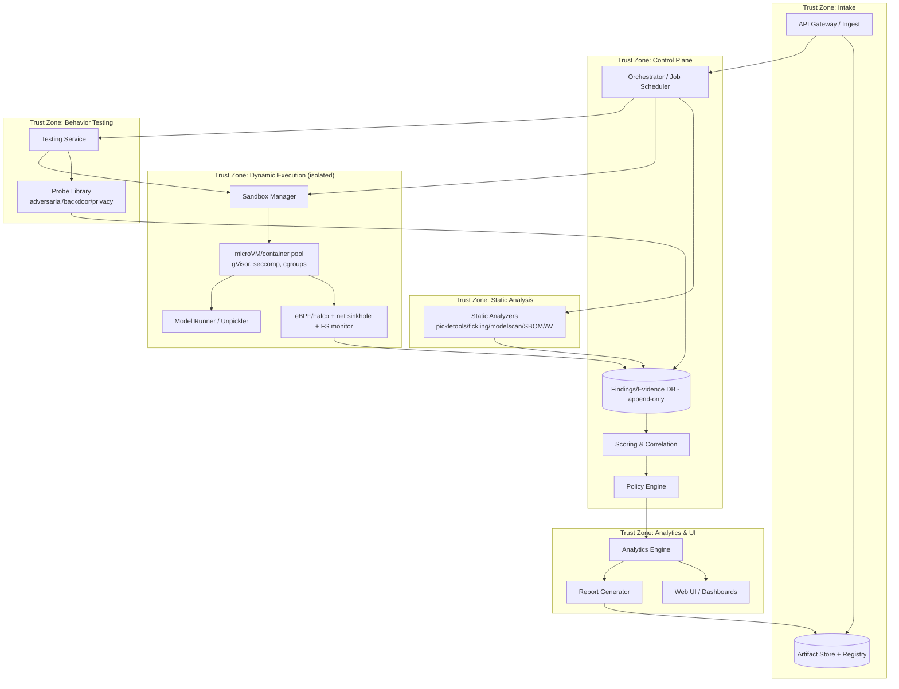
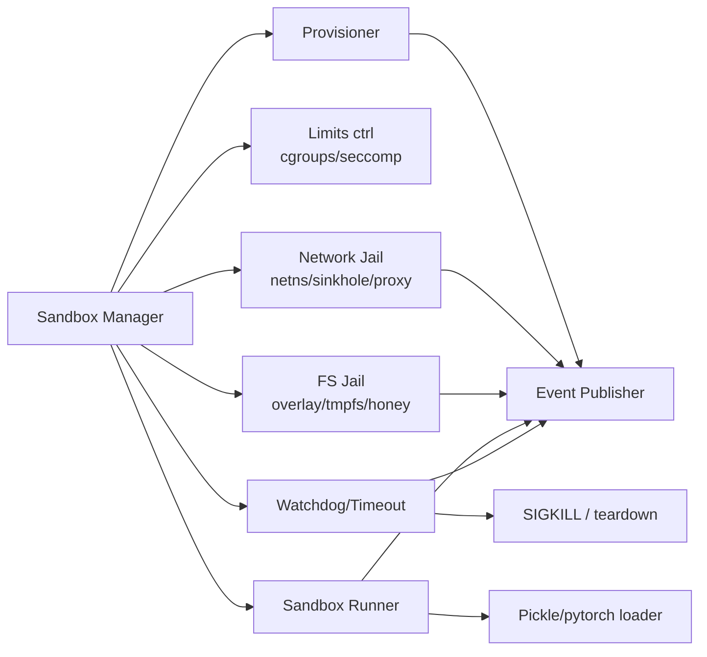
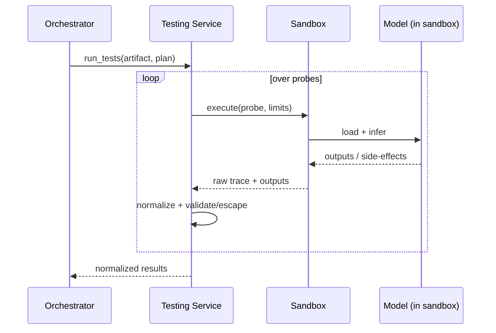
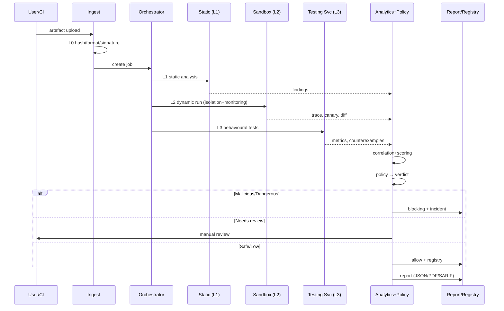
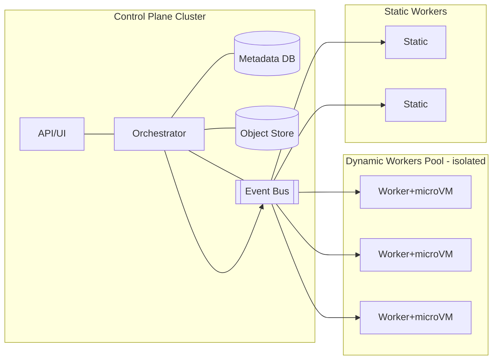

[Русский](../05-architecture.md) | **English**

# Architecture of the system for automatic danger analysis of ML models (pickle)

Working name: **MLScanner**. The document describes the architecture of a system consisting of
three mandatory components:

1. **Sandbox** — running and isolating models, observation of behaviour.
2. **Testing Service** — submitting requests to the model and safe control of the results.
3. **Analytics Engine + UI** — process management, information collection/analysis, conclusion.

> **Implementation (as-built):** [`07-implemented-architecture.md`](../07-implemented-architecture.md) —
> component composition, flows, storages (S3/Garage + PostgreSQL in v2), access and localisation.
> The document below is the design architecture; differences of the actual implementation: a message
> queue (RabbitMQ/Kafka/NATS) is not used — the testing service creates a Job synchronously, analytics
> is synchronised by polling; **Metadata DB** and **Object Store** are implemented in v2
> (PostgreSQL + Garage), and the UI and service messages are localised RU/EN
> ([`12-i18n.md`](../12-i18n.md)).

---

## 1. Goals and boundaries

### 1.1 Goal
To give an organisation a reproducible, provable and safe answer to the question:
**"Is this ML model (pickle) safe to use, and what are its characteristics,
vulnerabilities and malicious content?"**

### 1.2 In scope
- Acceptance of pickle-compatible artefacts (`.pkl`, `.pt/.pth`, `.bin`, `.joblib`, `.npy/.npz`, `.h5`, ONNX, zip containers).
- Static, dynamic and behavioural analysis.
- Isolation, monitoring, evidence collection.
- Risk scoring, verdict, report, integration with CI/CD and the model registry.

### 1.3 Out of scope (but taken into account)
- Model training.
- Running models in production (the system only issues a verdict).
- Full protection against all hypervisor 0-days (provides best-effort defense in depth).

### 1.4 Non-functional requirements (NFR)

| NFR | Requirement |
|-----|------------|
| Isolation | Sandbox compromise is impossible without a multiple failure of independent layers |
| Observability | 100% of runs with a full trace (syscalls, network, filesystem, resources) |
| Reproducibility | Same artefact + profile → deterministic report |
| Throughput | Horizontal scaling of workers, job queue |
| Scan time | Target SLAs by level (L0/L1 — minutes; L2/L3 — manageable; L4 — on demand) |
| Audit | Append-only log, signing of results, versioning of rules |
| Data security | Testing data does not leave the perimeter; minimisation of PII in reports |
| Extensibility | Plugin detectors, rules, new formats |

---

## 2. General architecture (C4 "containers" level)



**Plane separation:**
- **Data plane** (execution): Sandbox + Testing Service — the untrusted zone for the artefact.
- **Control plane** (management): Orchestrator, Policy, Scoring, Analytics/UI — trusted,
  without direct access to the executed code.
- Between the zones — only one-way transfer of results via the event bus.

---

## 3. Component 1 — Sandbox

### 3.1 Purpose
Sealed execution of an untrusted model, full observation, guaranteed destruction.

### 3.2 Responsibilities
- Provisioning of an ephemeral microVM/container from an immutable image.
- Configuration of isolation (see `./03-isolation.md`): gVisor/Kata, seccomp, cgroups v2, netns, overlay filesystem.
- Running model loading via its own `sandbox-runner`.
- Monitoring: eBPF/Falco, network sinkholes, filesystem inotify, process events, resources.
- Deception: honeypot credentials, fake IMDS, canary files/URLs.
- Generation of a **Behavioral Trace** and a **canary report**.
- Teardown and attestation.

### 3.3 Internal modules


### 3.4 Interfaces (example)
- `POST /sandbox/run` → `{artifact_ref, profile, limits, deception}` → `{run_id}`.
- `GET /sandbox/runs/{run_id}/trace` → traces, diff, canary triggers.
- Internal bus: events `syscall`, `network`, `fs`, `process`, `resource`, `canary`.

### 3.5 Run profiles
- `static-only` — without `execve`, interception of `find_class`.
- `safe-load` — `weights_only=True` / `allow_pickle=False` where possible.
- `full-dynamic` — real `pickle.load` under maximum monitoring (microVM).
- `behavior` — loading of a trusted (after verification) model and running of a probe set.

---

## 4. Component 2 — Testing Service

### 4.1 Purpose
Managing the submission of requests to the model and the **safe** receipt/normalisation of results
(both from loading and from inference), without putting the platform at risk.

### 4.2 Responsibilities
- Formation of a set of inputs (probes) for each class of tests.
- Scheduling tasks for execution in the Sandbox (never executing them itself).
- Normalisation of model outputs and environment responses into a single contract.
- Isolation and validation of results: cutting off/escaping dangerous artefacts (huge
  tensors, malicious strings, "poisoned" output files) before passing them to analytics.
- Management of timeouts, retries, quotas.
- Deduplication and correlation of results across runs.
- **Streaming acceptance of artefacts of any size** (streaming to storage, without buffering in memory).
- **Storage of artefacts** on a PVC and **delivery of them to the sandbox** via a one-time tokenised URL
  (Artifact server on a separate port).
- **Progress** of the check (`state/stage/progress`) and **statistics** (volume, number of unique hashes).

### 4.3 Types of tests (probe library)
- **Load probes:** attempts to load with different options, recording of behaviour, canary.
- **Functional probes:** compliance with the input/output contract.
- **Adversarial probes:** FGSM/PGD (vision), text attacks (NLP).
- **Backdoor probes:** trigger patterns, activation anomalies, diff with a reference.
- **Privacy probes:** membership inference, model inversion, PII extraction.
- **Robustness probes:** NaN/Inf, boundary values, distribution shift.
- **Resource probes:** latency/CPU/GPU/memory stress, DoS resilience.

### 4.4 Scheme


### 4.5 Service security
- The service **does not parse** the model contents itself — it only proxies to the sandbox.
- Validation of inputs/outputs, size limits, prohibition of executing serialised objects.
- Its own least-privilege, with no secrets accessible to the payload.
- The artefact is passed to the sandbox **not by mounting** but by downloading from the service's
  Artifact server by token; in the NetworkPolicy this is the only narrow exception (`sandbox → testing:8090`).

---

## 5. Component 3 — Analytics Engine + UI

### 5.1 Purpose
A single point for managing scanning, collection, correlation, analysis and forming the conclusion.

### 5.2 Modules
- **Orchestrator/Scheduler** — manages the L0–L4 pipeline, queues, resources.
- **Correlation & Scoring** — normalisation, dedup, risk score (see `./04-risk-analysis-decision.md`).
- **Policy Engine** — declarative rules → verdict and auto-actions.
- **Evidence Store** — append-only DB of findings and evidence (immutable, signed).
- **Knowledge Base** — library of detectors, rules, baseline profiles, known threats (IrDB: IoC/ATT&CK/ATLAS).
- **Report Generator** — JSON/PDF/HTML/SARIF + signature.
- **Web UI** — management, monitoring, analysis of findings, dashboards, manual decisions.
- **Integrations** — CI/CD gate, Model Registry, SOC/SIEM, tickets.

### 5.3 UI (key screens)
- **Queue and status** of scans (live).
- **Artefact card**: metadata, lineage, verdict, checklist coverage.
- **Findings explorer**: filters by category/severity/level, evidence inline
  (pickle disassembly, trace, network dump, diff).
- **Model behavior**: metrics, counterexamples, backdoor/privacy results.
- **Policy editor**: rules and their versions.
- **Decision log**: verdict history, audit, manual overrides.
- **Dashboards**: TPR/FPR, coverage, SLA, top risks.

### 5.4 API (example)
```
POST /scans                        # start a scan
POST /upload?name=&fmt=            # streaming model upload (including large files)
GET  /scans/{id}                   # status (state/stage/progress, sha256, size)
GET  /scans/{id}/findings          # findings
GET  /scans/{id}/report?format=   # report
GET  /api/overview                 # scan list + progress + verdict
GET  /api/progress/{id}            # live scan progress
GET  /api/stats                    # statistics (verdicts, volume, hash count)
GET  /artifacts/{hash}             # artifact card and verdict
POST /artifacts/{hash}/review      # manual decision + justification
GET/PUT /policies                  # policy management
```

---

## 6. End-to-end flow



---

## 7. Data model (key entities)

- **Artifact** — `hash` (sha256), `size`, `format`, `source`, `lineage`, `signature`, `verdict`;
  on upload: `state` (`queued/running/done/error`), `stage`, `progress`, `artifact_token`.
- **Scan** — `scan_id`, `artifact_hash`, `profile`, `levels`, `status`, `coverage`, `toolchain_hash`,
  `timings` (`static_s`, `sandbox_s`).
- **Finding** — see Normalized Finding (`./04-risk-analysis-decision.md` §2).
- **Evidence** — type, content/link, hash, link to the finding.
- **Trace** — normalised system events (`syscall/network/fs/process/resource`).
- **ModelBehavior** — metrics, counterexamples, results of probe sets.
- **Policy** and **PolicyVersion** — rules and their versions.
- **Decision** — verdict, author (auto/human), justification, time, signature.
- **ThreatIntel** — CVE/CWE/ATT&CK/ATLAS records, IoC.

Storage: a relational DB for entities + object storage (S3/MinIO) for raw
evidence/trace; immutability via append-only + checksums.

> **Implemented (as-built):** no DB is used — file storage on a PVC (JSON/JSONL),
> the Evidence Store — append-only with a hash chain; artefacts — on the PVC `/artifacts`. Details:
> `./07-implemented-architecture.md` §6.

---

## 8. Deployment and scaling



- **Kubernetes** for the control plane; for execution — a separate pool of nodes (node taints/labels),
  preferably bare-metal or VMs with a microVM runtime (Kata/Firecracker).
- Network policies: executing nodes **do not have** access to the control plane or the internet.
- **Ingress:** a single entry point (Istio Gateway → VirtualServices by hosts), not per-service
  NodePort; **egress:** allowlist (deny-by-default). Implementation — `../../deploy/ingress/`.
- A queue (RabbitMQ/Kafka/NATS) for jobs; autoscaling of workers.
- A separate GPU pool, with MIG/vGPU for isolation.

---

## 9. Security of the system itself (platform security)

- **Separation of trust zones** (see the diagram): the artefact is never executed in the control plane.
- **Least privilege**: RBAC, separate service accounts, no shared secrets.
- **Secrets** — only in the control plane, not available in the sandbox; honeypot versions in the sandbox.
- **Immutable images**, signing and attestation (Sigstore/cosign), SBOM.
- **Audit**: append-only logs, signing of decisions, versioning of detectors/policies.
- **Channel protection**: results from the sandbox undergo validation and escaping.
- **Isolation between scans**: one instance = one artefact, full teardown.
- **Regular red-team/escape tests** of the infrastructure.

---

## 10. Technology stack (recommendations)

| Layer | Options |
|------|----------|
| Isolation runtime | Firecracker / Kata Containers, gVisor, Podman/Docker rootless |
| Observation | Falco/Tetragon (eBPF), auditd, cgroups v2, Profiled netns |
| Static analysis | pickletools, fickling, picklescan, ModelScan, semgrep, bandit |
| Supply chain | syft/grype, trivy, pip-audit, cosign/sigstore |
| Backend/Control | Python (FastAPI) or Go, PostgreSQL, MinIO/S3, RabbitMQ/Kafka |
| Analytics | Python (pandas/duckdb), OPA/Rego rules, ML for anomalies (opt.) |
| UI | React/Vue + a standard design system, WebSocket for live status |
| Validation/inference | the sandbox image `mlscan-sandbox` (Python 3.12 + PyTorch CPU + numpy/joblib/dill/cloudpickle); build — Kaniko |

---

## 11. Extensibility and plugins

- **Detector plugin API**: a single interface for new static/dynamic detectors.
- **Probe plugin API**: new sets of tests (backdoor, privacy, robustness).
- **Policy as code**: rules are added without a core release.
- **Format adapters**: new model containers (GGUF, TF SavedModel, etc.).
- **Threat-intel sync**: updating rules from external feeds.

---

## 12. Risks of the architecture itself and their mitigations

| Risk | Mitigation |
|------|----------|
| Sandbox escape | microVM + gVisor + seccomp + drop caps; escape tests |
| Sandbox evasion | Randomisation, deception, multiple runs, fuzzing |
| Incomplete coverage | Explicit modelling of coverage; `Inconclusive`, not `Safe` |
| False negatives | Layering, red team, feedback from incidents |
| Data leakage via channels | Normalisation of timings, isolation, no shared state |
| Scanner DoS | cgroups/quotas, timeouts, watchdog, autoscaling |
| Control plane compromise | Zone separation, RBAC, audit, signing |

---

## 13. Roadmap (proposal)

1. **MVP**: L0 (integrity) + L1 (static analysis: opcode-allowlist, fickling, SBOM) + basic UI/reports.
2. **M2**: Sandbox (L2) with a microVM, eBPF monitoring, deception, canary.
3. **M3**: Testing Service (L3) — functional/robustness/privacy probes.
4. **M4**: Backdoor detection, adversarial, correlation/scoring + Policy Engine.
5. **M5**: L4 red-team automation, CI/CD gate, Model Registry, continuous monitoring.

---

## 14. Related documents

- `./01-threat-checklist.md` — danger checklist.
- `./02-testing-strategy.md` — testing strategy L0–L4.
- `./03-isolation.md` — isolation methods.
- `./04-risk-analysis-decision.md` — processing of results and decision-making.
- `../../Concept.md` — the consolidated concept document.
