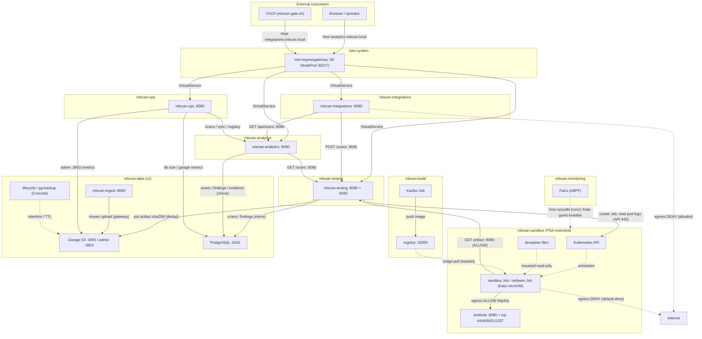
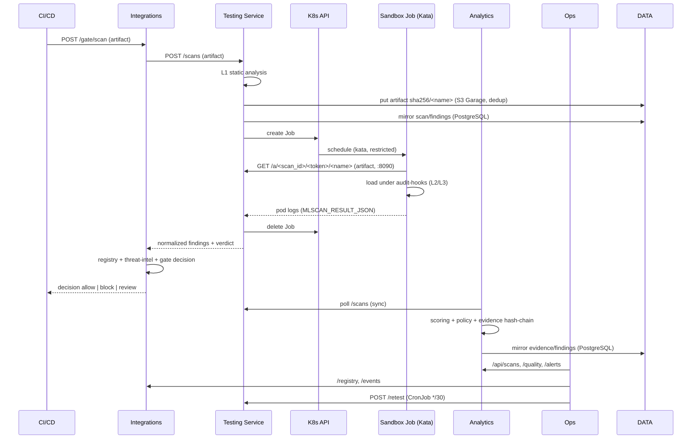

[Русский](../07-implemented-architecture.md) | **English**

# 07. Implemented MLScan architecture (as-built)

Final description of the MLScan system **actually deployed** in the cluster `<CLUSTER>` (MicroK8s
v1.33, containerd, Calico, RuntimeClass `kata`): component composition, network interaction diagram,
data flows, trust boundaries and limitations.

The description covers both the base system for pickle (Stages 0–5) and **v2**: object storage,
PostgreSQL, authentication/authorization with audit and RU/EN localisation.

Source: `deploy/stage1…stage5/`, `deploy/v2/`, `deploy/sandbox-image/`, `deploy/i18n/`,
`deploy/ingress/`. Concept — `../../Concept.md`, design architecture — `./05-architecture.md`,
plan — `./06-implementation-plan.md`, test guide — `./08-testing-guide.md`, target architecture
v2 — `./11-target-architecture-v2.md`, localisation — `./12-i18n.md`.

---

## 1. Overview

MLScan is a system for automatic danger analysis of ML/AI artifacts (the core is pickle, then
format adapters). It is implemented as a set of microservices in **nine namespaces**:
`mlscan-sandbox`, `mlscan-monitoring`, `mlscan-testing`, `mlscan-analytics`,
`mlscan-integrations`, `mlscan-ops`, `mlscan-data` (v2: object storage, PostgreSQL,
ingest, retention/backup), `mlscan-build` (building the sandbox image) and `mlscan-ingress`
(Istio Gateway/VirtualServices and egress policies). All services use the Python standard library
(no external dependencies), the image `python:3.12-slim` (Python 3.12.14); the sandbox
uses a separate image `mlscan-sandbox` (torch CPU and format libraries).

Key as-built principles:
- the artifact is **never executed** in the trusted zone — only in a Kata microVM with network
  egress denied;
- services exchange over HTTP inside the cluster; external access is through the single entry point
  Istio Ingress Gateway (host-based routing);
- **two storage layers**: object storage **S3 (Garage)** for artifacts (key
  `sha256/<name>`, deduplication) and **PostgreSQL** for metadata, findings, evidence,
  users/keys, audit and system settings; file PVCs are retained as local
  hash-chain evidence and as a fallback;
- the Evidence Store is append-only with a hash chain (file on a PVC **and** a mirror in PostgreSQL);
- the UI and service messages are localised **RU/EN**; the language is set globally (`MLSCAN_LANG` at
  startup or a setting in the DB) — see `./12-i18n.md`.

### 1.1 Products and versions used

| Product | Version | Role in MLScan |
|---------|--------|---------------|
| Kubernetes (MicroK8s) | 1.33 | cluster platform |
| `kubectl` | — | management (apply, exec, port-forward) |
| containerd | — | node container runtime |
| Kata Containers | — | sandbox microVM (RuntimeClass `kata`) |
| Node OS | Ubuntu LTS | operating system |
| Kata microVM | its own kernel per pod | sandbox isolation |
| Calico | — | CNI + NetworkPolicy |
| CoreDNS | — | cluster DNS |
| metrics-server | — | resource metrics (HPA readiness) |
| hostpath-provisioner | — | StorageClass (local volume) |
| Falco | driver `modern_ebpf` | eBPF runtime monitoring |
| Python | **3.12.14** (image `python:3.12-slim`) | runtime of all services and the in-sandbox harness — **standard library only** |
| PyTorch (CPU) | **2.14.1+cpu** (sandbox image `mlscan-sandbox:v2`, `deploy/sandbox-image/`) + numpy 2.5.4, safetensors 0.8.0, onnxruntime 1.31.0, h5py 3.16.0, gguf, joblib, dill, cloudpickle | dynamic loading and execution of pickle/torch/numpy/model-as-code models in the sandbox |
| Garage | **v1.0.1** (`dxflrs/garage:v1.0.1`) | S3-compatible object storage of artifacts (`sha256/<name>`, deduplication) |
| PostgreSQL | **16** (`postgres:16-alpine`) | metadata, findings, evidence (hash-chain), users, API keys, `audit_log`, settings (`settings`) |
| Kaniko | executor v1.23.2 | building the sandbox image in the in-cluster registry |
| `pickletools` / `zipfile` / `sys.addaudithook` | Python 3.12 stdlib | static parsing (L1) and observability (L2/L3) |
| Helm | — | Falco installation |
| Image registry (OCI) | — | private registry; **stores the sandbox image** `mlscan-sandbox:v2` |
| Localisation module `deploy/i18n/i18n.py` | — | RU/EN catalog and rules for localising messages/findings (ConfigMap `mlscan-i18n` → `/opt/i18n`) |
| Istio | — | **used for Ingress** (Gateway + VirtualServices); sidecar injection (mTLS/mesh) not enabled; there is an egress gateway |

All MLScan services are our own Python stdlib code on top of the `python:3.12-slim` image;
there are no external service dependencies (DB, queue, brokers) — state is in files on PVCs.

---

## 2. Component composition

### 2.1 `mlscan-sandbox` — isolation and execution (Component 1)

| Object | Type | Purpose |
|--------|-----|-----------|
| `sinkhole` (Deployment + ClusterIP Service) | :8080 HTTP, :4444/9001/1337 TCP | in-cluster "trap": the only allowed egress; logs the requests |
| sandbox Job (on demand) | `runtimeClassName: kata` (Kata 3.32.0), image `mlscan-sandbox:v2` | run the harness from the PoC over the artifact (pickle/torch/numpy/model-as-code) |
| `mlscan-redteam` (Job) | kata | isolation escape test (Stage 5) |
| ConfigMap `mlscan-harness`, `mlscan-samples`, `mlscan-deception*`, `mlscan-sinkhole`, `mlscan-redteam` | — | harness code, demo data, honeypot files, sinkhole server, redteam script |
| NetworkPolicy `default-deny-all`, `allow-dns-egress`, `sandbox-to-sinkhole`, `sinkhole-ingress`, `sandbox-to-testing-artifacts` | — | network isolation (Calico) |
| PSA `restricted` (namespace label) | — | prohibition of privileged pods |

**Artifact transport:** the file resides on the PVC of the testing service (`/artifacts`); the
sandbox Job downloads it from the Artifact server of the testing service (port **8090**) using a
one-time token. The per-scan ConfigMap transport is no longer used.

### 2.2 `mlscan-monitoring` — eBPF monitoring (optional component)

Falco is an **optional** level-1 component: it provides host-side runtime monitoring
(exec/egress/write for **runc** pods and host events, rules `MLScan sandbox *`). Base isolation
and model-behaviour observation work **without it** (in-guest harness audit hooks); syscalls
inside a Kata microVM are not visible to host eBPF (see §10). Install:
`bash deploy/stage1/60-falco.sh` (or `bash deploy/install.sh 1 --with-falco`); verify:
`bash deploy/verify.sh 1`.

| Object | Type | Purpose |
|--------|-----|-----------|
| `falco` (DaemonSet) | Helm chart `falco` 9.2.0, Falco 0.45.0, `modern_ebpf` driver (installed in the current stand) | host syscalls: exec/egress/write; rules `MLScan sandbox *` |

### 2.3 `mlscan-testing` — testing service (Component 2)

| Object | Type | Purpose |
|--------|-----|-----------|
| `mlscan-testing` (Deployment + ClusterIP Service :8080 + :8090) | stdlib HTTP | streaming ingestion of artifacts of any size, L1 (static analysis), launching the Job, Artifact server (8090, serves to the sandbox by token), collecting L2/L3, normalization, verdict, `/stats`; **writing the artifact to S3 (Garage)** under the key `sha256/<name>` with a deduplication check; mirroring metadata and findings into **PostgreSQL**; messages in the request language (RU/EN) |
| ServiceAccount `mlscan-testing` + Role/RoleBinding in `mlscan-sandbox` | RBAC | create/delete Jobs, get pods/logs in the sandbox |
| PVC `mlscan-testing-data` | hostpath 1Gi | scan records (`/data/scans/*.json`) |
| PVC `mlscan-artifacts` | hostpath 20Gi | uploaded models (`/artifacts/<scan_id>/<name>`) |
| ConfigMap `mlscan-poc-lib`, `mlscan-testing-code`, `mlscan-formats`, `mlscan-s3client`, `mlscan-pgclient`, `mlscan-authz`, `mlscan-i18n` | — | shared analysis (PoC), service code, format adapters, S3 and PG clients, authentication/authorization, localisation |

Scan reads: the list (`/scans`) and aggregates (`/stats`) are served **from PostgreSQL**
(`scans JOIN artifacts`; ~0.1 s for 1900+ rows instead of re-reading thousands of JSON files),
while `/data/scans/*.json` remains the fallback (when the DB is unavailable) and the store of
scan details (`/scans/<id>`: `static`, `sandbox`, trace). Writes go to both places (file + DB),
and scan progress is mirrored into the DB. On startup the service marks interrupted scans
(`queued`/`running`) as `error` — there is no queue, processing runs in the process thread.
Historical records are linked to artifacts (`scans.artifact_id`) by
`deploy/v2/db/backfill_scans.py`.

**Coverage completeness (always taken into account in the verdict).** There are three
verification modules: static (L1), dynamic (L2, load/execution in the sandbox) and behaviour
(L3, probe). A module counts as executed only if it ran **without errors**: static — no
exception; dynamic — the Job is `succeeded` **and** the model loaded (`load.ok`); behaviour —
the object is loaded and the probe completed. If a module could not run (missing dependency,
insufficient resources, timeout, corrupted file, sandbox did not start), the result is **not
considered complete**:

* a `Safe`/`Needs review` verdict is replaced by **`Inconclusive`**, with the reason
  "not all verification modules could run (dynamic analysis: <reason>; behaviour: <reason>);
  partial result: <what was found>";
* if the partial data **already proves** danger (`critical`/`high` or hard dynamic signals),
  the verdict is kept, but the reason gets "incomplete scan (<modules>)";
* the scan record stores a structured `coverage` field (`modules`, `failed`, `complete`) which is
  shown as a banner on the artifact card and included in the reports (JSON/Markdown).

Wave 7 added compressed payloads and datasets: **`.gz/.bz2/.xz`** are decompressed (64 MB cap) and
dispatched by content — a pickle inside gzip is genuinely deserialised in the sandbox (behaviour is
preserved), text `protocol 0` is recognised by opcodes, and a nested zip is processed recursively;
**JSONL** (`INJ-03`) and **CSV/TSV** (`INJ-06` — formula injections `=cmd|.../HYPERLINK/DDE`);
**MessagePack** (a pickle stream inside → `EXEC-02`); **secret leaks** in configs, cards and
datasets (`SEC-01`: AWS keys, private keys, HF/GitHub/Slack tokens); **duplicate archive entries**
(`FMT-12` — parser differential); **tar bombs** by declared size (`FMT-04`); **extension mismatch**
(`FMT-02`); **unsupported containers** (7z/rar/zstd) are explicitly reported as "cannot be parsed"
with incomplete coverage. Fixed along the way: an archive containing `config.json` is no longer
treated as Keras, and `.gz` is no longer treated as a tar archive.

Wave 6 added documents and build artifacts: **HTML/SVG** inside a model package (`INJ-05` —
XSS on card render; the `www.w3.org` namespace is not treated as an external source),
**Dockerfile/Containerfile** (`EXEC-02` — download-and-execute at image build time), **GGUF with a
Jinja chat_template** (`INJ-01` — SSTI, `INJ-02` — review required), **nested archives** (zip in zip
are traversed recursively up to 2 levels — `EXEC-02`/`INT-04`), **text protocol-0 pickles** and
**broken containers** (`FMT-01`: invalid safetensors header, corrupted tar, unreadable notebook
JSON), plus real **ONNX with custom operators** (`EXEC-06`).

Wave 5 added code-delivery paths and service formats: **wheels** with site-packages hooks
(`.pth`), **text `.pth`** files, **native libraries** (.so/.dll/.dylib, `EXEC-08`),
**Jinja prompt templates** (SSTI, `INJ-01`), standalone **frozen graph `.pb`**, **safetensors
indexes** and real **Keras/HDF5 with Lambda** (`EXEC-05`). Behaviour was tightened: a plain
`import ...` and the mere presence of `.py` in an archive are no longer findings (markers are
limited to real dangerous calls; an archive without dangerous code yields `info` only), and a
`.pth` counts as an install hook only when it contains code. Behavioural checks are covered by
samples (`F-20/F-21/F-23/F-25/F-26/F-27/F-30/F-31/F-33`) as are container errors
(`B-01/B-02/B-03`, `A-00`, `FMT-01`).

Wave 4 additionally supports **notebooks** (.ipynb), **scripts** (.sh/.ps1/.bat and others),
**MLflow models** (a zip with `MLmodel`), **TensorFlow SavedModel** (`saved_model.pb`),
**TFLite** (`TFL3`), **CoreML** (`.mlmodel`), **PMML**, **Parquet/Arrow/Feather datasets**
(pyarrow) and **TorchScript/torch.package** (`archive/code/...`). For these, static analysis
looks at executable code, external references and pickle streams in metadata, while the dynamic
stage parses the container (structural load/schema). Archive member names are normalised
(`archive/` is torch's service prefix), TorchScript code is distinguished from arbitrary Python,
and for data-only formats `exec` performed by parser libraries (pyarrow/onnxruntime etc.) does not
count as payload execution. HDF5 external links are detected dynamically at load time
(finding `EXEC-07`).

The dynamic stage loads more than pickle: the harness can read **safetensors** (mmap), **ONNX**
(onnxruntime plus a trial inference), **HDF5** (h5py), **Keras `.keras`** (zip: `config.json` and
`weights.h5` in memory — no temporary files), **GGUF**, `.zip`/`.tar*` archives, text artifacts
and images (signature/integrity checks). So "dynamic analysis is not applicable" is no longer
reported as an error — the module really inspects the container. The format is passed to the
sandbox by the adapter (`sandbox_fmt`), and the libraries ship in the `mlscan-sandbox:v3` image.

**Large files.** Static analysis reads a 64 MB prefix (`MAX_STATIC_BYTES`); otherwise analysing a
200 MB model exhausted the service memory (`OOMKilled` at `limits.memory=1Gi`). Limits: testing
service — **3Gi**, sandbox Job — **3Gi** (`JOB_MEMORY`). The full body is read by the dynamic
stage (mmap where the library supports it).

Analytics applies the same rule: when `coverage.complete = false`, a `Safe`/`Needs review` verdict
from the Policy Engine is replaced by **`Inconclusive`** with the reason "not all verification modules
could run (...); partial result: ...", while `Malicious`/`Dangerous` is kept with an "incomplete scan"
note. The `coverage` field is stored in the record and shown as a banner on the card. Historical
records (analysed before coverage accounting was introduced) are recalculated during sync:
`POST /sync?backfill=<N>` appends a corrected record to the append-only evidence store (history is
never overwritten) - with backfill enabled, 3449 records received a correct verdict.

The per-module reason comes from the sandbox: e.g.
`pickle.loads: ModuleNotFoundError: No module named 'mymod'` (model not loaded) or
`формат safetensors не является pickle; динамика не применима`. The logic lives in
`poc.coverage_of()` and `poc.decide()`; the sandbox harness is distributed as the
`mlscan-harness` ConfigMap (`deploy/stage1/gen_configmaps.py` — **regenerate it whenever
`HARNESS_SRC` changes**).

### 2.4 `mlscan-analytics` — analytics engine + UI (Component 3)

| Object | Type | Purpose |
|--------|-----|-----------|
| `mlscan-analytics` (Deployment + ClusterIP Service :8080; externally — Ingress `analytics.mlscan.local`) | stdlib HTTP | collection of results, scoring, Policy Engine, evidence (file + mirror in PostgreSQL), reports, web UI with a **RU/EN** language switcher, UI login (users/API keys), `/settings` page (global language; role `admin`) |
| PVC `mlscan-analytics-data` | hostpath 1Gi | `/data/evidence.jsonl` (hash-chain) |
| ConfigMap `mlscan-analytics-code`, `mlscan-policy`, `mlscan-authz`, `mlscan-pgclient`, `mlscan-i18n` | — | engine code, `policy.json`, authentication/authorization, PG client, localisation |

Dashboard performance: queries that reach the testing service (`/api/overview`, `/api/stats`)
are cached in analytics for 5 s (the testing service cache is 30 s and is invalidated when a new
scan is written). The UI renders the table as soon as `/api/overview` returns and the statistic
cards after the separate `/api/stats`, so the scan list appears in ~0.2 s.

### 2.5 `mlscan-integrations` — integrations (Stage 4)

| Object | Type | Purpose |
|--------|-----|-----------|
| `mlscan-integrations` (Deployment + ClusterIP Service :8080; externally — Ingress `integrations.mlscan.local`) | stdlib HTTP | Model Registry, CI/CD gate, SIEM export, threat-intel |
| PVC `mlscan-integrations-data` | hostpath 512Mi | `registry.json`, `events.jsonl` |
| ConfigMap `mlscan-integrations-code`, `mlscan-intel`, `mlscan-authz`, `mlscan-pgclient`, `mlscan-i18n` | — | service code, seed threat-intel, authentication/authorization, PG client, localisation (PG is connected for moving the registry out) |

### 2.6 `mlscan-ops` — operations (Stage 5)

| Object | Type | Purpose |
|--------|-----|-----------|
| `mlscan-ops` (Deployment + ClusterIP Service :8080; externally — Ingress `ops.mlscan.local`) | stdlib HTTP | Prometheus metrics, stack health, quality (TPR/FPR), SLA, retest, storage alerts (`/alerts`), language settings (`/settings`, `POST /settings/language`) |
| CronJob `mlscan-retest` | `*/30 * * * *` | continuous retest of the golden set |
| PDB `*-pdb` | — | PodDisruptionBudget for testing/analytics/integrations |
| ConfigMap `mlscan-ops-code`, `mlscan-golden`, `mlscan-golden-samples`, `mlscan-authz`, `mlscan-pgclient`, `mlscan-i18n` | — | code, golden labels and samples, authentication/authorization, PG client, localisation |
| Storage access | env `PGHOST…`, `GARAGE_ADMIN_URL/TOKEN` | reading DB sizes and Garage metrics for alerts |

### 2.7 `mlscan-data` — storages and service tasks (v2)

| Object | Type | Purpose |
|--------|-----|-----------|
| `garage` (StatefulSet + Services :3900 API, :3903 admin; PVC `data-garage-0` 800Gi) | Garage v1.0.1 | **S3-compatible object storage** of artifacts; keys `sha256/<name>`; admin API for metrics and keys |
| `postgres` (StatefulSet + Service :5432; PVC `data-postgres-0` 20Gi, backups in `mlscan-backups` 10Gi) | PostgreSQL 16 | relational storage (`artifacts`, `scans`, `findings`, `evidence`, `users`, `api_keys`, `audit_log`, `settings`, …); schema — `deploy/v2/db/10-schema.yaml`; append-only triggers on `evidence` and `audit_log` |
| `mlscan-ingest` (Deployment + Service :8080) | stdlib HTTP | streaming upload gateway to S3 with deduplication (for external suppliers), size control, audit |
| CronJob `mlscan-lifecycle` | `30 3 * * *` | **retention/TTL**: deletion of expired artifacts from S3, tombstones, quarantine cleanup |
| CronJob `mlscan-pg-backup` | `0 2 * * *` | PostgreSQL backup with restore verification |
| Secret `mlscan-s3`, `garage-secrets`, `mlscan-pg` | — | access to S3, the Garage cluster and PostgreSQL |
| ConfigMap `mlscan-s3client`, `mlscan-pgclient`, `mlscan-authz`, `mlscan-i18n`, `mlscan-pg-init`, `mlscan-lifecycle` | — | stdlib clients (SigV4, SCRAM), authorization, localisation, DB schema, maintenance tasks |

### 2.8 `mlscan-ingress` — external entry point (v2)

| Object | Type | Purpose |
|--------|-----|-----------|
| `mlscan-gateway` (Gateway) + VirtualServices | Istio | host-based routing of `analytics|integrations|ops|api.mlscan.local` to MLScan ClusterIP services |
| NetworkPolicy egress-allowlist | Calico | for platform namespaces: DNS + cluster CIDRs; external egress is prohibited |

### 2.9 `mlscan-build` — building the sandbox image

| Object | Type | Purpose |
|--------|-----|-----------|
| `mlscan-sandbox-build` (Job, Kaniko) | executor v1.23.2 | building the `mlscan-sandbox` image and publishing it to the in-cluster registry |
| ConfigMap `mlscan-sandbox-build` | — | `Dockerfile` of the build context |

Image: `python:3.12-slim` + **torch 2.14.1+cpu** + numpy, safetensors, onnxruntime, h5py,
gguf, joblib, dill, cloudpickle. Built without Docker on the host (Kaniko); the result is
`localhost:32000/mlscan-sandbox:v2` (for kubelet). The tag is set by an argument
(`bash deploy/sandbox-image/build.sh v2`) and passed to the testing service via
`SANDBOX_IMAGE`.

---

## 3. Network interaction diagram

**Directions and protocols:**
- External access — **the single entry point Istio Ingress Gateway** (HTTP NodePort `30217`),
  host-based routing `analytics|integrations|ops|api.mlscan.local`; MLScan services have no NodePort
  (ClusterIP).
- Internal calls — HTTP `:8080` via cluster DNS (`<svc>.<ns>.svc.cluster.local`).
- `TEST → Kubernetes API` — HTTPS `:443` (creating a Job, reading `pods/log`).
- `Kata-Job → testing:8090` — downloading ITS OWN artifact by token (allow);
- `Kata-Job → sinkhole` — the allowed channel; to the outside — deny (NetworkPolicy default-deny).
- `Falco` observes host syscalls; syscalls **inside the Kata microVM are invisible to it**
  (in-guest harness instrumentation works there).
- The sandbox image is built by Kaniko in `mlscan-build` and published to the in-cluster registry;
  kubelet pulls it when the Job is created.
- **Platform egress** — allowlist (deny-by-default + DNS + cluster CIDRs); external egress of
  services is prohibited.
- **Artifacts** — `TEST → Garage S3` (`sha256/<name>`, deduplication by key presence), a local
  copy on the PVC remains as a fallback; **metadata/findings/evidence** are mirrored to PostgreSQL.
- **Retention** — the CronJob `mlscan-lifecycle` deletes expired S3 objects, keeps tombstones
  and clears the quarantine; `mlscan-pg-backup` makes a DB backup with restore verification.

---

## 4. Network access model and policies

### 4.1 NetworkPolicy in `mlscan-sandbox` (Calico v3.29.3)

| Policy | Type | Effect |
|----------|-----|--------|
| `default-deny-all` | Ingress+Egress | all traffic denied by default |
| `allow-dns-egress` | Egress | DNS to `kube-dns` (UDP/TCP 53) |
| `sandbox-to-sinkhole` | Egress | `app=mlscan-sandbox → app=sinkhole` (any ports) |
| `sinkhole-ingress` | Ingress | into sinkhole — only from `app=mlscan-sandbox` |
| `sandbox-to-testing-artifacts` | Egress | `mlscan-sandbox → mlscan-testing:8090` (downloading ITS OWN artifact by token) |

Verified: `1.1.1.1:443` and `example.com:80` → **DENY** (timeout), `sinkhole:8080` → **OK**.

### 4.2 External exposure

The single entry point is the **Istio Ingress Gateway** (external MLScan services are ClusterIP):

| Host (Host header) | Gateway | Purpose |
|--------------------|---------|-----------|
| `analytics.mlscan.local` | `mlscan-ingress/mlscan-gateway` | web UI + JSON API |
| `integrations.mlscan.local` | the same | gate/registry/SIEM/intel |
| `ops.mlscan.local` | the same | metrics/quality/SLA |
| `api.mlscan.local` | the same | testing API |

Gateway: `istio-ingressgateway` (ns `istio-system`), HTTP NodePort **30217** (HTTPS 30921).
The services `mlscan-testing` (ClusterIP :8080+:8090) and `sinkhole` are internal.

### 4.3 Egress control (migration from "open" egress to allowlist)

| Namespace | Egress policy | Allowed |
|-----------|-----------------|-----------|
| `mlscan-testing` | `mlscan-egress` | DNS; cluster CIDRs (8080/8090/443); Kubernetes API (`<API_ENDPOINT>`) |
| `mlscan-analytics` | `mlscan-egress` | DNS; cluster CIDRs (8080/8090) |
| `mlscan-integrations` | `mlscan-egress` | DNS; cluster CIDRs (8080) |
| `mlscan-ops` | `mlscan-egress` | DNS; cluster CIDRs (8080) |
| `mlscan-sandbox` | `default-deny-all` + allow | DNS; sinkhole; `testing:8090` (artifact) |

External egress of platform services is **prohibited** (verified: `1.1.1.1:443 → DENY`).
Point access to external resources — via an FQDN allowlist (Calico) or an Egress Gateway (planned).

---

## 5. End-to-end flow (scan + gate)

---

## 6. Storages, configuration, RBAC

| Component | Storage | What is stored |
|-----------|-----------|--------------|
| **S3 (Garage), ns `mlscan-data`** | object (`data-garage-0`, 800Gi), `sha256/<name>` | **artifacts** (model bodies) for testing/ingest; deduplication by key |
| **PostgreSQL, ns `mlscan-data`** | StatefulSet + PVC (`data-postgres-0` 20Gi; backups in `mlscan-backups` 10Gi) | `artifacts`, `scans`, `findings`, `evidence`, `users`, `api_keys`, `audit_log`, `uploads`, `connections`, `settings` |
| testing | PVC `mlscan-testing-data` (1Gi), `mlscan-artifacts` (20Gi) | `/data/scans/<id>.json`; local copies of artifacts (fallback if S3 is unavailable) |
| analytics | PVC `mlscan-analytics-data` (1Gi) | `/data/evidence.jsonl` (hash-chain) |
| integrations | PVC `mlscan-integrations-data` (512Mi) | `/data/registry.json`, `/data/events.jsonl` |
| ops | — (stateless) | state in memory |

Configuration — ConfigMaps (service code, `policy.json`, `intel.json`, `golden.json`, harness,
deception, sinkhole, and also the shared modules `mlscan-authz`, `mlscan-pgclient`, `mlscan-s3client`,
`mlscan-i18n`). Evidence integrity attestation — `deploy/stage5/60-attest.sh` (HMAC-SHA256).

### 6.1 S3 (Garage) layer — artifacts

**Object storage** `garage` (ns `mlscan-data`, S3 API `:3900`, admin `:3903`).

- The object key is `sha256/<filename>`: content-addressed, so re-uploading the same
  file is **deduplicated** (key existence check before upload).
- Writers: the testing service (`POST /scans/upload`) and the gateway `mlscan-ingest` (`POST /upload`,
  for external suppliers). Readers: the testing service (serving the artifact to the sandbox by a
  one-time token) and `mlscan-lifecycle` (deletion by TTL).
- The client is the stdlib `s3client.py` (SigV4, streaming), delivery to the sandbox — via the
  testing service (port 8090), so the sandbox's network access is not expanded.
- Retention: the CronJob `mlscan-lifecycle` (`30 3 * * *`) deletes expired objects,
  keeps `artifact_deletions` (tombstones) and clears the quarantine. Inter-zone replication
  (RF) — a Garage operational parameter (in single-node RF=1).

### 6.2 PostgreSQL layer — metadata, evidence, access

**There is no DBMS in the base contour (Stages 0–5); in v2 it was added** and is used by the services
as the primary relational storage (schema — `deploy/v2/db/10-schema.yaml`, client —
stdlib `pgclient.py` with SCRAM authentication).

| Table | Who writes | Content |
|---------|-----------|-----------|
| `artifacts`, `artifact_fingerprints` | testing, analytics | deduplicated artifacts (sha256, size, format, `s3_key`), fingerprints |
| `scans`, `findings` | testing (immediately), analytics (mirror) | status/stages/verdict/reason, normalized findings |
| `evidence` | analytics | **append-only hash-chain**: `prev_hash`, `hash`, `payload` |
| `users`, `api_keys` | access management | UI users (PBKDF2 hashes) and API keys (hashes), roles |
| `audit_log`, `uploads`, `connections` | all services (via `authz`) | action audit, upload log, HTTP connection log |
| `settings` | admin (`/settings` page / API) | system settings, incl. the **global language** (`language`) |
| `policies`, `decisions` | — | the schema is ready; in practice the policy is set by `policy.json` (ConfigMap) |

The testing service's hot read paths (`/scans`, `/stats`) are served from these tables (a
`scans`+`artifacts` join), so the list and statistics do not depend on the number of files on the
PVC; writes are dual (file + DB).

Integrity: `evidence` and `audit_log` have triggers prohibiting `UPDATE/DELETE`
(append-only "at the DB level"), in addition to the hash chain. Backup —
the CronJob `mlscan-pg-backup` (`0 2 * * *`) with restore verification.

### 6.3 File storages (retained)

- **Analytics:** `/data/evidence.jsonl` — append-only JSONL; a line = `{"prev","hash","record"}`,
  where `hash = sha256(prev + json(record))` → **tamper-evident hash chain** (read at
  startup into the in-memory index `scan_id → record`; control — `GET /api/evidence/verify`).
  In PostgreSQL the same evidence is mirrored (double write).
- **Testing:** `/data/scans/<id>.json` — scan card; `/artifacts/<scan_id>/<name>` —
  local copy of the artifact (fallback when S3 is unavailable).
- **Integrations:** `/data/registry.json` (registry `sha256 → entry`) and `/data/events.jsonl`
  (append-only gate/SIEM events).

**Actual state (at the time of update):** `scans=1442`, `findings=7399`,
`evidence=1422`, `artifacts=70`, `audit_log=6302`, `users=2`, `settings=1` (language);
`/data/evidence.jsonl` ≈ 3.7 MB.

### 6.4 RBAC

- The only cross-namespace link is the SA `mlscan-testing` (ns `mlscan-testing`) with a Role in
  `mlscan-sandbox` (Jobs/ConfigMaps create·delete·get, pods/logs get). The other services
  work without access to the Kubernetes API.
- Access to the API/UI — `authz` (`mlscan-authz`): static API keys from the Secret `mlscan-keys`
  (roles `admin`/`ci-reader`/`service`) and UI users from the `users` table (session in a cookie);
  role checks on endpoints, audit in `audit_log`.

---

## 7. Trust boundaries and isolation

| Zone | Trust | Isolation |
|------|---------|----------|
| `mlscan-sandbox` (artifact execution) | **untrusted** | Kata 3.32.0 (microVM), PSA restricted, non-root 65532, read-only rootfs, drop ALL, seccomp, limits, default-deny egress, deception |
| `mlscan-monitoring` | trusted (monitoring) | DaemonSet, modern eBPF |
| `mlscan-testing` / `mlscan-analytics` / `mlscan-integrations` / `mlscan-ops` | trusted | PSA restricted, non-root, read-only rootfs, drop ALL, no excess privileges |
| `mlscan-data` (S3/Garage, PostgreSQL, ingest) | trusted | PSA restricted, StatefulSet PVC, access via Secret; the artifact is **not executed** |
| `mlscan-ingress` (Gateway, VirtualServices, egress policies) | trusted (configuration) | Istio/Calico objects; executes no code |

The artifact is transferred to the sandbox **without shared directories and without content in the manifests**:
the Job downloads its file from the Artifact server of the testing service (`:8090`) by a one-time
token; platform secrets (SA tokens, access to S3/DB) are not mounted into the sandbox.

---

## 8. Ports and internal addresses (DNS)

| Service | DNS (inside the cluster) | Port |
|--------|----------------------|------|
| testing | `mlscan-testing.mlscan-testing.svc.cluster.local` | 8080 (API), 8090 (artifact) |
| analytics | `mlscan-analytics.mlscan-analytics.svc.cluster.local` | 8080 |
| integrations | `mlscan-integrations.mlscan-integrations.svc.cluster.local` | 8080 |
| ops | `mlscan-ops.mlscan-ops.svc.cluster.local` | 8080 |
| sinkhole | `sinkhole.mlscan-sandbox.svc.cluster.local` | 8080, 4444, 9001, 1337 |
| Garage (S3) | `garage.mlscan-data.svc.cluster.local` | 3900 (S3 API), 3903 (admin) |
| PostgreSQL | `postgres.mlscan-data.svc.cluster.local` | 5432 |
| ingest (S3 gateway) | `mlscan-ingest.mlscan-data.svc.cluster.local` | 8080 |

External access — Ingress: `analytics|integrations|ops|api.mlscan.local` via `:30217`.
Main endpoints: `/scans`, `/scans/upload?lang=` (testing),
`/`, `/artifact/<id>`, `/lang`, `/settings`, `/settings/language`, `/api/scans|/api/overview|
/api/stats|/reports|/policy` (analytics),
`/registry|/gate|/gate/scan|/events|/export/cef|/intel` (integrations),
`/metrics|/health/stack|/quality|/sla|/alerts|/settings|/settings/language|/retest` (ops),
`/upload` (ingest).

**Egress allowlist and the Kubernetes API.** Platform namespaces receive a deny-by-default
egress policy; access to the K8s API is allowed by a rule for the real API server address, which
`deploy/ingress/apply.sh` discovers via EndpointSlice (legacy `Endpoints` were removed in k8s 1.33).
A placeholder left in the applied policy blocks the API, so scans fail with `TimeoutError` while
creating the sandbox Job; the script now aborts if the placeholder remains. Ingress manifests are
split per level (`20/21/22` VirtualServices, `30/31/32` egress).

The response language is selected as follows: `?lang=ru|en` → cookie `mlscan_lang` → `X-MLScan-Lang`/
`Accept-Language` → the global setting (`settings` table) → `MLSCAN_LANG` at startup.

---

## 9. Observability

- **In the sandbox:** audit-hooks harness (L2/L3: files/processes/network/ctypes, state diff) —
  also works inside Kata.
- **Host:** Falco (modern eBPF), rules `MLScan sandbox *` (exec/egress/write) for runc pods.
- **Hardening:** `mlscan_integrity_ok{service}` (code integrity of services),
  `mlscan_evidence_ok/signed/entries`, `mlscan_scans_inconclusive_ratio`; alerts `integrity_<service>`,
  `coverage_low`, `evidence_broken`; CronJob `mlscan-attest` (evidence chain check every 6 h).
- **Stack:** `/metrics` (Prometheus `mlscan_*`), `/health/stack`, `/quality` (TPR/FPR), `/sla`,
  `/alerts` (state of PostgreSQL/Garage and evidence integrity — messages in the request language).

Verified metrics: red-team — 7/7 PASS; quality — TPR=1.0, FPR=0.0 (tp=7, fp=0, tn=2, fn=0);
evidence-chain — ok.

---

## 10. Limitations (single-node) and growth points

- **GPU:** `nvidia.com/gpu: 0` — GPU isolation was not applied; the GPU pod template is ready after
  installing the NVIDIA device plugin.
- **Scaling:** services with RWO-PVC and file-based state do not scale horizontally correctly;
  RWX/external DB and stateless pods are needed. The Ops service is stateless.
- **Attestation:** HMAC (for prod — Sigstore/cosign, image signing).
- **eBPF in Kata:** host-eBPF does not see the guest's syscalls — an in-guest sensor is needed (the
  harness already performs this role).
- External SIEM/tickets — via `/export/cef` and `/events` (integration on the consumer side).
- **Dynamic analysis:** torch/numpy models and Python 2-style pickle (`__builtin__`) are now
  executed in the sandbox (`mlscan-sandbox` image + harness compatibility).
- **Storages (v2, implemented):** artifacts — in **S3 (Garage)** with deduplication and
  retention/TTL (CronJob `mlscan-lifecycle`); metadata/findings/evidence — in **PostgreSQL**
  (+ append-only triggers, backup with restore verification). Local PVCs are retained as a
  fallback and as the source of hash-chain evidence; the analytics file storage is still a
  **single writer** (`replicas=1`), and there are no arbitrary SQL queries from the UI.
- **Access (v2, implemented):** authentication/authorization (API keys from a Secret + UI users
  in the DB + session), roles `admin`/`ci-reader`/`service`, audit in `audit_log`. Not implemented:
  OIDC/Keycloak and mTLS (Istio sidecar not enabled).
- **Storage fault tolerance:** single-node — Garage without replication (RF=1), PostgreSQL without
  a replica; DR/backup is moved to a CronJob and external procedures.
- **GPU** — still unavailable (see above).
- **Localisation:** the UI, service messages, findings and reports are localised; canonical
  identifiers (`verdict`, `severity`, `policy.action`, `check_id`) are not translated.

---

## 12. Platform hardening (implemented)

Measures protecting the system itself (full review and plan: [`14-security-review.md`](../14-security-review.md)):

| Measure | Implementation | Evidence |
|---------|----------------|----------|
| Isolation | Kata microVM, egress allowlist (DNS/sinkhole/artifact), read-only FS, drop ALL, seccomp, honeypots, `default-deny` | red-team Job, `verify.sh 1` |
| Image | digest published by the Kaniko build; Jobs only `@sha256:`; Kyverno `mlscan-sandbox-jobs` (Enforce): kata + digest + hardened SC | a Job with a foreign image is rejected by admission |
| Platform egress | only PG/S3/DNS plus the K8s API address (ClusterIP and node); foreign services/ports blocked; manifests split per level | from the testing pod: PG/S3 OK, `istio-ingressgateway:443` unreachable |
| Quotas | `ResourceQuota`/`LimitRange` for the sandbox; 30/min rate limit -> `429`; 5 in-flight scans cap | flood: 30x`202`, 10x`429`; quota 4/12 pods |
| Coverage and findings | `Inconclusive` + banner on incomplete scans; 500-finding cap with a note | corpus; truncation 600->500 |
| Result forgery | harness markers carry the scan nonce; only own markers accepted; summary/result cross-check | spoofer `vuln_result_spoof.pkl` ignored |
| Code/config | CM digest via env; verified on start; fail-closed `503` | `/healthz` `integrity: true`; CM substitution test |
| Evidence | append-only + hash chain + HMAC signatures (key in a Secret), per-generation check, single-writer (advisory lock) | `verify` -> ok/signed/generations 2; wrong key -> `HMAC mismatch` |
| Attestation | CronJob `mlscan-attest` (6 h) plus the result in `/retest` and `mlscan_evidence_*` metrics | Job `succeeded`, `ATTEST {...}` |
| Keys | API keys with `expires_at`; expired -> `401` | expired key test |

## 11. Related documents

- `../../Concept.md` — concept and target architecture.
- `./01-threat-checklist.md`, `./02-testing-strategy.md`, `./03-isolation.md`, `./04-risk-analysis-decision.md`, `./05-architecture.md`, `./06-implementation-plan.md`.
- `../../deploy/stage1…stage5/README.md`, `../../deploy/sandbox-image/README.md`, `../../deploy/ingress/README.md` — operational descriptions of the stages, the sandbox image and the migration to Ingress/Egress.
- `./08-testing-guide.md` — what to test and where to connect.
- `./09-formats-and-backdoors-analysis.md` — analysis of other ML/AI formats and types of backdoors.
- `./10-plan-new-formats.md` — plan of enhancements for new formats.
- `./11-target-architecture-v2.md` — target architecture v2 (large models, S3/DB, speed).
- `./12-i18n.md` — localisation of the UI and messages (RU/EN): language selection levels, global setting.
- `../../deploy/v2/README.md` — v2 (S3/PostgreSQL/AuthN+audit/observability/backup/lifecycle/detectors).
- `../../deploy/i18n/README.md` — localisation module; `../../deploy/ingress/README.md` — Ingress/Egress.
- `../../README.en.md`, `./` — English-language versions of the documentation.
- `../../poc/README.md` — single-file PoC.

---

## 13. Large files: implemented pipeline (P0–P2)

Besides the legacy intake (`POST /scans/upload`, streaming), a path for large (TB-class) artifacts is
implemented for prod conditions (network ≥ 10 Gbit/s, sufficient capacity):

* **Multipart S3** — objects ≥ threshold uploaded in parallel parts (`s3client.put_stream_multipart`),
  dedup by `sha256`, retry with backoff, adaptive part size (≤ 10000 parts).
* **Direct presigned upload** — `POST /uploads/initiate` issues presigned part URLs; the client
  (browser/aws-cli/rclone/CI) uploads **straight to Garage** into `tenant/<subject>/`, bypassing the
  service; then `POST /scans/complete` registers the object.
* **Resumable** — `GET /uploads/<id>/parts` (ListParts + fresh URLs) and the `upload_sessions` table;
  `DELETE /uploads/<id>` aborts.
* **Streaming static** — for objects over the materialization cap: `read_prefix` + `static_stage(
  total_size=…)`; dynamic is marked `skipped` ("static-only + sampled dynamic").
* **Data-path metrics** — receive/Garage/register and MB/s in `/stats` and Prometheus (`mlscan_upload_*`).
* **Limits** — `MAX_UPLOAD=1 TiB`, `ephemeral-storage=1Ti`, ingress route timeout `24h`.

Details, time estimate and diagrams (deployment + state for 1 TB safetensors and a 1 TB all-format
archive) — `docs/en/15` §11–14. Limitation: single-node Garage ingest ~32–43 MB/s (bottleneck);
horizontal scaling/RF>1 is a growth point.
