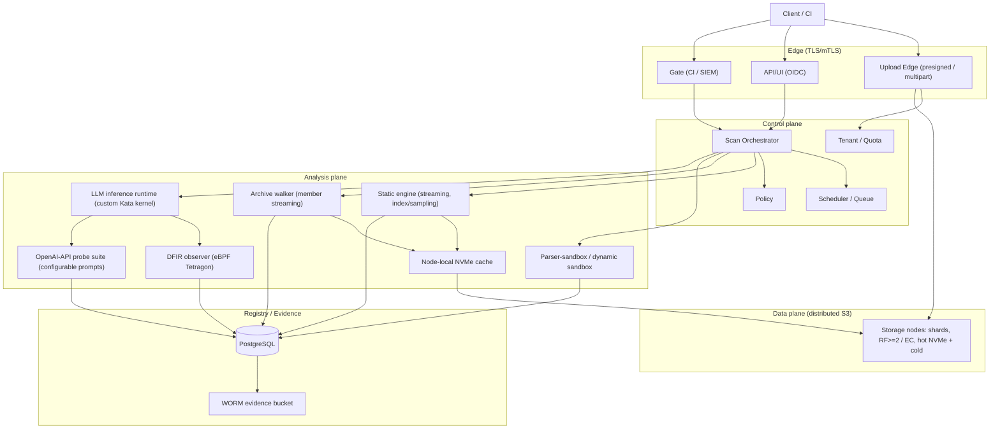
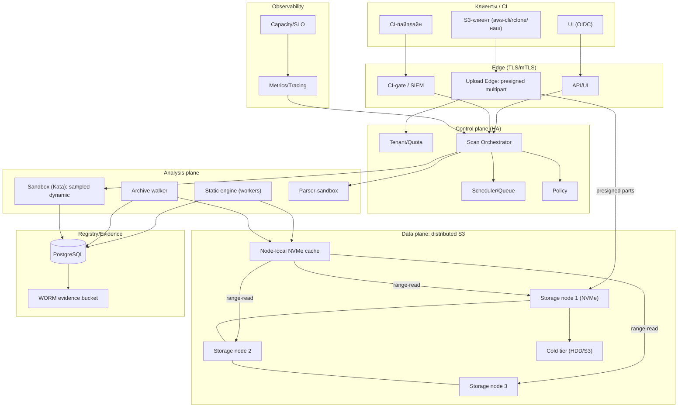

# 02. Архитектура v3

## 1. Обзор

v3 разделена на **edge**, **control plane**, **data plane** и **analysis plane**. Ключевое отличие
от v2: данные не проходят через сервис анализа, а анализ читает **нужные диапазоны** объекта прямо
из распределённого S3 (при необходимости — через node-local кэш).

## 2. Компоненты

### 2.1 Edge
- **Upload Edge** — выдаёт presigned multipart (CreateMultipartUpload/UploadPart/Complete), проверяет
  тенанта/квоты, ведёт аудит; TLS/mTLS-терминация.
- **API/UI** — дашборд, карточка артефакта, политика, язык; OIDC-аутентификация людей.
- **Gate** — CI-gate (решение по `sha256`+версии правил), SIEM-экспорт (NDJSON/CEF).

### 2.2 Control plane
- **Tenant/Quota service** — тенанты, квоты (байты, RPS, concurrency, part-size), fair-share.
- **Scheduler/Queue** — персистентная очередь сканов, приоритеты (CI > ad-hoc), backpressure.
- **Policy engine** — правила вердикта/`action`, версии политики (подпись).
- **Scan Orchestrator** — жизненный цикл скана: стратегия, бюджеты, шаги, агрегация, покрытие.

### 2.3 Data plane
- **Distributed S3** — ≥3 storage-узла, шардинг, **RF≥2 или erasure coding**, hot NVMe + cold tier.
- **Content-addressed общий пул** — ключи по `sha256` (без тенанта), **тенант-ссылки (refcount)**;
  дедуп между тенантами; ACL и (опц.) per-tenant KMS.
- **Node-local NVMe cache** — read-through кэш «горячих» диапазонов для анализа (CoW, TTL).

### 2.4 Analysis plane
- **Static engine** — потоковый обход, index-driven (safetensors/ONNX/HDF5/GGUF), sampling, coverage.
- **Archive walker** — членный стриминг из S3 (zip central directory по range, tar sequential),
  вложенные архивы (depth-бюджет), индекс членов, параллельные member-workers.
- **Sandbox (Kata)** — сэмплированная динамика (срезы/члены) с бюджетами.
- **Parser-sandbox** — изолированный разбор недоверенных форматов/фаззинг.
- **LLM inference runtime** — запуск **движка инференса в изоляции Kata** вместе с моделью
  (движок поставляется **контейнерным образом**, который тестируется как часть скана), с
  выделенными ресурсами (GPU/CPU/RAM/диск).
- **DFIR observer (eBPF/Tetragon)** — наблюдение за работой инференса через **eBPF Tetragon** в
  **кастомном ядре Kata** (syscalls, процессы, сеть, файлы, mmap/exec) → вердикт по поведению.
- **OpenAI-API probe suite** — отправка тестовых запросов в OpenAI-совместимый API инференса по
  **настраиваемому списку** (промпты) и оценка ответов по **эталонным** ответам/критериям.

### 2.5 LLM-инференс как отдельный тип тестирования
См. [`16-llm-inference-testing.md`](16-llm-inference-testing.md). Кратко: для особенно больших LLM
модель и её движок (образ контейнера) подаются вместе; тестовый сервер должен иметь достаточно
ресурсов для запуска конкретного инференса; вердикт формируется по поведению (eBPF/Tetragon в
кастомном ядре Kata) и по качеству/безопасности ответов на тестовые запросы (OpenAI API +
эталонные ответы). Это дополняет обычные статику/динамику и требует отдельного пула узлов,
политик ресурсов и стратегии `llm-inference`.

### 2.6 Registry/Evidence
- **PostgreSQL** — объекты/сканы/находки/члены/покрытие/квоты/аудит; для LLM-тестов — прогоны,
  промпты/эталоны, оценённые ответы, поведенческие события eBPF.
- **WORM/evidence** — append-only журнал, HMAC-цепочка, анкоринг во внешний object-lock bucket,
  периодическая нотаризация.

## 3. Диаграмма развёртывания

## 4. Диаграмма состояния (a): загрузка и анализ модели 1 ТБ

```mermaid
stateDiagram-v2
  [*] --> Init
  Init : POST /uploads/initiate (tenant, sha256, size)
  Init --> Dedup : объект уже в пуле (refcount++)
  Init --> Parts : presigned URLs (adaptive 64 МиБ..1 ГиБ, TLS/mTLS)

  Parts : клиент PUT частей напрямую в S3 (16..64 параллельно)
  Parts --> Resume : обрыв/рестарт
  Resume : GET /uploads/<id>/parts → догрузка
  Resume --> Parts
  Parts --> Complete : POST /uploads/complete (ETag+SHA-256)

  Dedup --> Complete
  Complete : завершение multipart + проверка checksum + манифест
  Complete --> Register
  Register : объект + ссылка тенанта; аудит

  Register --> Strategy
  Strategy : автоподбор по размеру/формату
  Strategy --> StaticStream : статика потоково из S3 (range)
  Strategy --> SampledDyn : сэмплированная динамика срезов
  Strategy --> FullDyn : полная динамика, если объект помещается

  StaticStream : index-driven обход + sampling + coverage
  SampledDyn : Sandbox Kata, бюджеты, нонс результата
  FullDyn : Sandbox Kata, полная загрузка

  StaticStream --> Aggregate
  SampledDyn --> Aggregate
  FullDyn --> Aggregate
  Aggregate : findings + coverage → вердикт
  Aggregate --> Policy
  Policy : scoring + policy (+ coverage → Inconclusive)
  Policy --> Evidence
  Evidence : PG + WORM + HMAC
  Evidence --> [*]
```

## 5. Диаграмма состояния (b): комплексный анализ архива 1 ТБ (все форматы)

```mermaid
stateDiagram-v2
  [*] --> Receive
  Receive : загрузка архива (direct-to-S3, tenant)
  Receive --> Index
  Index : чтение оглавления по range (zip центральный каталог / tar потоково)
  Index --> Members

  state Members {
    [*] --> TakeMember
    TakeMember --> Fmt : определить формат члена
    Fmt --> MemberStatic : статика потоково из S3 (диапазон члена)
    MemberStatic --> DynDecision
    DynDecision --> MemberDyn : член в бюджете песочницы
    DynDecision --> SkipDyn : крупный/неисполняемый член
    MemberDyn --> MemberAgg
    SkipDyn --> MemberAgg
    MemberAgg : находки + покрытие члена
    MemberAgg --> Nested : член = вложенный архив
    Nested --> TakeMember : depth-бюджет не исчерпан
    MemberAgg --> TakeMember : следующий член
    TakeMember --> [*] : все члены обработаны
  }

  Members --> Aggregate
  Aggregate : нормализация, лимит находок, покрытие архива
  Aggregate --> Verdict
  Verdict : max_severity/risk_score + policy (+ Inconclusive)
  Verdict --> Evidence
  Evidence : PG + WORM + HMAC; отчёты JSON/MD/SARIF
  Evidence --> [*]
```

## 6. Ключевые инварианты

1. Данные анализа читаются **range-read** из S3; полная загрузка — только для объектов в пределах
   лимита песочницы.
2. Любая неполнота (непрочитанные диапазоны/члены/пропущенная динамика) отражается в **coverage** и
   влияет на вердикт (`Inconclusive`).
3. Evidence — append-only с HMAC и WORM-анкорингом.
4. Мультитенантность: каждый объект/скан принадлежит тенанту; квоты и SLO — per-tenant.
5. Образы/конфиги/политики версионируются и подписываются; анализ воспроизводим по версии.
