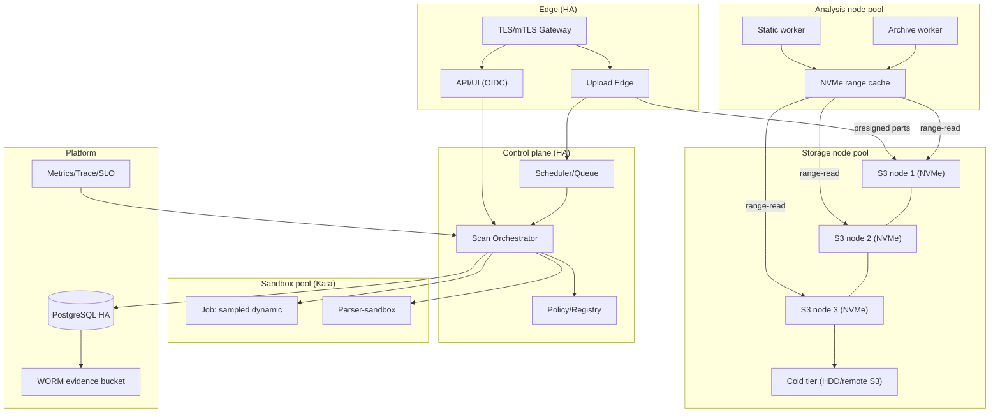

# 10. Развёртывание v3 (топология, HA, DR)

## 1. Топология

```
                    ┌──────────────── Edge (HA, ≥2) ────────────────┐
                    │  TLS/mTLS Gateway  ·  Upload Edge  ·  API/UI    │
                    └───────────────┬───────────────┬───────────────┘
                                    │               │
        ┌─────────────── Control plane (HA ≥2) ─────┴──────────────┐
        │ Tenant/Quota · Scheduler/Queue · Policy · Orchestrator    │
        └───────┬───────────────────────────────┬──────────────────┘
                │                               │
   ┌────────────┴───────────┐        ┌──────────┴─────────────┐
   │ Storage node pool      │        │ Analysis node pool      │
   │ (≥3, NVMe hot + HDD    │◀─range──│ Static/Archive workers  │
   │  cold, RF≥2/EC)        │        │ NVMe cache · Sandbox    │
   └────────────┬───────────┘        └──────────┬─────────────┘
                │                               │
        ┌───────┴──────┐                 ┌──────┴──────────────┐
        │ PostgreSQL   │                 │ Observability stack │
        │ (HA/repl)    │                 │ metrics/trace/SLO   │
        │ WORM bucket  │                 └─────────────────────┘
        └──────────────┘
```

## 2. Node pools

| Пул | Роли | Особенности |
|-----|------|-------------|
| storage | S3-узлы | ≥3 узла, NVMe (hot) + HDD (cold), большой сетевой канал |
| analysis | analysis workers + cache | много CPU/RAM, NVMe под кэш срезов, доступ к S3 |
| sandbox | исполнение Job (Kata) | аппаратная виртуализация, изоляция |
| control | оркестратор/очередь/политика | HA, stateless/locks |
| platform | ingress, ops, PG | TLS/mTLS, наблюдаемость |

## 3. Развёртывание (деплоймент-диаграмма)



## 4. HA и отказоустойчивость

- Edge/Control — **≥2 реплики**, leader-election/распределённые локи (очередь персистентна).
- Storage — **RF≥2/EC**, scrubing, автовосстановление; добавление узлов без простоя.
- PostgreSQL — репликация/HА; бэкапы с проверкой восстановления.
- Sandbox — переиспользуемые тёплые образы; пул Job с лимитами.
- Устранены v2-ограничения: single replica, in-memory сессии, единый писатель evidence.

## 5. DR (Disaster Recovery)

| Цель | Значение |
|------|----------|
| RPO | ≤ 15 мин (async-репликация объектов; WAL-стриминг БД) |
| RTO | ≤ 1 ч (failover control/data-plane) |
| Сценарии | выход узла, выход сайта, порча данных, потеря ключей |
| Меры | multi-site replication / backup to external S3; восстановление индексов; ротация ключей |

## 6. Обновления и GitOps

- Инфраструктура и приложения — **GitOps** (Flux/Argo): изменения через PR, версионирование.
- Образы — по digest; SBOM + подпись; admission-проверка.
- Политики/детекторы — версионированные артефакты с подписью; мгновенный откат.
- Blue/green или canary для edge/control; storage-узлы — rolling с репликацией.

## 7. Квоты ресурсов и мультитенантность в k8s

- Тенанты: отдельные namespace (или общий + RBAC), `ResourceQuota`/`LimitRange`.
- Приоритеты (`PriorityClass`): CI > интерактив > batch.
- NetworkPolicy: deny-by-default; egress-allowlist.

## 8. Миграция с v2

Описан отдельно — `11-migration-v2-to-v3.md`: поэтапно, с сохранением работы v2 до полного переключения.
