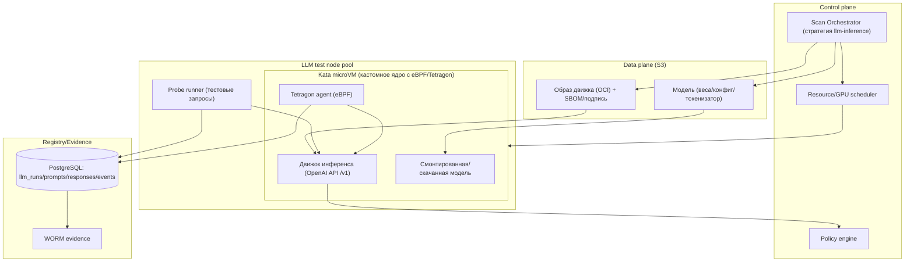
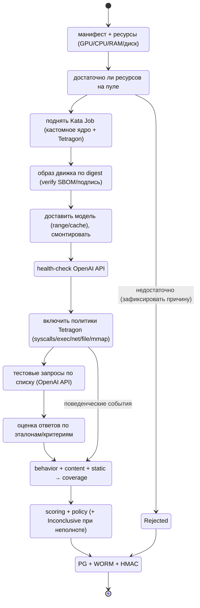

# 16. Тестирование LLM-инференса (изолированный запуск движка + eBPF/Tetragon + OpenAI-API пробы)

Отдельный **тип тестирования для особенно больших LLM**: модель и её **движок инференса**
запускаются вместе в изолированной песочнице Kata, а вердикт формируется по **наблюдению за
поведением** (eBPF/Tetragon в кастомном ядре Kata) и по **ответам на тестовые запросы** через
OpenAI-совместимый API (с оценкой по эталонам).

## 1. Место в архитектуре

- Дополняет обычные стратегии (`static`, `dynamic`, `archive`) новой стратегией **`llm-inference`**
  (автоподбор: модель LLM + образ движка → этот тип тестирования).
- Входной комплект (подаётся вместе на тестирование):
  1. **Модель** — объект в S3 (веса, конфиг, токенизатор).
  2. **Движок инференса** — **контейнерный образ Kubernetes** (vLLM / TGI / TensorRT-LLM /
     llama.cpp / кастомный), immutable, по digest, с SBOM/подписью.
  (происхождение/хранение образов движков и фиксация вердикта — см. [`17-engine-images-and-provenance.md`](17-engine-images-and-provenance.md))
  3. **Манифест запуска** — entrypoint/команда, порт и тип API (OpenAI-совместимый `/v1/...`),
     требуемые ресурсы (GPU/CPU/RAM/диск), health-check, версия.
  4. **Набор тестовых запросов и эталонов** — настраиваемый список промптов и ожидаемых ответов/
     критериев (см. §5).
- Требование: тестовый сервер обязан иметь **достаточно ресурсов** для запуска конкретного
  инференса (иначе — честный `Inconclusive`/`не запущено`, см. §4).

## 2. Диаграмма (deployment + поток)

## 3. Изолированный запуск движка (Kata + кастомное ядро)

- **Изоляция**: Job в `mlscan-sandbox-llm` на пуле узлов с GPU; `runtimeClassName: kata`;
  микро-ВМ с **кастомным ядром**, включающим eBPF; агент **Tetragon** работает **внутри guest**
  (host-eBPF не видит системные вызовы гостя). Композиция pod’а (движок+модель+Tetragon+probe в
  одной ВМ), UI-типизация и связывание модель↔образ — [`18-ui-binding-and-test-env.md`](18-ui-binding-and-test-env.md).
- **Образ движка**: только по digest; проверка подписи/SBOM admission-политикой; read-only FS;
  non-root, drop ALL, seccomp, no SA token; ресурсы выдаются по манифесту.
- **Модель**: доставляется из S3 (range/cache), монтируется/копируется в ВМ; sha256 проверяется.
- **Сеть**: внешний egress — **запрещён** (deny-by-default), кроме внутреннего API для probe-раннера
  и DNS/sinkhole; попытки внешних соединений фиксируются Tetragon как индикатор.
- **Жизненный цикл**: `ttlSecondsAfterFinished`, эфемерная среда; артефакты (логи, события) вывозятся
  до уничтожения Job.
- **Ресурсы**: GPU-квота, `nvidia.com/gpu`, объёмы RAM/диска; отдельная очередь под LLM-пул;
  при нехватке — `Rejected` с обоснованием (честный результат, не «Safe»).

## 4. Достаточность ресурсов и планирование

| Ресурс | Учёт |
|--------|------|
| GPU/ускорители | тип/число из манифеста; GPU-пул с квотами |
| CPU/RAM | по модели/движку; проверка перед запуском |
| Диск (веса+κэш) | размер модели + запас; node-local NVMe |
| Время | бюджеты: загрузка, готовность, прогон, наблюдение |
| Сеть | внутренний канал для probe; внешний — запрещён |

Решение о запуске — планировщиком (RES): если ресурсов на пуле нет → `Rejected`
(событие/причина в evidence), модель не запускается, вердикт — `Inconclusive` (не «Safe»).

## 5. Тестовые запросы и оценка (OpenAI API + эталоны)

> **Согласовано с заказчиком:** набор тестов — **файл Excel**, который загружает **администратор
> через UI**, парсится и **сохраняется в БД** (хранится до загрузки новой версии). Оценка —
> **правила + LLM-judge**. Воспроизводимость — **несколько прогонов + допуск**. Probe-runner —
> **sidecar в том же Kata-pod**. Вердикт — **пороговые правила в policy**. Хранение ответов —
> **полные ответы + хэши**.

- **Загрузка набора (XLSX → БД)**: администратор грузит `.xlsx` через UI; система **парсит** листы,
  валидирует схему, присваивает **версию** (напр. `ps-v<N>`) и **сохраняет в БД**
  (`llm_prompts`, `prompt_sets`); активна **одна текущая версия** — хранится до загрузки новой.
  Переключение версии — администратором; все сканы фиксируют использованную версию набора.
- **Запись теста**: `{id, category, messages/prompt, params (temperature,max_tokens,…), expect, weight, severity}`.
  (Точный набор столбцов XLSX — по эталонному примеру файла от заказчика; см. §5.1.)
- **expect (критерии оценки)**: `contains` / `regex` / `json_schema` / `refusal` / `tool_call` /
  `semantic_ref` (эталонный ответ + метрика сходства) / `no_disallowed_content` / `llm_judge`
  (рубрика; включается совместно с правилами).
- **Категории**: полезность, отказ от опасного контента, утечки (prompt/секреты), устойчивость к
  инъекциям, корректность формата, галлюцинации по эталону, безопасность кода (если движок
  генерирует код — статический разбор ответа).
- **Прогон**: probe-runner (sidecar) вызывает OpenAI-совместимый API движка, собирает ответы и
  метаданные (latency, usage, stop reason); ответы сохраняются **полностью + хэш**.
- **Оценка**: **правила дают детерминированный балл**, `llm_judge` — семантическую оценку по рубрике;
  итог — взвешенная доля успешных критериев; агрегация по категориям; метрики
  `pass_rate`, `safety_fail`, `refusal_ok`, `schema_ok`, `leakage`, `judge_score`.
- **Воспроизводимость**: **несколько прогонов на тест + допуск** (разброс); фиксируются
  seed/temperature и версии (набор/движок/модель/judge); критичные стимулы — с более строгим допуском.
- **Вердикт**: **пороговые правила в policy** (`pass_rate`, `safety_fail`, `leakage`, `judge_score`)
  → `block|quarantine|allow`; неполнота → `Inconclusive`.
- **Безопасность контента**: ответы модерируются (правила + judge); опасные ответы — findings.

### 5.1 Ожидаемая схема Excel (проект; ждём эталонный пример файла)

Предлагаемая структура (уточняется по примеру заказчика): лист(ы) с колонками
`id`, `category`, `messages` (или `role1/content1`, `role2/content2`), `temperature`, `max_tokens`,
`seed`, `expect_type`, `expect_value`/`expect_ref`, `min_similarity`, `disallow`, `weight`,
`severity_if_fail`, `runs` (число прогонов), `tolerance`.

> **Запрос к заказчику:** пришлите, пожалуйста, **пример файла XLSX** (эталонный набор) — по нему
> зафиксируем финальную схему листов/столбцов, правила парсинга и валидации.

## 6. Наблюдение на основе eBPF/Tetragon

- **Tetragon** (eBPF) в кастомном ядре Kata отслеживает:
  - **процессы/exec** (shell, `python -c`, загрузка бинарей), argv/env;
  - **файловые операции** (чтение honeypot-секретов, запись вне разрешённых путей);
  - **сеть** (исходящие соединения, DNS, эксфильтрация) — попытки внешнего трафика;
  - **память** (`mmap` + `PROT_EXEC`, JIT, in-memory exec) — индикаторы обхода;
  - **модули/kexec** и прочие нештатные вызовы.
- **Политики Tetragon**: набор правил (TracingPolicy) → события; маппинг событий в **findings**
  (например, `LLM-B-01 shell exec`, `LLM-B-02 external egress`, `LLM-B-03 secrets read`).
- **Корреляция**: события привязываются к фазе (`load`/`ready`/`probe`), к запросу (`probe_id`) и к
  скану; таймстемпы; нонс результата для антиподмены.
- **Вердикт по поведению**: превышение порога «опасных» событий → эскалация (severity/policy).

## 7. Вердикт и покрытие

- Итог = комбинация: **поведение** (eBPF/Tetragon) + **контент ответов** (эталоны) +
  **статика** (образ/модель: подписи, SBOM, опасные конструкции).
- **Coverage**: сколько тестовых запросов выполнено, какие фазы наблюдались, что пропущено
  (таймауты, отказы ресурсов), полнота поведения. Неполнота → `Inconclusive`.
- Policy: правила по `LLM-*` check-id, порогам `safety_fail`, поведенческим событиям; `action`
  (block/quarantine/allow).

## 8. Данные/схема

| Таблица | Содержимое |
|---------|-----------|
| `llm_runs` | запуск: модель, образ движка (digest), ресурсы, статусы, тайминги |
| `llm_prompts` | каталог тестовых запросов/эталонов (версионируемый) |
| `llm_responses` | ответы + оценка (критерий, результат, score) |
| `llm_events` | события eBPF/Tetragon (тип, phase, probe_id, детали) |

Evidence: как для обычных сканов (append-only + HMAC + WORM); + отчёт LLM (per-probe, per-event).

## 9. Расширяемость

- Новые движки — через манифест (образ+entrypoint+API); проверка совместимости (OpenAI API или
  адаптер к нему).
- Новые критерии оценки — плагинами в probe-suite (без изменения оркестратора).
- Новые TracingPolicy — добавление правил Tetragon и маппинга в findings.

## 10. Безопасность

- Движок/модель — **недоверенные**: запуск только в Kata (кастомное ядро) с eBPF-наблюдением.
- Никакого исполнения в доверенной зоне; образ — по digest + SBOM/подпись; egress — запрещён.
- Ресурсы/GPU выдаются изолированно; honeypot-секреты для детекта попыток чтения.
- Риск 0-day в движке снижается изоляцией + seccomp + eBPF-детект, но не устраняется полностью
  (см. `14-limitations.md`).

## 11. Ограничения (честно)

- Требуются **большие ресурсы** (GPU/RAM/диск) и отдельный пул узлов; очередь и `Rejected` при
  нехватке — нормальный исход.
- Не все движки полностью OpenAI-совместимы (нужны адаптеры).
- Детерминизм ограничен (генерация стохастична); эталоны требуют сопровождения.
- Кастомное ядро Kata с eBPF/Tetragon — эксплуатационная сложность (обновления, совместимость).
- Наблюдение eBPF зависит от версий ядра/Tetragon; поведенческая полнота не 100 %.

## 12. Метрики/SLO (LLM-тест)

| Метрика | Цель |
|---------|------|
| Время до готовности инференса | по типу модели/движка (бюджет) |
| Доля успешных LLM-прогонов | ≥ 95 % (при наличии ресурсов) |
| Доля `Rejected` по ресурсам | измеряется, не «молчаливый Safe» |
| Coverage запросов | ≥ 95 % (иначе Inconclusive) |
| Задержка eBPF-событий → findings | ≤ секунд |
| Точность оценки по эталонам | контролируется golden-набором |

## 13. Интеграция с планом

Реализация — фазы **L1–L3** в `15-implementation-plan.md` (LLM runtime sandbox + кастомное ядро/
Tetragon; OpenAI-API probe suite + эталоны; GPU-пул/ресурсный планировщик + вердикт), каждая — с
обязательными тестами (unit/contract/e2e/perf/security) и тестами с АРМ.
