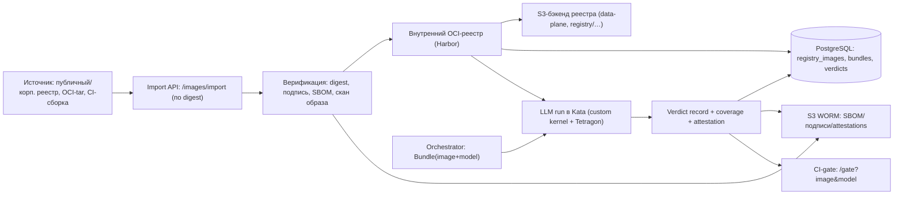

# 17. Образы движков инференса: попадание в систему, хранение, привязка к модели и фиксация результата

Документ закрывает вопросы для LLM-инференс-тестирования ([`16-llm-inference-testing.md`](16-llm-inference-testing.md)):
**откуда и как образы движков попадают в систему**, **где хранятся**, **как связывается конкретный
образ с конкретной моделью** и **как фиксируется, что именно эта пара прошла/не прошла тесты**.

## 1. Терминология и ключевая идея

- **Engine image** — контейнерный образ движка инференса (vLLM/TGI/TensorRT-LLM/llama.cpp/кастомный),
  immutable, идентифицируется **digest** (`sha256:…`).
- **Model artifact** — объект в S3 (веса/конфиг/токенизатор), идентифицируется **sha256**.
- **Binding/UI** — явное указание типа артефакта и связывание модели с образом движка описаны в
  [`18-ui-binding-and-test-env.md`](18-ui-binding-and-test-env.md).
- **Bundle (тест-комбинация)** — неизменяемая связка `{engine image digest + model sha256 + engine
  manifest (entrypoint/API/ресурсы) + prompt-set version + detectors/policy version}`.
- **Verdict record** — подписанная запись о результате прогона bundle (pass/fail/Inconclusive) с
  доказательствами.

Ключевая идея: **всё адресуется по digest/sha**, а вердикт привязан к **immutable bundle**, поэтому
результат воспроизводим и не «размывается» при обновлении образа/модели.

## 2. Откуда образы попадают в систему (источники)

| Источник | Как попадает | Примечание |
|----------|--------------|-----------|
| Публичный реестр (Docker Hub, NGC, HuggingFace, vendor-registry) | `POST /images/import {ref, digest, platform}` → система **pull** в внутренний реестр | всегда по **digest**, не по тегу |
| Корпоративный реестр (Harbor/internal) | импорт по ссылке или CI-push | предпочтительный источник |
| CI-сборка MLScan | сборка в `mlscan-build` → **push** во внутренний реестр | сопровождение SBOM/подписи |
| Загруженный **OCI-архив** (tar/docker-save) | загрузка как артефакт (multipart direct-to-S3) → `POST /images/import {oci_tar_key}` | для air-gapped/офлайн-кейсов |

Все пути сходятся в **внутренний реестр** (`mlscan-registry`), который становится **единственным
доверенным источником** образов для запуска (admission разрешает образы только оттуда, только по digest).

## 3. Конвейер импорта образа

1. **Приём ссылки/архива** — API `/images/import` (тенант, источник, ожидаемый digest, platform).
2. **Pull/copy** — `skopeo copy`/`crane`/registry API: `docker://<public>@sha256:…` →
   `docker://mlscan-registry/<tenant>/<engine>@sha256:…` (для OCI-архива — `docker-archive:` → реестр).
3. **Верификация** — сверка digest; проверка подписи (cosign), SBOM, лицензий; фиксация успеха/ошибки.
4. **Скан образа** (статический) — уязвимости/секреты/опасные слои (переиспользуем v3-статику и/или
   сканер образов); результат — находки `IMG-*`.
5. **Реестровая запись** — в PostgreSQL: digest, теги (как алиасы), источник, подпись, SBOM, лицензии,
   размер, слои, статус; в S3 — копии SBOM/подписи и (опц.) OCI-layout.
6. **Готовность** — образ доступен для прогонов (только по digest).

## 4. Где хранятся образы

```
Источник ──▶ Внутренний OCI-реестр (mlscan-registry, Harbor) ──▶ S3-бэкенд (распределённый data-plane)
                    │                                                     │
                    │ метаданные/подписи/SBOM                             │ blobs/layers (objects/registry/…)
                    ▼                                                     ▼
              PostgreSQL (registry_images, …)                     cold tier / DR-репликация
                    ▲
                    │ pre-pull / warm pool
            LLM node pool: containerd image cache (node-local NVMe)
```

- **Авторитетное хранилище** — **внутренний OCI-реестр** (Harbor) с **S3-бэкендом на
  распределённом data-plane** (`03-data-plane.md`). Так образы и модели живут в одном
  масштабируемом хранилище, но в разных пространствах (bucket/prefix `registry/…` против `objects/…`).
- **Дедуп слоёв**: реестр дедуплицирует по digest слоёв; общий для тенантов слой (например, CUDA
  base) хранится один раз. Это даёт экономию на крупных (многогигабайтных) образах движков.
- **Cold tier/DR**: образы участвуют в lifecycle и репликации data-plane (RF≥2/EC, DR-копия).
- **Node-local кэш**: LLM node pool держит **pre-pulled/warm** образы (containerd), ускоряя запуск.
- **Provenance-копии**: SBOM, подписи, результаты скана образа и OCI-layout (для офлайн-повторного
  импорта) — в S3 (WORM-совместимо) + ссылки в PostgreSQL.

Размер: образы движков могут быть десятки ГБ → используются те же механизмы, что и для крупных
моделей (multipart/range/resume, дедуп, tiering); импорт идёт через реестр, а не через S3 «как объект».

## 5. Откуда берётся модель и как связывается с образом

- Модель приходит как объект в S3 (см. `04-ingest.md`), адресуется по `sha256`.
- Оркестратор формирует **Bundle** — неизменяемую связку:
  ```json
  {"bundle_id":"b-<hash>","engine_image":"mlscan-registry/<t>/vllm@sha256:…",
   "model_sha256":"…","engine_manifest":{"entrypoint":"…","api":"openai:/v1",
   "resources":{"gpu":1,"ram_gb":80,"disk_gb":200}},"prompt_set":"ps-v3","detectors":"det-v7",
   "policy":"pol-v12"}
  ```
- `bundle_id` — content-addressed по полям, поэтому любое изменение (образа/модели/манифеста/набора
  промптов/детекторов/политики) создаёт **новый** bundle и, значит, новый вердикт.

## 6. Как фиксируется «прошли/не прошли тесты»

Вердикт фиксируется **на уровне bundle** (а не «образа» или «модели» по отдельности):

| Таблица (PostgreSQL) | Что хранит |
|----------------------|------------|
| `registry_images` | образ: digest, источник, подпись/SBOM-ссылки, размер, статус |
| `bundles` | `bundle_id`, image digest, model sha256, версии manifest/prompt-set/detectors/policy |
| `llm_runs` | прогон bundle: статус (`pass`/`fail`/`inconclusive`/`rejected`), ресурсы, тайминги |
| `llm_responses` | ответы на пробы + оценка (критерий/score) |
| `llm_events` | события eBPF/Tetragon (поведение) |
| `verdicts` | итоговый вердикт/`action` + `coverage` + ссылка на evidence |
| `image_attestations` | подписанные аттестации (см. §7) |

- **Evidence** — append-only + HMAC + WORM (`08-security-isolation.md`):
  фиксирует входы (digest/sha), шаги, находки, поведение, ответы, версии — «цепочку доказательств».
- **Идемпотентность/кэш**: повторный прогон того же `bundle_id` (с теми же версиями) может
  переиспользовать результат; любое изменение — новый bundle/вердикт.
- **Запрос результата**: `GET /bundles/<bundle_id>` (вердикт+coverage+отчёт) и
  `GET /gate?image=<digest>&model=<sha256>` для CI (см. §7).

## 7. Аттестация, подпись и CI-gate

- **Attestation**: результат оформляется как подписанное утверждение (in-toto/SLSA-подобный
  predicate) и:
  - сохраняется в S3 (WORM) и PostgreSQL (`image_attestations`);
  - опционально прикрепляется к образу в реестре (**cosign attest** на `sha256:…`), а также к
    модели (attestation на `sha256` модели в реестре/объекте).
- **CI-gate**: пайплайн запрашивает `GET /gate?image=<digest>&model=<sha256>` → получает
  `allow|block|quarantine` + `bundle_id` + подпись; решение принимается строго по **этой** паре и
  версиям правил.
- **Воспроизводимость**: в аттестации перечислены все входы (digests, версии) и выходы (находки,
  вердикт), поэтому результат проверяем и оспорим.

## 8. Диаграмма (приём образа → хранение → тест → вердикт)



## 9. Политики реестра и допуска (admission)

- Запуску разрешены **только** образы из `mlscan-registry`, **только по digest**, **только
  подписанные** (cosign) с SBOM — проверяется Kyverno/admission.
- Запрещены теги и внешние реестры в рантайме; pull-through кэш — только для импорта, не для запуска.
- Изоляция тенантов: отдельные проекты/namespace реестра; RBAC на push/pull; аудит операций импорта.

## 9a. Выбор реестра: отдельный ресурс, не реестр стенда AISandBox

**Решение:** внутренний реестр MLScan — **отдельный ресурс**, а не проект внутри реестра стенда
приёмки AISandBox (`192.168.20.116:30003`). У того стенда свой жизненный цикл, свои пересборки и своя
приёмка: деление реестра создаёт связанность выкладок и риски безопасности/квот, которых можно избежать.
Варианты по предпочтению:

1. **Общий корпоративный реестр** (рекомендуемый при нескольких проектах) — например farm-Harbor
   `192.168.20.254:30003`: проекты `mlscan/<...>` с отдельными robot-аккаунтами (pull/push), квотами и
   владельцем репозитория.
2. **Собственный Harbor MLScan** (S3-бэкенд на нашем data-plane, prefix `registry/…`) на целевом стенде.
3. Локальный реестр узла — только как временный обход при отсутствии кредов (использован на стенде:
   образ песочницы импортирован `ctr images import` и задан **тегом**).

Факты рекогносцировки farm-Harbor (проверено 2026-10-29): доступен и с АРМ, и с узла; отвечает
`401` + `Www-Authenticate: Bearer realm="https://192.168.20.254:30003/service/token",
service="harbor-registry"` → это Harbor, анонимный pull/push закрыт; TLS-сертификат `CN = 192.168.20.254`
выдан внутренним `CN = harbor-ca` (в системном доверии отсутствует).

Что нужно, чтобы включить (порядок):

1. **Владелец/квоты/безопасность**: согласовать проект (`mlscan`), лимиты по объёму, политику
   retention, список роботов (отдельный robot на pull и, при необходимости, на push).
2. **Robot-креды** — хранить в Secret (`mlscan-registry-creds`), не в образе и не в манифестах.
3. **Доверие CA на узлах**: для каждого узла
   `/etc/containerd/certs.d/192.168.20.254:30003/hosts.toml` (`ca = "/etc/containerd/certs.d/192.168.20.254:30003/ca.crt"`)
   + сам `ca.crt` (он же — в trust-store АРМ, откуда выполняется push).
4. **Push образов** в проект: `mlscan-sandbox`, `ebpf-agent`, `nvidia-device-plugin` — по digest;
   затем переключить `SANDBOX_IMAGE` на `192.168.20.254:30003/mlscan/...@sha256:…` (возврат
   digest-pinning вместо тега).
5. **Подпись/аттестация**: cosign-подпись + SBOM (B4), затем admission по digest+подписи.

Замечание: на текущем стенде собственная Kyverno-политика (`aisandbox-verify-images`) действует только
на образы `192.168.20.116:30003/{dev,library,…}/*` — наши образы не блокирует, поэтому локальный обход
(тег + импорт) рабочий, но не является целевым способом доставки.

## 10. Жизненный цикл и retention

- Образы: TTL/карантин по политике; GC по `refcount` (образ не нужен, если нет bundles/бандлов/
  воспроизводимости) — с сохранением аттестаций.
- Attestations и evidence — **не удаляются** (WORM), даже если образ выведен из обращения.
- Повторный импорт того же digest — no-op (идемпотентно).

## 11. Связь с планом

Реализация — фазы **L1a** (внутренний реестр + импорт образов + S3-бэкенд + admission) и
**L4** (аттестации/подпись/CI-gate) в [`15-implementation-plan.md`](15-implementation-plan.md);
тесты: contract (import/verify), security (подпись/admission), e2e (import→run→verdict), e2e с АРМ
(загрузка OCI-архива), DR (репликация реестра).
