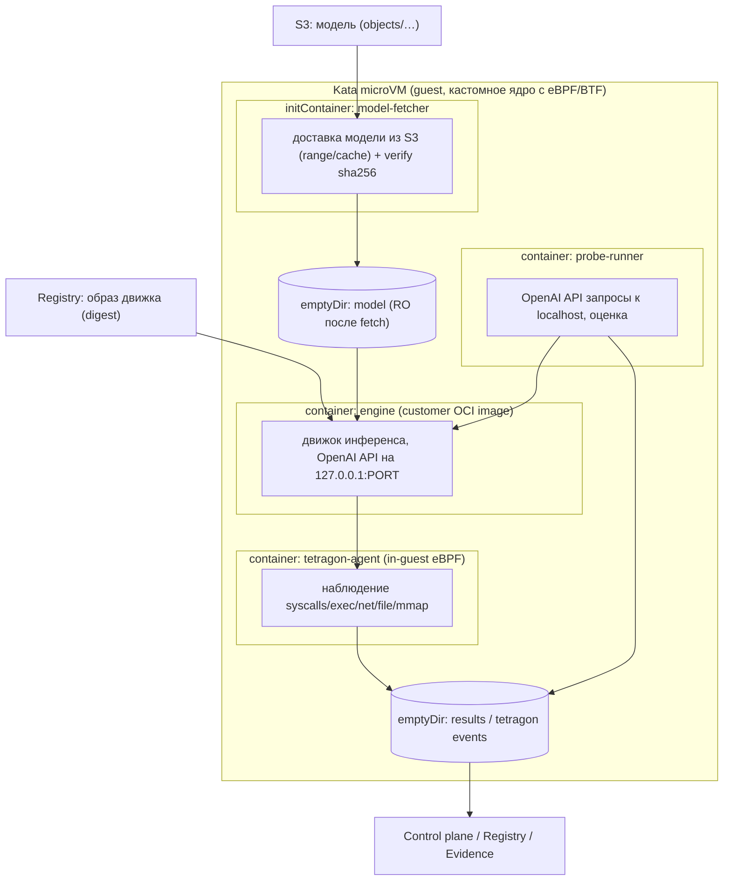

# 18. UI-типизация артефактов, классификация LLM, связывание «модель ↔ образ движка» и единая среда Kata

Документ отвечает на вопросы: (1) как в UI **явно** показать, что загружается именно **образ
инференс-движка**; (2) как для LLM-моделей **указать это явно** или определить **автоматическим
классификатором** и связать с конкретным образом; (3) как **разместить контейнер инференса и модель
в одной тестовой среде Kata**.

## 1. Типизация артефактов в UI (явное указание типа)

Приём артефактов в UI/API получает **обязательное поле `kind`** (тип артефакта):

| `kind` | Что это | Поля | UI-признак |
|--------|---------|------|-----------|
| `model` | ML/LLM-модель (веса/конфиг/токенизатор) | `fmt`, `architecture?` | карточка «Model», значок формата |
| `engine_image` | **контейнерный образ инференс-движка** | `ref`/`oci_tar`, `digest`, `platform` | **карточка «Engine image», с digest и бейджем «container»** |
| `archive` | архив моделей/артефактов | — | «Archive», список членов |
| `dataset` | датасет | — | «Dataset» |
| `notebook`/`other` | прочее | — | типизированные значки |

UI-требования:
- **Раздельные точки входа**: «Загрузить модель» и **«Загрузить образ инференс-движка»** —
  последняя явно сообщает: *«загружается образ контейнера (engine image), он будет запущен вместе с
  моделью в изолированной среде Kata»*.
- Для `engine_image`: интерфейс импорта (реестр/ссылка по digest или OCI-архив), предпросмотр
  digest/размера/подписи/SBOM, бейдж **«Container image»** (визуально отличим от «Model»).
- Карточка артефакта показывает `kind` и (для образа) `digest`, источник, статус подписи.
- Нельзя «молча» загрузить образ как модель: при несоответствии расширения/сигнатуры система
  запрашивает подтверждение типизации (`IMG-00` — «тип не соответствует содержимому»).

## 2. Классификация LLM-моделей

Если `kind=model`, система **автоматически классифицирует** содержимое и определяет, является ли это
LLM и какой семьи, чтобы предложить привязку к образу движка.

**Признаки (взвешенные)**:
- `config.json`: `model_type` (llama/qwen2/mistral/gpt2/…), `architectures`, `num_hidden_layers`,
  `max_position_embeddings`, `hidden_size`, `vocab_size`.
- Наличие **токенизатора** (`tokenizer.json/model`, `vocab.json`, `merges.txt`, `tokenizer_config.json`).
- Индекс шардов (`*.safetensors.index.json`, `pytorch_model.bin.index.json`), соглашения об именах тензоров.
- `gguf` metadata (`general.architecture`, `*.block_count`), `generation_config.json`.
- Эвристики: соотношение параметров/контекста, «decoder-only» сигнатуры; размер (LLM обычно крупные).

**Выход классификатора**:
```json
{"is_llm": true, "family": "qwen2", "confidence": 0.93,
 "evidence": ["config.json:model_type=qwen2", "tokenizer.json", "*.index.json"],
 "suggested_engines": ["vllm:latest","tgi:latest","llama.cpp:latest"],
 "recommended_resources": {"gpu":1,"ram_gb":64,"disk_gb":120}}
```
- **Порог уверенности**: выше порога → система предлагает bundle с рекомендованным образом;
  ниже — помечает как «возможно LLM» и требует ручного выбора.
- **Ручное указание** всегда доступно (явно пометить как LLM/выбрать семью и образ).
- Результат классификации сохраняется в `model_profiles` и влияет на автоподбор стратегии
  `llm-inference` (см. `16-llm-inference-testing.md`).

## 3. Связывание «модель ↔ образ движка» (binding)

Связь **всегда явная** и неизменяемая — через **Bundle** (`17-engine-images-and-provenance.md`):

- Модель (`sha256`) и образ (`digest`) связываются в `bundle` вместе с манифестом запуска и версиями
  (`prompt-set`, `detectors`, `policy`).
- Способы создания связи:
  1. **Авто (предложение)**: классификатор предложил образ → пользователь подтверждает (UI «Bind»).
  2. **Явно**: пользователь выбирает образ движка из `mlscan-registry` (по digest) и параметры.
  3. **Политика**: тенант/CI может разрешить авто-binding по правилу (families → engines) — с аудитом.
- Хранение связи: таблицы `model_profiles`, `bundles`, `bundle_refs` (модель/образ/манифест/версии);
  всё адресуется по digest/sha, поэтому связь воспроизводима и оспорима.
- UI: на карточке модели — раздел «Инференс»: `kind`, семья, уверенность, выбранный образ движка,
  ресурсы, кнопка «Запустить LLM-тест» (создаёт bundle и скан).
- Повторное связывание той же пары — идемпотентно (`bundle_id` совпадает).

## 4. Единая тестовая среда Kata: движок + модель вместе

**Как размещаем**: **один Kata-pod = одна микро-ВМ**, в которой совместно живут доставка модели,
движок инференса и наблюдатель; probe-runner тоже внутри (через `localhost`), чтобы исключить внешний
сетевой доступ.



**Композиция pod’а (эскиз)**:

```yaml
apiVersion: v1
kind: Pod
metadata: {name: llm-test-<scan>, namespace: mlscan-sandbox-llm, labels: {app: mlscan-llm-test}}
spec:
  runtimeClassName: kata            # микро-ВМ; guest-ядро — кастомное (eBPF/BTF)
  automountServiceAccountToken: false
  restartPolicy: Never
  # модель доставляется ДО движка в общий том
  initContainers:
    - name: model-fetcher           # наш доверенный образ (не customer)
      image: mlscan-registry/mlscan/model-fetcher@sha256:...
      args: ["--key","${MODEL_KEY}","--dest","/model","--sha256","${MODEL_SHA}"]
      volumeMounts: [{name: model, mountPath: /model}]
  containers:
    - name: engine                  # CUSTOMER-образ движка (только из реестра, по digest)
      image: mlscan-registry/<tenant>/<engine>@sha256:...
      args: ["--model","/model","--host","127.0.0.1","--port","8000"]
      ports: [{name: openai, containerPort: 8000}]
      readinessProbe: {httpGet: {path: /v1/models, port: 8000}, initialDelaySeconds: 30}
      resources: {limits: {nvidia.com/gpu: 1, memory: 80Gi, cpu: "8", ephemeral-storage: 200Gi}}
      securityContext: {runAsNonRoot: true, readOnlyRootFilesystem: true,
                        allowPrivilegeEscalation: false, capabilities: {drop: ["ALL"]}}
      volumeMounts: [{name: model, mountPath: /model, readOnly: true}]
    - name: tetragon-agent          # in-guest eBPF-наблюдатель (кастомное ядро)
      image: mlscan-registry/mlscan/tetragon@sha256:...
      securityContext: {privileged: false, capabilities: {add: ["BPF","PERFMON","SYS_ADMIN"]}}
      volumeMounts: [{name: events, mountPath: /events}]
    - name: probe-runner            # тестовые запросы к localhost:8000 + эталоны
      image: mlscan-registry/mlscan/probe-runner@sha256:...
      args: ["--endpoint","http://127.0.0.1:8000/v1","--prompt-set","${PROMPT_SET}"]
      volumeMounts: [{name: events, mountPath: /events}]
  volumes:
    - {name: model, emptyDir: {sizeLimit: 300Gi}}   # shared между init и engine (virtio-fs в guest)
    - {name: events, emptyDir: {}}                  # события Tetragon + результаты проб
```

Ключевые решения:
- **Модель и образ — в одной ВМ** (один pod), модель передаётся через **shared emptyDir** (в
  микро-ВМ монтируется как virtio-fs): `initContainer model-fetcher` (доверенный) скачивает модель из
  S3 (range/cache, verify sha256), затем `engine` (недоверенный customer-образ) читает её **read-only**.
- **Tetragon — внутри guest** (не на хосте): host eBPF не видит системные вызовы гостя; поэтому агент
  Tetragon запускается **в том же pod/микро-ВМ** с **кастомным guest-ядром** (eBPF/BTF), наблюдая
  именно `engine`-процессы. События пишутся в общий том.
- **Probe-runner — внутри pod**, обращается к движку по `127.0.0.1`, поэтому **внешний egress не
  нужен**; результаты (ответы/оценки) и события уходят в control plane через вывоз тома/сайдкар-шиппер.
- **Ресурсы** (GPU/RAM/диск) объявлены в манифесте/образе; планировщик проверяет достаточность на
  LLM-пуле; при нехватке — `Rejected`.
- **Изоляция**: customer-образ только из `mlscan-registry` по digest; read-only FS; drop ALL; seccomp;
  весь pod — в Kata; probe/tetragon — наши доверенные образы.
- **Результаты**: события Tetragon + ответы/оценки проб + версии → findings/coverage → вердикт
  bundle → evidence/attestation.

## 5. Альтернативы размещения (и почему выбран вариант)

| Вариант | Плюсы | Минусы | Выбор |
|---------|-------|--------|-------|
| init-fetcher + shared emptyDir (один pod) | модель и движок в одной ВМ; сеть не нужна; контроль доставки | нужен наш fetcher-образ; объём emptyDir | **да** |
| PVC/hostPath с моделью (RO-mount) | без копии в guest | узел-локально, хуже для ТБ/мультиаренды | опция |
| Модель «запекается» в образ движка | нет отдельной доставки | тяжёлые образы, плохой дедуп | нет |
| Движок сам скачивает модель из S3 | проще pod | движок в сети (риск), нет нашего контроля целостности | нет |
| Два pod’а (движок, probe) | разделение ролей | нужен сетевой доступ/политики, сложнее | нет |

## 6. Как это фиксируется (связь с вердиктом)

- `kind`, `model_profiles` (класс LLM/семья/уверенность), `bundles`/`bundle_refs`
  (image digest + model sha + manifest + versions) — в PostgreSQL.
- Вердикт — на уровне **bundle** (`17`), подписан (attestation), доступен в CI-gate по
  `(image digest, model sha256)`.
- UI: карточка модели показывает связь с образом и статус; карточка bundle — вердикт/покрытие/отчёт.

## 7. Требования к реализации (в план)

Фазы **L0** (UI-типизация + классификатор LLM + binding), расширение **L1/L1a** (fetcher+shared
volume+in-guest Tetragon+probe-runner в одном pod) и **L4** (bundle/аттестации) — в
[`15-implementation-plan.md`](15-implementation-plan.md). Тесты: UI (явное указание типа, binding),
unit (классификатор), e2e (запуск в одной Kata-ВМ), security (in-guest Tetragon, egress),
perf (ресурсы/готовность).

## 8. Загрузка моделей с Hugging Face (UI)

- **Поиск**: по типу (`text-generation`/архитектура), **вендору/автору** (`org`), **названию**,
  **квантизации** (GGUF `Q4_K_M`/`Q5_K_M`/`Q8_0`/`FP16`), фильтр по размеру; предпросмотр ревизии/файлов.
- **Аутентификация**: HF-токен вводится в UI/настройках и хранится в **KMS/Secret** (per-tenant),
  **не** в браузере/логах; поддержка gated-репозиториев; allowlist хостов (huggingface.co + CDN).
- **Фоновая серверная загрузка**: UI лишь запускает задачу (`POST /hf/downloads`) и показывает прогресс;
  скачивание идёт **на сервере** и **не зависит от браузера** — продолжается после закрытия вкладки,
  останавливается только явным действием (пауза/отмена). **Докачка** при обрыве (Range/ETag),
  повтор с последнего байта, идемпотентность; по завершении — artifact + binding (модель↔образ).
- **Статус**: таблица `hf_downloads` (repo/revision/files/quantization/bytes/status/etag/attempts/tenant);
  в UI — очередь загрузок, прогресс, ошибки, повтор.
- Детали фаз — `15-implementation-plan.md` (H1–H3).

---

## As-built (актуально)

См. сводку `19-implementation-as-built.md`: соответствующие возможности реализованы на стенде и
покрыты тестами (190 unit, 42 e2e, 6 браузерных). Осталось — целевое железо/согласования
(BTF-ядро `kata-btf` для in-guest eBPF, GPU-пул, Harbor+cosign/SBOM, Vault/TSA/WORM, mTLS,
multi-node HA/DR, GitOps-контроллер, доверенная judge-модель, HDF5-адаптер, перф 1 ТБ, реальный HF).

---

## 9. Раздел «Загрузки»: подзакладки и правила (план §10)

Единый раздел UI **«Загрузки»** с четырьмя подзакладками:

| Подзакладка | Назначение | Обязательный движок |
|-------------|------------|---------------------|
| **Модели (кроме LLM)** | загрузка/импорт не-LLM моделей | нет |
| **Локальные LLM** | выбор уже локально доступной LLM (в S3) и запуск теста | **да** (из уже скачанных) |
| **Движки инференса** | импорт/список/удаление движков (по digest) | — |
| **Модель с HF** | **поиск по фильтрам** (тип/вендор/имя/**квантизация**/размер) и выбор из списка → загрузка | **да** (из уже скачанных) |

Правила:
- Движок и модель качаются **раздельно**; для **LLM-модели** (HF/локальной) движок обязателен из **уже
  скачанных** — иначе старт загрузки отклоняется (`400` + сообщение в UI).
- **HF-токен**: ввод в UI, хранение в **KMS/Secret per-tenant**, маскирование, «проверить», не логируется;
  allowlist хостов HF/CDN.
- Если выбранный движок **не подошёл при старте** — в UI «Сменить движок» → список скачанных → **перезапуск
  теста** без повторной загрузки модели (новый bundle/аттестация, история сохранена).
- Поиск HF — это **выбор из списка возможных моделей** с фильтрами (не единичный `repo_id`).
