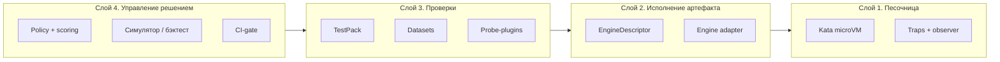
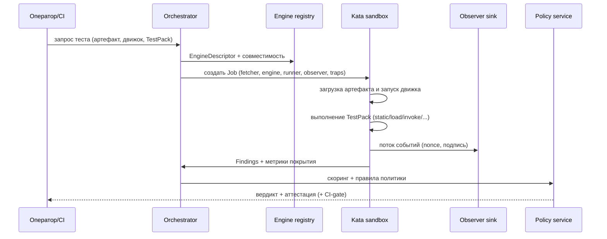

# 00. Обзор архитектуры v4

## 1. Задача

Дать возможность **безопасно запускать произвольный артефакт ML/AI** в **единой изолированной
песочнице** так, чтобы:

- любой код (артефакт **и** движок инференса) исполнялся только внутри микро-ВМ;
- для артефакта поднимался **подходящий движок** (загрузчик, инференс-сервер, рантайм) — по типу;
- над артефактом можно было проводить **разные расширяемые проверки**: от простой «загрузки» и
  статического анализа — до **произвольного взаимодействия с инференсом** и подачи **настраиваемых
  тестовых данных**;
- всё поведение во время проверок **наблюдалось** (в том числе через ловушки), а покрытие влияло на
  вердикт;
- **критерии итогового вердикта** управлялись отдельным инструментом (скоринг + правила), без правки
  кода платформы.

## 2. Принципы

| Принцип | Формулировка |
|---------|--------------|
| Контейнмент по умолчанию | Недоверенный код — всегда в Kata; хост-исполнение запрещено политикой admission |
| Движок = данные | Поведение движка описано записью `EngineDescriptor`, а не кодом платформы |
| Тест = данные | Набор проверок — декларативный `TestPack`; новые шаги — плагины |
| Наблюдение обязательно | `observer` + `traps` в каждом job'е; нет наблюдения ⇒ `Inconclusive` |
| Вердикт = политика | Скоринг и правила вердикта версионируются, подписываются, симулируются |
| Прозрачность | Любое «не смогли проверить» — явный `Inconclusive`, а не `Safe` |
| Воспроизводимость | bundle фиксирует все версии и конфигурацию наблюдения |

## 3. Уровни абстракции

- **L1** — изоляция и наблюдение (общие для всех).
- **L2** — «как поднять артефакт» (движок и адаптер).
- **L3** — «что и как проверяем» (пакеты тестов, данные, плагины).
- **L4** — «каким критерием решаем» (скоринг, правила, вердикт).

Слои разделены так, чтобы **добавление движка, теста или правила не требовало изменения остальных**.

## 4. Разбор по типам артефактов

| Тип артефакта | Движок | Минимальные проверки | Расширенные проверки |
|---------------|--------|----------------------|----------------------|
| pickle / torch / model-as-code | `sandbox-loader` | `static` + `load` (в песочнице!) + наблюдение | `probe` (интроспекция объекта), сценарии |
| safetensors / ONNX / HDF5 / GGUF | `sandbox-loader` или профильный рантайм | `static` (парсер в песочнице) + `load` | `probe`, `invoke` (для рантаймов) |
| архивы / датасеты | `sandbox-loader` | `static` (обход членов) + извлечение в песочнице | рекурсивные сценарии, `fuzz` |
| **LLM (GGUF/safetensors)** | `llama.cpp` / `vLLM` / `SGLang` | `load` + `invoke` (короткий набор) | `interactive` (multi-turn, tool-call), `adversarial`, `fuzz`, `invoke` с большими датасетами |
| прочие инференс-форматы (TFLite, OpenVINO, TRT) | соответствующий сервер | `load` + `invoke` | как выше |
| образ движка (сам движок) | — | подпись/SBOM/скан образа | поведенческий прогон движка-заглушки |

> Ключевое отличие v4 от v3: **статический анализ и «просто загрузка» тоже идут внутри песочницы** —
> чтобы дефекты парсеров/загрузчиков не били по доверенной зоне.

## 5. Сквозной поток (высокоуровнево)

## 6. Что переиспользуется из v3 (не ломаем)

- **bundle**, аттестация, `bundle_verdict_chain`, CI-gate — сохраняются; добавляются поля
  `testpack_version`, `policy_version`, `observation_profile`.
- **Engine registry по digest** — расширяется до `EngineDescriptor`.
- **S3/Ceph RGW, PostgreSQL, артефакт-сервер, presigned-доставка** — без изменений.
- **Ловушки deception + sinkhole + NetworkPolicy** — переносятся на все job'ы.
- **XLSX-наборы вопросов** — становятся одним из типов `Dataset` в TestPack.

## 7. Границы документа

v4 описывает **целевое** состояние. Часть элементов (GPU-в-Kata, BTF-ядро для eBPF) зависит от
платформенных возможностей стенда; в [`07-migration-roadmap.md`](07-migration-roadmap.md) описаны
фазы и режимы деградации, при которых инвариант «всё в Kata» сохраняется (например, CPU-инференс
вместо GPU, пока `kata-gpu` не готов).
