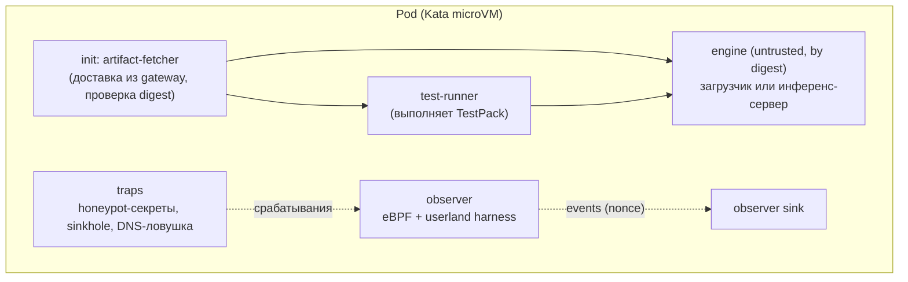
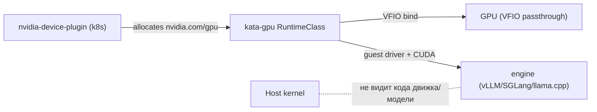
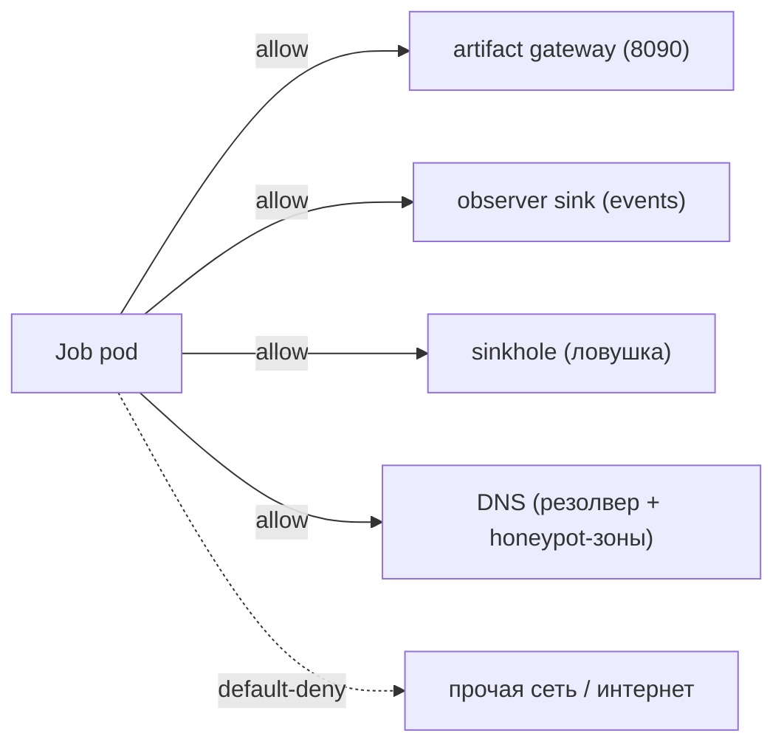
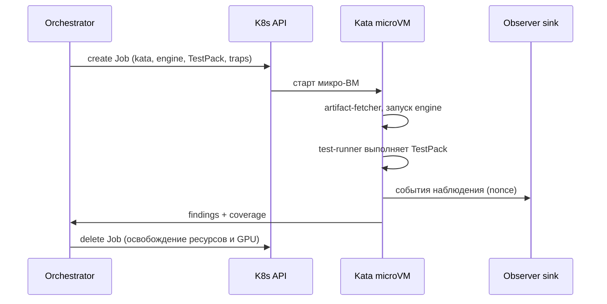

# 01. Унифицированная песочница: одна Kata-среда для всех артефактов и инференсов

## 1. Цель

Свести **все** сценарии исполнения недоверенного кода (статика парсеров, «просто загрузка»,
инференс LLM/ONNX/…, любые будущие рантаймы) к **одному шаблону песочницы** на базе Kata.
Отличия — только в **движке** ([`02-engine-framework.md`](02-engine-framework.md)) и **пакете тестов**
([`03-test-framework.md`](03-test-framework.md)).

## 2. RuntimeClass-политика (жёстко)

| RuntimeClass | Назначение | Недоверенный код |
|--------------|-----------|------------------|
| `kata` | песочница без GPU | да (Kata microVM) |
| `kata-btf` | песочница + BTF-ядро гостя для in-guest eBPF | да |
| `kata-gpu` | песочница + GPU (VFIO passthrough) + BTF | да |
| ~~`nvidia` (host)~~ | **запрещён** для job'ов проверки артефактов | — |

Admission (**Kyverno**) для namespace песочницы:

- `runtimeClassName ∈ {kata, kata-btf, kata-gpu}` — иначе reject;
- образы только `image@sha256:…` (+ подпись по политике окружения);
- безопасный `securityContext` (non-root, RO-FS, drop ALL, seccomp, без SA-токена)
  с **исключением** контейнера `observer` (см. §6);
- запрет hostPath (кроме контролируемых `/dev` для GPU в `kata-gpu`);
- обязательны тома/сайдкары `observer` и `traps`.

> Так исполнение артефакта/движка **физически** не может попасть на хостовое ядро: единственный
> валидный путь — Kata-микро-ВМ.

## 3. Состав пода (единый шаблон)



| Контейнер | Тип | Роль | Особенности |
|-----------|-----|------|-------------|
| `artifact-fetcher` | init | забирает артефакт из **artifact gateway** (S3 presigned / in-cluster), проверяет sha256, раскладывает в `emptyDir` | никогда не исполняет артефакт |
| `engine` | main | «поднимает» артефакт: загрузчик (для простых) или инференс-сервер (для LLM/рантаймов) | **недоверенный**, по digest, ограничен по ресурсам |
| `test-runner` | main/sidecar | исполняет `TestPack`: статика/загрузка/инференс/фаззинг/ассерты; стримит результаты | источник «настраиваемых тестовых данных» |
| `observer` | sidecar | обязательный сенсор: eBPF/Tetragon + userland harness; публикует события | root-в-госте для eBPF (см. §6), но внутри микро-ВМ |
| `traps` | тома/сервисы | honeypot-секреты, sinkhole, DNS-ловушка, canary-endpoints | общие для **всех** типов job'ов |

Раннер и движок могут быть **одним процессом** для простых артефактов (движок = `sandbox-loader`);
для инференса — раннер обращается к движку по локальному API (см. §5).

## 4. GPU-в-Kata (ключевая доработка v3→v4)

В v3 GPU-инференс шёл на **хостовом** `runtimeClassName: nvidia`. В v4 GPU должен быть **внутри
микро-ВМ**.



Требования и устройство:

1. **Kata + VFIO passthrough.** GPU-устройство передаётся в микро-ВМ (VFIO); внутри гостя — драйвер
   NVIDIA и CUDA-рантайм (в образе гостевого rootfs). Хост-ядро не исполняет код движка/модели.
2. **RuntimeClass `kata-gpu`.** Собирается из Kata с включённой поддержкой GPU; задаёт ресурс
   `nvidia.com/gpu`, hostPath `/dev` только для контролируемых устройств.
3. **Device plugin.** Штатный `nvidia/k8s-device-plugin` выделяет GPU; для микро-ВМ —
   через VFIO-привязку (узел должен позволять passthrough).
4. **Один GPU — один job (по умолчанию).** Микро-ВМ владеет устройством на время теста; параллелизм
   ограничен числом GPU. Для многомодельных сценариев — очередь и «GPU-пул».
5. **Warm pool.** Запуск микро-ВМ с GPU дорог; поддерживается пул «прогретых» микро-ВМ (pre-boot
   Kata + драйвер), куда подаётся job — снижает задержку, не нарушая изоляции между job'ами.
6. **Кэш модели.** Модель кладётся в `emptyDir` job'а (per-job, уничтожается); для больших моделей —
   локальный per-node кэш по digest **только для чтения**, монтируемый как read-only и не содержащий
   исполняемых файлов движка.
7. **Наблюдение GPU.** CPU-сторона (порты, сеть, файлы, процессы раннера/движка) — полноценно;
   GPU-сторона — ограниченно: используется **гостевая телеметрия** и перехват CUDA host-API (если
   поддерживается драйвером). Ограничение фиксируется в покрытии и влияет на вердикт
   ([`04-observation.md`](04-observation.md) §5).

**Режимы работы (инвариант «всё в Kata» сохраняется всегда):**

| Режим | Когда | Что происходит |
|-------|-------|----------------|
| `gpu-in-kata` | доступен `kata-gpu` | GPU-инференс внутри микро-ВМ (целевой) |
| `cpu-in-kata` | GPU ещё не в Kata | тот же артефакт, но движок CPU (llama.cpp/vLLM CPU) — **частичное** покрытие, вердикт учитывает ограничение |
| `refuse` | движку обязателен GPU, а `kata-gpu` недоступен | job **отклоняется** с явной ошибкой (никакого отката на хост) |

## 5. Локальный контракт «runner ↔ engine»

Раннер и движок общаются по **локальному** каналу (внутри пода) через **engine adapter**
([`02-engine-framework.md`](02-engine-framework.md)). Базовый профиль — HTTP на `127.0.0.1`:

| Метод | Назначение |
|-------|-----------|
| `GET /manifest` | возможности адаптера (протоколы, лимиты, стриминг) |
| `GET /health` | готовность движка |
| `POST /invoke` | одиночный вызов инференса (типизированный запрос/ответ) |
| `POST /stream` | стриминговый вызов |
| `POST /control` | управление сессией (reset, multi-turn, tool-режим) |

Это даёт **произвольное взаимодействие с инференсом** (LLM-чат, tool-calls, батчи, стриминг) без
выхода за границы пода.

## 6. Наблюдение и безопасность внутри пода

- `observer` запускается как **root-в-госте** (иначе eBPF недоступен из-за CapEff=0), но это root
  **внутри микро-ВМ** — изоляция от хоста сохраняется; capabilities ограничены (`BPF`, `PERFMON`).
- `harness` (userland) подключается к раннеру/движку для фиксации языковых событий.
- Все маркеры событий содержат **nonce** job'а; sink принимает только подписанные/нонсованные события.
- Ловушки (`traps`) монтируются в **любой** job: honeypot-секреты (`~/.aws`, `~/.ssh`, `~/.kube`,
  `.env`, `.netrc`), canary-URL, sinkhole-сервис, DNS-ловушка.

## 7. Сеть



`default-deny` egress; разрешены только: gateway, observer sink, sinkhole, DNS. Любая попытка наружу
попадает в **sinkhole** (сигнал) и не имеет маршрута в интернет (`natOutgoing:false`).

## 8. Ресурсы, жизненный цикл, квоты

- **Лимиты**: CPU/RAM/ephemeral-storage, pids, TTL; отдельные профили для движков GPU/CPU.
- **Жизненный цикл**: `create → fetch → start engine → run TestPack → collect → teardown`; при
  завершении вердикта Job **удаляется** (освобождение GPU), с TTL как страховкой.
- **Квоты**: `ResourceQuota`/`LimitRange` namespace песочницы; per-tenant fair-share.
- **Warm pool**: пул прогретых микро-ВМ для быстрых тестов; между job'ами среды не разделяются.

## 9. Единый шаблон job'а (эскиз)

```yaml
apiVersion: batch/v1
kind: Job
metadata: { name: mlscan-test-<bundle>, namespace: t-mlscan-sandbox }
spec:
  template:
    spec:
      runtimeClassName: kata-gpu          # kata | kata-btf | kata-gpu (host nvidia запрещён)
      automountServiceAccountToken: false
      initContainers:
        - name: artifact-fetcher          # доставка + digest-проверка
      containers:
        - name: engine                    # EngineDescriptor: image@sha256, порт, профиль ресурсов
        - name: test-runner               # исполняет TestPack (шаги static/load/invoke/...)
        - name: observer                  # eBPF + harness (root-в-госте), nonce, подпись
      volumes:                            # model(emptyDir), traps(deception...), datasets(ro)
```

Точные схемы — в [`06-contracts.md`](06-contracts.md).

## 10. Диаграмма жизненного цикла



## 11. Соответствие требованиям

| Требование | Раздел |
|-----------|--------|
| Все инференсы в Kata | §2, §4 |
| Единая песочница | §3 |
| Ловушки и мониторинг всегда | §6, §7 |
| Возможность тестировать запущенный артефакт | §5 (runner↔engine) |
| Простые артефакты — загрузка/статика в безопасной среде | §3, Движок `sandbox-loader` |
| Сложные — произвольный доступ к инференсу + свои данные | §5 + [`03-test-framework.md`](03-test-framework.md) |
