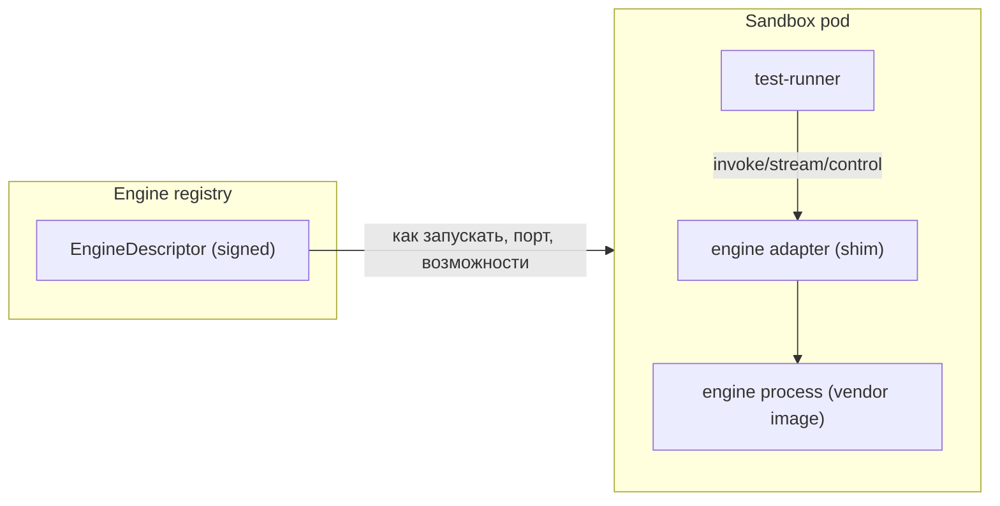
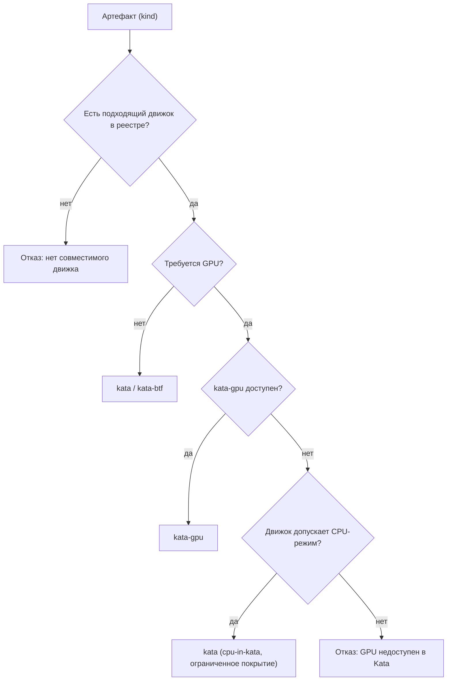

# 02. Движки инференса как данные: EngineDescriptor и адаптеры

## 1. Цель

Дать возможность поднимать **разные движки под конкретный тип артефакта** так, чтобы платформа не
знала деталей каждого движка. Движок описывается **подписанной записью** `EngineDescriptor`;
единообразное взаимодействие обеспечивает тонкий **engine adapter**.

## 2. Модель



- **EngineDescriptor** — данные: что за движок, где образ (digest), как запускать, как проверять
  готовность, какие протоколы поддерживает, какие артефакты им проверяются.
- **Engine adapter** — код внутри образа движка (или отдельный сайдкар-шим), приводящий «родной» API
  движка к единому контракту `manifest/health/invoke/stream/control`.

## 3. EngineDescriptor (схема, эскиз)

```yaml
id: vllm-0.9.2
oci: harbor.platform.rtx.local/mlscan/engine-vllm:v0.9.2@sha256:...
kind: llm                      # llm | runtime | loader | analyzer
artifact_kinds: [llm-gguf, llm-safetensors, onnx, tflite]
capabilities:
  gpu: true
  streaming: true
  batch: true
  tools: true
  modalities: [text]
  protocols: [openai-http, raw-http]
runtime:
  start: "python -m vllm.entrypoints.openai.api_server --model {{model}} --port 8000"
  readiness: { type: http, path: /v1/models, port: 8000, timeout_s: 600 }
  ports: [8000]
  resources: { cpu: "4", ram_gb: 24, gpu: 1, disk_gb: 40 }
integrity: { signed: true, sbom: true }   # подпись образа/описание
```

Поля важны для **планирования** (ресурсы, GPU), **наблюдения** (порты) и **тестов** (возможности:
стриминг/батч/tools нужны, чтобы TestPack мог использовать соответствующие шаги).

## 4. Engine adapter (единый контракт)

Адаптер — узкий, подписанный шим; вся «непонятность» движка остаётся в нём.

| Эндпоинт | Назначение |
|----------|-----------|
| `GET /manifest` | возвращает возможности адаптера (протоколы, лимиты, схемы входа/выхода) |
| `GET /health` | готовность движка (маппинг на readiness движка) |
| `POST /invoke` | одиночный типизированный вызов (`{inputs, params}` → `{outputs, usage, meta}`) |
| `POST /stream` | стриминговый вызов (`text/event-stream`) |
| `POST /control` | сессии/состояние: `reset`, `system`, `tools`, `multi-turn` |

Требования к адаптеру: детерминированный маппинг ошибок (например, «модель не найдена», «OOM»,
«timeout») в типизированные коды; запрет произвольного сетевого доступа; публикация только на
`127.0.0.1`; поддержка версии контракта.

## 5. Классы движков

| `kind` | Движок | Что «поднимает» | Режим взаимодействия |
|--------|--------|-----------------|----------------------|
| `loader` | `sandbox-loader` | десериализация/загрузка артефакта с инструментацией (без сервера) | синхронный вызов: `load`, `introspect` |
| `runtime` | ONNX Runtime, OpenVINO, TRT, TFLite | рантайм-инференс | `invoke` (тензоры/вход) |
| `llm` | llama.cpp, vLLM, SGLang | LLM-сервер | `invoke`/`stream`/`control` (чат, tools, батч) |
| `analyzer` | профильный формат-парсер | статический разбор формата в песочнице | `invoke` (файл → findings/индекс) |

Движок `loader`/`analyzer` — то, чем в v3 была «статика в сервисе»; в v4 она **исполняется в
песочнице** (дефекты парсеров контейнментятся).

## 6. Реестр движков и политика

- Реестр хранит `EngineDescriptor` (подписанные записи) и статус (`signed`, `sbom`).
- Политика окружения: `IMAGES_REQUIRE_SIGNED` (при включении — только подписанные образы),
  allowlist реестра, **совместимость** `artifact_kind × engine.capabilities`.
- Импорт движка = регистрация `EngineDescriptor` + (опц.) server-side copy OCI-архива.
- Kyverno/admission проверяет digest и подпись; платформа планирует ресурсы по `runtime.resources`.

## 7. Как добавить новый движок (без правки платформы)

1. Собрать образ движка с **engine adapter** (реализует контракт §4).
2. Опубликовать в Harbor; получить digest + подпись/SBOM.
3. Зарегистрировать `EngineDescriptor` в реестре.
4. Добавить/расширить `TestPack` (или использовать существующий), отметив `applies_to.engines`.
5. Создать `bundle` (артефакт + движок + TestPack) и запустить.

Никаких изменений в оркестраторе, песочнице или политике вердикта это не требует.

## 8. Диаграмма выбора движка



## 9. Совместимость с v3

- Текущие образы `engine-vllm`, `engine-sglang`, `engine-sglang-sm75`, `llama.cpp` регистрируются как
  `EngineDescriptor` (`kind: llm`).
- «Песочный движок» v3 (`sandbox-loader`/harness) становится `kind: loader` (и `analyzer` для
  форматных парсеров).
- Контракт адаптера первое время может быть «тонкой обёрткой» над OpenAI-совместимым API vLLM/SGLang
  и над stdio-harness для загрузчика.
