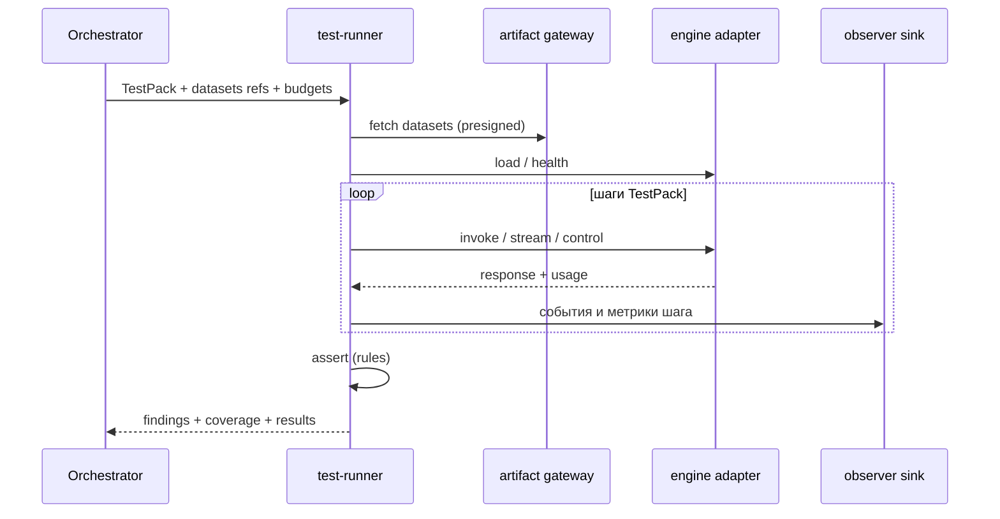

# 03. Расширяемые проверки: TestPack, шаги, плагины, данные

## 1. Цель

Сделать проверки **декларативными и расширяемыми**: от «просто загрузить/разобрать артефакт» до
**произвольного взаимодействия с инференсом** и подачи **настраиваемых тестовых данных**. Новый тест
не должен требовать изменения платформы.

## 2. TestPack — версионированный пакет проверок

```yaml
id: llm-safety-v2
version: 3
applies_to:
  artifact_kinds: [llm-gguf, llm-safetensors]
  engines: ["kind:llm"]
observation:                # требования к наблюдению (влияют на вердикт)
  require: [process, network, file]
budgets: { wall_s: 1800, tokens: 200000, bytes: 0 }
datasets:
  - { id: redteam-ru, ref: ds://prompts/redteam-ru@4 }
  - { id: benign-ru,  ref: ds://prompts/benign-ru@2 }
steps:
  - { type: load,    engine: auto }
  - { type: invoke,  dataset: benign-ru,  params: { max_tokens: 64 } }
  - { type: invoke,  dataset: redteam-ru, params: { max_tokens: 64 } }
  - { type: interactive, script: ds://scripts/tool-call-basic@1 }
  - { type: assert,  over: [responses, findings, events], rules: ds://rules/llm-safety@5 }
```

TestPack — **данные**: хранится, версионируется, подписывается; фиксируется в `bundle`.

## 3. Типы шагов (расширяются плагинами)

| Шаг | Назначение | Для кого |
|-----|-----------|----------|
| `static` | структурный разбор/детекторы формата (в песочнице) | все |
| `load` | загрузка/десериализация с инструментацией (harness) | pickle/torch/скрипты/датасеты |
| `probe` | вызов плагина-зонда (токенизатор, эмбеддинги, introspection) | все |
| `invoke` | одиночный вызов инференса на датасете | LLM/рантаймы |
| `stream` | стриминговый вызов | LLM |
| `interactive` | многошаговый сценарий (multi-turn, tool-call, MCP) | LLM/агенты |
| `fuzz` | property-based/coverage-guided генерация входов | рантаймы/парсеры |
| `adversarial` | корпуса prompt-injection/jailbreak/poisoning | LLM |
| `assert` | проверки над ответами/находками/событиями/бюджетами | все |
| `snapshot` | снятие срезов (файлы, память, выходы) для доказательств | все |

**Плагины** — отдельный вид расширения: шаг `probe`/`assert` может ссылаться на **плагин** (в образе
или в пакете), реализующий интерфейс `run(ctx) -> result`. Плагин исполняется **в песочнице** и
подписывается.

## 4. Датасеты

- **Управляемые, версионированные**: наборы промптов (`ds://prompts/...`), fuzz-сиды, входы рантайма,
  эталонные ответы.
- Импорт: XLSX/CSV/JSON/HF; наследование из v3 (набор вопросов = `Dataset` типа `prompts`).
- Адресация `ds://<kind>/<name>@<version>`; раннер подтягивает датасет через **artifact gateway**
  (presigned), как модель.
- Для больших потоков — стриминг датасета в раннер (без загрузки целиком).

## 5. Произвольное взаимодействие с инференсом

- Раннер общается с движком через **engine adapter** ([`02-engine-framework.md`](02-engine-framework.md)):
  `invoke`/`stream`/`control` — этого достаточно для чата, батчей, tools, multi-turn.
- Для НИОКР — шаг типа `raw`: оператор задаёт **небольшой скрипт** (HTTP/gRPC/stdio) в рамках
  схемы адаптера; скрипт исполняется **внутри песочницы**, ограничен бюджетом и наблюдением.
- Все внешние вызовы (сеть) для инференса — только **внутри пода** (`127.0.0.1`); наружу — запрещено.

## 6. Простые vs сложные артефакты

| Сценарий | TestPack | Шаги |
|----------|----------|------|
| «Инертный» формат (safetensors/ONNX/HDF5) | `format-basic` | `static` + `load` (в песочнице) + `assert` |
| pickle/скрипт/model-as-code | `code-exec-basic` | `static` + `load` (реально исполняется) + `probe` + `assert` |
| архив/датасет | `container-basic` | `static` (обход членов) + `load` + `assert` |
| LLM (базовый) | `llm-basic` | `load` + `invoke` (малый набор) + `assert` |
| LLM (расширенный) | `llm-safety-v2` | `load` + `invoke`(benign+redteam) + `interactive` + `adversarial` + `assert` |

TestPack выбирается по `applies_to`; оператор может запускать дополнительные/свои пакеты.

## 7. Исполнение (последовательность)



## 8. Запись и реплей

- Раннер **записывает** входы/выходы каждого шага (с хешами) → это доказательство и «кассета».
- **Replay** позволяет: воспроизвести вердикт, прогнать новый `assert`/Policy на сохранённых данных
  (без повторного инференса), сравнить движки/версии.
- Replay используется инструментом управления вердиктом ([`05-verdict-scoring.md`](05-verdict-scoring.md)).

## 9. Бюджеты и честность

- Жёсткие бюджеты (время/токены/байты/шаги); при исчерпании — шаг помечается незавершённым.
- Покрытие по шагам и по доменам наблюдения; неполнота ⇒ вердикт `Inconclusive`, а не `Safe`.
- Все шаги детерминированно перечислимы и логируются (что именно запускали).

## 10. Требования к расширяемости

- **Новый шаг** — новый плагин (интерфейс `run(ctx)`) + регистрация; ядро не меняется.
- **Новый датасет** — регистрация `Dataset` (версия+хеш) без правки раннера.
- **Новое правило** — в `Policy` (DSL), а не в коде ([`05-verdict-scoring.md`](05-verdict-scoring.md)).
