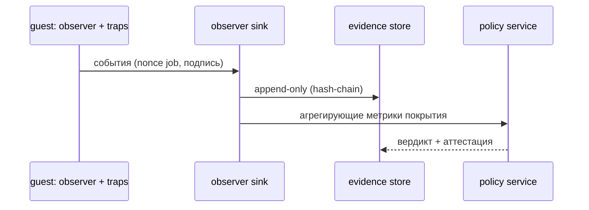

# 04. Обязательное наблюдение и ловушки (v4)

## 1. Цель

Наблюдать поведение артефакта **во время выполнения проверок** — включая инференс — и делать
результат наблюдения **первоклассным** (влияет на покрытие и вердикт). Закрыть открытые зоны v3:
выключенный eBPF-сенсор, отсутствие honeypot'ов на инференс-пути, исполнение LLM вне микро-ВМ
(в v4 — модель и движок **внутри** Kata, см. [`01-unified-sandbox.md`](01-unified-sandbox.md)).

## 2. Состав наблюдателя (внутри микро-ВМ)

| Механизм | Что фиксирует | Данные |
|----------|---------------|--------|
| **eBPF/Tetragon** (`kata-btf`) | процессы (`execve`), сеть (`connect`), файлы (`open`), память (`mmap`/`PROT_EXEC`), модули ядра, DNS | поток событий с атрибуцией (comm, pid, путь, адрес) |
| **userland harness** | языковые события: `os.system`, `subprocess`, `socket`, `ctypes`, `exec/compile`, `pickle`, чтение файлов | события + маркеры `RESULT`/`SUMMARY` с nonce |
| **traps** | чтение honeypot-секретов, обращения к canary-URL, подключения к sinkhole, «стук» в DNS-ловушку | срабатывания (finding) |
| **сетевой контроль** | попытки egress (всё, кроме gateway/observer/sinkhole/DNS) | блокировки NetworkPolicy + лог sinkhole |
| **GPU-телеметрия** | CUDA host-API (если поддерживается), счётчики/ошибки драйвера в госте | события/предупреждения (ограниченно) |

## 3. Маппинг событий → находки

Единая схема `Finding` (детектор, категория, severity, confidence, доказательство, источник),
источники: `static`, `load`, `invoke`, `observation`. Примеры поведенческих правил (перенос v3 + новое):

| ID | Тип | Условие | Severity |
|----|-----|---------|----------|
| `BEH-01` | process | запуск shell/интерпретатора из артефакта/движка | high |
| `BEH-02` | network | попытка внешнего egress | high |
| `BEH-03` | file | чтение honeypot-секрета | high |
| `BEH-04` | memory | исполняемый `mmap`/in-memory exec | high |
| `BEH-05` | module | загрузка модуля ядра | critical |
| `BEH-06` | filesystem | запись вне разрешённых путей | medium |
| `BEH-07` | dns | обращение к ловушечной зоне | high |
| `BEH-08` | lateral | попытка подключения к внутренним сервисам (кроме разрешённых) | high |

## 4. Поток событий и свидетельства



Требования: события помечены **nonce** job'а; sink принимает только свои маркеры (антиспуф);
хранилище — append-only (hash-chain); покрытие считается детерминированно.

## 5. Покрытие и честность

- **Покрытие по доменам**: process / network / file / memory / module / dns — сколько доменов реально
  наблюдалось.
- **Покрытие по шагам TestPack**: какие шаги выполнены полностью/частично.
- **GPU-ограничение**: GPU-сторона наблюдается ограниченно; это явно фиксируется и **понижает
  максимально достижимый вердикт** (без наблюдения ⇒ не `Safe`).
- Если `observer` не стартовал или события не поступали — job помечается `observation: missing`,
  вердикт — `Inconclusive`, CI-gate — `quarantine`.

## 6. Ловушки (едины для всех job'ов)

- **Honeypot-секреты**: `~/.aws`, `~/.ssh`, `~/.kube`, `.env`, `.netrc`, canary-токены.
- **Canary-URL** и **sinkhole-сервис**: обращения сигнализируют о попытке эксфильтрации.
- **DNS-ловушка**: отдельная зона резолвится в sinkhole; обращения — high-signal.
- **Фальшивые «внутренние» сервисы** (БД, metadata-api): ловят SSRF/латеральное движение.

Для инференс-пути ловушки монтируются так же, как для сканов (что закрывает пробел v3).

## 7. Наблюдение самого движка

Движок — тоже недоверенный: наблюдаются его процессы, порты, файлы, сеть, загрузка модулей. Отдельно
фиксируется **предсказуемая** телеметрия работоспособности (успешный старт, ошибки загрузки модели,
OOM, сбои kernel'ов движка) — это влияет на **покрытие**, но не даёт «поблажки» вердикту.

## 8. Данные наблюдателя (форма)

```json
{
  "ts": 1720000000.123, "job": "bundle-<id>", "nonce": "…",
  "domain": "process", "event": "execve", "comm": "python3",
  "args": ["/bin/sh","-c","…"], "pid": 42, "ppid": 1, "src": "ebpf"
}
```

Нормализация к общему `Event`-контракту ([`06-contracts.md`](06-contracts.md)) обязательна, чтобы
правила Policy были едиными для всех источников.

## 9. Соответствие «наблюдаемость ⇒ вердикт»

- Нет наблюдения → `Inconclusive` + `quarantine`.
- Наблюдение ограничено (GPU) → максимальный вердикт ограничен, ограничение видно в отчёте.
- Полное наблюдение + чисто → `Safe`.
- Любое high/critical поведенческое finding → как минимум `Needs review`, обычно `block`.
