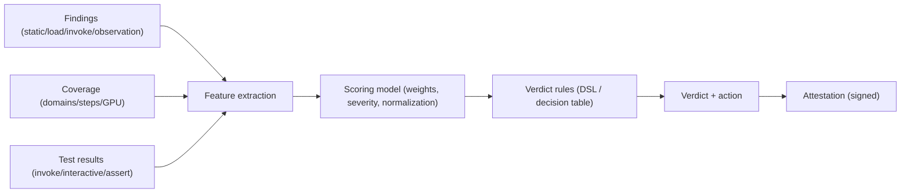
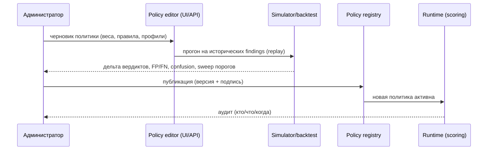

# 05. Скоринг и управление критериями вердикта

## 1. Цель

Отделить **решение** (вердикт) от **механики проверок**: вердикт вычисляется **политикой** —
версионируемым набором скоринга и правил — которой **управляет отдельный инструмент** (редактор +
симулятор + публикация), без правки кода платформы.

## 2. Модель данных



**Finding** (единая схема): `id, detector, category, severity, confidence, evidence, source, step, engine`.

**Features** (примеры): число и вес находок по категориям; максимальная severity; агрегированный
risk-score; для LLM — `pass_rate`, `safety_fail`, `refusal`, `leakage`, `tool_misuse`; покрытие
(domains/steps/GPU).

## 3. Скоринг

- **Веса по категориям** и **множители severity**; нормализация к шкале 0..100.
- **Coverage-gating**: если покрытие ниже порога — `Safe` запрещён (максимум `Inconclusive`).
- **Профили**: разные веса/пороги для разных `artifact_kind`/`engine` (напр., LLM vs pickle).
- Скоринг **детерминирован** и воспроизводим по сохранённым findings (можно пересчитать).

## 4. Правила вердикта (DSL / таблица решений)

Пример DSL (декларативно, версионируется):

```text
verdict llm-safety:
  if any(critical)                     -> block
  if coverage < required               -> inconclusive
  if safety_fail_rate > 0.05 or score >= 75 -> block
  if score >= 50 or any(high)          -> review
  else                                  -> safe
```

Правила — над **множеством findings + scoring + coverage + test results**; выражают и пороги, и
жёсткие «полы» (critical ⇒ блок), и обязательные условия (наблюдение/покрытие).

## 5. Управление критериями (инструмент)



Возможности инструмента:

- **Редактор** политики: веса, severity, пороги, правила, профили по типам/движкам.
- **Симулятор/бэктест**: прогон черновика на **replay**-логах TestPack и на **синтетическом корпусе**
  → predicted verdicts, сравнение с эталоном, **FP/FN**, **sweep порогов**, чувствительность.
- **Guardrails**: нельзя «разрешить» `Safe` при низком покрытии; нельзя опустить критический порог
  ниже заданного минимума; блокировка опасных конфигураций.
- **Версионирование и подпись**: каждая версия неизменяема; `bundle` и вердикт фиксируют
  `policy_version`; аттестация HMAC/подпись.
- **A/B и канареечный выкат**: доля трафика на новую политику; откат.
- **Аудит**: журнал изменений (кто, когда, diff, обоснование).

## 6. Результат и действия

| Вердикт | Значение | Действие по умолчанию |
|---------|----------|------------------------|
| `Safe` | полное покрытие, находок нет | `allow` |
| `Needs review` | есть средние/высокие находки или частичное покрытие | `review` |
| `Malicious` | есть critical/блокирующие | `block` |
| `Inconclusive` | не смогли проверить (наблюдение/шаги) | `quarantine` |

Действия и пороги задаются политикой; CI-gate использует **ту же** политику для
`allow/block/quarantine`.

## 7. Интеграция с bundle и CI-gate

- Вердикт привязан к `bundle` (артефакт + движок + TestPack + **policy**) и подписан.
- `GET /gate?image&model` (и интеграции) возвращает решение **fail-closed**: нет вердикта —
  `quarantine`.
- Хранится **цепочка** вердиктов (append-only) и **replay**-данные для пересчёта при смене политики.

## 8. Что это даёт

- **Управляемость**: критерии вердикта меняются через инструмент, а не через релиз кода.
- **Обоснованность**: любые изменения проверяются на исторических данных и корпусе.
- **Прозрачность**: вердикт всегда сопровождается версией политики, покрытием и доказательствами.
- **Безопасность**: guardrails не позволяют «ослабить» вердикт в ущерб покрытию/критичным находкам.
