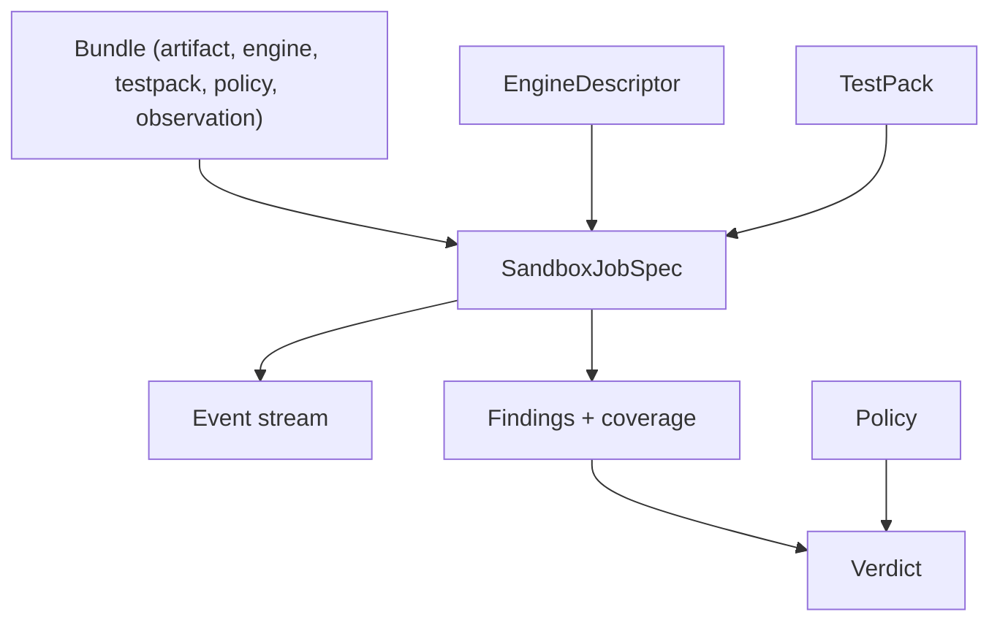

# 06. Контракты и схемы (v4)

Ниже — **контракты данных**, по которым реализуются песочница, движки, тесты и политика. Форматы —
эскизные (имена полей стабильны, детали уточняются при реализации). Все записи версионируются и
подписываются.

## 1. Карта контрактов



## 2. Bundle

```yaml
bundle_id: b-<hash>
artifact:   { sha256: "...", kind: "llm-safetensors", size: 4079423234 }
engine:     { descriptor_id: "vllm-0.9.2", oci: "harbor/.../engine-vllm@sha256:..." }
testpack:   { id: "llm-safety-v2", version: 3 }
policy:     { id: "default", version: 7 }
observation:{ profile: "kata-btf", require: [process, network, file] }
runtime_class: kata-gpu          # kata | kata-btf | kata-gpu
```

## 3. SandboxJobSpec (единый шаблон)

```yaml
runtimeClassName: kata-gpu
initContainers:
  - name: artifact-fetcher
    inputs: [ { ref: "s3://<bucket>/<key>", sha256: "...", dest: "/model" } ]
containers:
  - name: engine        # из EngineDescriptor.runtime
  - name: test-runner   # TestPack + datasets + budgets
  - name: observer      # eBPF + harness; root-в-госте; capabilities: [BPF, PERFMON]
volumes:
  - { name: model,  emptyDir: {} }
  - { name: traps,  configMap: mlscan-deception }      # honeypot
  - { name: datasets, emptyDir: {} }
network: default-deny + allow(gateway, observer-sink, sinkhole, dns)
```

## 4. EngineDescriptor

```yaml
id: onnxruntime-1.20
oci: harbor/.../engine-onnxruntime@sha256:...
kind: runtime            # llm | runtime | loader | analyzer
artifact_kinds: [onnx]
capabilities: { gpu: false, protocols: [raw-http], batch: true }
runtime:
  start: "python -m mlscan_onnx_adapter --model {{model}} --port 8000"
  readiness: { type: http, path: /health, port: 8000, timeout_s: 120 }
  resources: { cpu: "2", ram_gb: 4, disk_gb: 8 }
```

## 5. TestPack (см. также [`03-test-framework.md`](03-test-framework.md))

```yaml
id: llm-basic
version: 1
applies_to: { artifact_kinds: [llm-gguf, llm-safetensors], engines: ["kind:llm"] }
observation: { require: [process, network] }
budgets: { wall_s: 600, tokens: 20000 }
datasets: [ { id: benign, ref: "ds://prompts/benign@1" } ]
steps:
  - { type: load }
  - { type: invoke, dataset: benign, params: { max_tokens: 32 } }
  - { type: assert, over: [responses], rules: "ds://rules/basic@1" }
```

## 6. Event (наблюдение)

```json
{ "ts": 0.0, "job": "bundle-<id>", "nonce": "…", "src": "ebpf|harness|traps",
  "domain": "process|network|file|memory|module|dns|gpu",
  "event": "execve|connect|open|mmap|module_load|dns_query|cuda_api",
  "pid": 42, "comm": "python3", "details": { }, "sig": "…" }
```

## 7. Finding

```json
{ "id": "BEH-01", "detector": "tetragon-mapper", "category": "process",
  "severity": "high", "confidence": 0.8, "source": "observation",
  "step": "invoke", "engine": "vllm-0.9.2",
  "evidence": { "comm": "sh", "args": ["-c", "..."] } }
```

## 8. Policy

```yaml
id: default
version: 7
profiles:
  llm:
    features: { weights: { network: 30, file: 25, process: 20, safety_fail: 40 } }
    coverage_min: { domains: [process, network] }
    rules:
      - { if: "any(critical)",            then: block }
      - { if: "coverage < required",      then: inconclusive }
      - { if: "score >= 75",              then: block }
      - { if: "score >= 50 or any(high)", then: review }
      - { else: safe }
  generic:
    features: { weights: { exec: 40, network: 20, fs: 10 } }
    coverage_min: { domains: [process, file] }
    rules:
      - { if: "any(critical)", then: block }
      - { if: "coverage < required", then: inconclusive }
      - { if: "score >= 60", then: review }
      - { else: safe }
attest: hmac-sha256            # подпись версии политики
```

## 9. Verdict

```json
{ "bundle_id": "b-<hash>", "verdict": "Needs review", "action": "review",
  "score": 58.3, "policy": { "id": "default", "version": 7 },
  "coverage": { "domains": ["process","network","file"], "steps": "8/8", "gpu": "limited" },
  "findings_count": 12, "attestation": "sha256:…" }
```

## 10. API-поверхности (эскиз)

| API | Назначение |
|-----|-----------|
| `POST /bundles` | создать bundle (артефакт + движок + TestPack) |
| `POST /bundles/{id}/test` | запустить Job (профиль движка/TestPack) |
| `GET  /bundles/{id}/verdict` | вердикт + аттестация |
| `POST /engines` | регистрация `EngineDescriptor` |
| `POST /testpacks` | регистрация/версия `TestPack` |
| `POST /datasets` | регистрация/версия датасета |
| `POST /policies` | черновик политики |
| `POST /policies/{id}/simulate` | симуляция/бэктест на replay/корпусе |
| `POST /policies/{id}/publish` | публикация версии (подпись) |
| `GET  /gate?image&model` | CI-gate решение (та же политика) |
| `GET  /events/{job}` | поток событий наблюдения |

## 11. Совместимость с v3

- Существующие эндпоинты (`/v3/artifacts/*`, `/bundles/*`, `/hf/*`, `/images/*`, `/prompt-sets/*`,
  `/llm/score`, `/llm/events`) сохраняются и отображаются на v4-контракты.
- Поля bundle дополняются `testpack`, `policy`, `observation`; старые наборы вопросов мигрируют в
  `Dataset`.
