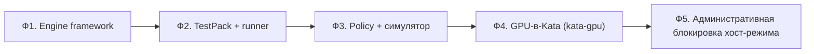

# 07. Переход v3 → v4: фазы, приёмка, риски

Переход **инкрементальный**: система остаётся работоспособной на каждом шаге, инварианты v4
(«всё в Kata», «наблюдение обязательно», «вердикт = политика») вводятся по мере готовности
платформенных возможностей. Где GPU-в-Kata ещё нет — используется явный режим деградации (или
отказ), **без** отката на хостовое исполнение.

## 1. Фазы

| Фаза | Что делаем | Результат |
|------|-----------|-----------|
| **Ф1. Engine framework** | ввести `EngineDescriptor` + engine adapter; зарегистрировать существующие движки (vLLM/SGLang/llama.cpp, sandbox-loader) | движки — данные; выбор движка под тип артефакта |
| **Ф2. TestPack + runner** | вынести проверки в `TestPack`; перенести наборы вопросов в `Dataset`; реализовать шаги `static/load/invoke/stream/interactive/assert`; `raw` для НИОКР | тесты — данные; расширяемость плагинами |
| **Ф3. Policy + симулятор** | политика (скоринг+правила), профили, версионирование/подпись; редактор + симулятор (replay + корпус); CI-gate на той же политике | управляемые критерии вердикта |
| **Ф4. GPU-в-Kata** | настроить `kata-gpu` (VFIO + гостевой драйвер), warm pool, кэш модели; перевести GPU-инференс в микро-ВМ | закрытие главного пробела изоляции |
| **Ф5. Блокировка хост-режима** | admission запрещает `nvidia` (host) для job'ов проверки; `kata-btf` observer обязателен; `SANDBOX_EBPF`/`LLM_TEST_EBPF` включены | инварианты v4 обеспечены |

## 2. Критерии приёмки (по фазам)

- **Ф1**: запуск теста bundle с движком, выбранным по `EngineDescriptor`; новый движок добавляется
  регистрацией (без правки платформы).
- **Ф2**: один и тот же артефакт проверяется разными `TestPack`; новый шаг/плагин подключается без
  изменения раннера; набор вопросов мигрирован в `Dataset`.
- **Ф3**: изменение политики прогоняется симулятором на исторических данных (replay) и корпусе;
  публикация версии; вердикт и CI-gate используют новую версию; в вердикте видна `policy_version`.
- **Ф4**: GPU-инференс (vLLM) исполняется в `kata-gpu`; хост-ядро не исполняет код движка/модели;
  e2e «HF → vLLM → набор вопросов → вердикт» проходит в микро-ВМ.
- **Ф5**: попытка job'а с `runtimeClassName: nvidia` отклоняется admission; `observation: missing`
  ⇒ `Inconclusive`/`quarantine`.

## 3. Деградация (пока платформа не готова)

| Ситуация | Поведение |
|----------|-----------|
| `kata-gpu` не готов, движок допускает CPU | `cpu-in-kata` (ограниченное покрытие, фиксируется) |
| `kata-gpu` не готов, движку нужен GPU | **отказ** с понятной ошибкой (без хост-исполнения) |
| BTF-ядро (`kata-btf`) недоступно | observer частичный (только harness); покрытие ниже ⇒ вердикт ограничен |

## 4. Риски и меры

| Риск | Влияние | Мера |
|------|---------|------|
| Зрелость Kata GPU (VFIO/драйвер в госте) | задержка Ф4 | warm pool; CPU-режим; изоляция достигается и без GPU |
| Драйвер NVIDIA в госте — новая поверхность | эксплуатируемость драйвера | микро-ВМ контейнментит; обновления драйвера контролируются; наблюдение CPU-стороны |
| Стоимость старта микро-ВМ с GPU | латентность | warm pool; кэш модели read-only |
| Узкая поддержка sm_75 (RTX 4000) | не все движки на Turing | матрица совместимости; CPU-режим; shim SGLang (как в v3) до Ampere+ |
| Парсеры в песочнице замедляют статику | пропускная способность | бюджеты/стриминг; параллелизм; вынос тяжёлых парсеров в `analyzer`-движок |
| Симулятор политики и корпус не отражают реальность | ошибочные пороги | guardrails; ревью; A/B; аудит |

## 5. Что снимается из «Осталось» v3

- **In-guest eBPF/Tetragon** — становится обязательным (`kata-btf`) и наблюдает **в т.ч. инференс**.
- **LLM вне Kata** — устраняется (`kata-gpu`, Ф4/Ф5).
- **judge/пороги зашиты** — выносятся в политику (Ф3).
- **honeypots только для сканов** — распространяются на все job'ы (Ф1/Ф5).

## 6. Не входит в v4 (осознанно)

- Внешние WORM/TSA, mTLS, cosign-admission, multi-node HA/DR — платформенные темы; v4 их учитывает
  (контракты подписи/аттестации), но не реализует.
- Полный паритет всех форматов/движков — расширяется через `EngineDescriptor`/`TestPack`.
