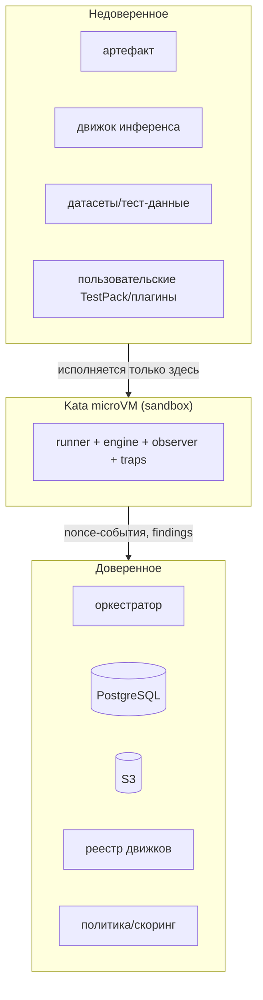

# 08. Модель угроз и границы доверия (v4)

## 1. Активы

- **Хост и платформа** (ядро узла, control plane, БД, S3, реестр образов).
- **Данные** (артефакты, датасеты, события наблюдения, вердикты, ключи/секреты).
- **Целостность вердикта** (нельзя выдать ложный `Safe`/`Malicious`).
- **Доступность** (проверки не должны валить платформу; ресурсы ограничены).

## 2. Границы доверия

Ключевой принцип: **и артефакт, и движок** — недоверенные; единственная среда их исполнения — Kata.
Доверенная зона их **не исполняет**.

## 3. Противники

| Противник | Мотивация/возможности |
|-----------|----------------------|
| Вредоносная модель/архив | RCE при загрузке, эксфильтрация, persistence |
| Вредоносный/уязвимый движок | эксплуатация парсеров/ядер, SSRF, выход из песочницы |
| Отравленные датасеты/промпты | обойти проверки, добиться ложного результата |
| Ошибочный оператор | небезопасная политика/плагин, ошибки конфигурации |
| Supply chain | подмена образа движка/парсера, неподписанные зависимости |
| Внешний атакующий | подмена событий/вердикта, отказ в обслуживании |

## 4. Угрозы и меры

| Угроза | Вектор | Мера v4 |
|--------|--------|---------|
| Побег из песочницы | уязвимость ядра/движка | микро-ВМ (своё ядро), минимальный интерфейс (VFIO/оверлей), drop capabilities, seccomp, RO-FS |
| RCE при парсинге/загрузке | дефект парсера в доверенной зоне | **парсеры и загрузка — в песочнице** (`analyzer`/`loader` движки) |
| Эксфильтрация | сеть/файлы/секреты | egress default-deny, только gateway/observer/sinkhole/DNS; honeypot-секреты и sinkhole |
| Подмена результата/событий | подделка отчёта | nonce job'а, подписанные/нонсованные события, append-only evidence |
| Ложный `Safe` | неполное покрытие | coverage-gating (нет наблюдения ⇒ `Inconclusive`), обязательный observer |
| Ослабление критериев | «удобная» политика | guardrails (нельзя `Safe` без покрытия; критический пол), ревью, аудит, симулятор, подпись версии |
| Подмена движка | подменённый образ | digest-only, подпись/SBOM (по политике), allowlist реестра |
| Отравление датасетов | вредоносные входы | версионирование/хеш датасетов, ревью, изоляция данных |
| DoS проверками | перегрузка | квоты, лимиты, TTL, rate-limit, per-tenant fair-share, отказ вместо хост-режима |
| GPU-драйвер в госте | эксплойт драйвера | микро-ВМ контейнментит; ограничение устройства (VFIO), обновления, наблюдение CPU-стороны |

## 5. Наследие v3, которое v4 закрывает

- **LLM вне микро-ВМ** (host `nvidia`) — устраняется: GPU-инференс в `kata-gpu`.
- **Наблюдение инференса выключено** — становится обязательным (`kata-btf` + observer).
- **Honeypots только для сканов** — распространяются на все job'ы.
- **Границы вердикта в коде** — выносятся в управляемую политику с guardrails.

## 6. Остаточные риски (принимаемые/отслеживаемые)

- **GPU-наблюдение ограничено**: GPU-сторона не наблюдаема полностью; фиксируется в покрытии и
  ограничивает максимальный вердикт.
- **Зрелость Kata GPU**: до готовности — CPU-режим или отказ (хост-путь не используется).
- **Доверие к подписям/аттестации**: без внешнего TSA/WORM гарантия внутренняя (платформенная тема).
- **Сложность симулятора политики**: качество порогов зависит от репрезентативности корпуса/replay.

## 7. Требования-инварианты безопасности

1. Нет пути исполнения артефакта/движка вне Kata (admission запрещает host-runtime).
2. Observer и traps присутствуют в каждом job; их отсутствие ⇒ не-`Safe`.
3. События/результаты антиспуф (nonce + подпись); evidence append-only.
4. Вердикт всегда с версией политики, покрытием и доказательствами; решения — fail-closed.
5. Любое расширение (движок/тест/правило) — подписанные данные, без обхода инвариантов.
