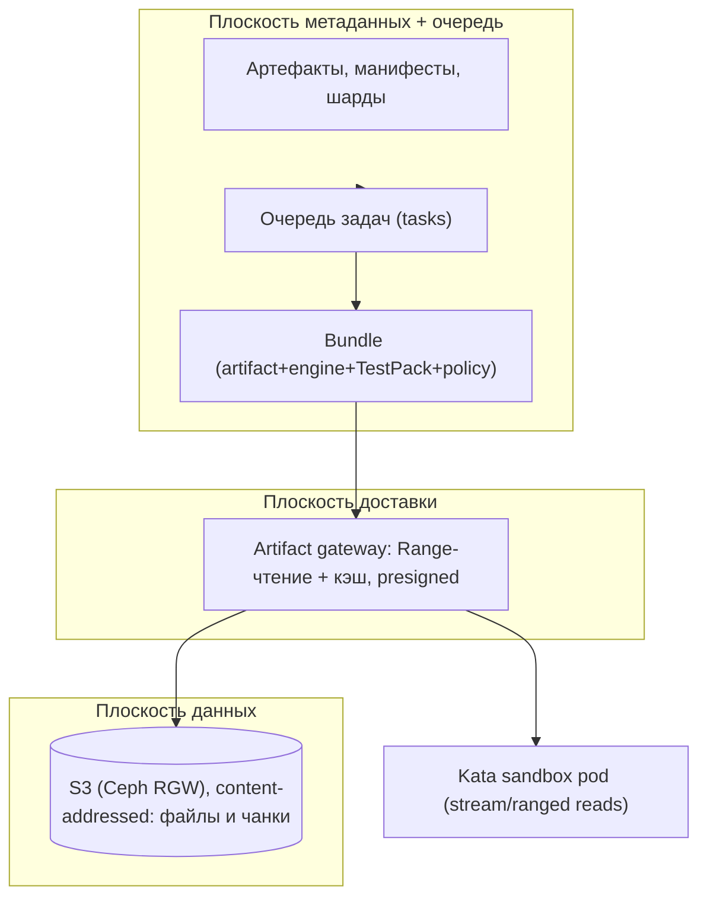
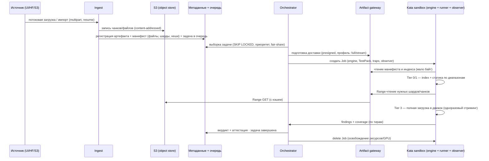
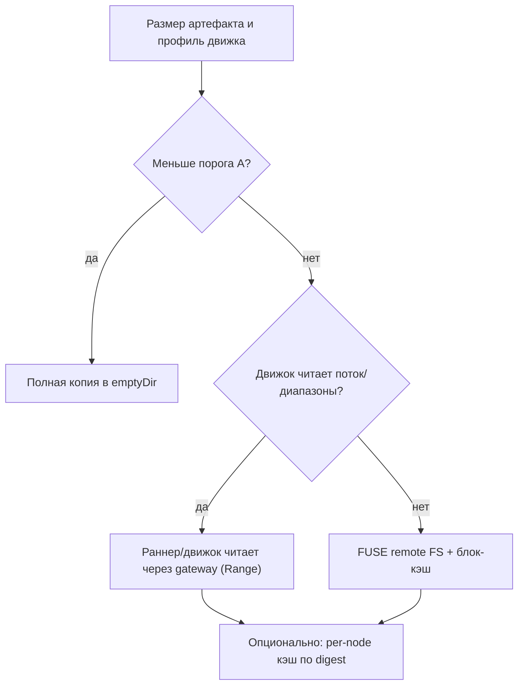

# 09. Сквозной процесс обработки большого артефакта (модель LLM на ТБ)

Документ отвечает на два вопроса: **(1)** как артефакт попадает в систему (очередь/S3) и как
извлекается для проверки, и **(2)** как обрабатывать **очень большие** образы моделей (несколько ТБ),
когда «скачать целиком» невозможно.

Связанные документы: [`01-unified-sandbox.md`](01-unified-sandbox.md),
[`02-engine-framework.md`](02-engine-framework.md), [`03-test-framework.md`](03-test-framework.md),
[`04-observation.md`](04-observation.md), [`Arch_v2/02-large-model-pipeline.md`](../Arch_v2/02-large-model-pipeline.md).

---

## 0. Короткий ответ

**Да, но в двух плоскостях**, и «извлекается» не наивной полной копией:

1. **Плоскость метаданных + очередь.** Артефакт **регистрируется** (имя, размер, sha256, тип,
   манифест файлов/шардов) и в **очередь задач** ставится работа на проверку. Здесь нет «тяжёлых»
   данных — только метаданные.
2. **Плоскость данных (S3, object store).** Содержимое лежит в S3 (Ceph RGW) в виде
   **content-addressed** объектов/чанков. S3 — источник истины; дедупликация и докачка — здесь.

Песочница **не исполняет артефакт «прямо из S3» и не обязана копировать его целиком**. Доставка идёт
через **artifact gateway** (in-cluster шлюз к S3), который умеет **Range-чтение** и кэш:

- **малые/средние** артефакты — полная копия в `emptyDir` job'а (как сейчас);
- **большие (ТБ)** — **не копируем целиком**: движок/загрузчик читает файл(ы) **диапазонами/чанками
  по мере надобности**, с локальным блочным кэшем и (опционально) переиспользуемым per-node кэшем по
  digest. Полное чтение всех байт происходит только если сам тест этого требует
  (например, полная загрузка модели в инференс) — но и тогда это **одноразовый последовательный
  стриминг**, а не хранение копии.

---

## 1. Три плоскости (разделение ответственности)



- **Метаданные** масштабируются дёшево (PostgreSQL): миллионы записей не проблема.
- **Данные** масштабируются объектным хранилищем: шардирование, дедуп, докачка.
- **Доставка** отделена от хранения: можно менять способ (полная копия / стриминг / FUSE / кэш), не
  меняя модель данных.

---

## 2. Сквозной путь большого артефакта (end-to-end)



Ключевое: **порядок — сначала «дешёвое» (манифест/индекс), затем выборочные диапазоны, и только при
необходимости — полное чтение**. Это позволяет давать вердикт даже для модели, которую целиком поднять
нельзя/долго.

---

## 3. Представление большого артефакта

### 3.1 Манифест и шарды

Большая LLM — это **каталог** (`config.json`, tokenizer, `model.safetensors.index.json`,
`model-XXXXX-of-YYYYY.safetensors`, иногда split-GGUF). Регистрируется **манифест**:

```json
{ "artifact": "hf/Qwen/Qwen3-1.7B",
  "files": [
    { "path": "config.json", "size": 1234, "sha256": "..." },
    { "path": "model-00001-of-00002.safetensors", "size": 2147483648, "sha256": "..." },
    { "path": "model-00002-of-00002.safetensors", "size": 1930701954, "sha256": "..." }
  ],
  "index": "model.safetensors.index.json",
  "total_bytes": 4079423234 }
```

Манифест — **первое, что читает** система и песочница; он подписан и хеширован.

### 3.2 Чанкинг (content-defined)

Файлы разбиваются на **чанки** (например, CDC/бустед-рабином или фиксированные окна), каждый —
content-addressed. Даёт:

- **дедуп** между версиями модели (переиспользование неизменённых шардов/окон);
- **докачку и параллелизм** (части грузятся/читаются независимо);
- **частичное чтение** (для статики/сэмплинга нужны не все чанки).

### 3.3 Range-чтение

Gateway отдаёт **byte-range** по ключу (`Range: bytes=a-b`) с проверкой хеша чанка. Это основа
«стриминга без копии».

---

## 4. Доставка в песочницу: варианты

| Вариант | Когда | Как | Плюсы | Минусы |
|---------|-------|-----|-------|--------|
| **A. Полная копия** | малые/средние (< десятки ГБ) | `artifact-fetcher` скачивает в `emptyDir` | просто, предсказуемо | требует места в поде; не для ТБ |
| **B. Стриминг через gateway** | большие | движок/загрузчик читает файл потоком (HTTP Range) | нет полной копии на диске пода | нужен адаптер движка/лоадер |
| **C. FUSE remote FS + блок-кэш** | большие, движок ждёт обычный файл | FUSE монтирует рантайм-представление из gateway, кэш на локальном NVMe | движок видит обычный файл | FUSE-накладные расходы |
| **D. Per-node кэш по digest** | повторные тесты/одна модель много раз | read-only кэш на узле, наполняется из gateway | повторный тест дешевле | нужен локальный диск и GC |

В v4 по умолчанию: **A** для малых, **B/C + D** для больших; режим выбирает оркестратор по размеру и
профилю движка (поле в `EngineDescriptor`/`SandboxJobSpec`).



---

## 5. Тиры проверки больших артефактов (честное покрытие)

Для ТБ-моделей «проверить всё» не всегда реально — вводим явные **тиры** и **фиксируем покрытие** в
вердикте ([`04-observation.md`](04-observation.md), [`05-verdict-scoring.md`](05-verdict-scoring.md)):

| Тир | Что делаем | Байт | Типичное время | Покрытие |
|-----|-----------|------|----------------|----------|
| **T0** | манифест/индекс/конфиг/tokenizer | килобайты | секунды | нет весов |
| **T1** | статика по диапазонам: заголовки тензоров, индекс, инварианты | МБ | секунды-минуты | структурное |
| **T2** | сэмплированные шарды/окна (динамика на подмножестве) | ГБ | минуты | частичное |
| **T3** | полная загрузка в движок + инференс/тесты | все байты | десятки минут-часы | полное |

Правило честности: если тест не выполнен (например, T3 не запускался) — это **не** `Safe` с полным
покрытием, а явное ограничение покрытия; вердикт это учитывает.

---

## 6. Инференс ТБ-моделей

- **Планирование по размеру**: `precheck` сопоставляет размер модели (манифест) и ёмкость
  (CPU RAM + VRAM, число GPU/узлов). Не влезает — job **отклоняется** (никакого «на хосте»).
- **Шардинг и параллелизм**: tensor/pipeline parallel по нескольким GPU/узлам (если доступны);
  иначе — отказ или CPU-режим (ограниченное покрытие).
- **Одноразовый стриминг**: байты читаются gateway → (память) → GPU/CPU, без полной копии на диск.
- **KV-кэш/квантизация**: учитываются при планировании; warm pool снижает латентность старта.
- **Бюджеты**: жёсткие лимиты времени/байт; при исчерпании — частичный результат, покрытие отражает.

## 7. Целостность, дедуп, безопасность

- **Манифест подписан**; **хеши файлов и чанков** проверяются при записи и **при каждом чтении**
  (fail-closed при несовпадении).
- **Дедуп**: одинаковые чанки не дублируются; `object_refs` связывают артефакты с чанками (несколько
  моделей переиспользуют неизменные шарды).
- **Безопасность**: диапазонное чтение идёт **только через gateway**; egress песочницы — default-deny;
  ловушки/observer работают и для большого артефакта (загрузчик и движок — тоже недоверенные).
- **DoS/стоимость**: квоты, лимит байт на задачу, тайровые проверки (T0/T1 дешёвые), fair-share,
  приоритеты; большие задачи не блокируют очередь.

## 8. Очередь и планирование

- **Очередь задач** (`tasks`): состояния `queued → materializing → running → verdict → gc`;
  выборка `FOR UPDATE SKIP LOCKED`; аренда (lease) и идемпотентность (перезапуск/resume).
- **Приоритеты и fair-share** по тенантам; «тяжёлые» задачи (Т3) — отдельный пул/лимит параллелизма.
- **Resume**: незавершённая загрузка/чтение продолжается с последнего чанка.

## 9. Модель данных (эскиз)

| Сущность | Что хранит |
|----------|-----------|
| `artifacts` | артефакт: id, sha256 (для одиночного файла), тип, размер, источник |
| `model_manifests` | манифест: список файлов (path, size, sha256), индекс, total_bytes |
| `chunks` / `object_refs` | content-addressed чанки и ссылки (дедуп) |
| `tasks` | очередь задач (состояние, lease, приоритет, тенант) |
| `bundles` | артефакт + движок + TestPack + policy + режим доставки |
| `hf_downloads` | прогресс фоновых загрузок (resume, статус) |

## 10. Соответствие требованиям

| Вопрос/требование | Ответ в документе |
|-------------------|------------------|
| «Сначала очередь/S3, потом извлечение?» | §0, §1, §2 — да: метаданные+очередь и S3-данные отдельно; доставка через gateway |
| «Огромные образы (ТБ)» | §3 (манифест/шарды/чанки), §4 (доставка), §6 (стриминг, параллелизм, планирование) |
| «Сквозной процесс большого артефакта» | §2 (диаграмма), §5 (тиры), §7–§9 |
| «Безопасность при больших объёмах» | §7 (gateway-only, ловушки/observer, fail-closed, квоты) |

## 11. Что переиспользуется из v2/v3

- Content-addressed S3, chunking/дедуп, multipart/resume, range-read, объектный пул + refs,
  резюмируемые HF-загрузки — из v2/v3.
- Новое в v4: **доставка по режимам** (full/stream/FUSE/cache), **тиры покрытия**, привязка к
  `EngineDescriptor`/`TestPack` и учёт покрытия в **политике вердикта**.
