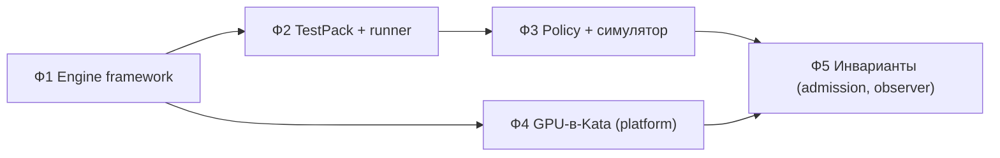

# 10. План реализации v4

План переводит [`Arch_v4`](README.md) из архитектуры в код **инкрементально**: на каждом шаге система
работоспособна, а инварианты v4 вводятся по мере готовности платформы. Зависимости от платформы
(GPU-в-Kata, BTF-ядро) выделены отдельно и не блокируют первые фазы.

Обозначения: **P0** — обязательно для инварианта v4; **P1** — ценно; **P2** — позже. Владелец:
`tenant` (наш код `deploy/`, `tests/`) или `platform` (кластер/админы).

## 0. Принципы реализации

1. **Не ломать v3.** Новые сущности добавляются как отдельные модули/таблицы/эндпоинты; старые пути
   работают и постепенно отображаются на новые.
2. **Данные вместо кода.** Движки/тесты/политики — записи (версионируемые, подписываемые), а не
   ветвления в коде.
3. **Fail-closed и честное покрытие.** Нет наблюдения/шагов ⇒ не `Safe`.
4. **Тестируемость.** Каждый модуль — с unit-тестами; интеграция — e2e на стенде.
5. **Один вертикальный срез за шаг.** Каждый инкремент заканчивается проверкой на стенде.

## 1. Фазы и задачи

### Ф1. Engine framework (P0, tenant) — движки как данные

| ID | Задача | Файлы | Приёмка |
|----|--------|-------|---------|
| E1 | `EngineDescriptor`: схема, валидация, совместимость | `deploy/v4/engines/descriptor.py` | unit: валид/невалид, `compatible()` |
| E2 | Планировщик RuntimeClass по дескриптору (kata-gpu/kata-btf/kata/refuse) | `deploy/v4/engines/descriptor.py` | unit: дерево решений (GPU есть/нет, CPU-режим) |
| E3 | Регистрация дескрипторов: API + БД (расширение `registry_images`) | `deploy/stage2/service/mlscan_testing.py`, схема | e2e: регистрация движка, выбор по типу |
| E4 | Генерация Job из дескриптора (вместо hardcode) | `deploy/v3/llm/llm_env.py` + адаптер | e2e: тест bundle с движком из дескриптора |

### Ф2. TestPack + runner (P0, tenant) — тесты как данные

| ID | Задача | Файлы | Приёмка |
|----|--------|-------|---------|
| T1 | `TestPack`: схема, валидация, версия/хеш | `deploy/v4/tests/testpack.py` | unit: схема, `applies_to` |
| T2 | Реестр TestPack + `Dataset` (миграция XLSX-наборов) | сервис + БД | e2e: набор из XLSX как `Dataset` |
| T3 | Runner: шаги `static/load/invoke/stream/interactive/assert` | `deploy/v4/tests/runner.py` | e2e: прогон на реальном движке |
| T4 | Плагин-интерфейс (probe/assert) | `deploy/v4/tests/plugins.py` | unit: регистрация/вызов плагина |
| T5 | Запись/реплей шагов (кассеты) | `deploy/v4/tests/recording.py` | unit: replay без движка |

### Ф3. Policy + симулятор (P0, tenant) — критерии вердикта как данные

| ID | Задача | Файлы | Приёмка |
|----|--------|-------|---------|
| P1 | Модель `Policy` + скоринг + правила (decision table) | `deploy/v4/scoring/policy.py` | unit: скоринг, coverage-gating, правила |
| P2 | Компиляция текстового DSL → условия (безопасно, без `eval`) | `deploy/v4/scoring/policy.py` | unit: формы из doc 05 |
| P3 | Симулятор/бэктест: confusion, FP/FN, sweep порогов | `deploy/v4/scoring/simulator.py` | unit: матрица ошибок, монотонность sweep |
| P4 | API: черновик → simulate → publish (версия+подпись) | сервис + БД | e2e: публикация политики, вердикт с `policy_version` |
| P5 | Интеграция `_llm_score`/`_verdict_from_score` на политику | `deploy/stage2/service/mlscan_testing.py` | e2e: тот же результат, что сейчас, на дефолтной политике |
| P6 | UI: редактор политики + предпросмотр симуляции | `deploy/stage3/service/mlscan_analytics.py` | e2e: изменение порога видно в симуляции |

### Ф4. GPU-в-Kata (P0, platform + tenant)

| ID | Задача | Владелец | Приёмка |
|----|--------|----------|---------|
| G1 | `kata-gpu` RuntimeClass (VFIO GPU + BTF), warm pool | platform | pod c GPU стартует в микро-ВМ |
| G2 | Гостевой драйвер/CUDA, device plugin, MIG/ограничения | platform | `nvidia-smi` внутри гостя |
| G3 | Перевести LLM-Job на `kata-gpu` (по дескриптору) | tenant | e2e: HF → vLLM → набор вопросов в Kata+GPU |
| G4 | Per-node read-only кэш модели по digest; доставка FUSE/Range | tenant | e2e: повторный тест без полной загрузки |

### Ф5. Инварианты и наблюдаемость (P0, platform + tenant)

| ID | Задача | Владелец | Приёмка |
|----|--------|----------|---------|
| I1 | `kata-btf` + ConfigMap `mlscan-ebpf-agent`; включить observer | platform+tenant | события `BEH-*` приходят из госта |
| I2 | Admission: запретить host-`nvidia` для job'ов проверки | platform | Job с `nvidia` отклоняется |
| I3 | Обязательные `traps`+`observer` в каждом job (шаблон) | tenant | нет observer ⇒ `Inconclusive`/`quarantine` |
| I4 | eBPF в каждой фазе инференса (в т.ч. стриминг/загрузка) | tenant | покрытие домена наблюдения |

## 2. Порядок исполнения (дорожная карта)

Первые **три фазы независимы от платформы** и выполняются сразу на текущем стенде.

## 3. Текущий инкремент (старт)

**Инкремент v4.0-a (библиотечный слой, без риска для стенда):**

- `deploy/v4/engines/descriptor.py` — `EngineDescriptor` + `plan_runtime_class()` (E1, E2).
- `deploy/v4/scoring/policy.py` — модель `Policy`, скоринг, безопасная компиляция DSL, вердикт (P1, P2).
- `deploy/v4/scoring/simulator.py` — симулятор/бэктест и sweep порогов (P3).
- `tests/v4/test_engine_descriptor.py`, `tests/v4/test_policy.py`, `tests/v4/test_simulator.py`.
- Документы: этот план; связка с `deploy/tenant/images/services/Dockerfile` (добавить `deploy/v4/**`),
  эндпоинты/интеграция — следующими инкрементами (E3, P4, P5).

Почему так: библиотечный слой даёт проверяемые контракты и **не меняет** поведение стенда; интеграция
(эндпоинты, UI, переключение вердикта на политику) выполняется поверх уже протестированных модулей.

## 4. Приёмка и Definition of Done

- **Unit**: `python3 -m unittest discover -s tests/v4` — зелёный.
- **E2E** (по мере интеграции): на стенде прогон bundle с движком из дескриптора и TestPack; вердикт с
  `policy_version`; симуляция политики на исторических вердиктах.
- **Регресс**: существующие `tests/v3`, `tests/v2` — без изменений поведения.
- **Документация**: обновлён `deploy/tenant/STATUS.md`; при изменении контрактов — `Arch_v4/06-contracts.md`.

## 5. Риски и меры

| Риск | Мера |
|------|------|
| Интеграция политики меняет текущие вердикты | дефолтная политика воспроизводит текущие пороги; сравнение на исторических данных |
| TestPack/DSL «разрастается» | держать минимальный набор шагов; DSL — только условия вердикта |
| Зависимость от platform (kata-gpu/kata-btf) | Ф1–Ф3 не зависят; Ф4/Ф5 — по готовности, с деградацией |
| Дублирование с v3 | адаптеры/маппинг, а не переписывание; старые пути сохраняются |
