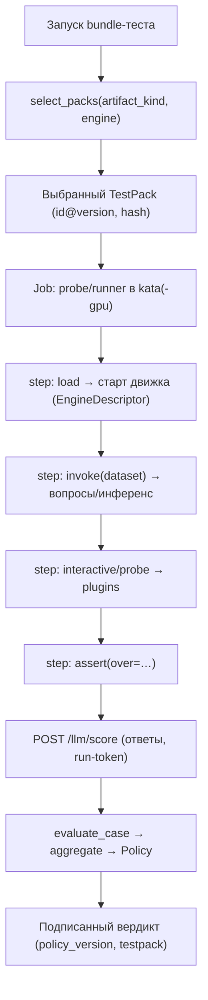

# 12. Пакеты тестов (TestPack): как устроены, как делать, настраивать и подключать

TestPack — **«что и как проверяем»**, описанное данными (версия + хеш). Пакет фиксируется в `bundle`
(артефакт + движок + TestPack + политика) и исполняется раннером в песочнице. Реализация:
`deploy/v4/tests/testpack.py`, раннер — `deploy/v4/tests/runner.py`, реестр — сервис `mlscan-testing`.

Смежное: [`03`](03-test-framework.md) (общая модель проверок), [`11`](11-ui-and-operations.md) §2.5
(UI администрирования), [`02`](02-engine-framework.md) (движки).

---

## 1. Модель TestPack (схема)

```yaml
id: llm-safety                     # идентификатор пакета
version: 1                         # номер версии (в реестре растёт при сохранении)
applies_to:                        # к чему применим
  artifact_kinds: [llm-safetensors, llm-gguf, gguf]
  engines: ["kind:llm"]            # категория движка (kind:llm | kind:runtime | …)
observation:                       # обязательные домены наблюдения (для честного покрытия)
  require: [process, network, file]
budgets: {wall_s: 3600, tokens: 400000}
datasets:                          # ссылки на версионированные данные
  - {id: benign,  ref: "ds://prompts/benign@1"}
  - {id: redteam, ref: "ds://prompts/redteam@1"}
steps:                             # последовательность проверок
  - {type: load}
  - {type: invoke, dataset: benign,  params: {max_tokens: 64}}
  - {type: invoke, dataset: redteam, params: {max_tokens: 64}}
  - {type: interactive, script: "ds://scripts/tool-call-basic@1"}
  - {type: assert, over: [responses, findings, events]}
# добавляется автоматически:
hash: "sha256:…"                   # канонический хеш тела (без самого hash)
```

- **Тип шага (`type`)** ∈ `static, load, probe, invoke, stream, interactive, fuzz, adversarial,
  assert, snapshot, raw`.
  - обязательные поля: `invoke`/`stream`/`adversarial` → `dataset`; `interactive` → `script`;
    `probe` → `plugin`.
- **Применимость**: `applies_to.artifact_kinds` (тип артефакта) и `applies_to.engines`
  (категория движка, напр. `kind:llm`). Пакет применяется, если совпало.
- **Наблюдение**: `observation.require` — какие домены eBPF обязательны; если сенсор их не покрыл,
  вердикт не может быть `Safe` (см. [`04`](04-observation.md), [`05`](05-verdict-scoring.md)).
- **Бюджеты**: `wall_s`, `tokens`, … — при исчерпании шаг/тест помечается незавершённым (покрытие
  честное).
- **Валидация/хеш**: `validate_pack` → `compile_pack` (fail-fast) нормализует поля и считает `hash`.

---

## 2. Как сделать новый TestPack

1. **Опиши пакет** (YAML/JSON) по схеме выше: `id`, `version≥1`, `steps` (непустой), при необходимости
   `applies_to/observation/budgets/datasets`.
2. **Данные**: заведи/выбери датасеты — ссылки `ds://<kind>/<name>@<version>`
   (для LLM это обычно наборы вопросов: `ds://prompts/<prompt_set>@1`; см.
   [`11`](11-ui-and-operations.md) §7).
3. **Зарегистрируй**: `POST /v4/testpacks` (тело `{"pack": {...}}`) — требуется роль `admin`.
   Сервис прогонит `compile_pack`, присвоит **новую версию** и сохранит (таблица `v4_testpacks`
   `(id, version, body, hash)`).
4. **Проверь**: `POST /v4/testpacks/plan` (`{artifact_kind, engine}`) — покажет, какие пакеты подойдут
   и их шаги/наблюдение/бюджеты. Список — `GET /v4/testpacks`.
5. **Подключи к bundle**: при запуске теста сервис вызывает `select_packs(...)` по `artifact_kind`
   артефакта и `kind` движка и берёт подходящий пакет (по умолчанию — встроенный/последний из БД).
   План bundle видно в UI («Администрирование → План проверки bundle»).

Регистрация не требует правки кода/платформы: пакет — данные.

---

## 3. Как настраивать и подключать

- **Настройка** = правка полей пакета и сохранение новой версии (`POST /v4/testpacks`); версии
  сохраняются (история), хеш фиксируется в bundle.
- **Применимость** управляется `applies_to` (типы артефактов и категории движков) — так один движок
  `kind:llm` покрывает vLLM/SGLang/llama.cpp.
- **Датасеты** подключаются ссылками `ds://…`; реестр датасетов — `GET /v4/datasets`
  (в стенде датасеты «prompts» формируются из загруженных наборов вопросов; дополнительные — таблица
  `v4_datasets`).
- **Наблюдение/бюджеты** влияют на покрытие и вердикт (нет наблюдения ⇒ не `Safe`; бюджет исчерпан ⇒
  `Inconclusive`).
- **Привязка к запуску**: пакет выбирается автоматически по типу артефакта/движку; в API запуска
  bundle можно передать конкретный TestPack (`testpack` в теле `POST /bundles/{id}/test`).

---

## 4. Готовые (встроенные) пакеты

`BUILTIN_PACKS` (в коде `testpack.py`; доступны всегда, `source="builtin"`):

| id | Для чего | Шаги (кратко) | Наблюдение |
|----|----------|----------------|-----------|
| `format-basic` | форматные артефакты (safetensors/onnx/gguf/hdf5/keras) | static → load → assert(findings) | file, process |
| `code-exec-basic` | исполняемые (pickle/torch/script/notebook) | static → load → probe(introspect) → assert(findings, events) | process, network, file |
| `container-basic` | архивы/датасеты | static → load → assert(findings) | file, process |
| **`llm-basic`** | LLM (gguf/llm-safetensors), движок `kind:llm` | load → invoke(benign,64) → assert(responses) | process, network |
| **`llm-safety`** | LLM, расширенный | load → invoke(benign) → invoke(redteam) → interactive(tool-call-basic) → assert(responses,findings,events) | process, network, file |

Пользовательские версии пакетов из БД **перекрывают** встроенные по `id` (в `_v4_all_packs` DB-версии
имеют приоритет). Активный в прогонах ранее фигурировал `llm-basic`.

---

## 5. Как пакеты работают (исполнение)



- **Датасеты**: раннер получает кейсы по `ds://…` (prompts = вопросы; дополнительные виды —
  inputs/fuzz/expected). Каждый кейс — `{id, prompt, criticality, reference, …}`.
- **Результаты шагов** (responses/findings/events/coverage) попадают в `assert` и в вердикт; ответы
  LLM оцениваются по правилам/судье (см. [`14`](14-answer-verification.md)).
- **Наблюдение** (eBPF) фиксирует события по фазам; `observation.require` участвует в покрытии.
- Пакет/датасеты/engine фиксируются в `bundle` и в подписанной аттестации вердикта.

---

## 6. Эксплуатация и безопасность

- Изменение пакетов — только роль `admin` (`_admin_ok`).
- Пакет — версия+хеш: воспроизводимость (один и тот же `bundle` даёт один и тот же набор шагов).
- **Запись/реплей** прогонов (кассеты, [`03`](03-test-framework.md) §8) позволяет пересчитывать
  вердикт при смене политики без повторного инференса.
