# 15. Концепт нового UI/UX (с сохранением всех функций)

Документ описывает анализ близких систем и концепт редизайна веб‑интерфейса MLScan **без потери
текущего функционала**. Текущее устройство UI и инвентарь функций — [`11-ui-and-operations.md`](11-ui-and-operations.md);
домены — [`12`](12-testpacks.md), [`13`](13-verdict-policies.md), [`14`](14-answer-verification.md).
Эскизы экранов — [`screenshots/`](screenshots/README.md).

---

## 1. Инвентарь функций (паритет обязателен)

- **Навигация:** Сканы · Загрузка · История операций · Настройки · Администрирование (admin).
- **Сканы:** список артефактов (файл/формат/размер/вердикт); карточка артефакта (находки, история
  проверок, sandbox, eBPF по фазам, «Связки» с политикой/аттестацией, запуск теста).
- **Карточка проверки:** статус + стадии + причина; вердикт/действие; политика `id@version`;
  аттестация (digest, версии: набор/движок/TestPack); метрики и разбивка по критичности; eBPF‑находки;
  таблица **кейсов с вопросом и ответом**; **ручной вердикт** (admin) с провенансом.
- **Загрузка:** HF‑обзор/скачивание (полный каталог), локальная загрузка, «проверка инференса»
  (модель+движок), план bundle (авто‑GPU), прогресс.
- **Настройки:** HF‑токен (личный); наборы XLSX (загрузка, история, активация).
- **Администрирование:** политики вердикта (черновик→симуляция→публикация), движки (дескрипторы),
  TestPack/Dataset + план, квоты HF, rate‑limit, аудит (цепочка вердиктов/gate/egress).
- **Сквозное:** статусы HF/скан/bundle (стадии), вердикт + действие, кэш моделей; Keycloak/роли;
  API‑ключи/run‑token; i18n ru/en.

---

## 2. Анализ аналогов и заимствуемые паттерны

| Класс | Системы | Что берём |
|-------|---------|-----------|
| AI/ML‑security & scanning | Protect AI Guardian, HiddenLayer, Robust Intelligence, CalypsoAI, Lakera | findings‑first триаж; риск‑скор с **объяснением**; честный **охват** (coverage) |
| Red‑team/eval LLM | NVIDIA Garak, promptfoo, W&B Weave, Braintrust, LangSmith | карточка прогона с **Q&A**, фильтры, **сравнение прогонов**, экспорт отчёта |
| Реестры моделей | Hugging Face Hub, MLflow Model Registry, W&B | страница модели (версии/файлы), запуск проверки из карточки |
| Артефакт/уязвимости | Snyk, Wiz, Aqua/Trivy, Harbor, Dependency‑Track, DefectDojo | список проверок с массовыми действиями, **saved views**, статус‑бейджи |
| Runtime‑security | Falco/Falcosidekick, Tetragon, Grafana | лента событий с фильтрами и live‑обновлением, привязка к фазам |
| Policy‑as‑code | OPA/Gatekeeper, Kyverno | редактор политик, **dry‑run/симуляция**, diff, версии/аудит, provenance |
| CI‑гейт | GitHub Checks, GitLab | гейт‑решение из UI/API, статус в pipeline |

**Вывод:** нынешний UI функционален, но «плоский по разделам»; аналоги ставят на
задачно‑ориентированную навигацию, findings‑first, **карточку прогона как центр**, объяснимость и
доказуемость, сравнение/диффы и live‑статусы.

---

## 3. Принципы

1. **Task‑first**: «Проверить модель», «Разобрать результаты», «Настроить критерии», «Опубликовать гейт».
2. **Explainable**: вердикт всегда с «почему» (правило политики, метрики, охват, доказательства).
3. **Honest coverage / fail‑visible**: явные стадии, причины сбоя, метрика охвата; пустой экран без
   объяснения недопустим.
4. **Dense but calm**: спокойная типографика, семантические цвета, тёмная/светлая темы, плотность.
5. **Parity by design**: ни одна функция из §1 не теряется (см. §7).

---

## 4. Информационная архитектура

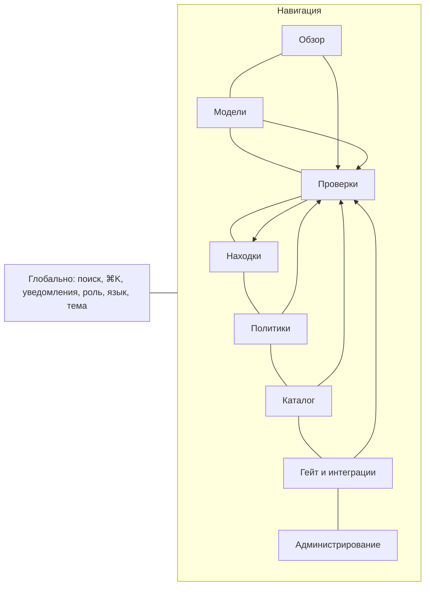

- **Обзор** — «требует внимания» (Needs review/Inconclusive/failed), очередь/GPU, KPI, свежие прогоны.
- **Модели** — артефакты/модели; страница модели (версии, кэш, запуск проверки).
- **Проверки** — единый список **сканов и bundle‑тестов** (фильтры, сравнение); **карточка прогона**.
- **Находки** — сквозной реестр по всем моделям (severity/тип/фаза/политика), массовые действия.
- **Политики / Каталог / Гейт / Админ** — критерии, сущности (движки/TestPack/датасеты/наборы),
  интеграции (gate/API‑ключи/egress), настройки/квоты/аудит/кэш.

---

## 5. Экраны (макеты)

### 5.1 Обзор
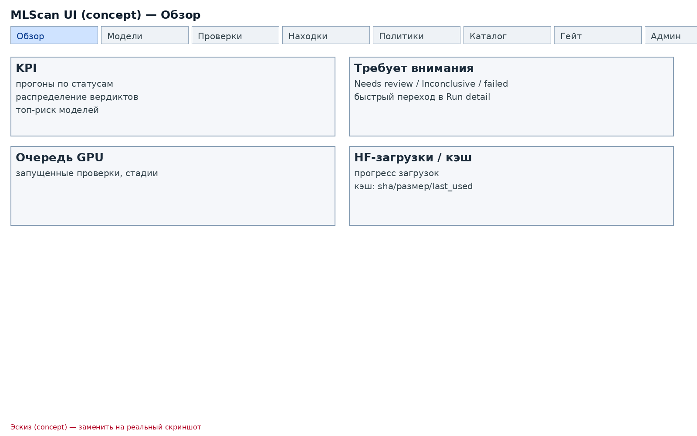
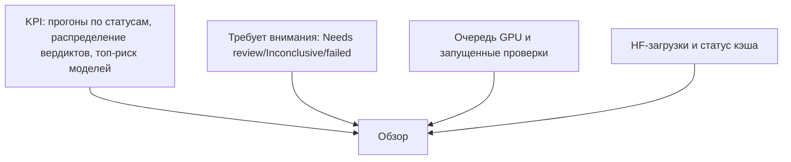

### 5.2 Проверки (список)
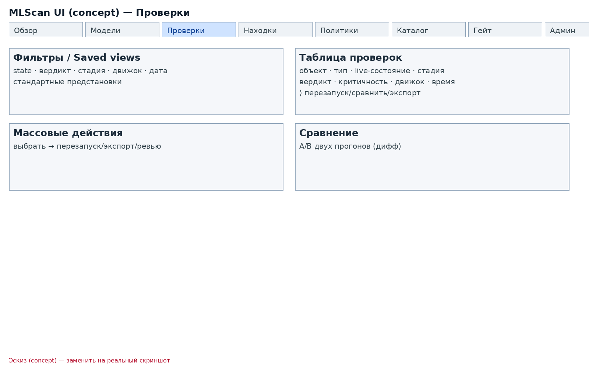
Колонки: объект · тип (скан/bundle) · **состояние live** · стадия · вердикт (бейдж) · критичность‑сводка ·
движок · время · «⋯» (перезапуск/сравнить/экспорт). **Saved views**, массовые действия, фильтры по
state/вердикту/стадии/движку/дате.

### 5.3 Карточка прогона (центр)
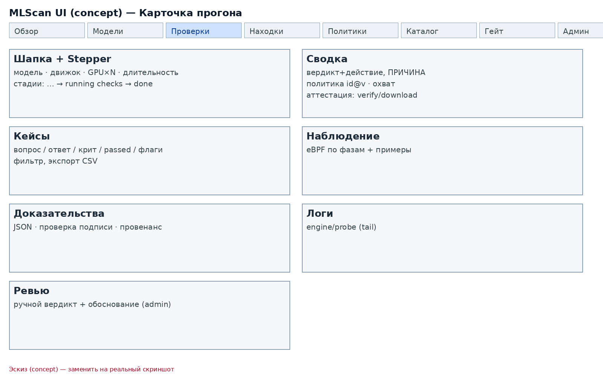
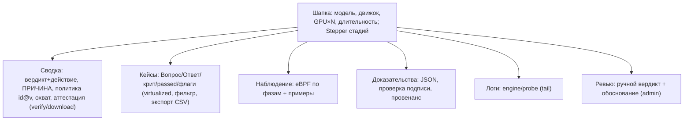

### 5.4 Страница модели
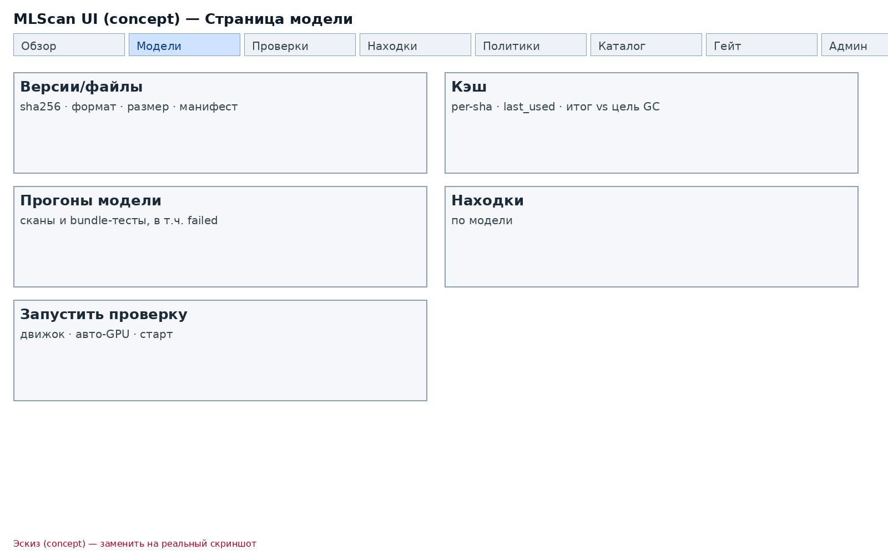
Версии/файлы, кэш (per‑sha, last_used), прогоны модели, находки, «Запустить проверку».

### 5.5 Онбординг (загрузка/запуск)
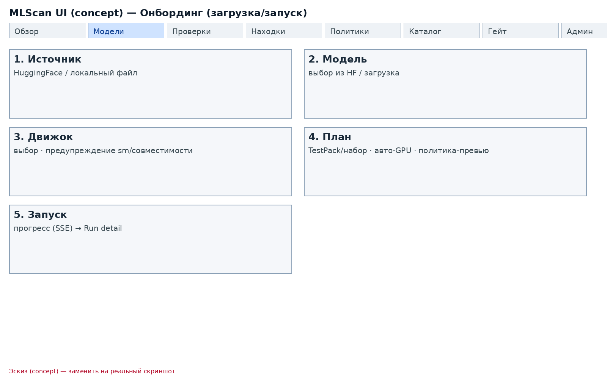
Мастер: Источник (HF/локально) → Модель → **Движок** (с предупреждением о `sm`/совместимости) →
План (TestPack/набор, авто‑GPU, политика‑превью) → Запуск. Прогресс (SSE), затем переход в прогон.

### 5.6 Политики v2
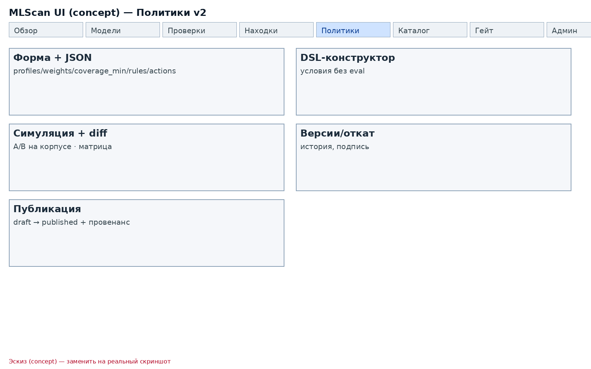
Форма + JSON‑режим, конструктор DSL‑условий, **симуляция с diff A/B на корпусе**, версии/откат,
публикация с провенансом.

### 5.7 Каталог
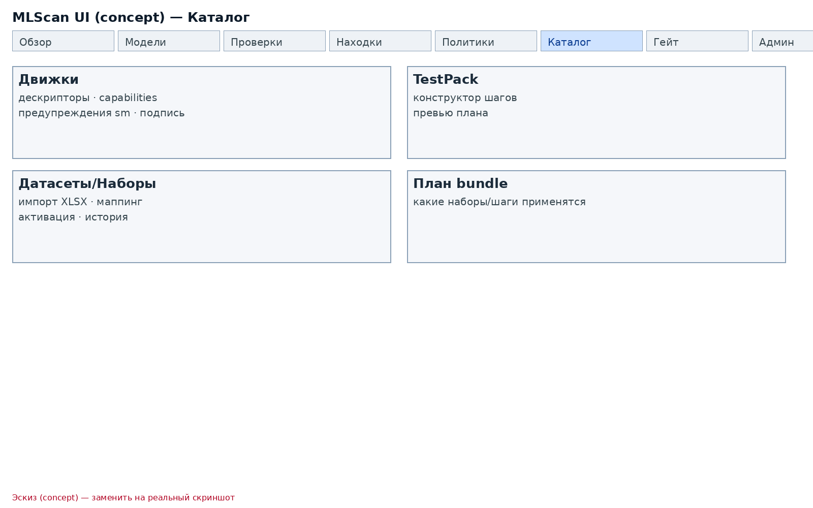
Движки (capabilities, `sm`‑требования, статус подписи), TestPack (конструктор шагов + превью плана),
Датасеты/Наборы (импорт XLSX с маппингом колонок, активация).

### 5.8 Гейт и интеграции
Решение gate (allow/review/block/quarantine), API‑ключи, webhooks/CI, журнал egress HF.

### 5.9 Администрирование
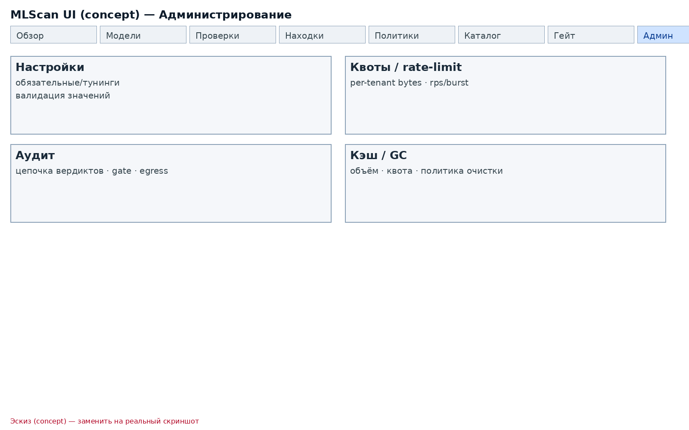
Настройки (обязательные/тунинги с валидацией, §6 в [`11`](11-ui-and-operations.md)), квоты/rate‑limit,
аудит (цепочка вердиктов/gate), кэш/GC.

---

## 6. Компоненты и дизайн‑система

- **StatusChip, StageStepper, VerdictBadge** (цвет+иконка+текст — не только цвет), **CoverageMeter**,
  **SeverityTag**, **EvidenceViewer** (JSON/подпись/скачивание), **CaseTable** (Q&A, виртуализация,
  diff), **PolicyRuleEditor**, **EmptyState/ErrorState** с рекомендацией, **JobProgress** (SSE),
  **Drawer** для быстрого просмотра.
- **Токены:** семантические цвета, типографика, радиусы, тени; **контраст WCAG 2.1 AA** (фикс недавней
  «нечитаемой таблицы» на системном уровне); фокус‑стейты, keyboard‑навигация, `prefers-reduced-motion`;
  **ru/en**; плотность comfortable/compact.

---

## 7. Паритет «сейчас → новое»

| Сейчас | Новое |
|--------|-------|
| Сканы (список) | **Модели** (+ **Проверки**) |
| Карточка артефакта | **Страница модели** |
| Карточка проверки («Подробнее») | **Run detail** (Сводка/Кейсы/Наблюдение/Доказательства/Логи/Ревью) |
| Загрузка (HF/локально/запуск/план) | **Онбординг‑мастер** + «Модели» |
| История операций | **Проверки**/**Гейт** + **Админ→Аудит** |
| Настройки (HF‑токен, XLSX) | **Настройки** + **Каталог→Наборы** |
| Админ (политики/движки/TestPack/квоты/аудит) | **Политики / Каталог / Админ** |
| Ручной вердикт | **Run detail → Ревью** |
| Статусы/стадии, вердикт+аттестация, кэш | Бейджи/Stepper/EvidenceViewer/Обзор |

---

## 8. Технический подход

- **API‑first** (эндпоинты уже есть) + **BFF**: текущий SSR‑сервис analytics остаётся точкой входа —
  отдаёт статику/роутинг, проксирует API и добавляет identity из oauth2‑proxy (чтобы **не светить
  `MLSCAN_KEY` в браузере**).
- **Инкрементальное** внедрение компонентного слоя + **SSE** для живых статусов; виртуализация таблиц.
- Держать **/legacy** до полного паритета; фича‑флаги; backend‑контракты не меняются.

---

## 9. План миграции

1. Дизайн‑токены + библиотека компонентов (включая фикс контраста).
2. Оболочка/навигация + **Обзор**.
3. **Проверки** + **Run detail** (наибольшая ценность).
4. **Модели/Онбординг**.
5. **Политики/Каталог/Админ**; снятие `/legacy`.
Метрики: время «найти проблему» и «разобраться» ↓; 100% вердиктов с объяснением; доступность AA;
нет «пустых экранов без объяснения».

---

## 10. Открытые вопросы

- **Фреймворк**: лёгкий компонентный (React/Preact/Vue) vs web‑components без сборки (влияет на
  пайплайн/образ). Рекомендация: лёгкий компонентный слой + статическая сборка в BFF.
- **Сравнение прогонов и тренды** — предлагаю включить сразу (сильно помогает в ревью).
- Где хранить эталонные макеты (предлагаю `Arch_v4/screenshots/` + ссылки на Figma).
- **Модель‑судья** в UI (настройка judge‑движка) — сейчас вынесено в extension ([`14`](14-answer-verification.md)).
