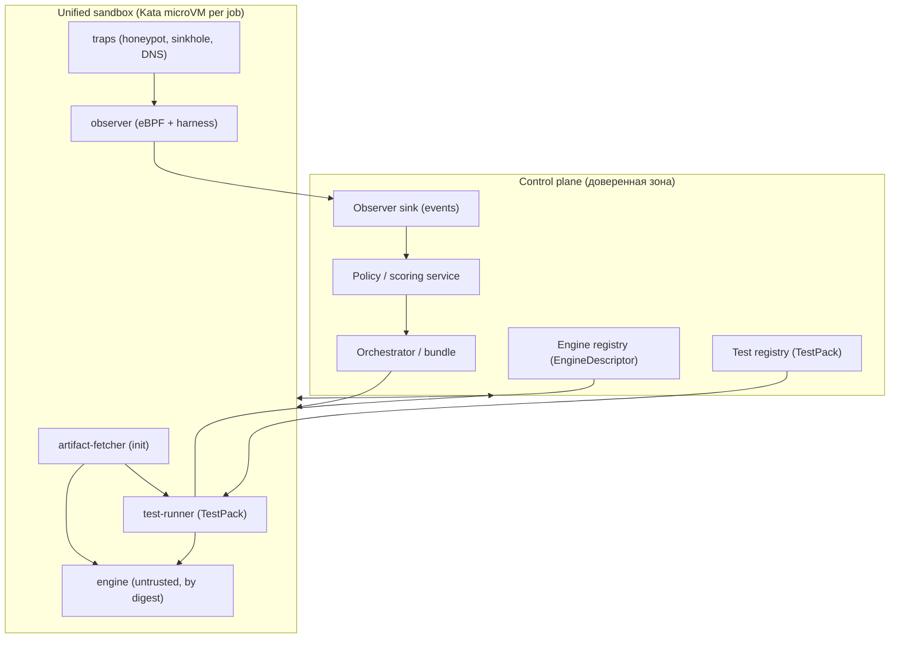

# Архитектура v4 — унифицированная песочница инференса

**Тема v4:** *любой артефакт — включая модели с инференсом — исполняется в единой изолированной
(Kata) песочнице с ловушками и обязательным наблюдением; движки инференса подключаются как данные
под тип артефакта; проверки — расширяемые «пакеты тестов»; вердикт выдаётся по управляемой
(скоринговой) политике.*

Документ описывает **архитектурное решение** (не отчёт о реализации). Основной код остаётся в
`deploy/`, `poc/`, `tests/`; здесь — архитектура и контракты, по которым её реализуют.

Опирается на факты текущего стенда: [`CrossProcess_overview.md`](../CrossProcess_overview.md)
(сквозные процессы и **области наблюдения / открытые зоны**), [`Arch_v3/19-implementation-as-built.md`](../Arch_v3/19-implementation-as-built.md)
(as-built v3), [`deploy/tenant/STATUS.md`](../deploy/tenant/STATUS.md).

---

## 1. Что и зачем меняется относительно v3

v3 уже умеет: запускать артефакт в Kata (сканы), поднимать **недоверенный движок инференса**
(vLLM / SGLang / llama.cpp) и получать вердикт `bundle` с аттестацией. Но в v3 остаются три
принципиальных расхождения с целевой моделью:

| Проблема v3 | Следствие | Что делает v4 |
|-------------|-----------|----------------|
| LLM-инференс идёт в `runtimeClassName: nvidia` (**хостовое ядро**, микро-ВМ нет) | движок и модель исполняются вне микро-ВМ; изоляция только seccomp/non-root | **все** движки (включая GPU-инференс) — в Kata (`kata-gpu`); хост-путь запрещён admission-политикой |
| Наблюдение за инференсом фактически отключено (eBPF-сенсор `SANDBOX_EBPF`/`LLM_TEST_EBPF=0`), honeypots только для сканов | поведение LLM/движка не наблюдается | **обязательный** in-guest observer (eBPF + harness) и общий набор ловушек **для всех** job'ов |
| Тесты и вердикт зашиты в код (порог 90/75/50, наборы вопросов, правила в `evaluators.py`) | нельзя расширять/управлять без правки и пересборки | **TestPack** — декларативные расширяемые тесты; **Policy** — управляемое скоринг/правило вердикта (редактор + симулятор) |

## 2. Инварианты v4 (непереговорные)

1. **Единый периметр доверия.** Любой недоверенный код (артефакт **и** движок) исполняется только
   внутри Kata-микро-ВМ. Хост-исполнение артефактов/движков запрещено; допустимые RuntimeClass —
   только Kata-варианты (`kata`, `kata-btf`, `kata-gpu`).
2. **Одна песочница на все типы.** Различия артефактов выражаются **движком (EngineDescriptor)** и
   **пакетом тестов (TestPack)**, а не разной изоляцией.
3. **Ловушки и наблюдение — всегда.** Для каждого job'а монтируются honeypot/traps и запускается
   observer; «нет наблюдения» ⇒ вердикт `Inconclusive` и запрет `Safe`.
4. **Расширяемость без правки ядра.** Новый движок/тест/детектор/правило подключается как **данные**
   (подписанные записи реестра), а не как патч платформы.
5. **Вердикт — функция политики.** Скоринг и правила вердикта версионируются, подписываются,
   воспроизводимы и **симулируемы** до публикации.
6. **Воспроизводимость.** `bundle` фиксирует: digest артефакта + digest движка + версию TestPack +
   версию Policy + конфигурацию наблюдения; всё записывается и аттестуется.

## 3. Состав документов

| Док. | Содержание |
|------|-----------|
| [`00-overview.md`](00-overview.md) | Цели, принципы, высокоуровневая схема, словарь, отличия v3→v4 |
| [`01-unified-sandbox.md`](01-unified-sandbox.md) | Единая Kata-песочница (в т.ч. **GPU-в-Kata**), состав пода, ловушки, сеть, ресурсы, деградация |
| [`02-engine-framework.md`](02-engine-framework.md) | Движок как данные: `EngineDescriptor`, адаптеры, реестр, матрица «тип артефакта × движок» |
| [`03-test-framework.md`](03-test-framework.md) | Расширяемые тесты: `TestPack`, шаги/плагины, датасеты, произвольное взаимодействие с инференсом, запись/реплей |
| [`04-observation.md`](04-observation.md) | Обязательное наблюдение: eBPF/Tetragon + harness + ловушки, покрытие, события, свидетельства |
| [`05-verdict-scoring.md`](05-verdict-scoring.md) | Скоринг и **инструмент управления критериями вердикта** (редактор + симулятор + публикация) |
| [`06-contracts.md`](06-contracts.md) | Контракты: SandboxJobSpec, EngineDescriptor, TestPack, Event, Verdict/Policy |
| [`07-migration-roadmap.md`](07-migration-roadmap.md) | Переход v3→v4 по фазам, критерии приёмки, риски |
| [`08-threat-model.md`](08-threat-model.md) | Модель угроз и границы доверия унифицированной песочницы |
| [`09-large-artifact-pipeline.md`](09-large-artifact-pipeline.md) | **Сквозной процесс большого артефакта** (модель на ТБ): очередь/S3, доставка через gateway, тиры проверки, стриминг/кэш |
| [`10-implementation-plan.md`](10-implementation-plan.md) | **План реализации v4**: фазы, задачи, приёмка, текущий инкремент (библиотечный слой) |

## 4. Высокоуровневая схема

## 5. Ключевые термины

- **Артефакт** — проверяемый объект (модель, архив, датасет, скрипт, образ движка и т.п.).
- **Движок (engine)** — недоверенный образ, который «поднимает» артефакт (загрузчик/инференс-сервер).
- **EngineDescriptor** — подписанное описание движка (как запускать, чем готов измерять готовность,
  как с ним взаимодействовать).
- **TestPack** — версионированный набор шагов проверки (статика/загрузка/инференс/фаззинг/ассерты).
- **Observer** — обязательный in-guest сенсор (eBPF + userland harness) и ловушки.
- **Finding** — нормализованная находка (детектор, категория, severity, confidence, доказательство).
- **Политика (Policy)** — версионируемые скоринг и правила вердикта; **вердикт** — её результат.
- **Bundle** — неизменяемая связка «артефакт + движок + TestPack + Policy + наблюдение».
