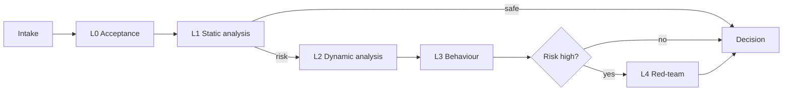
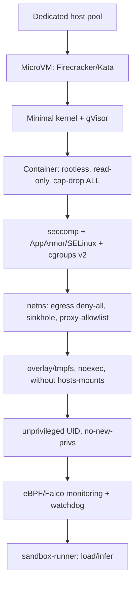
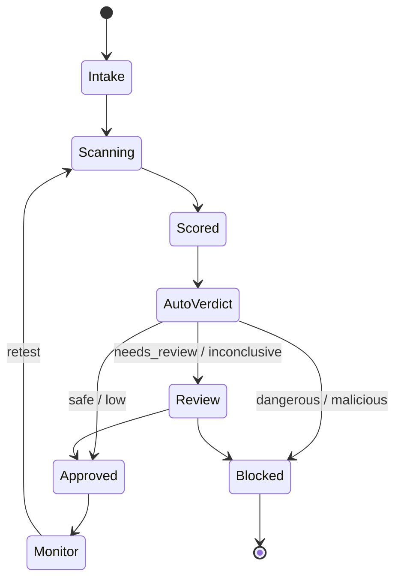
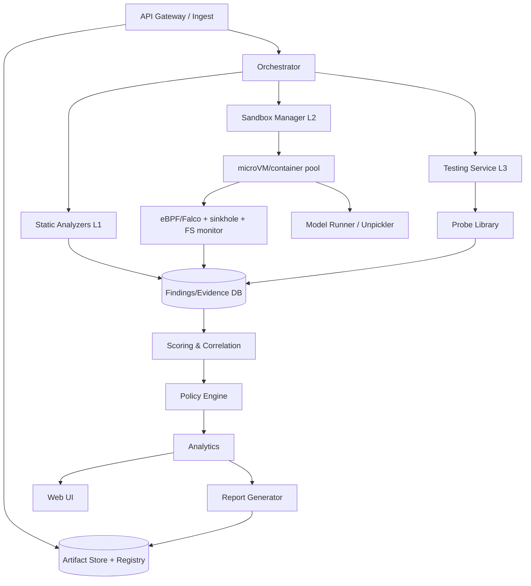
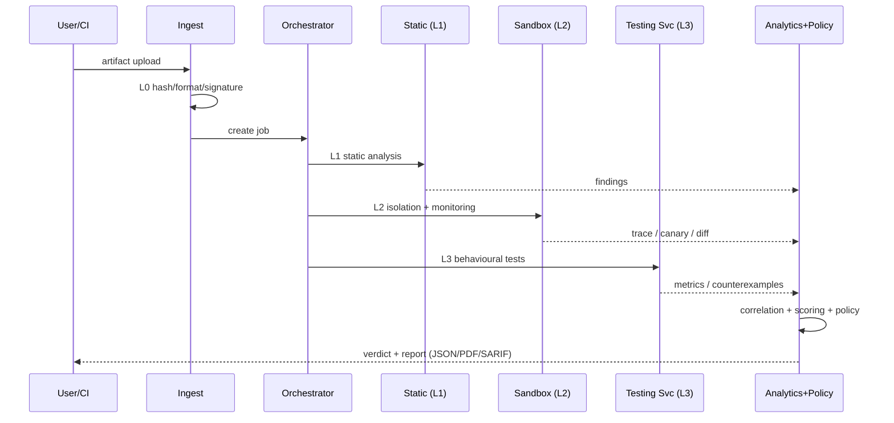

[Русский](./Concept.md) | **English**

# Concept.md — Concept of a system for automatic danger analysis of ML models (pickle)

**Working title:** MLScanner
**Status:** Architectural concept (v1.0)
**Scope:** security analysis of ML models delivered in pickle format and derivatives

---

## 0. Summary (Executive Summary)

The pickle format serializes **arbitrary Python objects and executes arbitrary code
during deserialization**. Therefore an ML model in pickle format (`.pkl`, `.pt/.pth`, `.bin`,
`.joblib`, `.npy/.npz` with `allow_pickle=True`, `dill`/`cloudpickle`, etc.) — is not a set of
data, but an **executable program**, potentially hostile.

A system **MLScanner** is proposed, consisting of three components:

1. **Sandbox (Sandbox)** — hermetic launch of the model, full observation, guaranteed destruction.
2. **Testing Service (Testing Service)** — submission of requests to the model and safe receipt/normalization of results without risk to the platform.
3. **Analytics Engine + UI (Analytics Engine)** — unified management of the process, collection, correlation, analysis and formation of a conclusion.

The system combines three independent verification contours:
- **Static** (without execution): disassembly of pickle, allowlist check, AST, metadata, integrity.
- **Dynamic** (in isolation): real execution with monitoring of syscalls/network/FS/processes/resources.
- **Behavioural**: testing of the already loaded model for backdoor, data leaks, reliability defects.

The result of the system's work — a **reproducible, provable verdict** on the admissibility of
applying a specific model, with a complete evidence base and an auditable decision.

Key principle: **"not proven safe" ≠ "safe"**. The absence of findings with incomplete
coverage gives the verdict `Inconclusive`, and not `Safe`.

---

## Implementation status (as-built)

Implemented and deployed in the cluster **<CLUSTER>** (MicroK8s, 9 namespaces):
- **Stage 0** — PoC (single-file analyzer: static analysis/dynamic analysis/behaviour).
- **Stage 1** — hardened sandbox: **Kata** microVM, deception, sinkhole, NetworkPolicy, eBPF (Falco).
- **Stage 2** — testing service: **streaming loading of models of any size**, Artifact server,
  sandbox-Job launch, normalization, verdict, progress and statistics.
- **Stage 3** — analytics engine + **web UI**: file upload, verification progress, statistics
  with hashes, filters/sorting, scoring, Policy Engine, append-only Evidence Store (hash-chain), reports JSON/MD/SARIF.
- **Stage 4** — integrations: Model Registry (by SHA-256), CI/CD gate, SIEM (NDJSON/CEF), threat-intel.
- **Transition to Ingress/Egress:** a single entry point Istio Gateway + VirtualServices by hosts;
  platform egress — allowlist (deny-by-default); per-service NodePort disabled (`deploy/ingress/`).
- **Stage 5** — operations: Prometheus metrics, quality (TPR/FPR), continuous retest, red-team, PDB, attestation.
- **v2, Wave 0** — object storage **S3 (Garage)** for artefacts (deduplication by
  `sha256/<name>`), **PostgreSQL** for metadata/findings/evidence/users/settings,
  **AuthN/Z + audit** (API keys + UI users + roles + `audit_log`), observability and
  backup, retention/TTL and quarantine (`mlscan-lifecycle`).
- **v2, format waves 1–3** — adapters and detectors beyond pickle (model-as-code, Keras, ONNX, HDF5,
  GGUF, archives, XXE/unsafe-YAML, tokenizers, prompt-injection, agent/MCP), dynamic analysis of
  model-as-code; check ids `EXEC/INJ/AGT/BD/FMT/INT/STEG`/`D`.
- **Localisation** — the UI and service messages in **RU/EN** with a global language setting
  (`MLSCAN_LANG` at launch or a setting in the DB; see `docs/12-i18n.md`).

The sandbox image `mlscan-sandbox` (`:v2`; Python 3.12 + PyTorch CPU + numpy, safetensors,
onnxruntime, h5py, gguf, joblib, dill, cloudpickle) is built by **Kaniko** into the in-cluster registry.
Dynamic analysis brings the payload to execution (including torch models, numpy and pickle in Python 2 style).
Verification of the system itself: the synthetic corpus `tests/vulnerabilities/` — 38 samples,
**33/33 detected, 0 misses, 0 false positives**. Details and diagrams —
`docs/07-implemented-architecture.md`, the test guide — `docs/08-testing-guide.md`.

---

# Part I. Checklist of potential dangers

A complete list of risks of a model in pickle format. Severity scale: **C** (critical),
**H** (high), **M** (medium), **L** (low).

## A. Deserialization risks (execution-time)

| ID | Risk | Mechanism / signs | Sev |
|----|------|---------------------|-----|
| A-01 | RCE at `pickle.load` | opcodes `REDUCE`/`GLOBAL`/`STACK_GLOBAL`/`BUILD`; suspicious globals (`os.system`, `subprocess`, `eval`, `exec`, `builtins`, `getattr`) | C |
| A-02 | RCE via `__reduce__` | the object returns `(callable, args)` | C |
| A-03 | RCE/side effects via `__setstate__`/`BUILD` | state restoration reads FS/network | H |
| A-04 | Interception of `find_class` | shadowed `Unpickler.find_class`, monkey-patching | H |
| A-05 | Dynamic compilation | `compile`, `types.FunctionType`, `marshal.loads`, `exec` | C |
| A-06 | Obfuscation of payload | base64/zlib/marshal inside pickle, high entropy | H |
| A-07 | Nested/recursive pickle | hidden second payload | H |
| A-08 | Legacy opcodes (`INST`,`OBJ`,`EXT*`) | rare opcodes | M |
| A-09 | `persistent_load` with side effects | external load by key | M |
| A-10 | Side-channel via `PROTO`/`MEMO` | extraction via the stream structure | L |
| A-11 | RCE via `dill`/`cloudpickle` | serialize functions/closures entirely | C |
| A-12 | RCE via `joblib` | joblib = pickle + numpy | C |
| A-13 | RCE via `torch.load` (legacy) | PyTorch uses pickle; `weights_only=False` | C |
| A-14 | Bypass of `weights_only=True` | historical vulnerabilities of the allowlist (e.g. CVE-2025-32434) | C |
| A-15 | RCE via Keras `Lambda` | arbitrary function in the layer config | C |
| A-16 | RCE via numpy object-array | `.npy/.npz` with `allow_pickle=True` | C |
| A-17 | `trust_remote_code=True` | execution of `modeling_*.py` from the repository | C |
| A-18 | Custom ops ONNX | external operators/Python-runtime | H |

## B. Wrapper formats and delivery vectors

| ID | Risk | Signs | Sev |
|----|------|----------|-----|
| B-01 | Disguise as a "safe" format | mismatch of extension and content | H |
| B-02 | Polyglot files | several sets of "magic bytes" | H |
| B-03 | Zip-slip / path traversal | names with `../`, absolute paths | H |
| B-04 | Zip-/decompression bomb | abnormal compression ratio | M |
| B-05 | Loading of external dependencies by URL | URL in config, network calls at load | H |
| B-06 | Malicious `config.json`/`requirements` | install scripts, external indexes | H |
| B-07 | Spoofing of metadata/model card | discrepancy of metadata and content | M |
| B-08 | Typosquatting of repositories/packages | similar names of popular models | M |
| B-09 | Malicious `__init__.py` in the artifact | Python files inside the model container | H |
| B-10 | Malicious `setup.py`/`pyproject.toml` | code at `pip install` | H |

## C. Model-level risks (model as algorithm)

| ID | Risk | Signs | Sev |
|----|------|----------|-----|
| C-01 | Backdoor / Trojan | sharp change of output on the trigger | C |
| C-02 | Trigger pattern (pixel/sticker/word) | anomalies on synthetic triggers | H |
| C-03 | Data poisoning in the weights | abnormal distributions of weights/activations | H |
| C-04 | Model inversion | recovery of training examples | H |
| C-05 | Membership inference | difference of confidence by training participation | M |
| C-06 | Leak of PII/secrets (memorization) | verbatim fragments in the outputs | H |
| C-07 | Leak of IP/architecture | recovery of hyperparameters/structure | M |
| C-08 | Adversarial evasion | successful adversarial examples | M |
| C-09 | Steganography in the weights | abnormal entropy/least significant bits | M |
| C-10 | Model extraction/skimming | high-volume identical requests | M |
| C-11 | Instability (NaN/Inf/overflow) | numerical anomalies, crashes | M |
| C-12 | Excessive complexity (DoS) | high latency/CPU/GPU | M |
| C-13 | Adversarial bypass of detectors | bypass of guardrails | M |
| C-14 | Bias/fairness defects | differences of metrics across subgroups | L |
| C-15 | Spurious correlation | low robustness out of distribution | L |
| C-16 | Hidden dual-use functionality | deviation from the declared purpose | H |
| C-17 | Poor calibration/class imbalance | incorrect probabilities | L |
| C-18 | Model as bait (watering hole) | anomalies of load/behaviour | H |

## D. Integrity, provenance and supply chain

| ID | Risk | Signs | Sev |
|----|------|----------|-----|
| D-01 | Substitution of weights (tampering) | mismatch of hash/signature | C |
| D-02 | Absence of signature/provenance | no sigstore/SBOM | H |
| D-03 | Compromise of the owner's account | sudden changes in the repository | H |
| D-04 | Dependency confusion | mismatch of the dependency source | H |
| D-05 | Supply chain in the base library | known CVEs of torch/numpy, etc. | H |
| D-06 | Absence of immutability/versioning | unstable artifact hash | M |
| D-07 | Absence of SBOM | no dependency manifest | M |
| D-08 | License violation | incompatible licenses | M |
| D-09 | Removal of watermark/marks | absence of expected marks | L |

## E. Information disclosure (information leaks)

| ID | Risk | Signs | Sev |
|----|------|----------|-----|
| E-01 | Theft of environment variables | accesses to `os.environ` at load | H |
| E-02 | Theft of credentials | access to `~/.aws`, `~/.ssh`, `.netrc`, kubeconfig | C |
| E-03 | Exfiltration of files | outgoing connections at load | C |
| E-04 | Leak of internal paths/hosts | internal domains/IPs | L |
| E-05 | Capture of cloud metadata | access to `169.254.169.254` (IMDS) | C |
| E-06 | Theft of CI/CD tokens | access to env/secrets of the runner | H |
| E-07 | Leak of training data (PII) | extraction via requests | H |
| E-08 | Leak of the model's source code | recovery of structure/code | M |
| E-09 | Capture of cryptographic material | access to keys/wallets | C |

## F. Uncontrolled behaviour at load and inference

| ID | Risk | Signs | Sev |
|----|------|----------|-----|
| F-01 | Network access at load | reverse shell, C2, DNS/HTTPS callback | C |
| F-02 | Write to the FS | modification/creation of files | H |
| F-03 | Persistence mechanisms | cron, systemd, `.bashrc`, autostart | C |
| F-04 | Fork bomb / DoS | explosion of the PID count | H |
| F-05 | Resource exhaustion | OOM, 100% CPU, disk filling | H |
| F-06 | Infinite loops/hangs | timeout, absence of progress | M |
| F-07 | Self-modification of weights | write to the artifact during operation | M |
| F-08 | Escape from the sandbox | container-escape indicators | C |
| F-09 | Crypto-mining | high load, accesses to pools | H |
| F-10 | Ransomware-like encryption | mass write/encryption | C |
| F-11 | Attack on the scanning system | impact on the scanner/dependencies | H |
| F-12 | Cross-contamination of tasks | shared volumes/state | H |
| F-13 | Theft of the results of other scans | access to shared directories | M |
| F-14 | Side channels (timing/cache) | microarchitectural anomalies | L |

## G. Risks of the execution environment and artifacts

| ID | Risk | Signs | Sev |
|----|------|----------|-----|
| G-01 | Unsafe hosts mounts | recommended volumes/sockets | H |
| G-02 | Access to the Docker socket | `/var/run/docker.sock` | C |
| G-03 | Unsafe default secrets | secrets in env/image | H |
| G-04 | Excessive capabilities | `CAP_SYS_ADMIN`, `--privileged` | C |
| G-05 | Shared kernel/namespace | shared kernel | H |
| G-06 | Obsolete kernel/engine | known exploits | H |
| G-07 | Unsafe dependencies of the scanner | CVE in the toolchain | H |
| G-08 | Poor control of artifacts | weak access to the storage | M |

## H. Risks of the scanner infrastructure and the verification process

| ID | Risk | Signs | Sev |
|----|------|----------|-----|
| H-01 | False negatives | a miss with an incomplete test set | C |
| H-02 | False positives | excessive triggers | M |
| H-03 | Incompleteness of coverage | no tests for a category | H |
| H-04 | Nondeterminism | unstable verdicts | M |
| H-05 | Sandbox evasion | conditional/delayed activation | H |
| H-06 | Compromise of the control plane | access to the DB/API | C |
| H-07 | Leak through verification channels | leaks of reports/logs | H |
| H-08 | Insufficient audit | no immutable logs | M |
| H-09 | Incorrect version attribution | confusion of hash/versions | H |
| H-10 | Absence of test isolation | shared state between scans | H |

## I. Legal, compliance and reputational risks

| ID | Risk | Sev |
|----|------|-----|
| I-01 | Privacy violation (GDPR/152-FZ) | H |
| I-02 | Liability for an incident | H |
| I-03 | License incompatibility | M |
| I-04 | Export control violation | M |
| I-05 | Reputational damage | H |
| I-06 | Absence of regulatory compliance (AI Act) | M |

## Framework mapping

- **OWASP ML Top 10 (2023):** ML01–ML10 (Input Manipulation, Data Poisoning, Model Inversion,
  Membership Inference, Model Theft, AI Supply Chain, Transfer Learning, Model Skewing,
  Output Integrity, Model Poisoning).
- **MITRE ATLAS:** ML Supply Chain Compromise, Backdoor ML Model, Poison Training Data, Exfiltration, Impact.
- **CWE:** CWE-502, CWE-94, CWE-78, CWE-200, CWE-400, CWE-22, CWE-770, CWE-284.
- **MITRE ATT&CK:** T1059, T1071, T1543, T1547, T1041, T1496, T1486.

## Prioritization for the first implementation

1. RCE during deserialization (A-01/02/13/14/15/16/17).
2. Network/persistence/mining/encryption (F-01/03/09/10).
3. Theft of secrets and exfiltration (E-01/02/03/05).
4. Disguise and malicious dependencies (B-01/06/09/10).
5. Backdoor/poisoning/leak/PII (C-01/03/06/16).
6. Integrity and provenance (D-01/02/03/04).

---

# Part II. Testing and detection strategy

## Principles
Assume malicious; never execute in a trusted environment; defense in depth by layers;
full observation; reproducibility; evidence, not flags; layering static analysis→dynamic analysis.

## Testing levels

**L0. Acceptance and integrity.** Hashes (SHA-256/BLAKE3), real format by magic-bytes,
verification of signature/provenance, lineage, detection of polyglots. → Artifact Record (immutable).

**L1. Static analysis (without execution).**
- disassembly (`pickletools.dis`) and parsing of the VM stream into IR;
- analysis of opcodes (`GLOBAL`,`STACK_GLOBAL`,`REDUCE`,`BUILD`,`INST`,`OBJ`,`EXT*`);
- allowlist check of globals (`numpy`, torch tensors/storage, `collections` are allowed);
- search for dangerous callables (`os.system`, `subprocess`, `eval`, `exec`, `compile`, `__import__`,
  `socket`, `requests`, `ctypes`, `marshal.loads`, `runpy`…);
- AST analysis (fickling); detection of obfuscation (entropy, base64/ZIP/marshal, nested pickle);
- analysis of third-party artifacts (`config.json`, `*.py`, `setup.py`, Lambda layers, ONNX ops);
- SBOM + CVE scan + dependency confusion/typosquatting; inventory of tensors.
- Tools: pickletools, **fickling**, **picklescan**, **ModelScan**, semgrep, bandit, pip-audit, syft/grype, trivy.

**L2. Dynamic analysis in the sandbox.** Real execution of `load` in isolation (see Part III):
monitoring of syscalls (eBPF/Falco), network, FS (inotify/overlay-diff), processes, resources;
deception (honeypot creds, fake IMDS/kubeconfig, canary files/URLs). → Behavioral Trace.

**L3. Behavioural testing of the model.**
- functional tests (conformity to purpose, input/output contract);
- robustness (FGSM/PGD, text attacks);
- backdoor search (trigger scanning, anomalies of activations, diff with a reference);
- privacy (membership inference, model inversion, extraction of PII);
- calibration/stability (NaN/Inf, distribution shift);
- resource tests (latency, memory/GPU, DoS). → Model Behavior Report.

**L4. Deep analysis and red-team.** Manual reverse, fuzzing of the format/inputs, check of
sandbox evasion, escape tests of isolation, attribution (ATT&CK/ATLAS).

## Flow and escalation



Rules: dangerous callables at L1 → immediately L2; network/exfiltration/persistence at L2 → immediate
stop and verdict *Malicious*; undefined format → L2 + L4.

## Evidence base
Each finding: id, category, level, detector, severity, confidence, reproducibility,
**raw evidence** (pickle disassembly, trace, network dump, FS diff, metric, counterexample),
references to standards. Storage — append-only with a hash-chain.

## Testability of the system
A "golden" set of references (safe/suspicious/malicious → EICAR analogue for pickle), metrics
TPR/FPR/FNR by category, checklist coverage, periodic escape tests, mutation
testing of detectors.

## Limitations
Full coverage of behaviour is impossible (conditional/delayed activation); static analysis does not solve
the halting problem; models can detect the sandbox → a policy of "managed risk".

---

# Part III. Methods of reliable isolation

**Assumption:** the payload is maximally hostile and tries to execute code, escalate
privileges, escape the sandbox, access the network, read/write the FS, steal secrets,
exhaust resources, attack the scanner, detect the sandbox.

## Isolation layers (defense in depth)



- **Host:** dedicated pool, isolation from production; microVM = its own kernel boundary per instance.
- **Kernel:** gVisor/Kata; fresh patches; LSM in enforce; disabling of unnecessary modules.
- **Container:** rootless; `--read-only`, `--no-new-privileges`, `--cap-drop=ALL`; prohibition of
  `--privileged`, `CAP_SYS_ADMIN`, access to the docker socket, host PID/net, home directories.
- **seccomp-bpf:** default deny, allowlist, block `execve`/`socket`/`ptrace`/`mount`/`bpf`/`unshare`.
- **Network:** separate netns, **egress deny-all**; only an egress proxy with allowlist and logging;
  DNS sinkhole; HTTP sinkhole + canary URL for beaconing detection; block of IMDS and internal services.
- **FS:** CoW overlay on tmpfs; only the needed libraries; `noexec,nosuid,nodev`; quotas;
  honeypot files with canary (`~/.aws/credentials`, `~/.ssh/id_rsa`, kubeconfig, `.env`).
- **cgroups v2:** CPU/GPU quota, memory limit (+swap=0), pids.max (against fork bombs), io.max,
  limits of FD/sockets; **hard timeout** for load and inference; SIGKILL on excess; watchdog.
- **GPU:** MIG/vGPU/emulation, context isolation, VRAM limit.
- **Monitoring:** eBPF (Falco/Tetragon), auditd, ptrace/strace for debugging, OOM-killer as the last line.
- **Deception/anti-evasion:** randomization of names/paths/env/timings; decoy secrets with
  canary; multiple runs in different configurations for detection of conditional activation.

## Application level
- Loading of the model — in a separate process via `sandbox-runner`; no network clients.
- Clean env (`env -i`, only `PATH`/`LANG`).
- Disabling "magic": `torch.load(weights_only=True)`, `numpy.load(allow_pickle=False)` where possible;
  `Unpickler` with allowlist `find_class` for static mode.
- **Two modes:** *static-only* (without `execve`, interception of `find_class`) and *dynamic* (real
  execution under full monitoring).

## Protection against leaks from the sandbox
Side channels (timings, CPU/memory, log size, DNS timings) are mitigated by
normalization of timings, isolation of shared memory, separation of data of different models.
One instance — one model (against cross-contamination).

## Instance lifecycle
Provisioning (immutable image) → Setup (artifact RO, limits, monitoring) → Execution
(sandbox-runner, watchdog) → Teardown (complete destruction) → Attestation (hash of image/toolchain).

## Isolation of static analysis
Pickle/marshal parsers may have their own vulnerabilities → parsing in a separate low-privilege
process without network; limit of size/depth of structures; do not import modules of the artifact
until an allowlist check.

## Isolation of the control plane
The control plane has no access to the execution network; trust zones `intake`→`static`→`dynamic`→`analysis`;
platform secrets are never available to the sandbox; signature of results, RBAC, audit, immutable logs.

## "Risk → measure" matrix

| Risk | Measures |
|------|------|
| RCE (A-*) | microVM + gVisor, seccomp, rootless, no-new-privs, read-only |
| Network/C2 (F-01) | netns, egress deny-all, sinkhole, canary URL, DNS interception |
| FS/persistence (F-02/03) | overlay/tmpfs, read-only, teardown, FS monitoring |
| Resources/DoS (F-04/05/06) | cgroups v2, pids.max, GPU/disk limits, timeouts, watchdog |
| Theft of secrets (E-*) | honeypot creds, empty env, no real secrets, IMDS block |
| Escape (F-08/G-*) | microVM, LSM, drop caps, prohibition of docker socket/privileged |
| Sandbox evasion (H-05) | randomization, deception, multiple runs, fuzzing |
| Confusion/contamination (H-09/10) | one instance = one model, hash pinning, isolation of volumes |

## Guarantee boundaries
A practical multi-layer guarantee (best-effort) is given, not a formal proof.
Residual risks: 0-day of the hypervisor/kernel/parser, hardware/microarchitectural attacks,
conditional activation, side channels. Mitigated by freshness of components, minimization of the
attack surface, segmentation, monitoring, red-team and "air-gap" for especially risky artifacts.

---

# Part IV. Processing of results and decision-making

## Pipeline
Static Findings + Behavioral Trace + Model Metrics → **Normalization** → **Correlation/dedup**
(coincidence of static and dynamic increases confidence) → **Scoring** → **Policy Engine** →
**Verdict** → **Report** → **Auto-actions**.

## Normalized Finding (contract)
`finding_id`, `artifact_hash`, `scan_id`, `level` (L0–L4), `category` (A–I), `check_id`,
`title`, `severity`, `confidence`, `detector`, `evidence[]`, `standards[]`, `remediation`,
`deterministic`.

## Risk scoring
```
risk_score = base_severity_weight × confidence_factor × exploitability_factor × scope_factor
```
| Severity | base |
|----------|------|
| critical | 9.0–10.0 |
| high | 7.0–8.9 |
| medium | 4.0–6.9 |
| low | 1.0–3.9 |
| info | 0.0–0.9 |

Aggregation over the artifact: **the maximum dominates** (critical findings determine the verdict),
plus an accumulative score.

## Verdict classes

| Verdict | Condition | Action |
|---------|---------|----------|
| Safe | 0 findings high+, coverage complete | Allow + registry |
| Low risk | only low/info | Allow with recommendations |
| Needs review | medium / uncertainty / incomplete coverage | Quarantine until manual analysis |
| Dangerous | high / malicious pattern without full confirmation | Block + escalation |
| Malicious | confirmed RCE/exfiltration/persistence/encryption/canary | Block + incident |
| Inconclusive | tests not performed/infrastructure error | Repeat/manual review (not "Safe") |

## Policy Engine (example)
```yaml
rules:
  - {id: block-rce,      when: findings.any(check_id in ["A-01","A-02","A-13"] and confidence>0.8), action: block, verdict: malicious}
  - {id: block-egress,   when: trace.network.egress_unexpected == true, action: block, verdict: malicious}
  - {id: quarantine-med, when: max_severity == "medium", action: quarantine, verdict: needs_review}
  - {id: allow-low,      when: max_severity in ["low","info"] and coverage.complete, action: allow}
  - {id: default-deny,   when: default, action: quarantine, verdict: inconclusive}
```

## Human in the loop
Verdicts Needs review / Dangerous / Inconclusive → manual review: confirmation/refutation of the
finding (feedback to detectors), override with justification (audit), launch of additional
tests. Feedback priority — false negatives.

## Auto-actions
CI/CD gate (block the build at ≥ Dangerous), Model Registry (allowed/blocked/quarantined),
quarantine of the artifact, incident response (SOC), continuous monitoring and retest.

## Verdict lifecycle

The verdict is tied to the artifact hash and the policy version; changes → re-verification. Auditability:
append-only decision log (who/what/when/why), signature, versions of detectors/policies.

---

# Part V. System architecture

## Components (the mandatory three)

### 1. Sandbox (Sandbox)
- Provisioning of ephemeral microVMs/containers, configuration of isolation (Part III).
- Launch of model loading via a dedicated `sandbox-runner`.
- Monitoring (eBPF/Falco, net/FS/process/resource), deception, canary.
- Formation of Behavioral Trace; teardown; attestation.
- API: `POST /sandbox/run`, `GET /sandbox/runs/{id}/trace`; profiles `static-only`, `safe-load`,
  `full-dynamic`, `behavior`.

### 2. Testing Service (Testing Service)
- Formation of probe sets, submission of tasks to the Sandbox (never executes on its own).
- Normalization and **safe validation/escaping** of results before analytics.
- Management of timeouts, retries, quotas; dedup/correlation.
- Probe types: load / functional / adversarial / backdoor / privacy / robustness / resource.
- Least-privilege, without secrets; only proxies the artifact into isolation.

### 3. Analytics Engine + UI
- Orchestrator/Scheduler (pipeline L0–L4, queues, resources).
- Correlation & Scoring, Policy Engine, Evidence Store (append-only, signed).
- Knowledge Base (detectors, rules, baseline, IoC/ATT&CK/ATLAS).
- Report Generator (JSON/PDF/HTML/SARIF + signature).
- Web UI: queue/status, artifact card, findings explorer, model behavior, policy editor,
  decision registry, dashboards (TPR/FPR, coverage, SLA, top risks).
- Integrations: CI/CD, Model Registry, SOC/SIEM, tickets.
- API: `/scans`, `/scans/{id}/findings`, `/scans/{id}/report`, `/artifacts/{hash}`,
  `/artifacts/{hash}/review`, `/policies`.

## General scheme (containers)


## Separation of planes
- **Data plane** (untrusted zone): Sandbox + Testing Service.
- **Control plane** (trusted): Orchestrator, Policy, Scoring, Analytics/UI — without direct
  access to executable code.
- Transfer between zones — only one-way through the event bus; validation of results.

## Data model
`Artifact`, `Scan`, `Finding`, `Evidence`, `Trace`, `ModelBehavior`, `Policy`/`PolicyVersion`,
`Decision`, `ThreatIntel`. Relational DB + object storage (S3/MinIO) for raw
evidence/trace; immutability via append-only + checksums.

## Deployment
- Kubernetes for the control plane; a separate pool of nodes (taints/labels) for execution,
  preferably bare-metal/VM with a microVM runtime (Kata/Firecracker).
- Network policies: executing nodes without access to the control plane and the internet.
- Queue (RabbitMQ/Kafka/NATS), autoscaling; a separate GPU pool (MIG/vGPU).

## Technology stack (recommendations)
| Layer | Options |
|------|----------|
| Isolation | Firecracker/Kata, gVisor, Podman/Docker rootless |
| Observation | Falco/Tetragon, auditd, cgroups v2 |
| Static analysis | pickletools, fickling, picklescan, ModelScan, semgrep, bandit |
| Supply chain | syft/grype, trivy, pip-audit, cosign/sigstore |
| Backend | Python (FastAPI) or Go, PostgreSQL, MinIO/S3, RabbitMQ/Kafka |
| Analytics | Python (pandas/duckdb), OPA/Rego, ML for anomalies (opt.) |
| UI | React/Vue + WebSocket for live status |

## Extensibility
Detector plugin API, Probe plugin API, Policy as code, Format adapters (GGUF, TF SavedModel…),
Threat-intel sync.

## Architecture risks and mitigations
| Risk | Mitigation |
|------|----------|
| Escape from the sandbox | microVM + gVisor + seccomp + drop caps; escape tests |
| Sandbox evasion | randomization, deception, multiple runs, fuzzing |
| Incomplete coverage | explicit coverage modeling; `Inconclusive`, not `Safe` |
| False negatives | layering, red-team, feedback on incidents |
| Leak through channels | normalization of timings, isolation, no shared state |
| Scanner DoS | cgroups/quotas, timeouts, watchdog, autoscaling |
| Compromise of the control plane | separation of zones, RBAC, audit, signature |

## Roadmap
1. **MVP:** L0 (integrity) + L1 (static analysis) + basic UI/reports.
2. **M2:** Sandbox (L2) — microVM, eBPF monitoring, deception, canary.
3. **M3:** Testing Service (L3) — functional/robustness/privacy probes.
4. **M4:** backdoor detection, adversarial, correlation/scoring + Policy Engine.
5. **M5:** L4 red-team automation, CI/CD gate, Model Registry, continuous monitoring.

---

# Appendices

## Appendix A. End-to-end flow


## Appendix B. Glossary
- **RCE** — Remote Code Execution, execution of arbitrary code.
- **Pickle opcodes** — commands of the pickle virtual machine (`GLOBAL`, `REDUCE`, `BUILD`…).
- **Sandbox evasion** — evasion of the payload from detection in the sandbox.
- **Canary** — a decoy marker whose triggering proves access/leakage.
- **SBOM** — Software Bill of Materials, a manifest of software composition.
- **Provenance** — origin and integrity of the artifact (signature, attestation).
- **eBPF** — kernel-level observation technology (Falco/Tetragon).

## Appendix C. Detailed documents
- `docs/01-threat-checklist.md` — complete risk checklist (A–I).
- `docs/02-testing-strategy.md` — testing strategy L0–L4.
- `docs/03-isolation.md` — isolation methods.
- `docs/04-risk-analysis-decision.md` — processing of results and decisions.
- `docs/05-architecture.md` — detailed architecture, API, data model, deployment.
- `docs/06-implementation-plan.md` — implementation plan; the first step is a minimal PoC.
- `docs/07-implemented-architecture.md` — implemented architecture (as-built): components and network interaction scheme.
- `docs/08-testing-guide.md` — what can be tested and where to connect.
- `docs/09-formats-and-backdoors-analysis.md` — analysis of other ML/AI formats and types of backdoors (expansion beyond pickle).
- `docs/10-plan-new-formats.md` — plan of improvements for new formats.
- `docs/11-target-architecture-v2.md` — target architecture v2 (large models, S3/PostgreSQL, authentication/audit, speed).
- `START.md` — the starting article about the project.
- `poc/mlscan_poc.py` — PoC implementation (one file, Docker sandbox, Markdown report).

**Deployed implementation (cluster <CLUSTER>):**
- `deploy/stage1/` — hardened sandbox (Kata microVM, deception, sinkhole, NetworkPolicy, Falco eBPF).
- `deploy/stage2/` — testing service (HTTP API, sandbox launch, normalization, verdict).
- `deploy/stage3/` — analytics engine + UI (scoring, Policy Engine, evidence store, reports).
- `deploy/stage4/` — integrations (Model Registry, CI/CD gate, SIEM export, threat-intel).
- `deploy/stage5/` — operations (metrics/quality, retest, red-team, PDB, attestation).

## Appendix D. Open questions for clarification
1. Required level of isolation (is a microVM mandatory or are gVisor containers sufficient)?
2. Expected volumes and SLA of scanning (number of models/day, acceptable time).
3. Presence of GPU: is isolation of the GPU context and MIG needed?
4. Compliance requirements (152-FZ/GDPR/AI Act) and evidence storage policy.
5. Depth of behavioural tests (are privacy/backdoor tests needed in the MVP or in M3+).
6. Integrations: specific CI/CD, model registries, SIEM/SOC.
7. Language/stack of the development team for choosing the backend.
