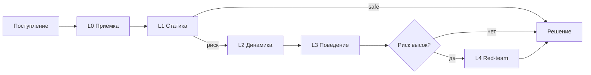
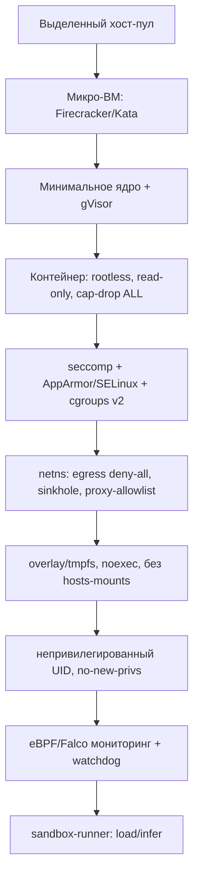
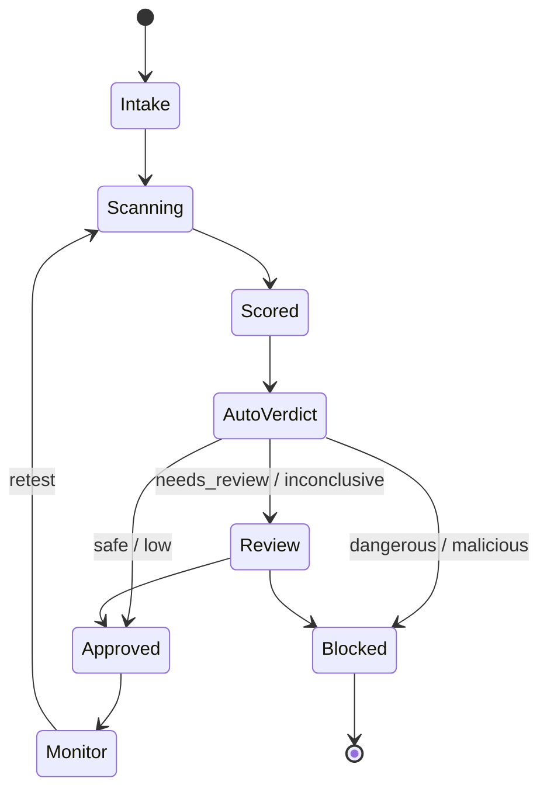
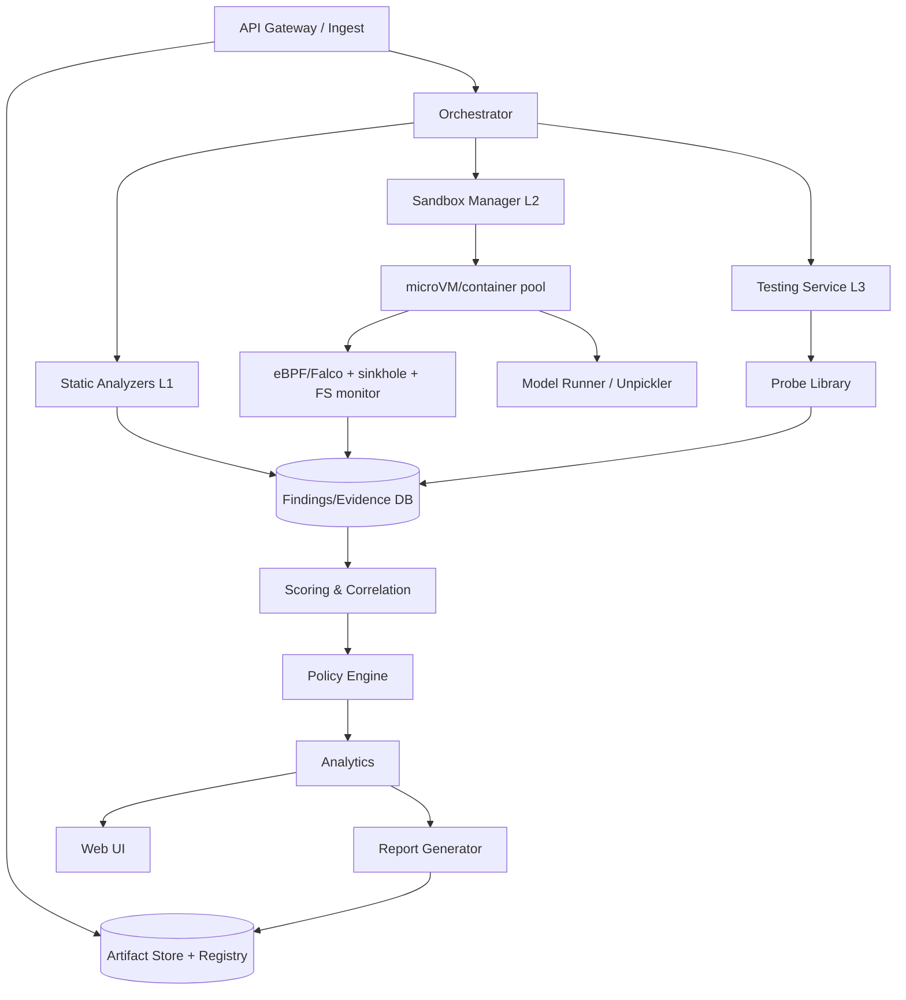
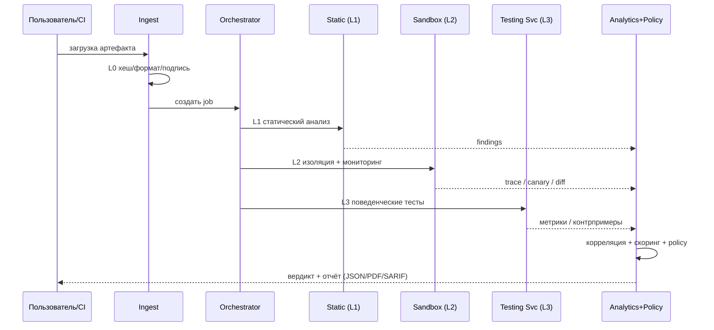

# Concept.md — Концепция системы автоматического анализа опасности ML-моделей (pickle)

**Рабочее название:** MLScanner
**Статус:** Архитектурная концепция (v1.0)
**Область:** анализ безопасности ML-моделей, поставляемых в формате pickle и производных

---

## 0. Резюме (Executive Summary)

Формат pickle сериализует **произвольные Python-объекты и исполняет произвольный код
при десериализации**. Поэтому ML-модель в формате pickle (`.pkl`, `.pt/.pth`, `.bin`,
`.joblib`, `.npy/.npz` с `allow_pickle=True`, `dill`/`cloudpickle` и др.) — это не набор
данных, а **исполняемая программа**, потенциально враждебная.

Предлагается система **MLScanner**, состоящая из трёх компонент:

1. **Sandbox (Песочница)** — герметичный запуск модели, полное наблюдение, гарантированное уничтожение.
2. **Testing Service (Сервис тестирования)** — подача запросов модели и безопасное получение/нормализация результатов без риска для платформы.
3. **Analytics Engine + UI (Аналитический движок)** — единое управление процессом, сбор, корреляция, анализ и формирование заключения.

Система объединяет три независимых контура проверки:
- **Статический** (без исполнения): дизассемблирование pickle, allowlist-проверка, AST, метаданные, целостность.
- **Динамический** (в изоляции): реальное исполнение с мониторингом syscalls/сети/ФС/процессов/ресурсов.
- **Поведенческий**: тестирование уже загруженной модели на backdoor, утечки данных, дефекты надёжности.

Итог работы системы — **воспроизводимый, доказуемый вердикт** о допустимости применения
конкретной модели, с полной доказательной базой и аудируемым решением.

Ключевой принцип: **«не доказано, что безопасно» ≠ «безопасно»**. Отсутствие находок при
неполном покрытии даёт вердикт `Inconclusive`, а не `Safe`.

---

# Часть I. Чеклист потенциальных опасностей

Полный перечень рисков модели в формате pickle. Шкала серьёзности: **C** (критическая),
**H** (высокая), **M** (средняя), **L** (низкая).

## A. Риски десериализации (execution-time)

| ID | Риск | Механизм / признаки | Sev |
|----|------|---------------------|-----|
| A-01 | RCE при `pickle.load` | opcodes `REDUCE`/`GLOBAL`/`STACK_GLOBAL`/`BUILD`; подозрительные глобалы (`os.system`, `subprocess`, `eval`, `exec`, `builtins`, `getattr`) | C |
| A-02 | RCE через `__reduce__` | объект возвращает `(callable, args)` | C |
| A-03 | RCE/побочные эффекты через `__setstate__`/`BUILD` | восстановление состояния читает ФС/сеть | H |
| A-04 | Перехват `find_class` | shadowed `Unpickler.find_class`, monkey-patching | H |
| A-05 | Динамическая компиляция | `compile`, `types.FunctionType`, `marshal.loads`, `exec` | C |
| A-06 | Обфускация payload | base64/zlib/marshal внутри pickle, высокая энтропия | H |
| A-07 | Вложенные/рекурсивные pickle | скрытый второй payload | H |
| A-08 | Устаревшие opcodes (`INST`,`OBJ`,`EXT*`) | редкие opcodes | M |
| A-09 | `persistent_load` с побочными эффектами | внешняя загрузка по ключу | M |
| A-10 | Side-channel через `PROTO`/`MEMO` | извлечение через структуру потока | L |
| A-11 | RCE через `dill`/`cloudpickle` | сериализуют функции/замыкания целиком | C |
| A-12 | RCE через `joblib` | joblib = pickle + numpy | C |
| A-13 | RCE через `torch.load` (legacy) | PyTorch использует pickle; `weights_only=False` | C |
| A-14 | Обход `weights_only=True` | исторические уязвимости allowlist (напр. CVE-2025-32434) | C |
| A-15 | RCE через Keras `Lambda` | произвольная функция в конфиге слоя | C |
| A-16 | RCE через numpy object-array | `.npy/.npz` с `allow_pickle=True` | C |
| A-17 | `trust_remote_code=True` | исполнение `modeling_*.py` из репозитория | C |
| A-18 | Custom ops ONNX | внешние операторы/Python-runtime | H |

## B. Форматы-обёртки и векторы доставки

| ID | Риск | Признаки | Sev |
|----|------|----------|-----|
| B-01 | Маскировка под «безопасный» формат | несоответствие расширения и контента | H |
| B-02 | Полиглот-файлы | несколько наборов «магических байтов» | H |
| B-03 | Zip-slip / path traversal | имена с `../`, абсолютные пути | H |
| B-04 | Zip-/decompression bomb | аномальный коэффициент сжатия | M |
| B-05 | Загрузка внешних зависимостей по URL | URL в конфиге, сетевые вызовы при load | H |
| B-06 | Вредоносный `config.json`/`requirements` | скрипты установки, внешние индексы | H |
| B-07 | Спуфинг метаданных/model card | расхождение метаданных и содержимого | M |
| B-08 | Typosquatting репозиториев/пакетов | близкие имена популярных моделей | M |
| B-09 | Вредоносный `__init__.py` в артефакте | Python-файлы внутри контейнера модели | H |
| B-10 | Вредоносный `setup.py`/`pyproject.toml` | код при `pip install` | H |

## C. Риски уровня модели (модель как алгоритм)

| ID | Риск | Признаки | Sev |
|----|------|----------|-----|
| C-01 | Backdoor / Trojan | резкая смена выхода на триггере | C |
| C-02 | Триггер-паттерн (pixel/sticker/word) | аномалии на синтетических триггерах | H |
| C-03 | Data poisoning в весах | аномальные распределения весов/активаций | H |
| C-04 | Model inversion | восстановление обучающих примеров | H |
| C-05 | Membership inference | различие уверенности по участию в обучении | M |
| C-06 | Утечка PII/секретов (memorization) | дословные фрагменты в выходах | H |
| C-07 | Утечка IP/архитектуры | восстановление гиперпараметров/структуры | M |
| C-08 | Adversarial evasion | успешные состязательные примеры | M |
| C-09 | Steganography в весах | аномальная энтропия/младшие биты | M |
| C-10 | Model extraction/skimming | высокообъёмные однотипные запросы | M |
| C-11 | Нестабильность (NaN/Inf/overflow) | числовые аномалии, падения | M |
| C-12 | Чрезмерная сложность (DoS) | высокая latency/CPU/GPU | M |
| C-13 | Состязательный обход детекторов | обход guardrails | M |
| C-14 | Bias/fairness-дефекты | различия метрик по подгруппам | L |
| C-15 | Spurious correlation | низкая robustность вне распределения | L |
| C-16 | Скрытая dual-use функциональность | отклонение от заявленного назначения | H |
| C-17 | Плохая калибровка/перекос классов | неверные вероятности | L |
| C-18 | Модель как приманка (watering hole) | аномалии загрузки/поведения | H |

## D. Целостность, происхождение и цепочка поставки

| ID | Риск | Признаки | Sev |
|----|------|----------|-----|
| D-01 | Подмена весов (tampering) | несовпадение хеша/подписи | C |
| D-02 | Отсутствие подписи/provenance | нет sigstore/SBOM | H |
| D-03 | Компрометация аккаунта владельца | внезапные изменения в репозитории | H |
| D-04 | Dependency confusion | несовпадение источника зависимостей | H |
| D-05 | Supply-chain в базовой библиотеке | известные CVE torch/numpy и др. | H |
| D-06 | Отсутствие immutability/versioning | нестабильный хеш артефакта | M |
| D-07 | Отсутствие SBOM | нет манифеста зависимостей | M |
| D-08 | Нарушение лицензий | несовместимые лицензии | M |
| D-09 | Удаление watermark/меток | отсутствие ожидаемых меток | L |

## E. Раскрытие информации (информационные утечки)

| ID | Риск | Признаки | Sev |
|----|------|----------|-----|
| E-01 | Кража переменных окружения | обращения к `os.environ` при load | H |
| E-02 | Кража учётных данных | доступ к `~/.aws`, `~/.ssh`, `.netrc`, kubeconfig | C |
| E-03 | Эксфильтрация файлов | исходящие соединения при load | C |
| E-04 | Утечка внутренних путей/хостов | внутренние домены/IP | L |
| E-05 | Захват метаданных облака | доступ к `169.254.169.254` (IMDS) | C |
| E-06 | Кража токенов CI/CD | доступ к env/secrets раннера | H |
| E-07 | Утечка обучающих данных (PII) | извлечение через запросы | H |
| E-08 | Утечка исходного кода модели | восстановление структуры/кода | M |
| E-09 | Захват криптоматериалов | доступ к ключам/кошелькам | C |

## F. Неконтролируемое поведение при загрузке и инференсе

| ID | Риск | Признаки | Sev |
|----|------|----------|-----|
| F-01 | Сетевой доступ при load | reverse shell, C2, DNS/HTTPS callback | C |
| F-02 | Запись в ФС | изменение/создание файлов | H |
| F-03 | Механизмы persistence | cron, systemd, `.bashrc`, автозапуск | C |
| F-04 | Форк-бомба / DoS | взрыв числа PID | H |
| F-05 | Исчерпание ресурсов | OOM, 100% CPU, заполнение диска | H |
| F-06 | Бесконечные циклы/зависания | timeout, отсутствие прогресса | M |
| F-07 | Самоизменение весов | запись в артефакт во время работы | M |
| F-08 | Побег из песочницы | контейнер-эскейп индикаторы | C |
| F-09 | Crypto-mining | высокая нагрузка, обращения к пулам | H |
| F-10 | Ransomware-подобное шифрование | массовая запись/шифрование | C |
| F-11 | Атака на сканирующую систему | влияние на сканер/зависимости | H |
| F-12 | Кросс-контаминация задач | общие тома/состояние | H |
| F-13 | Кража результатов других сканов | доступ к общим каталогам | M |
| F-14 | Побочные каналы (тайминг/кэш) | микроархитектурные аномалии | L |

## G. Риски окружения исполнения и артефактов

| ID | Риск | Признаки | Sev |
|----|------|----------|-----|
| G-01 | Небезопасные hosts mounts | рекомендуемые тома/сокеты | H |
| G-02 | Доступ к Docker-сокету | `/var/run/docker.sock` | C |
| G-03 | Небезопасные default-секреты | секреты в env/образе | H |
| G-04 | Избыточные capabilities | `CAP_SYS_ADMIN`, `--privileged` | C |
| G-05 | Shared kernel/namespace | общий kernel | H |
| G-06 | Устаревшее ядро/движок | известные эксплойты | H |
| G-07 | Небезопасные зависимости сканера | CVE в toolchain | H |
| G-08 | Плохой контроль артефактов | слабый доступ к хранилищу | M |

## H. Риски инфраструктуры сканера и процесса проверки

| ID | Риск | Признаки | Sev |
|----|------|----------|-----|
| H-01 | Ложные негативы | пропуск при неполном наборе тестов | C |
| H-02 | Ложные позитивы | избыточные срабатывания | M |
| H-03 | Неполнота покрытия | нет тестов на категорию | H |
| H-04 | Недетерминизм | нестабильные вердикты | M |
| H-05 | Sandbox evasion | условная/отложенная активация | H |
| H-06 | Компрометация control plane | доступ к БД/API | C |
| H-07 | Утечка через каналы проверки | утечки отчётов/логов | H |
| H-08 | Недостаточный аудит | нет immutable-логов | M |
| H-09 | Некорректная атрибуция версии | путаница hash/версий | H |
| H-10 | Отсутствие изоляции тестов | общее состояние между сканами | H |

## I. Юридические, комплаенс и репутационные риски

| ID | Риск | Sev |
|----|------|-----|
| I-01 | Нарушение приватности (GDPR/152-ФЗ) | H |
| I-02 | Ответственность за инцидент | H |
| I-03 | Лицензионная несовместимость | M |
| I-04 | Нарушение экспортного контроля | M |
| I-05 | Репутационный ущерб | H |
| I-06 | Отсутствие регуляторного соответствия (AI Act) | M |

## Карта соответствия фреймворкам

- **OWASP ML Top 10 (2023):** ML01–ML10 (Input Manipulation, Data Poisoning, Model Inversion,
  Membership Inference, Model Theft, AI Supply Chain, Transfer Learning, Model Skewing,
  Output Integrity, Model Poisoning).
- **MITRE ATLAS:** ML Supply Chain Compromise, Backdoor ML Model, Poison Training Data, Exfiltration, Impact.
- **CWE:** CWE-502, CWE-94, CWE-78, CWE-200, CWE-400, CWE-22, CWE-770, CWE-284.
- **MITRE ATT&CK:** T1059, T1071, T1543, T1547, T1041, T1496, T1486.

## Приоритезация для первой реализации

1. RCE при десериализации (A-01/02/13/14/15/16/17).
2. Сеть/persistence/майнинг/шифрование (F-01/03/09/10).
3. Кража секретов и эксфильтрация (E-01/02/03/05).
4. Маскировка и вредоносные зависимости (B-01/06/09/10).
5. Backdoor/poisoning/утечка/PII (C-01/03/06/16).
6. Целостность и происхождение (D-01/02/03/04).

---

# Часть II. Стратегия тестирования и обнаружения

## Принципы
Assume malicious; никогда не исполнять в доверенном окружении; defense in depth по уровням;
полное наблюдение; воспроизводимость; доказательства, а не флаги; эшелонирование статика→динамика.

## Уровни тестирования

**L0. Приёмка и целостность.** Хеши (SHA-256/BLAKE3), реальный формат по magic-bytes,
проверка подписи/provenance, lineage, детект полиглотов. → Artifact Record (immutable).

**L1. Статический анализ (без исполнения).**
- дизассемблирование (`pickletools.dis`) и разбор VM-потока в IR;
- анализ opcodes (`GLOBAL`,`STACK_GLOBAL`,`REDUCE`,`BUILD`,`INST`,`OBJ`,`EXT*`);
- allowlist-проверка глобалов (разрешены `numpy`, тензоры/storage torch, `collections`);
- поиск опасных callable (`os.system`, `subprocess`, `eval`, `exec`, `compile`, `__import__`,
  `socket`, `requests`, `ctypes`, `marshal.loads`, `runpy`…);
- AST-анализ (fickling); детект обфускации (энтропия, base64/ZIP/marshal, вложенные pickle);
- анализ сторонних артефактов (`config.json`, `*.py`, `setup.py`, Lambda-слои, ONNX ops);
- SBOM + CVE-скан + dependency confusion/typosquatting; инвентаризация тензоров.
- Инструменты: pickletools, **fickling**, **picklescan**, **ModelScan**, semgrep, bandit, pip-audit, syft/grype, trivy.

**L2. Динамический анализ в песочнице.** Реальное исполнение `load` в изоляции (см. Часть III):
мониторинг syscalls (eBPF/Falco), сети, ФС (inotify/overlay-diff), процессов, ресурсов;
deception (honeypot-креды, фальшивый IMDS/kubeconfig, canary-файлы/URL). → Behavioral Trace.

**L3. Поведенческое тестирование модели.**
- функциональные тесты (соответствие назначению, контракт ввода/вывода);
- robustness (FGSM/PGD, текстовые атаки);
- backdoor-поиск (триггер-сканирование, аномалии активаций, diff с референсом);
- privacy (membership inference, model inversion, извлечение PII);
- калибровка/стабильность (NaN/Inf, сдвиг распределения);
- ресурсные тесты (latency, память/GPU, DoS). → Model Behavior Report.

**L4. Глубокий анализ и red-team.** Ручной реверс, fuzzing формата/входов, проверка
sandbox evasion, эскейп-тесты изоляции, атрибуция (ATT&CK/ATLAS).

## Поток и эскалация



Правила: опасные callable в L1 → сразу L2; сеть/эксфильтрация/persistence в L2 → немедленная
остановка и вердикт *Malicious*; неопределённый формат → L2 + L4.

## Доказательная база
Каждый finding: id, категория, уровень, детектор, severity, confidence, воспроизводимость,
**сырые доказательства** (дизасм pickle, трасса, дамп сети, diff ФС, метрика, контрпример),
ссылки на стандарты. Хранение — append-only с хеш-цепочкой.

## Тестируемость системы
«Золотой» набор эталонов (safe/suspicious/malicious → EICAR-аналог для pickle), метрики
TPR/FPR/FNR по категориям, покрытие чеклиста, периодические эскейп-тесты, мутационное
тестирование детекторов.

## Ограничения
Полный охват поведения невозможен (условная/отложенная активация); статика не решает
проблему остановки; модели могут детектировать песочницу → политика «управляемого риска».

---

# Часть III. Методы надёжной изоляции

**Допущение:** payload максимально враждебен и пытается выполнить код, эскалировать
привилегии, выйти из песочницы, обратиться к сети, читать/писать ФС, воровать секреты,
исчерпать ресурсы, атаковать сканер, обнаружить песочницу.

## Слои изоляции (defense in depth)



- **Хост:** выделенный пул, изоляция от продакшена; микро-ВМ = своя граница ядра на инстанс.
- **Ядро:** gVisor/Kata; свежие патчи; LSM в enforce; отключение ненужных модулей.
- **Контейнер:** rootless; `--read-only`, `--no-new-privileges`, `--cap-drop=ALL`; запрет
  `--privileged`, `CAP_SYS_ADMIN`, доступа к docker-сокету, host PID/net, домашним каталогам.
- **seccomp-bpf:** дефолт deny, allowlist, блок `execve`/`socket`/`ptrace`/`mount`/`bpf`/`unshare`.
- **Сеть:** отдельный netns, **egress deny-all**; только egress-прокси с allowlist и логированием;
  DNS-sinkhole; HTTP-sinkhole + canary-URL для детекта beaconing; блок IMDS и внутренних сервисов.
- **ФС:** CoW-overlay на tmpfs; только нужные библиотеки; `noexec,nosuid,nodev`; квоты;
  honeypot-файлы с canary (`~/.aws/credentials`, `~/.ssh/id_rsa`, kubeconfig, `.env`).
- **cgroups v2:** CPU/GPU quota, memory limit (+swap=0), pids.max (против форк-бомб), io.max,
  лимиты FD/сокетов; **жёсткий таймаут** на load и инференс; SIGKILL при превышении; watchdog.
- **GPU:** MIG/vGPU/эмуляция, изоляция контекста, лимит VRAM.
- **Мониторинг:** eBPF (Falco/Tetragon), auditd, ptrace/strace для отладки, OOM-killer как последняя линия.
- **Deception/anti-evasion:** рандомизация имён/путей/env/таймингов; подставные секреты с
  canary; множественные прогоны в разных конфигурациях для детекта условной активации.

## Прикладной уровень
- Загрузка модели — в отдельном процессе через `sandbox-runner`; никаких сетевых клиентов.
- Чистый env (`env -i`, только `PATH`/`LANG`).
- Отключение «магии»: `torch.load(weights_only=True)`, `numpy.load(allow_pickle=False)` где возможно;
  `Unpickler` с allowlist `find_class` для статического режима.
- **Два режима:** *static-only* (без `execve`, перехват `find_class`) и *dynamic* (реальное
  исполнение под полным мониторингом).

## Защита от утечек из песочницы
Побочные каналы (тайминги, CPU/память, размер логов, DNS-тайминги) митигируются
нормализацией таймингов, изоляцией общей памяти, разделением данных разных моделей.
Один инстанс — одна модель (против cross-contamination).

## Жизненный цикл инстанса
Provisioning (immutable-образ) → Setup (артефакт RO, лимиты, мониторинг) → Execution
(sandbox-runner, watchdog) → Teardown (полное уничтожение) → Attestation (хеш образа/toolchain).

## Изоляция статического анализа
Парсеры pickle/marshal могут иметь свои уязвимости → разбор в отдельном низкопривилегированном
процессе без сети; ограничение размера/глубины структур; не импортировать модули артефакта
до allowlist-проверки.

## Изоляция control plane
Control plane не имеет доступа к execution-сети; trust-зоны `intake`→`static`→`dynamic`→`analysis`;
секреты платформы никогда не доступны песочнице; подпись результатов, RBAC, аудит, иммутабельные логи.

## Матрица «риск → мера»

| Риск | Меры |
|------|------|
| RCE (A-*) | микро-ВМ + gVisor, seccomp, rootless, no-new-privs, read-only |
| Сеть/C2 (F-01) | netns, egress deny-all, sinkhole, canary-URL, DNS-перехват |
| ФС/persistence (F-02/03) | overlay/tmpfs, read-only, teardown, мониторинг ФС |
| Ресурсы/DoS (F-04/05/06) | cgroups v2, pids.max, лимиты GPU/диска, таймауты, watchdog |
| Кража секретов (E-*) | honeypot-креды, пустой env, нет реальных секретов, IMDS-блок |
| Эскейп (F-08/G-*) | микро-ВМ, LSM, drop caps, запрет docker-сокета/privileged |
| Sandbox evasion (H-05) | рандомизация, deception, множественные прогоны, fuzzing |
| Путаница/контаминация (H-09/10) | один инстанс = одна модель, хеш-фиксация, изоляция томов |

## Границы гарантий
Даётся практическая многослойная гарантия (best-effort), не формальное доказательство.
Остаточные риски: 0-day гипервизора/ядра/парсера, аппаратные/микроархитектурные атаки,
условная активация, побочные каналы. Митигируются свежестью компонентов, минимизацией
attack surface, сегментацией, мониторингом, red-team и «air-gap» для особо рискованных артефактов.

---

# Часть IV. Обработка результатов и принятие решений

## Конвейер
Static Findings + Behavioral Trace + Model Metrics → **Нормализация** → **Корреляция/дедуп**
(совпадение статики и динамики повышает confidence) → **Скоринг** → **Policy Engine** →
**Вердикт** → **Отчёт** → **Автодействия**.

## Normalized Finding (контракт)
`finding_id`, `artifact_hash`, `scan_id`, `level` (L0–L4), `category` (A–I), `check_id`,
`title`, `severity`, `confidence`, `detector`, `evidence[]`, `standards[]`, `remediation`,
`deterministic`.

## Скоринг риска
```
risk_score = base_severity_weight × confidence_factor × exploitability_factor × scope_factor
```
| Severity | base |
|----------|------|
| critical | 9.0–10.0 |
| high | 7.0–8.9 |
| medium | 4.0–6.9 |
| low | 1.0–3.9 |
| info | 0.0–0.9 |

Агрегация по артефакту: **максимум доминирует** (критические находки определяют вердикт),
плюс накопительный балл.

## Классы вердиктов

| Вердикт | Условие | Действие |
|---------|---------|----------|
| Safe | 0 находок high+, покрытие полное | Разрешить + реестр |
| Low risk | только low/info | Разрешить с рекомендациями |
| Needs review | medium / неопределённость / неполное покрытие | Карантин до ручного анализа |
| Dangerous | high / вредоносный паттерн без полного подтверждения | Блокировать + эскалация |
| Malicious | подтверждённые RCE/эксфильтрация/persistence/шифрование/canary | Блокировать + инцидент |
| Inconclusive | тесты не выполнены/инфраструктурная ошибка | Повтор/ручной разбор (не «Safe») |

## Policy Engine (пример)
```yaml
rules:
  - {id: block-rce,      when: findings.any(check_id in ["A-01","A-02","A-13"] and confidence>0.8), action: block, verdict: malicious}
  - {id: block-egress,   when: trace.network.egress_unexpected == true, action: block, verdict: malicious}
  - {id: quarantine-med, when: max_severity == "medium", action: quarantine, verdict: needs_review}
  - {id: allow-low,      when: max_severity in ["low","info"] and coverage.complete, action: allow}
  - {id: default-deny,   when: default, action: quarantine, verdict: inconclusive}
```

## Человек в контуре
Вердикты Needs review / Dangerous / Inconclusive → ручной разбор: подтверждение/опровержение
находки (обратная связь в детекторы), переопределение с обоснованием (аудит), запуск доп.
тестов. Приоритет обратной связи — ложные негативы.

## Автодействия
CI/CD gate (блок сборки при ≥ Dangerous), Model Registry (allowed/blocked/quarantined),
карантин артефакта, инцидент-реагирование (SOC), непрерывный мониторинг и retest.

## Жизненный цикл вердикта

Вердикт привязан к хешу артефакта и версии политики; изменения → перепроверка. Аудируемость:
append-only журнал решений (кто/что/когда/почему), подпись, версии детекторов/политик.

---

# Часть V. Архитектура системы

## Компоненты (обязательные три)

### 1. Sandbox (Песочница)
- Provisioning эфемерных микро-ВМ/контейнеров, настройка изоляции (Часть III).
- Запуск загрузки модели через собственный `sandbox-runner`.
- Мониторинг (eBPF/Falco, net/FS/process/resource), deception, canary.
- Формирование Behavioral Trace; teardown; attestation.
- API: `POST /sandbox/run`, `GET /sandbox/runs/{id}/trace`; профили `static-only`, `safe-load`,
  `full-dynamic`, `behavior`.

### 2. Testing Service (Сервис тестирования)
- Формирование probe-наборов, постановка задач в Sandbox (никогда не исполняет у себя).
- Нормализация и **безопасная валидация/экранирование** результатов перед analytics.
- Управление таймаутами, ретраями, квотами; дедуп/корреляция.
- Виды probe: load / functional / adversarial / backdoor / privacy / robustness / resource.
- Least-privilege, без секретов; только проксирует артефакт в изоляцию.

### 3. Analytics Engine + UI
- Orchestrator/Scheduler (пайплайн L0–L4, очереди, ресурсы).
- Correlation & Scoring, Policy Engine, Evidence Store (append-only, подписано).
- Knowledge Base (детекторы, правила, baseline, IoC/ATT&CK/ATLAS).
- Report Generator (JSON/PDF/HTML/SARIF + подпись).
- Web UI: очередь/статус, карточка артефакта, findings explorer, model behavior, policy editor,
  реестр решений, дашборды (TPR/FPR, покрытие, SLA, топ-рисков).
- Integrations: CI/CD, Model Registry, SOC/SIEM, тикеты.
- API: `/scans`, `/scans/{id}/findings`, `/scans/{id}/report`, `/artifacts/{hash}`,
  `/artifacts/{hash}/review`, `/policies`.

## Общая схема (контейнеры)


## Разделение плоскостей
- **Data plane** (недоверенная зона): Sandbox + Testing Service.
- **Control plane** (доверенная): Orchestrator, Policy, Scoring, Analytics/UI — без прямого
  доступа к исполняемому коду.
- Передача между зонами — только односторонняя (one-way) через шину событий; валидация результатов.

## Модель данных
`Artifact`, `Scan`, `Finding`, `Evidence`, `Trace`, `ModelBehavior`, `Policy`/`PolicyVersion`,
`Decision`, `ThreatIntel`. Реляционная БД + объектное хранилище (S3/MinIO) для сырых
evidence/trace; иммутабельность через append-only + контрольные суммы.

## Развёртывание
- Kubernetes для control plane; отдельный пул узлов (taints/labels) для исполнения,
  предпочтительно bare-metal/VM с микро-ВМ рантаймом (Kata/Firecracker).
- Network policies: исполняющие узлы без доступа к control plane и интернету.
- Очередь (RabbitMQ/Kafka/NATS), autoscaling; отдельный GPU-пул (MIG/vGPU).

## Технологический стек (рекомендации)
| Слой | Варианты |
|------|----------|
| Изоляция | Firecracker/Kata, gVisor, Podman/Docker rootless |
| Наблюдение | Falco/Tetragon, auditd, cgroups v2 |
| Статика | pickletools, fickling, picklescan, ModelScan, semgrep, bandit |
| Supply chain | syft/grype, trivy, pip-audit, cosign/sigstore |
| Backend | Python (FastAPI) или Go, PostgreSQL, MinIO/S3, RabbitMQ/Kafka |
| Analytics | Python (pandas/duckdb), OPA/Rego, ML для аномалий (опц.) |
| UI | React/Vue + WebSocket для live-статуса |

## Расширяемость
Detector plugin API, Probe plugin API, Policy as code, Format adapters (GGUF, TF SavedModel…),
Threat-intel sync.

## Риски архитектуры и митигции
| Риск | Митигция |
|------|----------|
| Побег из песочницы | микро-ВМ + gVisor + seccomp + drop caps; эскейп-тесты |
| Sandbox evasion | рандомизация, deception, множественные прогоны, fuzzing |
| Неполное покрытие | явное моделирование coverage; `Inconclusive`, не `Safe` |
| Ложные негативы | эшелонирование, red-team, обратная связь по инцидентам |
| Утечка через каналы | нормализация таймингов, изоляция, no shared state |
| DoS сканера | cgroups/квоты, таймауты, watchdog, autoscaling |
| Компрометация control plane | разделение зон, RBAC, аудит, подпись |

## Дорожная карта
1. **MVP:** L0 (целостность) + L1 (статика) + базовые UI/отчёты.
2. **M2:** Sandbox (L2) — микро-ВМ, eBPF-мониторинг, deception, canary.
3. **M3:** Testing Service (L3) — functional/robustness/privacy probes.
4. **M4:** backdoor-детекция, adversarial, correlation/scoring + Policy Engine.
5. **M5:** L4 red-team автоматизация, CI/CD gate, Model Registry, continuous monitoring.

---

# Приложения

## Приложение A. Сквозной поток


## Приложение B. Глоссарий
- **RCE** — Remote Code Execution, исполнение произвольного кода.
- **Pickle opcodes** — команды виртуальной машины pickle (`GLOBAL`, `REDUCE`, `BUILD`…).
- **Sandbox evasion** — уклонение payload от обнаружения в песочнице.
- **Canary** — подставной маркер, срабатывание которого доказывает доступ/утечку.
- **SBOM** — Software Bill of Materials, манифест состава ПО.
- **Provenance** — происхождение и целостность артефакта (подпись, attestation).
- **eBPF** — технология наблюдения на уровне ядра (Falco/Tetragon).

## Приложение C. Детальные документы
- `docs/01-threat-checklist.md` — полный чеклист рисков (A–I).
- `docs/02-testing-strategy.md` — стратегия тестирования L0–L4.
- `docs/03-isolation.md` — методы изоляции.
- `docs/04-risk-analysis-decision.md` — обработка результатов и решения.
- `docs/05-architecture.md` — детальная архитектура, API, модель данных, развёртывание.
- `docs/06-implementation-plan.md` — план реализации; первый шаг — минимальный PoC.
- `docs/07-implemented-architecture.md` — реализованная архитектура (as-built): компоненты и схема сетевого взаимодействия.
- `poc/mlscan_poc.py` — реализация PoC (один файл, Docker-песочница, Markdown-отчёт).

**Развёрнутая реализация (кластер rtx-cluster):**
- `deploy/stage1/` — укреплённая песочница (Kata-микро-ВМ, deception, sinkhole, NetworkPolicy, Falco eBPF).
- `deploy/stage2/` — сервис тестирования (HTTP API, запуск песочницы, нормализация, вердикт).
- `deploy/stage3/` — аналитический движок + UI (скоринг, Policy Engine, evidence store, отчёты).
- `deploy/stage4/` — интеграции (Model Registry, CI/CD gate, SIEM-экспорт, threat-intel).
- `deploy/stage5/` — эксплуатация (метрики/качество, retest, red-team, PDB, аттестация).

## Приложение D. Открытые вопросы для уточнения
1. Требуемый уровень изоляции (микро-ВМ обязателен или достаточно gVisor-контейнеров)?
2. Ожидаемые объёмы и SLA сканирования (количество моделей/сутки, допустимое время).
3. Наличие GPU: нужна ли изоляция GPU-контекста и MIG?
4. Требования комплаенс (152-ФЗ/GDPR/AI Act) и политика хранения evidence.
5. Глубина поведенческих тестов (нужны ли privacy/backdoor-тесты в MVP или в M3+).
6. Интеграции: конкретные CI/CD, реестры моделей, SIEM/SOC.
7. Язык/стек команды разработки для выбора backend.
