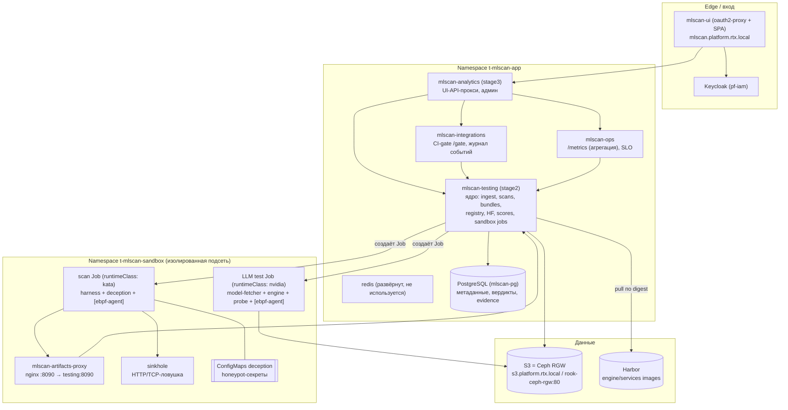
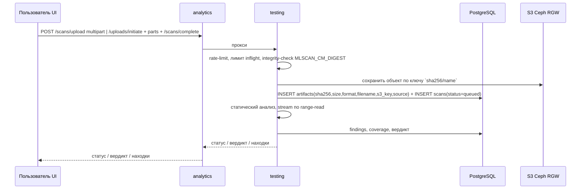
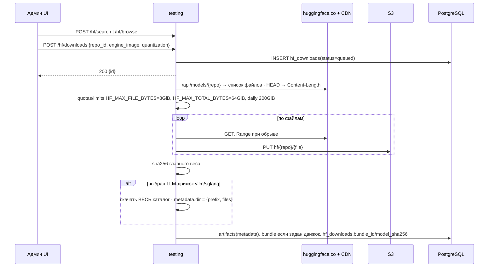
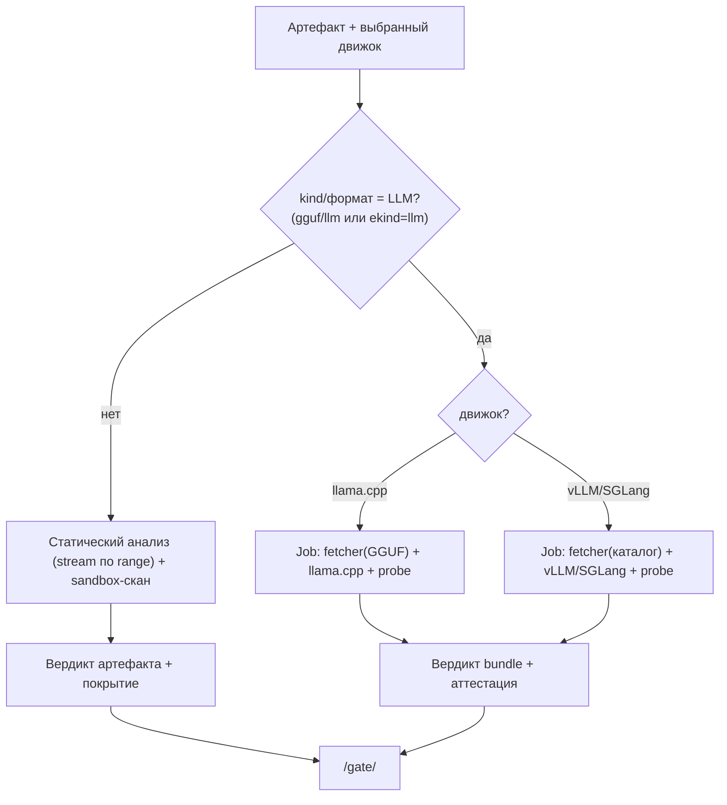
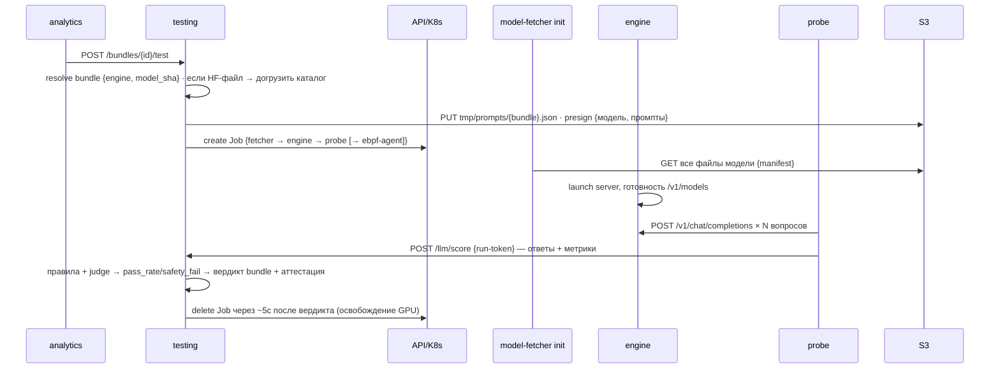
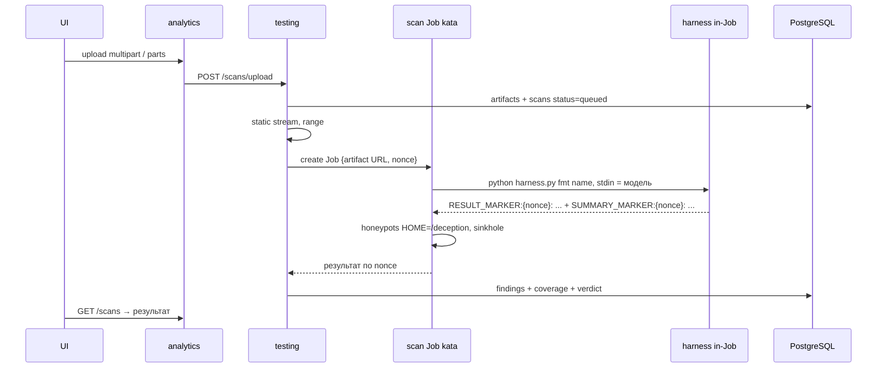
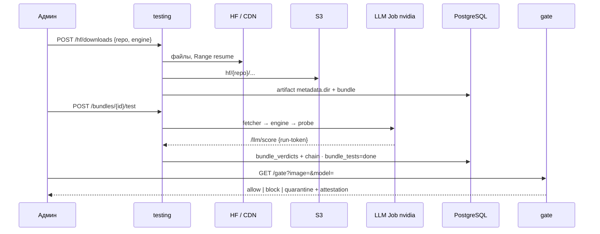
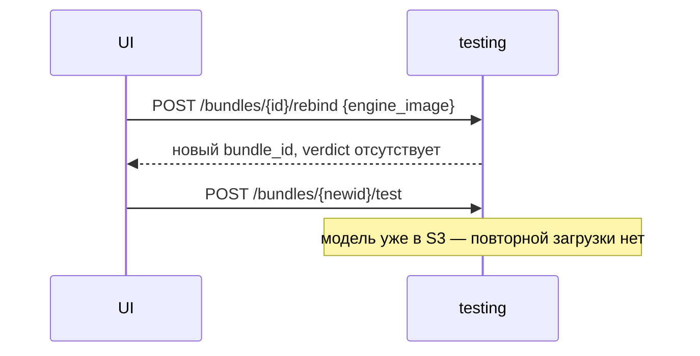
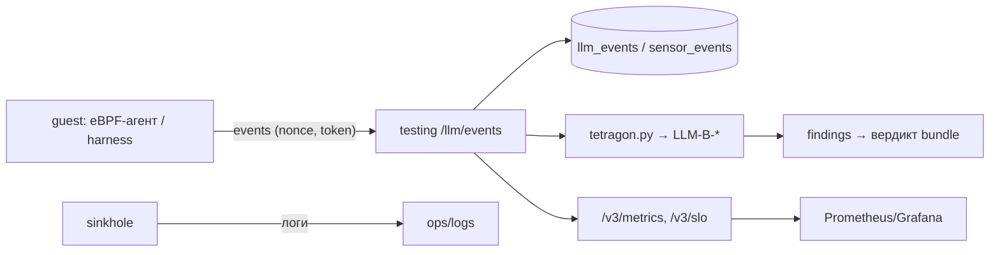

# CrossProcess_overview — сквозной обзор сервисов, процессов и наблюдения MLScan

Документ описывает **как есть** (стенд `rtx-cluster`, тенант `t-mlscan-app` + песочница
`t-mlscan-sandbox`): как артефакты попадают в систему, как к ним привязывается инференс, как
проходит проверка для разных типов артефактов и движков, **где и чем ведётся наблюдение**, какие
данные снимаются, и **где наблюдения нет** либо есть проблемы безопасности при тестировании
потенциально опасных артефактов.

Связанные документы: [`Arch_v3/16-llm-inference-testing.md`](Arch_v3/16-llm-inference-testing.md),
[`Arch_v3/18-ui-binding-and-test-env.md`](Arch_v3/18-ui-binding-and-test-env.md),
[`Arch_v3/08-security-isolation.md`](Arch_v3/08-security-isolation.md),
[`Arch_v3/09-observability-sla.md`](Arch_v3/09-observability-sla.md),
[`Arch_v3/13-formats.md`](Arch_v3/13-formats.md),
[`Arch_v3/14-limitations.md`](Arch_v3/14-limitations.md),
[`Arch_v3/19-implementation-as-built.md`](Arch_v3/19-implementation-as-built.md),
[`deploy/tenant/STATUS.md`](deploy/tenant/STATUS.md).

---

## Содержание

1. [Компоненты (сервисы) и их роли](#1-компоненты-сервисы-и-их-роли)
2. [Зоны доверия и изоляция](#2-зоны-доверия-и-изоляция)
3. [Поток 1 — попадание артефактов в систему](#3-поток-1--попадание-артефактов-в-систему)
4. [Поток 2 — привязка инференса (bundle / binding)](#4-поток-2--привязка-инференса-bundle--binding)
5. [Поток 3 — проверка по типам артефактов](#5-поток-3--проверка-по-типам-артефактов)
6. [Диаграммы последовательностей](#6-диаграммы-последовательностей)
7. [Наблюдаемость: механизмы и данные](#7-наблюдаемость-механизмы-и-данные)
8. [Открытые зоны без наблюдения и проблемы безопасности](#8-открытые-зоны-без-наблюдения-и-проблемы-безопасности)
9. [Матрица «тип × движок × среда × наблюдение»](#9-матрица-тип--движок--среда--наблюдение)
10. [Ссылки на код](#10-ссылки-на-код)

---

## 1. Компоненты (сервисы) и их роли

| Компонент | Назначение | Ключевое |
|-----------|-----------|----------|
| **mlscan-ui** | Точка входа для людей (OIDC через oauth2-proxy), веб-UI | `--skip-oidc-discovery` + JWKS: стартует даже при 503 Keycloak |
| **mlscan-analytics** (stage3) | UI-API: отдаёт SPA, проксирует вызовы в testing, админ-функции (наборы XLSX, rate-limit, квоты HF, журналы gate/egress, проверка цепочки вердиктов) | многоэтапный прокси `_test_request` (таймаут 120с) |
| **mlscan-testing** (stage2) | **Ядро**: приём артефактов, статический анализ, оркестрация сканов, реестр образов движков, HF-загрузки, bundles, наборы промптов, `/llm/score` и `/llm/events`, генерация Job'ов песочницы; артефакт-сервер на `:8090` | единый процесс, обработка сканов в потоках (без внешней очереди) |
| **mlscan-integrations** | CI-шлюз `GET /gate?image=&model=` → `allow|block|quarantine` + аттестация; журнал событий | fail-closed по умолчанию |
| **mlscan-ops** | Сбор `/metrics` (per-tenant метрики тестирования → платформенный Prometheus), `/v3/slo` | скрейпится Prometheus (auth по внутреннему ключу) |
| **redis** | Развёрнут (`mlscan-redis`), но в коде сервисов **не используется** (задел/placeholder); состояние rate-limit/кеша — в процессе `mlscan-testing` | не источник истины |
| **PostgreSQL** | Артефакты, сканы, находки, образы, bundles, вердикты, аттестации, промпты, evidence-цепочка | `db_query`/`db_exec` (свой клиент) |
| **S3 (Ceph RGW)** | Хранение самих артефактов: загрузки — ключ `<sha256>/<name>`; HF — `hf/<repo>/<file>` | presigned-URL с внутренним endpoint |
| **Harbor** | Реестр образов движков (`engine-vllm`, `engine-sglang`, `engine-sglang-*-sm75`) и образа сервисов | admission требует digest |
| **sandbox: artifacts-proxy** | nginx, даёт Job'ам доступ к артефакт-серверу testing без прямого сетевого доступа | egress позволяет только `:8090` |
| **sandbox: sinkhole** | Ловушка: логирует HTTP/TCP-подключения (4444/9001/1337) | детектирует «стук наружу» внутри подсети |
| **sandbox: deception** | ConfigMap'ы с honeypot-секретами (`~/.aws`, `~/.ssh`, `~/.kube`, `.env`, `.netrc`) | монтируются в **scan Job**, `HOME=/deception` |

> **Текущий стенд:** одиночный узел `rtx-cluster`; RuntimeClass'ы `kata`, `kata-btf`, `nvidia`
> зарегистрированы. Сканы идут в `kata`, LLM-тесты — в `nvidia` (см. §8).

---

## 2. Зоны доверия и изоляция

| Зона | Что входит | Доверие |
|------|-----------|---------|
| **Untrusted** | артефакт (модель/архив/датасет), пользователь, внешняя сеть | не доверяем |
| **Edge** | ingress, oauth2-proxy, presigned-URL | полу-доверенная |
| **Trusted control/data plane** | testing/analytics/integrations/ops, PostgreSQL, S3, Harbor | доверенная (но парсит недоверенный контент — см. §8.5) |
| **Sandbox** | Job'ы в `t-mlscan-sandbox` (микро-ВМ Kata для сканов; см. §8.1 про LLM) | изолированная, недоверенный код |

Базовые меры (декларативно + Kyverno):
`runtimeClassName`, `image@sha256`, `automountServiceAccountToken: false`, `readOnlyRootFilesystem`,
`runAsNonRoot` (65532; кроме eBPF-агента), `drop ALL`, `seccomp RuntimeDefault`, запрет
privilege-escalation, `ttlSecondsAfterFinished`, эфемерные `emptyDir`.

---

## 3. Поток 1 — попадание артефактов в систему

### 3.1 Локальный артефакт (модель/архив/датасет)

Точки входа (testing):
`POST /scans`, `POST /upload`, `POST /scans/upload` (multipart) — для крупных: `POST /uploads/initiate`
(+ части) и `POST /scans/complete`. Лимиты: размер (`MAX_UPLOAD`), частота (`RATE_LIMIT_PER_MIN`),
параллелизм (`MAX_INFLIGHT_SCANS`), контроль целостности кода (`INTEGRITY_DIGEST` → fail-closed).

### 3.2 Загрузка с Hugging Face (LLM и датасеты)

Загрузка — **серверная и фоновая** (не зависит от браузера), с докачкой (Range/ETag).

Особенности:
- **Имена объектов**: `hf/<org>/<name>/<file>` (плоско, дедуп по basename).
- **LLM-каталог**: для `vllm`/`sglang` качается **весь репозиторий** (config/tokenizer/все шарды),
  артефакт получает `metadata = {"dir": true, "prefix": "...", "files": [...]}`; для `llama.cpp`
  (GGUF) — один файл.
- **Публичные/приватные**: HF-токен per-tenant хранится зашифрованным (KMS) и применяется в воркере.
- **Журнал egress**: append-only `hf_egress_log` + метрики `mlscan_hf_*`.

### 3.3 Импорт образов движков (инференс)

- `POST /images/import` `{ref, digest, oci_tar?}` → запись в `registry_images` (только по digest;
  allowlist реестра; опц. server-side copy OCI-tar).
- `POST /images/<ref@sha256>/sign` (admin) — платформенная подпись digest (HMAC).
- `POST /images/<digest>/sbom` (admin) — SBOM (≤64 КиБ).
- `GET /images/list` — флаги `signed`/`sbom`. Политика `IMAGES_REQUIRE_SIGNED` (по умолчанию **выкл**).

### 3.4 Что фиксируется в БД

| Таблица | Содержимое |
|---------|-----------|
| `artifacts` | sha256, размер, формат, имя, `s3_key`, source (`upload`/`hf`), `metadata` (для LLM-каталога) |
| `scans` | сканы артефакта: статус, вердикт, покрытие, версии |
| `registry_images` | движки: ref, digest, `signature`, `sbom`, статус |
| `model_profiles` | классификация LLM (семья/уверенность) |
| `bundles` / `bundle_refs` | неизменяемая связка **модель + движок + версии** |
| `hf_downloads` | очередь/прогресс/статус HF-загрузок |
| `llm_prompts` / `prompt_sets` | версионируемый набор вопросов (XLSX) |
| `bundle_verdicts` / `bundle_verdict_chain` | вердикт bundle + append-only цепочка |
| `bundle_tests` / `scan_tokens` / `sensor_events` | запуски тестов, одноразовые токены, счётчики сенсора |
| `gate_decisions`, `hf_egress_log` | append-only журналы решений и egress |

---

## 4. Поток 2 — привязка инференса (bundle / binding)

**Bundle** — неизменяемая комбинация: `{image_digest, model_sha256, engine_manifest, prompt_set,
detectors, policy}` с **детерминированным** `bundle_id`. Повторная привязка идемпотентна.

Способы создать/изменить связку:
1. `POST /bundles` — явно (model sha + engine).
2. `POST /v3/artifacts/<sha>/bind` — из карточки артефакта.
3. При HF-загрузке, если движок задан, bundle создаётся автоматически.
4. `POST /bundles/<id>/rebind` — **сменить движок** (новый bundle/вердикт, модель не перекачивается).

Типизация движка:
- Для **LLM** движок **обязателен** (без дефолта). UI-значение — «голый» digest; `_norm_engine()`
  приводит к `<ref>@sha256:…`.
- Для **не-LLM** артефактов используется **песочный движок платформы** (Kata + harness) — единообразно
  оформлен как запись в `registry_images` (`source=builtin`), поэтому bundle/история есть у всех.

> Привязка инференса — это и есть «какой проверкой проверять артефакт»: см. §5.

---

## 5. Поток 3 — проверка по типам артефактов

Дерево выбора проверки (упрощённо, `_v3_artifact_test` / `_bundle_test_start_core`):

### 5.1 Обычный (не-LLM) артефакт

- **Статика**: потоковый разбор по range-read (`static_stream.py`, `archive_walk.py`):
  SafeTensors (`FMT-01/02/11`), GGUF (`FMT-01`), ONNX (`FMT-01/12`), HDF5/Keras (`FMT-H5-01..04`),
  pickle (`PKL-*`), архивы (zip/tar, zip-slip/bomb), неизвестные (сигнатуры/энтропия).
- **Динамика**: `make_scan_job` → Job в `t-mlscan-sandbox` (`runtimeClassName: kata`), образ
  `SANDBOX_IMAGE`, подключён **harness** (`harness.py`): наблюдаемая десериализация + поведенческий
  probe через `sys.addaudithook`; honeypot-тома deception; результат в stdout с nonce-маркерами.
- **Вердикт**: агрегируется в скан артефакта (находки + покрытие), отражается в `/scans` и
  `/v3/artifacts/<sha>`.

### 5.2 Архивы

Zip (central directory по range) / tar — **рекурсивный обход по членам** с бюджетом глубины/объёма;
отдельные находки на член (путь + вложенность). Ограничения — `Arch_v3/14-limitations.md`.

### 5.3 LLM-инференс (vLLM / SGLang / llama.cpp)

Job (`llm_env.make_llama_test_job`), состав pod'а:

| Контейнер | Роль | Ключевое |
|-----------|------|----------|
| `model-fetcher` (init) | доставка модели из S3 | манифест presigned-URL (каталог) **или** один `model.gguf`; проверка sha256 |
| `engine` | недоверенный движок по digest | OpenAI API на `:8000`; для SGLang sm_75 — флаги native + shim (§7.1) |
| `probe` (sidecar) | прогон вопросов к `localhost:8000` | берёт набор вопросов по **presigned-URL из S3**; POST в `/llm/score` по **run-token** |
| `ebpf-agent` (опц.) | in-guest eBPF-сенсор | включается только при `LLM_TEST_EBPF=1` (**сейчас выключен**) |

Поток:

Вердикт: `Safe` | `Needs review` | `Inconclusive`; действие `allow|block|quarantine`; сохраняется
в `bundle_verdicts` и append-only `bundle_verdict_chain`; доступен через `GET /bundles/<id>/verdict`
и CI-gate `GET /gate?image=&model=`.

### 5.4 Датасеты

Тип `dataset`: проверка содержимого (подозрительные скрипты/файлы, несоответствие формата),
инференс не требуется. Может идти через скан-путь §5.1 с правилами датасетов.

### 5.5 Вердикт, аттестация, CI-gate

- Вердикт bundle подписывается (`attest.py`, HMAC платформенным ключом) → `attestation_digest`.
- `GET /gate?image=&model=` (и прокси в integrations) возвращает решение **fail-closed**: нет
  вердикта → `quarantine`; все решения — в append-only `gate_decisions`.
- `GET /v3/evidence/verify` — проверка целостности цепочки вердиктов.

---

## 6. Диаграммы последовательностей

### 6.1 Локальный не-LLM артефакт → скан → вердикт

### 6.2 HF → bundle → LLM-тест → вердикт → gate

### 6.3 Смена движка и повторный тест

---

## 7. Наблюдаемость: механизмы и данные

### 7.1 Состав механизмов наблюдения

| Механизм | Где работает | Что фиксирует | Данные / артефакты | Статус на стенде |
|----------|-------------|---------------|--------------------|------------------|
| **Userland harness** (`harness.py`) | в scan Job (guest) | Python-события: `os.system`, `subprocess`, `socket.*`, `ctypes.*`, `exec/compile`, `pickle`, файловые операции | события + `RESULT_MARKER`/`SUMMARY_MARKER` (с **nonce**), покрытие | **включено** (сканы) |
| **in-guest eBPF-агент** (`ebpf_agent.py`) | в Job (guest, нужен `kata-btf`) | syscalls: `execve`, `connect`; атрибуция через `bpf_get_current_comm`; публикация в `/llm/events` | события → маппинг `LLM-B-01..05` (`tetragon.py`), nonce | **выключено** (`SANDBOX_EBPF`/`LLM_TEST_EBPF`=0, нет CM `mlscan-ebpf-agent`) |
| **Honeypots (deception)** | том в scan Job (`HOME=/deception`) | попытки чтения `~/.aws`, `~/.ssh`, `~/.kube`, `.env`, `.netrc` | детектировались бы как `LLM-B-03` (**требует eBPF file-open hook**) | том монтируется; **детект события не активен** |
| **Sinkhole** | Deployment в sandbox | HTTP/TCP-подключения наружу (4444/9001/1337) | лог sinkhole | **включено** |
| **NetworkPolicy** | namespace sandbox | egress/ingress: DNS, testing:8080/8090, sinkhole, artifacts-proxy, S3 RGW | срабатывания: блокировка трафика | **включено** |
| **Pod hardening + Kyverno** | admission + pod | digest-образ, non-root, RO-FS, drop ALL, seccomp, no SA-token, caps-guard | отказы admission | **включено** |
| **nonce / run-token / scan-token** | testing ↔ Job | антиспуф результата; одноразовые токены на тест/скан; окно дозвона 2 мин | `scan_tokens`, `bundle_tests.run_token` | **включено** |
| **Метрики сенсора** | testing | `bundle_tests.sensor_events`, `scan_tokens.sensor_events`, `/v3/slo.sensor_coverage` | per-погон счётчик событий | **включено (механика)**, но событий нет, т.к. агент выключен |
| **Evidence** | testing/PG | HMAC-цепочка, `bundle_verdict_chain` (append-only триггер), WORM-анкор (по докам) | `/v3/evidence/verify` | **частично** (HMAC+chain — есть; внешний WORM/TSA — нет) |
| **Metrics/SLO** | ops/testing | per-tenant метрики, `/v3/metrics`, `/v3/slo` | Prometheus/Grafana | **включено** (targets `up`) |
| **Журналы** | testing/PG | `gate_decisions`, `hf_egress_log` (append-only) | audit | **включено** |

### 7.2 Маппинг поведенческих событий → находки (LLM-B-*)

`deploy/v3/llm/tetragon.py`:

| Check | Тип | Условие | Severity |
|-------|-----|---------|----------|
| `LLM-B-01` | process_exec | запуск shell/интерпретатора | high |
| `LLM-B-02` | network | внешний (публичный) egress | high |
| `LLM-B-03` | file | чтение honeypot-секретов | high |
| `LLM-B-04` | memory | `PROT_EXEC`/in-memory exec (**отключён**) | high |
| `LLM-B-05` | module | загрузка модуля ядра (**отключён**) | critical |

Ограничения агента (as-built): извлечение строк `probe_read_user` частично (`-EFAULT`) → `LLM-B-02`
требует kprobe/CO-RE; `LLM-B-03` ждёт file-open hook; `LLM-B-04/05` отключены.

### 7.3 Путь данных наблюдения

### 7.4 Что **точно** наблюдается сейчас (по факту стенда)

- Сканы (kata): **userland harness** (Python-level события) + honeypot-тома + sinkhole + netpol.
- LLM-тесты (nvidia): **только** ответы probe (контент) + отсутствие egress (netpol) + sinkhole;
  **in-guest ядерного наблюдения нет**.
- Инфраструктура: метрики/SLO, журналы gate/egress, цепочка вердиктов.

---

## 8. Открытые зоны без наблюдения и проблемы безопасности

> Ниже — честный список «дыр» текущего стенда при тестировании потенциально опасных артефактов.

1. **LLM-тесты исполняются вне Kata.** `LLM_TEST_RUNTIME_CLASS=nvidia` → Job идёт на **хостовом ядре**
   (runc + NVIDIA), а не в микро-ВМ. Недоверенные **движок и модель** исполняются без изоляции уровня
   микро-ВМ; остаются seccomp/RO-FS/non-root/drop-ALL. Это **главный риск**. (Причина: GPU-доступ через
   `nvidia`, Kata+GPU не сконфигурирован.)
2. **In-guest eBPF-сенсор выключен.** `SANDBOX_EBPF`/`LLM_TEST_EBPF` не заданы, ConfigMap
   `mlscan-ebpf-agent` отсутствует. Следствия: нет ядерного наблюдения syscalls/exec/net; `LLM-B-01..05`
   на практике не срабатывают; honeypot-чтение (`LLM-B-03`) не детектируется; метрика
   `sensor_coverage` нулевая.
3. **Honeypots не монтируются в LLM-тест.** Deception-тома есть только в scan Job; инференс-путь
   (наиболее ресурсоёмкий и потенциально опасный) **лишён канареек**.
4. **Обход userland-наблюдения.** Harness фиксирует Python-события; нативный код (C-extensions,
   ctypes-вызовы в обход аудит-хуков, raw-сисколлы, JIT) может не попасть в события. Для LLM это
   усугубляется отсутствием eBPF (п.2).
5. **Парсеры недоверенных форматов работают в доверенной зоне.** Статический анализ (safetensors/
   ONNX/HDF5/pickle/архивы) выполняется в процессе `mlscan-testing`; `parser-sandbox` не реализован →
   потенциальный 0-day парсера бьёт по доверенному сервису (DoS/RCE).
6. **HF-контент и метаданные обрабатываются в доверенной зоне.** Воркер скачивает недоверенные файлы
   и разбирает метаданные в `mlscan-testing`; вредоносный «заголовок» формата — поверхность.
7. **Сеть песочницы шире, чем «только артефакты».** `allow-s3-rgw-egress` открывает доступ к RGW
   (namespace `rook-ceph`, порты 80/8080) всем подам sandbox. При компрометации это канал к объектному
   хранилищу (ограничен ACL/presigned, но это уже не «денy-all»).
8. **Judge — правила, а не отдельная доверенная модель.** Согласован отдельный доверенный judge, но в
   as-built оценка строится правилами/эвристиками → риск ложных pass/fail (`Safe` при неполном
   покрытии/коротком прогоне; наблюдали эффект «30 вопросов → Safe», «726 → Needs review»).
9. **Провенанс/подписи неполны.** `IMAGES_REQUIRE_SIGNED=0`; cosign/SBOM-admission, WORM/TSA, mTLS не
   реализованы; аттестация — HMAC платформенным ключом (внутренняя целостность, не внешняя гарантия).
10. **SGLang sm_75 shim.** Текущий SGLang запускается с `sitecustomize.py` (замена RMSNorm/SiLU на
    torch) и native-бэкендами. Работает, но: (а) производительность ниже; (б) сам шим — модификация
    доверенного движка (внутри платформенного образа по digest, но не upstream).
11. **Одиночный узел → нет HA.** Рестарт узла/CSI/Kube-OVN/Keycloak влияет на весь контур (наблюдалось).
12. **Зашифрованные/непрозрачные артефакты.** Не расшифровываются → покрытие ограничено, вердикт
    `Inconclusive` (честно, но это «слепая зона»).
13. **Бюджеты/сэмплирование.** Сэмплированная динамика и бюджеты обхода архивов **не эквивалентны**
    полному анализу — часть поведения не проверяется (отражается в покрытии).
14. **`natOutgoing:false`** у подсети sandbox — плюс (нет интернета), но `allow-artifact-egress`
    к `testing:8080/8090` и `allow-s3-rgw-egress` — обязательные «окна», которые нужно держать под
    контролем при изменениях.

---

## 9. Матрица «тип × движок × среда × наблюдение»

| Тип артефакта | Движок | Где исполняется | Что наблюдается сейчас | Что не наблюдается (риск) |
|---------------|--------|-----------------|------------------------|---------------------------|
| safetensors / pickle / ONNX / HDF5 / Keras | песочный (builtin) | scan Job, **kata** | harness (Python-события), honeypots, sinkhole, netpol | нативные/E2E-обходы harness; нет eBPF |
| Архив (zip/tar, вложенный) | песочный | scan Job, **kata** | обход членов + harness на каждом | бюджеты/глубина; нет eBPF |
| Датасет | песочный | scan Job, **kata** | правила датасета + harness | полнота покрытия |
| **LLM: GGUF** | `llama.cpp` | LLM Job, **nvidia** | probe-ответы, netpol, sinkhole | **нет микро-ВМ, нет eBPF, нет honeypots** |
| **LLM: HF-каталог (safetensors)** | `vLLM`/`SGLang` | LLM Job, **nvidia** | probe-ответы, netpol, sinkhole | **нет микро-ВМ, нет eBPF, нет honeypots** |
| Образ движка (engine_image) | — | registry | digest, подпись/sbom (опц.), allowlist | admission-подпись выключена |
| Зашифрованный/непрозрачный | любой | — | факт непрозрачности | содержимое недоступно (Inconclusive) |

---

## 10. Ссылки на код

- Оркестрация/API: `deploy/stage2/service/mlscan_testing.py` (маршруты `do_GET`/`do_POST`),
  `deploy/stage3/service/mlscan_analytics.py` (UI-прокси/админ).
- LLM Job: `deploy/v3/llm/llm_env.py::make_llama_test_job`; bundle:
  `deploy/v3/llm/binding.py::make_bundle`; оценка: `deploy/v3/llm/evaluators.py`.
- Наблюдение: `deploy/v3/llm/tetragon.py` (LLM-B-*), `deploy/tenant/workloads/data/harness.yaml`
  (harness), `deploy/v3/sandbox/kata-btf/ebpf_agent.py` (eBPF-агент).
- Sandbox: `deploy/tenant/workloads/sandbox/{sinkhole,deception,artifacts-proxy,sgl-shim}.yaml`,
  `deploy/tenant/network/20-sandbox-netpol.yaml`, `deploy/tenant/network/30-sandbox-isolation-gate.yaml`.
- Безопасность/evidence: `deploy/v3/security/evidence.py`, `deploy/v3/control/attest.py`,
  `deploy/v3/control/policy.py`.
- Схема БД: `deploy/v3/db/schema-v3.sql`, `deploy/tenant/platform/schema/01-schema.sql`.
- Статус стенда: `deploy/tenant/STATUS.md`.
