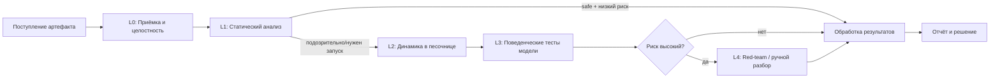

# Стратегия тестирования и обнаружения рисков

Документ определяет, **как** обнаруживать риски из `01-threat-checklist.md`.
Цель — не «просканировать файл», а получить воспроизводимую, доказуемую картину
поведения модели на всех уровнях.

## 1. Принципы

1. **Defense in depth по уровням (L0–L4)** — от безопасного статического разбора до red-team.
2. **Assume malicious** — по умолчанию артефакт считается опасным до доказательства обратного.
3. **Никогда не исполнять в доверенном окружении** — любой запуск только в песочнице.
4. **Полное наблюдение (observability)** — фиксируются syscalls, сеть, ФС, процессы, ресурсы.
5. **Воспроизводимость** — одинаковый артефакт + одинаковый профиль тестов → детерминированный отчёт.
6. **Доказательства, а не флаги** — каждый вердикт подкрепляется артефактом (лог, дамп, diff, трасса).
7. **Минимизация ложных негативов в ущерб скорости** — при сомнении эскалация на ручной разбор.
8. **Эшелонирование: статика дешевле и безопаснее → динамика только после статики.**

## 2. Уровни тестирования (Test Levels)

### L0. Приёмка и целостность (Intake & Integrity)
**Цель:** зафиксировать артефакт и исключить подмену.

- Расчёт криптографических хешей (SHA-256/BLAKE3), фиксация размера и MIME.
- Определение **реального** формата по «магическим байтам», а не по расширению.
- Проверка подписи/provenance (sigstore, GPG, hash-манифест), если доступно.
- Регистрация источника (URL, репозиторий, коммит, автор, дата) — lineage.
- Детект полиглотов и несоответствия расширению.
- Результат: **Artifact Record** (immutable).

### L1. Статический анализ (Static Analysis) — без исполнения
**Цель:** найти опасные конструкции, не запуская код.

Методы:
- **Дизассемблирование pickle:** `pickletools.dis`, разбор VM-потока в IR.
- **Анализ opcodes:** поиск `GLOBAL`, `STACK_GLOBAL`, `REDUCE`, `BUILD`, `INST`, `OBJ`, `EXT*`.
- **Allowlist-проверка глобалов:** разрешены только «безопасные» модули
  (`numpy`, `torch.*` (тензоры/storage), `collections`, `builtins` с оговорками).
  Всё остальное → finding. (подход picklescan / fickling / modelscan).
- **Поиск опасных callable:** `os.system`, `os.popen`, `subprocess.*`, `eval`, `exec`,
  `compile`, `getattr`, `setattr`, `__import__`, `socket`, `requests`, `urllib`,
  `pty`, `ctypes`, `marshal.loads`, `builtins.*`, `runpy`.
- **AST-анализ (fickling):** восстановление дерева и интерпретация как кода.
- **Обнаружение обфускации:** энтропия строк, base64/ZIP/marshal-blob, вложенные pickle.
- **Анализ дополнительных артефактов:** `config.json`, `*.py`, `setup.py`, `requirements`,
  `Lambda`-слои Keras, кастомные ops ONNX.
- **Анализ зависимостей:** SBOM, CVE-скан, обнаружение dependency confusion и typosquatting.
- **Инвентаризация:** список тензоров, их формы, типы, статистика весов.

Инструменты (референс): `pickletools`, **fickling**, **picklescan**, **ModelScan (Protect AI)**,
`semgrep`, `bandit`, `pip-audit`, `syft`/`grype`, `trivy`.

Результат: набор **Static Findings** + извлечённый IR для динамического планирования.

### L2. Динамический анализ в песочнице (Dynamic Sandbox Analysis)
**Цель:** безопасно исполнить загрузку и наблюдать поведение.

- Исполнение `load` в герметичной песочнице (см. `03-isolation.md`).
- Мониторинг:
  - **syscalls** — eBPF (Falco/Tetragon), `seccomp`, `strace` (для отладки).
  - **сеть** — DNS/HTTP/raw-сокеты, egress-прокси, sinkhole, TLS-inspection опционально.
  - **ФС** — `inotify`/overlay-diff: что читается, что создаётся/меняется.
  - **процессы** — `fork/exec`, дерево процессов, потомки.
  - **ресурсы** — CPU, RAM, GPU, диски, PID, IO (cgroups).
  - **безопасность** — попытки эскалации, доступ к `/var/run/docker.sock`, IMDS.
- **Обманки (deception):** honeypot-креды, фальшивые `~/.aws`, `kubeconfig`, canary-токены,
  фальшивый IMDS — для детекта кражи секретов и атрибуции.
- **Canary-файлы и beacon-эндпоинты:** утечка/обращение = доказательство эксфильтрации.
- Изоляция попыток: каждое тестирование — чистый эфемерный инстанс.

Результат: **Behavioral Trace** (системные события с временными метками) + сетевые/FС diff.

### L3. Поведенческое тестирование модели (Model Behavior Testing)
**Цель:** оценить саму модель как алгоритм (после безопасной загрузки).

- **Функциональные тесты:** соответствие заявленному назначению, контракт ввода/вывода.
- **Robustness:** adversarial-примеры (FGSM/PGD, для NLP — текстовые атаки).
- **Backdoor/trojan-поиск:**
  - триггер-сканирование (патчи-стикеры, редкие токены, специфические паттерны);
  - методы нейронной очистки/поиска аномалий активаций (Neural Cleanse-подходы);
  - дифференциальное сравнение с референсной моделью того же класса.
- **Privacy-тесты:** membership inference, model inversion, извлечение memorized-PII.
- **Калибровка и стабильность:** NaN/Inf, переполнения, устойчивость к сдвигу распределения.
- **Ресурсные тесты:** latency, throughput, пиковая память/GPU, DoS-устойчивость.
- **Safety/alignment:** обход guardrails, генерация запрещённого контента (для LLM).

Результат: **Model Behavior Report** (метрики + контрпримеры + доказательства).

### L4. Глубокий анализ и red-team (Deep / Red-Team)
**Цель:** целенаправленный поиск обходов и скрытых закладок.

- Ручной реверс подозрительных payload.
- Fuzzing формата и входов (структурный fuzz pickle и входов модели).
- Проверка на «sandbox evasion»: условная активация, детект песочницы, отложенные триггеры.
- Проверка стойкости самих механизмов изоляции (эскейп-тесты).
- Атрибуция (ATT&CK/ATLAS), сравнение с БД известных угроз.

## 3. Поток обработки (Pipeline)

Правила эскалации:
- L1 нашёл опасные callable → сразу L2 (не запускать в обычном окружении).
- L2 зафиксировал сеть/эксфильтрацию/persistence → **немедленная остановка** и вердикт *Malicious*.
- Любой артефакт, не прошедший L1 из-за неопределённости формата → L2 + L4.

## 4. Соответствие рисков и тестов (Traceability)

| Категория риска | Покрывающие уровни | Ключевые методы |
|-----------------|--------------------|-----------------|
| A. Десериализация/RCE | L1, L2, L4 | opcode-анализ, allowlist, sandbox-исполнение, syscall-мониторинг |
| B. Форматы/доставка | L0, L1 | magic-bytes, полиглот-детект, анализ архивов, dependency-скан |
| C. Уровень модели | L3, L4 | backdoor-скан, privacy-тесты, robustness, fuzzing |
| D. Целостность/SC | L0, L1 | подпись, SBOM, CVE-скан, provenance |
| E. Инфо-утечки | L1, L2, L3 | статический поиск путей, honeypot, мониторинг ФС/сети, extraction-тесты |
| F. Неконтроль | L2, L4 | поведенческий мониторинг, cgroups, эскейп-тесты |
| G/H. Окружение/процесс | Инфраструктура | hardening, аудит, метатесты песочницы |

## 5. Доказательная база (Evidence)

Каждый finding содержит:
- `finding_id`, категория риска (A–I), уровень (L0–L4), правило/детектор;
- `severity`, `confidence`, воспроизводимость;
- **сырые доказательства**: фрагмент pickle-дизассемблирования, трасса syscalls,
  дамп сетевого соединения, diff ФС, метрика, контрпример;
- ссылки на стандарты (CWE/ATLAS/OWASP).

Evidence хранится в иммутабельном виде (append-only, хеш-цепочка) — см. `04-risk-analysis.md`.

## 6. Тестируемость самой системы (metatesting)

- Набор «золотых» эталонов: заведомо безопасные, подозрительные и вредоносные модели
  (e.g. EICAR-аналоги для pickle) → регресс детекторов.
- Метрики качества: TPR/FPR/FNR по категориям, coverage чеклиста.
- Периодические эскейп-тесты изоляции.
- Мутационное тестирование детекторов (можно ли обойти правило?).

## 7. Ограничения и допущения

- Полный охват поведения невозможно гарантировать (условная/отложенная активация).
- Статический анализ pickle принципиально не решает проблему остановки — нужна динамика.
- Модели могут детектировать песочницу и не активироваться (sandbox evasion) → нужны
  deception и рандомизация окружения.
- Поведенческие тесты всегда неполны → политика «управляемого риска», а не «абсолютной безопасности».
