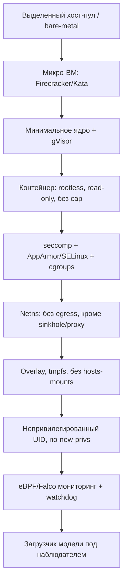

# Методы надёжной изоляции системы от опасного поведения модели

Документ описывает, как гарантировать, что исполнение любой (в т.ч. вредоносной)
pickle-модели не выйдет за пределы контролируемой среды и не навредит
инфраструктуре. Изоляция строится по принципу **defense in depth**: провал одного
слоя не приводит к компромиссу.

## 1. Модель угроз для изоляции

Допущение: **исполняемый payload максимально враждебен** и пытается:
- выполнить произвольный код, эскалировать привилегии, выйти из контейнера/ВМ;
- получить доступ к сети (C2, эксфильтрация, майнинг);
- читать/писать ФС, воровать секреты, ставить persistence;
- исчерпать ресурсы (CPU/RAM/GPU/диск/PID);
- атаковать сканер, его данные и другие проверки;
- обнаружить песочницу и «замолчать».

## 2. Слои изоляции (снаружи внутрь)

### 2.1 Уровень хардware/хоста
- **Выделенный пул хостов** для сканирования; изоляция от продакшена.
- **Микро-ВМ** (Firecracker, Kata Containers) — сильнейшая граница: свой kernel на инстанс.
- Для максимальных требований — отдельный физический хост / сетевой сегмент.
- Гипервизор-level hardening, отключение ненужных устройств (USB, GPU passthrough только при необходимости).

### 2.2 Уровень ОС/ядра
- **gVisor** (`runsc`) или Kata — перехват syscalls, снижение attack surface ядра.
- Свежее ядро с патчами, LSMs (AppArmor/SELinux) в enforce-режиме.
- Отключение модулей, `unprivileged_userns` по политике, ограничение `/proc`, `/sys`.

### 2.3 Контейнер и привилегии
- **Rootless** контейнеры (Podman/Docker rootless).
- `--read-only` rootfs, `--no-new-privileges`, `--cap-drop=ALL`.
- **Запрещено**: `--privileged`, `CAP_SYS_ADMIN`, `CAP_NET_ADMIN`, `CAP_SYS_PTRACE`.
- Непривилегированный UID/GID, `userns`-маппинг.
- Не монтировать: docker-сокет, `/proc/sys`, host PID/net IPC, домашние каталоги хоста.
- Явные пустые/эфемерные тома вместо хостовых путей.

### 2.4 Syscall-фильтрация
- **seccomp-bpf**: дефолт deny, allowlist для `read/write/mmap/…`, блок `execve` (если не нужен),
  `socket`/`connect` при сетевой изоляции, `ptrace`, `mount`, `keyctl`, `bpf`, `unshare`.
- Отдельные профили: `static-eval` (без `execve`), `dynamic-load` (минимум для torch/numpy).

### 2.5 Сетевая изоляция
- Отдельный **network namespace** без маршрута наружу.
- По умолчанию **egress deny-all**.
- Разрешённые каналы — только через **egress-прокси с allowlist** и полным логированием.
- **DNS-sinkhole**: все запросы резолвятся/перехватываются; попытки соединений фиксируются.
- **HTTP sinkhole + canary-URL**: имитируют C2, чтобы обнаружить beaconing.
- Блокировка доступа к **IMDS** (`169.254.169.254`) и внутренним сервисам (metadata, kube-API).
- Опционально: TLS-inspection для восстановления полезной нагрузки эксфильтрации.

### 2.6 Файловая система
- **Overlay/CoW** rootfs на tmpfs; изменения не влияют на хост и исчезают после запуска.
- Только **необходимые** библиотеки; никаких секретов в образе.
- `noexec`, `nosuid`, `nodev` на монтированиях.
- Контроль размера tmpfs и общего диска (квоты).
- **Honeypot-файлы** с canary: `~/.aws/credentials`, `~/.ssh/id_rsa`, `kubeconfig`,
  `.env` — фиксируем любые чтения.

### 2.7 Ресурсные ограничения (cgroups v2)
- **CPU/GPU quota**, **memory limit** (+ `memory.swap=0`), **pids.max** (против форк-бомб),
  **io.max**, лимит числа открытых файлов и сетевых соединений.
- **GPU**: MIG/vGPU или эмуляция; изоляция контекста, лимит VRAM, watchdog на зависание.
- **Time budget**: жёсткий таймаут на load и инференс; SIGKILL при превышении.

### 2.8 Мониторинг и наблюдение (не мешает изоляции, но обязателен)
- **eBPF** (Falco/Tetragon/Cilium) — syscall/сетевые/файловые события, блокировка по правилам.
- **auditd** на хосте, `ptrace`/`strace` для отладочных прогонов.
- **Watchdog** и OOM-killer как последняя линия.
- Экспорт событий в коллектор; временная корреляция с фазами load/инференс.

### 2.9 Обманки и анти-evasion (важно!)
- Рандомизация: имена хостов, пути, env, тайминги — чтобы payload не «узнавал» песочницу.
- Подставные секреты (fake credentials/tokens) с canary-маркерами.
- Задержки/шум окружения, эмуляция «реалистичного» окружения.
- Многократные прогоны в разных конфигурациях для детекта условной активации.

## 3. Изоляция на уровне приложения (внутри песочницы)

- **Только загрузка** модели в отдельном процессе; никаких сетевых клиентов в окружении.
- Запуск через **собственный sandbox-runner**, который:
  - настраивает лимиты и мониторинг до старта;
  - сериализует фазы (load → infer) и логирует границы;
  - не передаёт хост-секреты (clean env, `env -i`).
- **Пустой env**: только минимально необходимые переменные (`PATH`, `LANG`), остальное удалено.
- Явное отключение «магии» загрузчиков:
  - `torch.load(..., weights_only=True)` где применимо;
  - `numpy.load(..., allow_pickle=False)` где применимо;
  - `pickle.Unpickler` с **allowlist `find_class`** для статического режима.
- **Два режима**:
  - *Static-only*: десериализация без исполнения (перехват `find_class`, opcode-интерпретация).
  - *Dynamic*: реальное исполнение под полным мониторингом, обязательно в максимальной изоляции.

## 4. Контроль исходящих каналов «утечки» из песочницы

Даже изолированный payload может создавать **побочные каналы**:
- Время выполнения, потребление CPU/памяти, размер логов, DNS-тайминги.
- Меры: нормализация таймингов на выходе, ограничение доступа к общей памяти,
  изоляция инфраструктуры сканера от данных, которые payload мог бы кодировать.
- **Не смешивать** данные разных моделей; один инстанс — одна модель (см. cross-contamination F-12).

## 5. Управление жизненным циклом инстанса

1. **Provisioning**: одноразовая ВМ/контейнер из чистого образа (immutable, версионированный).
2. **Setup**: монтирование артефакта только для чтения, настройка лимитов и мониторинга.
3. **Execution**: запуск под sandbox-runner, живой мониторинг, отсечка по таймауту/лимитам.
4. **Teardown**: немедленное уничтожение всего инстанса, удаление томов и сети.
5. **Attestation**: фиксация хеша образа/toolchain для воспроизводимости.
6. **Периодическая ротация** образов и проверка их целостности.

## 6. Отдельная критичная изоляция: статический анализ

Статический анализ **не исполняет** payload, но и он не абсолютно безопасен:
- Парсеры pickle/marshal могут иметь собственные уязвимости → запускать разборщики
  в отдельном низкопривилегированном процессе/песочнице без сети.
- Ограничивать размер и глубину входных структур (защита от DoS на парсере).
- Не импортировать модули, на которые ссылается артефакт, до allowlist-проверки.

## 7. Изоляция самой сканирующей платформы (control plane)

- Control plane (БД, API, UI) **не имеет доступа** к execution-сети, только к шине результатов.
- Разные trust-зоны: `intake` → `static` → `dynamic` → `analysis`.
- Секреты платформы (ключи, токены) недоступны в песочнице **никогда**.
- Подписывание результатов, RBAC, аудит, immutable-логи.
- См. `05-architecture.md`, раздел «Безопасность системы».

## 8. Матрица «риск → мера изоляции»

| Риск (чеклист) | Ключевые меры |
|----------------|---------------|
| A-01…A-18 (RCE) | микро-ВМ + gVisor, seccomp, rootless, no-new-privs, read-only |
| F-01 (сеть/C2) | netns, egress deny-all, sinkhole, canary-URL, DNS-перехват |
| F-02/F-03 (ФС/persistence) | overlay/tmpfs, read-only, teardown, мониторинг ФС |
| F-04/F-05/F-06 (ресурсы/DoS) | cgroups v2, pids.max, лимиты GPU/диска, таймауты, watchdog |
| F-07/F-10 (шифрование/самоизменение) | read-only artifact, эфемерность, overlay |
| E-01…E-09 (кража секретов) | honeypot-креды, пустой env, нет доступа к реальным секретам, IMDS-блок |
| F-08/G-* (эскейп) | микро-ВМ, LSM, drop caps, запрет docker-сокета/privileged |
| H-05 (sandbox evasion) | рандомизация, deception, множественные прогоны, fuzzing |
| H-09/H-10 (путаница/контаминация) | один инстанс = одна модель, хеш-фиксация, изоляция томов |

## 9. Гарантии и их границы

Даётся **практическая** гарантия (best-effort, многослойная), а не формальное доказательство.
Остаточные риски:
- 0-day в гипервизоре/ядре/парсере;
- аппаратные и микроархитектурные атаки;
- условная активация, не проявляющаяся в песочнице;
- побочные каналы через разделяемые ресурсы.
Митигируются: свежесть компонентов, минимизация attack surface, сегментация, мониторинг,
периодические эскейп-/red-team-тесты, «air-gap» для наиболее рискованных артефактов.

---

## 10. Реализация «Этап 1» (кластер <CLUSTER>)

Слои из §2 реализованы (см. `deploy/stage1/`):

| Слой (док) | Реализация |
|------------|------------|
| Микро-ВМ | RuntimeClass `kata` (собственное ядро на под) |
| ОС/hardening | PSA `restricted`; non-root 65532, read-only rootfs, drop ALL, no-new-privs, seccomp RuntimeDefault |
| Ресурсы | limits CPU/RAM/ephemeral-storage; tmpfs `/tmp` |
| Сеть | Calico NetworkPolicy: default-deny egress + DNS + `sandbox→sinkhole` (sinkhole HTTP/TCP) |
| ФС/секреты | honeypot-файлы (`~/.aws`, `~/.ssh`, `~/.kube`, `.env`), `HOME=/deception`; без хостовых монтирований |
| Мониторинг | внутригостевые audit-hooks (Kata) + Falco `modern_ebpf` (рatternы `MLScan sandbox *`, runc/хост) |
| Секреты платформы | SA-токен не монтируется (`automountServiceAccountToken: false`) |

Проверено: внешний egress запрещён, sinkhole доступен; чтение honeypot-кредов и утечка на
sinkhole фиксируются; Kata-изоляция подтверждена отдельным ядром гостя.
Остаточные пункты (рандомизация/anti-evasion, подпись образов, egress-прокси) — следующие этапы.
