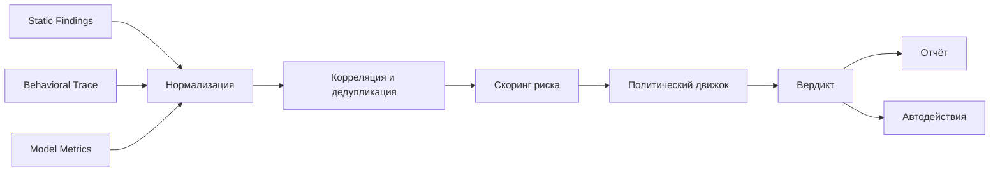
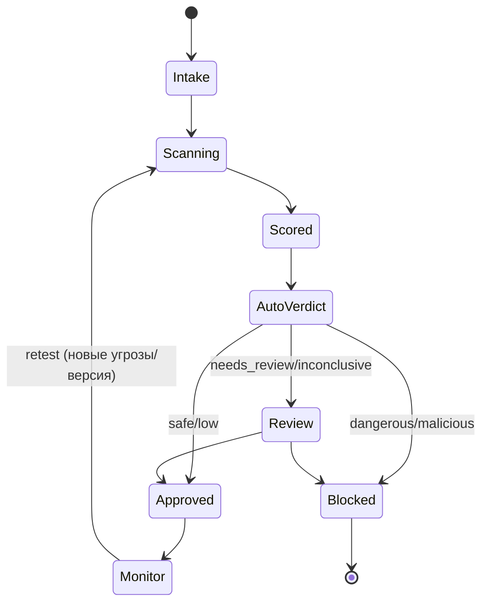

# Обработка результатов тестирования и принятие решений

Документ описывает, как из сырых данных (статика + трассы динамики + метрики поведения)
формируется единый вердикт о допустимости применения модели и автоматизированные
решения по ней.

## 1. Конвейер обработки результатов



## 2. Единая модель данных (Result Schema)

Все результаты приводятся к общему контракту (**Normalized Finding**):

```json
{
  "finding_id": "uuid",
  "artifact_hash": "sha256:...",
  "scan_id": "uuid",
  "level": "L0|L1|L2|L3|L4",
  "category": "A|B|C|D|E|F|G|H|I",
  "check_id": "A-01",
  "title": "RCE via os.system in pickle",
  "severity": "critical|high|medium|low|info",
  "confidence": 0.0,
  "detector": "opcode_allowlist@1.2.0",
  "evidence": [
    {"type": "pickle_disasm", "snippet": "c os\nsystem\n..."},
    {"type": "syscall", "line": "execve('/bin/sh',...)"}
  ],
  "standards": ["CWE-502", "ATLAS:Execution", "OWASP-ML06"],
  "remediation": "...",
  "first_seen": "2026-...",
  "deterministic": true
}
```

**Correlation & dedup:** одинаковые находки из разных уровней объединяются,
повышая `confidence` (статика нашла + динамика подтвердила = высокая уверенность).

## 3. Скоринг риска

Двухосная модель: **серьёзность × уверенность** (аналог CVSS + доверие).

```
risk_score = base_severity_weight(category, check)      # 0..10
           × confidence_factor(confidence)               # 0.5..1.0
           × exploitability_factor                        # насколько легко/активно
           × scope_factor                                 # влияние (host/cluster/data)
```

Веса серьёзности (пример):
| Severity | base |
|----------|------|
| critical | 9.0–10.0 |
| high | 7.0–8.9 |
| medium | 4.0–6.9 |
| low | 1.0–3.9 |
| info | 0.0–0.9 |

**Агрегация по артефакту:** максимальный риск + «взвешенная сумма» (накопительный балл).
Критические находки (RCE, эксфильтрация, persistence) **доминируют** — вердикт по максимуму,
а не по среднему.

## 4. Классы вердиктов

| Вердикт | Условие | Действие по умолчанию |
|---------|---------|-----------------------|
| **Safe** | 0 находок high+, покрытие чеклиста полное | Разрешить (с записью в реестр) |
| **Low risk** | только low/info | Разрешить с рекомендациями |
| **Needs review** | medium, либо высокая неопределённость/неполное покрытие | Карантин до ручного анализа |
| **Dangerous** | high, либо доказанный вредоносный паттерн без полного подтверждения | Блокировать, эскалация |
| **Malicious** | подтверждённое RCE/эксфильтрация/persistence/шифрование/canary-срабатывание | Блокировать, инцидент, изоляция артефакта |
| **Inconclusive** | тесты не выполнены/инфраструктурная ошибка | Повтор/ручной разбор (никогда не «Safe») |

**Ключевое правило:** «не доказано, что безопасно» ≠ «безопасно». Отсутствие находок при
неполном покрытии → `Inconclusive`, не `Safe`.

## 5. Политический движок (Policy Engine)

Декларативные правила (YAML/Rego/OPA), определяющие итоговое решение:

```yaml
rules:
  - id: block-rce
    when: findings.any(check_id in ["A-01","A-02","A-13"] and confidence > 0.8)
    action: block
    verdict: malicious
  - id: block-egress
    when: trace.network.egress_unexpected == true
    action: block
    verdict: malicious
  - id: quarantine-medium
    when: max_severity == "medium"
    action: quarantine
    verdict: needs_review
  - id: allow-low
    when: max_severity in ["low","info"] and coverage.complete
    action: allow
  - id: default-deny
    when: default
    action: quarantine
    verdict: inconclusive
```

Политика конфигурируема под требования заказчика (например, «запрещать любую сетевую
активность», «требовать подпись», «запрещать неподписанные источники»).

## 6. Человек в контуре (Human-in-the-loop)

- Все вердикты `Needs review`, `Dangerous`, `Inconclusive` — на ручной разбор.
- Аналитик видит доказательства, может:
  - подтвердить/опровергнуть находку (с обратной связью в детекторы);
  - переопределить вердикт с обоснованием (эскалация прав + аудит);
  - запустить доп. тесты (L4, red-team).
- Решения аналитика фиксируются и используются для калибровки весов и правил.
- **Ложные негативы** — приоритет обратной связи: разбор инцидентов → новые правила.

## 7. Работа с ложными срабатываниями

- **Whitelisting** доверенных callable/модулей (с версионированием и ревью).
- **Baseline-модели:** для класса моделей строится профиль «нормального» поведения;
  отклонения — подозрительны.
- **Confidence-порог** и обязательное подтверждение динамикой для high-severity, где возможно.
- Метрики качества (см. `02-testing-strategy.md` §6) отслеживаются как SLA.

## 8. Отчётность и артефакты решения

**Отчёт по модели** содержит:
1. Идентификацию артефакта (hash, источник, lineage, подпись).
2. Область и глубину тестирования (какие уровни/чеки выполнены; покрытие).
3. Список находок с описанием, доказательствами, severity/confidence, CWE/ATLAS/OWASP.
4. Итоговый риск-скор и **вердикт**.
5. Ограничения/неопределённости (что не проверялось, что могло быть скрыто).
6. Рекомендации (allowed use, условия, доработки).
7. Хеш целостности отчёта и подпись (для аудита).

**Форматы:** JSON (машинный), PDF/HTML (человеческий), SARIF (интеграция в CI), и запись в реестр моделей.

## 9. Автоматические действия (Enforcement)

- **CI/CD Gate:** интеграция как шаг пайплайна — сборка блокируется при вердикте ≥ Dangerous.
- **Реестр моделей (Model Registry):** запись статуса (allowed/blocked/quarantined), версия,
  полиси, срок действия вердикта.
- **Карантин:** изоляция артефакта, запрет распространения, уведомление владельца.
- **Инцидент-реагирование:** при Malicious — алерт SOC, изоляция источника, проверка,
  не пострадала ли уже инфраструктура.
- **Непрерывный мониторинг:** периодическая перепроверка по мере появления новых угроз
  (обновление детекторов, retest по расписанию или по триггеру).

## 10. Жизненный цикл вердикта



Вердикт **не вечен**: привязывается к хешу артефакта и версии политики; изменения →
перепроверка.

## 11. Аудит и доказуемость решения

- Каждое решение воспроизводимо из сохранённых evidence.
- Append-only журнал решений (кто/что/когда/почему), подпись.
- Хранение версий детекторов/политик, применённых при сканировании.
