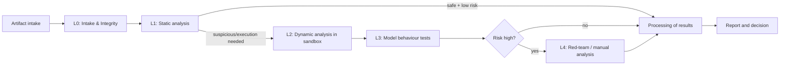

[Русский](../02-testing-strategy.md) | **English**

# Testing and risk detection strategy

The document defines **how** to detect the risks from `./01-threat-checklist.md`.
The goal is not to "scan a file", but to obtain a reproducible, provable picture
of the model's behaviour at all levels.

## 1. Principles

1. **Defense in depth by levels (L0–L4)** — from safe static parsing to red-team.
2. **Assume malicious** — by default the artifact is considered dangerous until proven otherwise.
3. **Never execute in a trusted environment** — any run only in a sandbox.
4. **Full observation (observability)** — syscalls, network, FS, processes, resources are recorded.
5. **Reproducibility** — the same artifact + the same test profile → a deterministic report.
6. **Evidence, not flags** — every verdict is supported by an artifact (log, dump, diff, trace).
7. **Minimizing false negatives at the expense of speed** — when in doubt, escalate to manual analysis.
8. **Layering: static analysis is cheaper and safer → dynamic analysis only after static.**

## 2. Test Levels

### L0. Intake & Integrity
**Goal:** record the artifact and exclude substitution.

- Calculation of cryptographic hashes (SHA-256/BLAKE3), recording of size and MIME.
- Determination of the **real** format by "magic bytes", not by extension.
- Verification of the signature/provenance (sigstore, GPG, hash manifest), if available.
- Registration of the source (URL, repository, commit, author, date) — lineage.
- Detection of polyglots and mismatch with the extension.
- Result: **Artifact Record** (immutable).

### L1. Static Analysis — without execution
**Goal:** find dangerous constructs without running code.

Methods:
- **Disassembly of pickle:** `pickletools.dis`, parsing of the VM stream into IR.
- **Analysis of opcodes:** search for `GLOBAL`, `STACK_GLOBAL`, `REDUCE`, `BUILD`, `INST`, `OBJ`, `EXT*`.
- **Allowlist check of globals:** only "safe" modules are allowed
  (`numpy`, `torch.*` (tensors/storage), `collections`, `builtins` with reservations).
  Everything else → finding. (the picklescan / fickling / modelscan approach).
- **Search for dangerous callables:** `os.system`, `os.popen`, `subprocess.*`, `eval`, `exec`,
  `compile`, `getattr`, `setattr`, `__import__`, `socket`, `requests`, `urllib`,
  `pty`, `ctypes`, `marshal.loads`, `builtins.*`, `runpy`.
- **AST analysis (fickling):** reconstruction of the tree and interpretation as code.
- **Detection of obfuscation:** string entropy, base64/ZIP/marshal blob, nested pickle.
- **Analysis of additional artifacts:** `config.json`, `*.py`, `setup.py`, `requirements`,
  Keras `Lambda` layers, custom ONNX ops.
- **Dependency analysis:** SBOM, CVE scan, detection of dependency confusion and typosquatting.
- **Inventory:** list of tensors, their shapes, types, weight statistics.

Tools (reference): `pickletools`, **fickling**, **picklescan**, **ModelScan (Protect AI)**,
`semgrep`, `bandit`, `pip-audit`, `syft`/`grype`, `trivy`.

Result: a set of **Static Findings** + the extracted IR for dynamic planning.

### L2. Dynamic Sandbox Analysis
**Goal:** safely execute the loading and observe behaviour.

- Execution of `load` in a hermetic sandbox (see `./03-isolation.md`).
- Monitoring:
  - **syscalls** — eBPF (Falco/Tetragon), `seccomp`, `strace` (for debugging).
  - **network** — DNS/HTTP/raw sockets, egress proxy, sinkhole, TLS inspection optionally.
  - **FS** — `inotify`/overlay diff: what is read, what is created/changed.
  - **processes** — `fork/exec`, process tree, descendants.
  - **resources** — CPU, RAM, GPU, disks, PID, IO (cgroups).
  - **security** — escalation attempts, access to `/var/run/docker.sock`, IMDS.
- **Deception:** honeypot creds, fake `~/.aws`, `kubeconfig`, canary tokens,
  fake IMDS — for detecting secret theft and attribution.
- **Canary files and beacon endpoints:** leakage/access = proof of exfiltration.
- Isolation of attempts: each test is a clean ephemeral instance.

Result: **Behavioral Trace** (system events with timestamps) + network/FS diff.

### L3. Model Behavior Testing
**Goal:** evaluate the model itself as an algorithm (after safe loading).

- **Functional tests:** compliance with the declared purpose, input/output contract.
- **Robustness:** adversarial examples (FGSM/PGD, for NLP — text attacks).
- **Backdoor/trojan search:**
  - trigger scanning (patch stickers, rare tokens, specific patterns);
  - methods of neural cleansing/search for activation anomalies (Neural Cleanse approaches);
  - differential comparison with a reference model of the same class.
- **Privacy tests:** membership inference, model inversion, extraction of memorized PII.
- **Calibration and stability:** NaN/Inf, overflows, robustness to distribution shift.
- **Resource tests:** latency, throughput, peak memory/GPU, DoS resistance.
- **Safety/alignment:** bypassing guardrails, generation of prohibited content (for LLM).

Result: **Model Behavior Report** (metrics + counterexamples + evidence).

### L4. Deep / Red-Team
**Goal:** targeted search for bypasses and hidden backdoors.

- Manual reverse of suspicious payloads.
- Fuzzing of the format and inputs (structural fuzzing of pickle and model inputs).
- Checking for "sandbox evasion": conditional activation, sandbox detection, delayed triggers.
- Checking the resilience of the isolation mechanisms themselves (escape tests).
- Attribution (ATT&CK/ATLAS), comparison with a DB of known threats.

## 3. Pipeline

Escalation rules:
- L1 found dangerous callables → immediately L2 (do not run in a normal environment).
- L2 recorded network/exfiltration/persistence → **immediate stop** and verdict *Malicious*.
- Any artifact that did not pass L1 due to format uncertainty → L2 + L4.

## 4. Risk-to-test Traceability

| Risk category | Covering levels | Key methods |
|---------------|-----------------|-------------|
| A. Deserialization/RCE | L1, L2, L4 | opcode analysis, allowlist, sandbox execution, syscall monitoring |
| B. Formats/delivery | L0, L1 | magic bytes, polyglot detection, archive analysis, dependency scan |
| C. Model level | L3, L4 | backdoor scan, privacy tests, robustness, fuzzing |
| D. Integrity/SC | L0, L1 | signature, SBOM, CVE scan, provenance |
| E. Info leaks | L1, L2, L3 | static path search, honeypot, FS/network monitoring, extraction tests |
| F. Uncontrolled | L2, L4 | behavioural monitoring, cgroups, escape tests |
| G/H. Environment/process | Infrastructure | hardening, audit, sandbox metatests |

## 5. Evidence

Each finding contains:
- `finding_id`, risk category (A–I), level (L0–L4), rule/detector;
- `severity`, `confidence`, reproducibility;
- **raw evidence**: a fragment of pickle disassembly, a syscall trace,
  a network connection dump, an FS diff, a metric, a counterexample;
- references to standards (CWE/ATLAS/OWASP).

Evidence is stored in an immutable form (append-only, hash chain) — see `./04-risk-analysis.md`.

## 6. Testability of the system itself (metatesting)

- A set of "golden" references: known-safe, suspicious and malicious models
  (e.g. EICAR analogues for pickle) → regression of detectors.
- Quality metrics: TPR/FPR/FNR by category, checklist coverage.
- Periodic escape tests of the isolation.
- Mutation testing of detectors (can a rule be bypassed?).

## 7. Limitations and assumptions

- Full coverage of behaviour cannot be guaranteed (conditional/delayed activation).
- Static analysis of pickle fundamentally does not solve the halting problem — dynamic analysis is needed.
- Models may detect the sandbox and not activate (sandbox evasion) → deception and
  environment randomization are needed.
- Behavioural tests are always incomplete → a policy of "managed risk", not "absolute safety".
