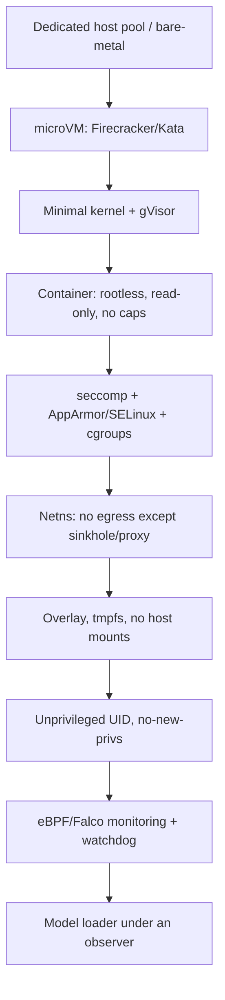

[Русский](../03-isolation.md) | **English**

# Methods for reliable isolation of the system from dangerous model behaviour

The document describes how to guarantee that the execution of any (including malicious)
pickle model does not go beyond the controlled environment and does not harm the
infrastructure. Isolation is built on the principle of **defense in depth**: the failure
of one layer does not lead to a compromise.

## 1. Threat model for isolation

Assumption: **the executable payload is maximally hostile** and tries to:
- execute arbitrary code, escalate privileges, escape the container/VM;
- gain access to the network (C2, exfiltration, mining);
- read/write the FS, steal secrets, establish persistence;
- exhaust resources (CPU/RAM/GPU/disk/PID);
- attack the scanner, its data and other checks;
- detect the sandbox and "fall silent".

## 2. Isolation layers (from outside in)

### 2.1 Hardware/host level
- **Dedicated host pool** for scanning; isolation from production.
- **microVM** (Firecracker, Kata Containers) — the strongest boundary: its own kernel per instance.
- For maximum requirements — a separate physical host / network segment.
- Hypervisor-level hardening, disabling unnecessary devices (USB, GPU passthrough only when necessary).

### 2.2 OS/kernel level
- **gVisor** (`runsc`) or Kata — interception of syscalls, reduction of the kernel attack surface.
- A fresh patched kernel, LSMs (AppArmor/SELinux) in enforce mode.
- Disabling modules, `unprivileged_userns` by policy, restriction of `/proc`, `/sys`.

### 2.3 Container and privileges
- **Rootless** containers (Podman/Docker rootless).
- `--read-only` rootfs, `--no-new-privileges`, `--cap-drop=ALL`.
- **Prohibited**: `--privileged`, `CAP_SYS_ADMIN`, `CAP_NET_ADMIN`, `CAP_SYS_PTRACE`.
- Unprivileged UID/GID, `userns` mapping.
- Do not mount: docker socket, `/proc/sys`, host PID/net IPC, host home directories.
- Explicit empty/ephemeral volumes instead of host paths.

### 2.4 Syscall filtering
- **seccomp-bpf**: default deny, allowlist for `read/write/mmap/…`, block `execve` (if not needed),
  `socket`/`connect` under network isolation, `ptrace`, `mount`, `keyctl`, `bpf`, `unshare`.
- Separate profiles: `static-eval` (without `execve`), `dynamic-load` (the minimum for torch/numpy).

### 2.5 Network isolation
- A separate **network namespace** without a route to the outside.
- By default **egress deny-all**.
- Allowed channels — only through an **egress proxy with an allowlist** and full logging.
- **DNS sinkhole**: all requests are resolved/intercepted; connection attempts are recorded.
- **HTTP sinkhole + canary URL**: imitate C2 in order to detect beaconing.
- Blocking of access to **IMDS** (`169.254.169.254`) and internal services (metadata, kube-API).
- Optionally: TLS inspection for recovering the exfiltration payload.

### 2.6 File system
- **Overlay/CoW** rootfs on tmpfs; changes do not affect the host and disappear after the run.
- Only the **necessary** libraries; no secrets in the image.
- `noexec`, `nosuid`, `nodev` on mounts.
- Control of the size of tmpfs and the total disk (quotas).
- **Honeypot files** with canary: `~/.aws/credentials`, `~/.ssh/id_rsa`, `kubeconfig`,
  `.env` — we record any reads.

### 2.7 Resource limits (cgroups v2)
- **CPU/GPU quota**, **memory limit** (+ `memory.swap=0`), **pids.max** (against fork bombs),
  **io.max**, a limit on the number of open files and network connections.
- **GPU**: MIG/vGPU or emulation; context isolation, VRAM limit, a watchdog for hangs.
- **Time budget**: a hard timeout for load and inference; SIGKILL on exceeding.

### 2.8 Monitoring and observation (does not hinder isolation, but is mandatory)
- **eBPF** (Falco/Tetragon/Cilium) — syscall/network/file events, blocking by rules.
- **auditd** on the host, `ptrace`/`strace` for debug runs.
- **Watchdog** and the OOM killer as the last line.
- Export of events to a collector; temporal correlation with the load/inference phases.

### 2.9 Deception and anti-evasion (important!)
- Randomization: host names, paths, env, timings — so that the payload does not "recognize" the sandbox.
- Decoy secrets (fake credentials/tokens) with canary markers.
- Delays/environment noise, emulation of a "realistic" environment.
- Multiple runs in different configurations to detect conditional activation.

## 3. Application-level isolation (inside the sandbox)

- **Loading only** of the model in a separate process; no network clients in the environment.
- Launch through a **dedicated sandbox-runner** that:
  - configures limits and monitoring before the start;
  - serializes the phases (load → infer) and logs the boundaries;
  - does not pass host secrets (clean env, `env -i`).
- **Empty env**: only the minimum necessary variables (`PATH`, `LANG`), the rest is removed.
- Explicit disabling of loader "magic":
  - `torch.load(..., weights_only=True)` where applicable;
  - `numpy.load(..., allow_pickle=False)` where applicable;
  - `pickle.Unpickler` with an **allowlist `find_class`** for static mode.
- **Two modes**:
  - *Static-only*: deserialization without execution (interception of `find_class`, opcode interpretation).
  - *Dynamic*: real execution under full monitoring, necessarily in maximum isolation.

## 4. Control of outgoing "leakage" channels from the sandbox

Even an isolated payload can create **side channels**:
- Execution time, CPU/memory consumption, log size, DNS timings.
- Measures: normalization of timings at the output, restriction of access to shared memory,
  isolation of the scanner infrastructure from data that the payload could encode.
- **Do not mix** data of different models; one instance — one model (see cross-contamination F-12).

## 5. Instance lifecycle management

1. **Provisioning**: a one-time VM/container from a clean image (immutable, versioned).
2. **Setup**: mounting the artifact read-only, configuring limits and monitoring.
3. **Execution**: launch under the sandbox-runner, live monitoring, cut-off by timeout/limits.
4. **Teardown**: immediate destruction of the entire instance, removal of volumes and network.
5. **Attestation**: recording of the image/toolchain hash for reproducibility.
6. **Periodic rotation** of images and verification of their integrity.

## 6. Separate critical isolation: static analysis

Static analysis **does not execute** the payload, but it is not absolutely safe either:
- pickle/marshal parsers may have their own vulnerabilities → run the parsers
  in a separate low-privileged process/sandbox without network.
- Limit the size and depth of input structures (protection against DoS on the parser).
- Do not import the modules referenced by the artifact until the allowlist check.

## 7. Isolation of the scanning platform itself (control plane)

- The control plane (DB, API, UI) **has no access** to the execution network, only to the results bus.
- Different trust zones: `intake` → `static` → `dynamic` → `analysis`.
- Platform secrets (keys, tokens) are **never** available in the sandbox.
- Signing of results, RBAC, audit, immutable logs.
- See `./05-architecture.md`, section "System security".

## 8. "Risk → isolation measure" matrix

| Risk (checklist) | Key measures |
|------------------|--------------|
| A-01…A-18 (RCE) | microVM + gVisor, seccomp, rootless, no-new-privs, read-only |
| F-01 (network/C2) | netns, egress deny-all, sinkhole, canary URL, DNS interception |
| F-02/F-03 (FS/persistence) | overlay/tmpfs, read-only, teardown, FS monitoring |
| F-04/F-05/F-06 (resources/DoS) | cgroups v2, pids.max, GPU/disk limits, timeouts, watchdog |
| F-07/F-10 (encryption/self-modification) | read-only artifact, ephemerality, overlay |
| E-01…E-09 (secret theft) | honeypot creds, empty env, no access to real secrets, IMDS block |
| F-08/G-* (escape) | microVM, LSM, drop caps, prohibition of docker socket/privileged |
| H-05 (sandbox evasion) | randomization, deception, multiple runs, fuzzing |
| H-09/H-10 (confusion/contamination) | one instance = one model, hash pinning, volume isolation |

## 9. Guarantees and their boundaries

A **practical** guarantee is given (best-effort, multi-layered), not a formal proof.
Residual risks:
- 0-day in the hypervisor/kernel/parser;
- hardware and microarchitectural attacks;
- conditional activation that does not manifest in the sandbox;
- side channels through shared resources.
Mitigated by: freshness of components, minimization of the attack surface, segmentation, monitoring,
periodic escape/red-team tests, "air-gap" for the most risky artifacts.

---

## 10. "Stage 1" implementation (cluster <CLUSTER>)

The layers from §2 are implemented (see `deploy/stage1/`):

| Layer (doc) | Implementation |
|-------------|----------------|
| microVM | RuntimeClass `kata` (its own kernel per pod) |
| OS/hardening | PSA `restricted`; non-root 65532, read-only rootfs, drop ALL, no-new-privs, seccomp RuntimeDefault |
| Resources | limits CPU/RAM/ephemeral-storage; tmpfs `/tmp` |
| Network | Calico NetworkPolicy: default-deny egress + DNS + `sandbox→sinkhole` (sinkhole HTTP/TCP) |
| FS/secrets | honeypot files (`~/.aws`, `~/.ssh`, `~/.kube`, `.env`), `HOME=/deception`; no host mounts |
| Monitoring | in-guest audit hooks (Kata) + Falco `modern_ebpf` (patterns `MLScan sandbox *`, runc/host) |
| Platform secrets | SA token is not mounted (`automountServiceAccountToken: false`) |

Verified: external egress is prohibited, the sinkhole is reachable; reading of honeypot creds and
leakage to the sinkhole are recorded; Kata isolation is confirmed by a separate guest kernel.
Residual items (randomization/anti-evasion, image signing, egress proxy) — subsequent stages.
