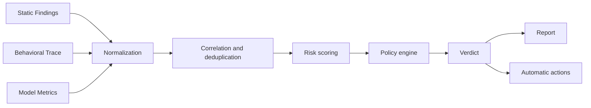
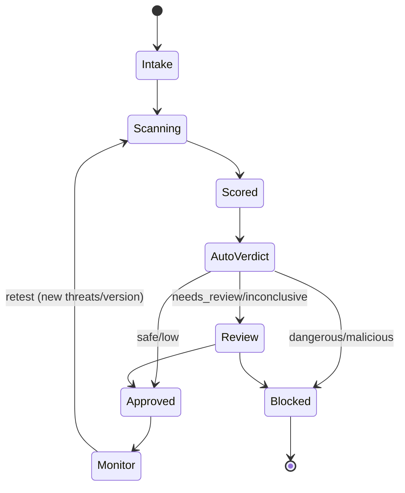

[Русский](../04-risk-analysis-decision.md) | **English**

# Processing of testing results and decision-making

The document describes how a single verdict on the admissibility of using a model and
automated decisions about it are formed from raw data (static analysis + dynamic traces +
behaviour metrics).

## 1. Results processing pipeline



## 2. Unified data model (Result Schema)

All results are reduced to a common contract (**Normalized Finding**):

```json
{
  "finding_id": "uuid",
  "artifact_hash": "sha256:...",
  "scan_id": "uuid",
  "level": "L0|L1|L2|L3|L4",
  "category": "A|B|C|D|E|F|G|H|I",
  "check_id": "A-01",
  "title": "RCE via os.system in pickle",
  "severity": "critical|high|medium|low|info",
  "confidence": 0.0,
  "detector": "opcode_allowlist@1.2.0",
  "evidence": [
    {"type": "pickle_disasm", "snippet": "c os\nsystem\n..."},
    {"type": "syscall", "line": "execve('/bin/sh',...)"}
  ],
  "standards": ["CWE-502", "ATLAS:Execution", "OWASP-ML06"],
  "remediation": "...",
  "first_seen": "2026-...",
  "deterministic": true
}
```

**Correlation & dedup:** identical findings from different levels are merged,
increasing `confidence` (static analysis found + dynamic analysis confirmed = high confidence).

## 3. Risk scoring

A two-axis model: **severity × confidence** (analogous to CVSS + trust).

```
risk_score = base_severity_weight(category, check)      # 0..10
           × confidence_factor(confidence)               # 0.5..1.0
           × exploitability_factor                        # how easy/actively exploitable
           × scope_factor                                 # impact (host/cluster/data)
```

Severity weights (example):
| Severity | base |
|----------|------|
| critical | 9.0–10.0 |
| high | 7.0–8.9 |
| medium | 4.0–6.9 |
| low | 1.0–3.9 |
| info | 0.0–0.9 |

**Aggregation per artifact:** maximum risk + "weighted sum" (cumulative score).
Critical findings (RCE, exfiltration, persistence) **dominate** — the verdict is by the maximum,
not by the average.

## 4. Verdict classes

| Verdict | Condition | Default action |
|---------|-----------|----------------|
| **Safe** | 0 findings high+, full checklist coverage | Allow (with recording in the registry) |
| **Low risk** | only low/info | Allow with recommendations |
| **Needs review** | medium, or high uncertainty/incomplete coverage | Quarantine until manual analysis |
| **Dangerous** | high, or a proven malicious pattern without full confirmation | Block, escalate |
| **Malicious** | confirmed RCE/exfiltration/persistence/encryption/canary trigger | Block, incident, isolate the artifact |
| **Inconclusive** | tests not performed/infrastructure error | Retry/manual analysis (never "Safe") |

**Key rule:** "not proven safe" ≠ "safe". The absence of findings with
incomplete coverage → `Inconclusive`, not `Safe`.

## 5. Policy Engine

Declarative rules (YAML/Rego/OPA) defining the final decision:

```yaml
rules:
  - id: block-rce
    when: findings.any(check_id in ["A-01","A-02","A-13"] and confidence > 0.8)
    action: block
    verdict: malicious
  - id: block-egress
    when: trace.network.egress_unexpected == true
    action: block
    verdict: malicious
  - id: quarantine-medium
    when: max_severity == "medium"
    action: quarantine
    verdict: needs_review
  - id: allow-low
    when: max_severity in ["low","info"] and coverage.complete
    action: allow
  - id: default-deny
    when: default
    action: quarantine
    verdict: inconclusive
```

The policy is configurable to customer requirements (for example, "prohibit any network
activity", "require a signature", "prohibit unsigned sources").

## 6. Human-in-the-loop

- All verdicts `Needs review`, `Dangerous`, `Inconclusive` — for manual analysis.
- The analyst sees the evidence and can:
  - confirm/refute a finding (with feedback to the detectors);
  - override the verdict with justification (privilege escalation + audit);
  - run additional tests (L4, red-team).
- The analyst's decisions are recorded and used to calibrate weights and rules.
- **False negatives** — feedback priority: incident analysis → new rules.

## 7. Handling false positives

- **Whitelisting** of trusted callables/modules (with versioning and review).
- **Baseline models:** for a class of models a profile of "normal" behaviour is built;
  deviations are suspicious.
- **Confidence threshold** and mandatory confirmation by dynamic analysis for high severity, where possible.
- Quality metrics (see `./02-testing-strategy.md` §6) are tracked as an SLA.

## 8. Reporting and decision artifacts

**The model report** contains:
1. Identification of the artifact (hash, source, lineage, signature).
2. The scope and depth of testing (which levels/checks were performed; coverage).
3. A list of findings with description, evidence, severity/confidence, CWE/ATLAS/OWASP.
4. The final risk score and the **verdict**.
5. Limitations/uncertainties (what was not checked, what could have been hidden).
6. Recommendations (allowed use, conditions, improvements).
7. The integrity hash of the report and the signature (for audit).

**Formats:** JSON (machine), PDF/HTML (human), SARIF (integration into CI), and recording in the model registry.

## 9. Automatic actions (Enforcement)

- **CI/CD Gate:** integration as a pipeline step — the build is blocked when the verdict is ≥ Dangerous.
- **Model Registry:** recording of the status (allowed/blocked/quarantined), version,
  policy, verdict validity period.
- **Quarantine:** isolation of the artifact, prohibition of distribution, notification of the owner.
- **Incident response:** on Malicious — a SOC alert, isolation of the source, checking
  whether the infrastructure has already been affected.
- **Continuous monitoring:** periodic re-checking as new threats appear
  (updating detectors, retest on a schedule or on a trigger).

## 10. Verdict lifecycle



The verdict is **not eternal**: it is bound to the artifact hash and the policy version; changes →
re-check.

## 11. Audit and provability of the decision

- Every decision is reproducible from the stored evidence.
- An append-only decision log (who/what/when/why), signature.
- Storage of the versions of detectors/policies applied during the scan.
