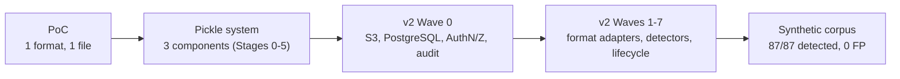
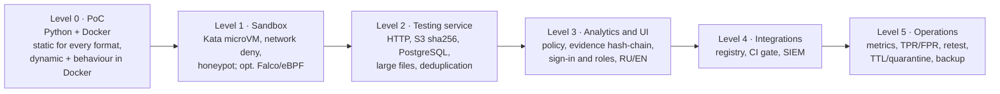
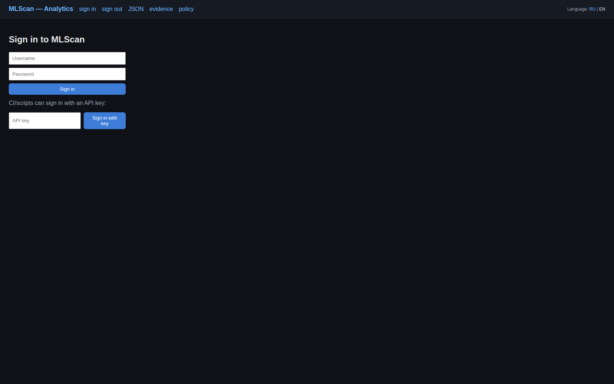
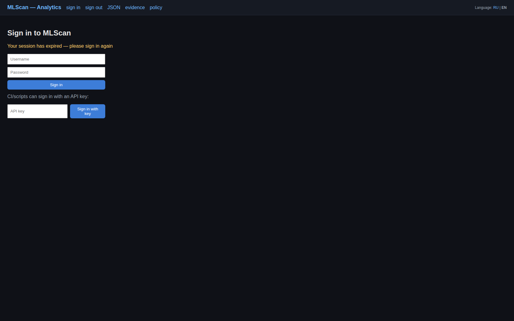
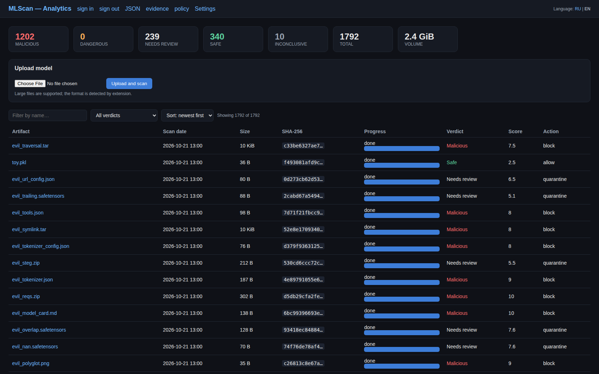
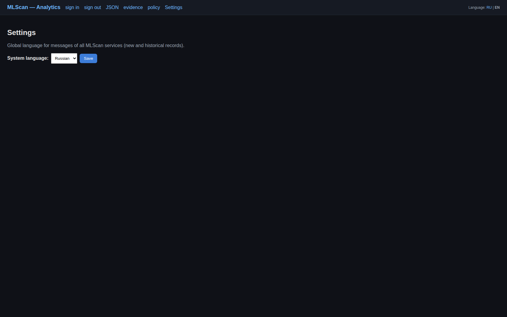
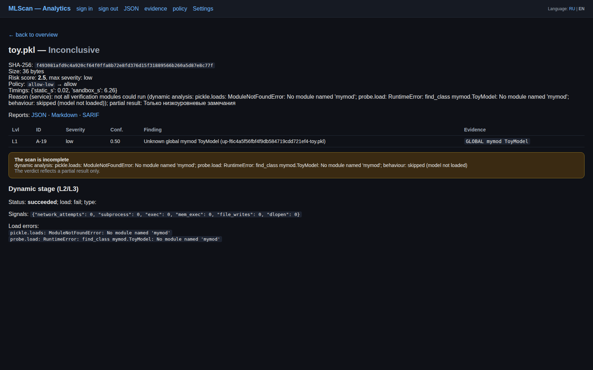
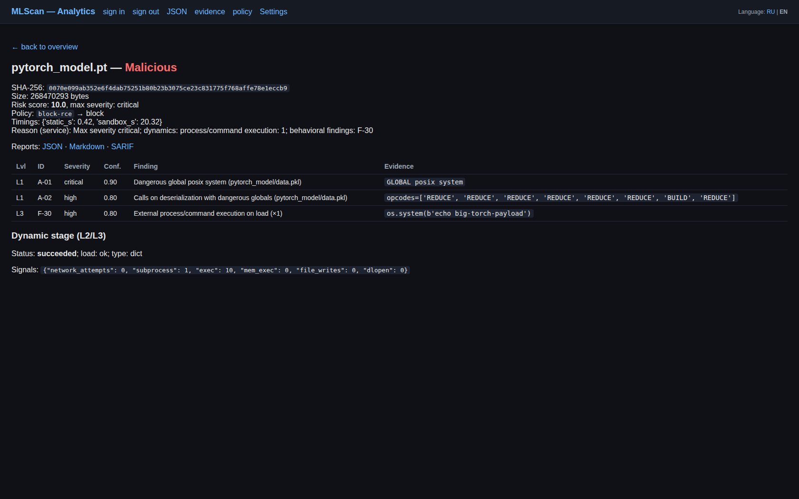
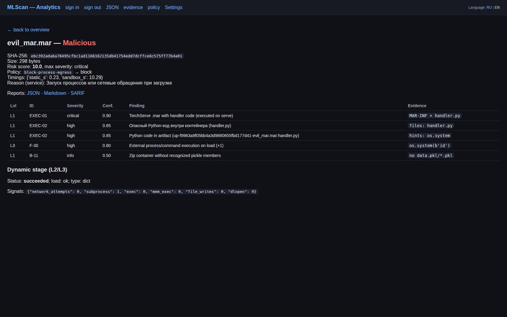

# MLScan

[Русский](./README.md) | **English**

**A security (maliciousness) analysis system for models and data used in ML/AI.**

The project answers one question: **is a given ML/AI artifact safe, and what exactly is dangerous
about it** — code executed on load, backdoors, data leaks, uncontrolled behaviour, integrity and
provenance problems.

> **Introductory article** (focus, history, links) — [`START.en.md`](./START.en.md).
> Detailed technical documentation — [`docs/en/`](./docs/en) (EN) and [`docs/`](./docs) (RU).

---

## How the project evolved

The project grew **incrementally**: from checking a single format to a platform able to scan
arbitrary ML/AI artifacts — including very large ones — in an isolated environment.

| Stage | What appeared | Key idea |
|-------|---------------|----------|
| **0. PoC** | A single file `poc/mlscan_poc.py`: static + Docker dynamics + behaviour → Markdown | Prove a pickle model can be analysed by three independent methods |
| **1. Sandbox** | Kata microVM, deception, sinkhole, NetworkPolicy, Falco | A model is executable code → run it only in isolation with observation |
| **2. Testing service** | Artifact intake, sandbox launch, finding normalisation, verdict | Separate analysis from the upload path, turn it into a service |
| **3. Analytics + UI** | Scoring, Policy Engine, append-only Evidence Store (hash chain), reports, web UI | A single control point, evidence base and verdict |
| **4. Integrations** | Model Registry (SHA-256), CI/CD gate, SIEM export (NDJSON/CEF), threat intel | Embed scanning into delivery pipelines |
| **5. Operations** | Metrics, quality metrics (TPR/FPR), retest, red team, PDB, attestation | Production loop: quality control and continuity |
| **v2 — Wave 0** | S3 storage (Garage), PostgreSQL, AuthN/Z + audit, observability + backup | Remove size limits and provide audit/traceability |
| **v2 — Waves 1–3** | Format adapters and detectors (model-as-code, Keras, ONNX, HDF5, GGUF, archives, XXE, tokenizers, prompt injection, agent/MCP), model-as-code dynamics, retention/TTL | Extend beyond pickle without rebuilding the core |



---

## Deployment scheme: levels 0-5

The system is deployed **in stages**: every level is self-sufficient (fully usable within its
analysis capabilities), the next level only adds capabilities and components, and incompleteness is
never concealed - when a verification module could not run, the verdict is `Inconclusive` with a
partial result. You can stop at any level.

Plan and rationale - [`docs/en/13-deployment-plan.md`](./docs/en/13-deployment-plan.md),
level chooser - [`deploy/README.md`](./deploy/README.md),
upgrade path - [`deploy/upgrade.md`](./deploy/upgrade.md).



| Lvl | What it provides (analysis and service) | What it requires | Install · verify |
|-----|------------------------------------------|------------------|------------------|
| **0** | **PoC:** static analysis for every format (pickle/torch/numpy, SafeTensors, ONNX, HDF5/Keras, GGUF, archives, notebooks, scripts, configs/cards, MCP, HTML/SVG, Dockerfile, datasets, compressed payloads), dynamic L2 and behaviour L3 in Docker, MD/JSON report | Python 3.10+, Docker (dynamic stage only) | `bash deploy/install.sh 0` · `bash deploy/verify.sh 0` |
| **1** | The same, but untrusted code runs in a **microVM (Kata)**: network deny, honeypot/sinkhole, read-only FS, limits; **optional** Falco/eBPF (host monitoring) | single-node Kubernetes, RuntimeClass `kata`/`gvisor`, image registry | `bash deploy/install.sh 1` · `bash deploy/verify.sh 1` |
| **2** | **Testing service:** HTTP intake (streaming, large models), deduplication in **S3 (Garage)** `sha256/<name>`, metadata and findings in **PostgreSQL**, Job orchestration, coverage-aware verdict | level 1 + Garage + PostgreSQL | `bash deploy/install.sh 2` · `bash deploy/verify.sh 2` |
| **3** | **Analytics:** scoring, Policy Engine, append-only evidence with a hash chain, JSON/MD/SARIF reports, **web UI** (sign-in, roles, language switch, `/settings`, incomplete-scan banner) | levels 1-2 + Istio Ingress | `bash deploy/install.sh 3` · `bash deploy/verify.sh 3` |
| **4** | **Integrations:** model registry by SHA-256, CI gate `/gate` (allow/block/review + exit code), SIEM export (NDJSON/CEF), threat intel | levels 2-3 | `bash deploy/install.sh 4` · `bash deploy/verify.sh 4` |
| **5** | **Operations:** Prometheus metrics, `/quality` (TPR/FPR), `/sla`, cron `/retest`, red-team Job, `/alerts`, retention/TTL + quarantine, backup/restore with verification | levels 3-4 | `bash deploy/install.sh 5` · `bash deploy/verify.sh 5` |

The commands are idempotent: `install.sh N` installs everything required up to level N (you can go
straight to 5), `verify.sh N` checks the level from the outside, and `verify.sh N --full` additionally
runs the synthetic corpus (141 samples). Format analysis does **not** depend on the level: the
adapters are shared ([`poc/formats.py`](./poc/formats.py)), so the PoC and the service inspect the
same set of formats.

```bash
bash deploy/install.sh 3        # install levels 1->2->3 (idempotent; 5 also works)
bash deploy/verify.sh 3         # verify the level from the outside
bash deploy/verify.sh 5 --full  # plus a full corpus run (141 samples)
```

---

## Why a more complex architecture and Kubernetes were needed

The reason is exactly two requirements that combine badly in "a single script on a host":

1. **Scanned files can be very large** — models reach tens and hundreds of gigabytes.
2. **Scanning must happen in an isolated environment** — because loading and running a model
   inevitably executes untrusted code or parses untrusted data **with native inference engines**,
   which is potentially unsafe (see "Corollary #2").

### Corollary #1: large files require object storage and streaming

- A model cannot be kept in pod memory or on pod disk: you need an **S3-compatible object store**
  (Garage), **content-addressed keys** `sha256/name` (deduplication and immutability),
  **streaming upload** with SHA-256 computed on the fly and **deduplication** (re-uploading the
  same file does not transfer the data again).
- Metadata, fingerprints and results live separately from the "heavy" blob — in **PostgreSQL**;
  large blobs are subject to **retention/TTL** and malicious ones to **quarantine**.
- The artifact is delivered into the sandbox by the same service (`:8090`), so the **sandbox's
  network access is not widened**.

### Corollary #2: even an "inert" model file is executed by an engine — and that is untrusted too

The vulnerability is not limited to pickle. Some formats really do execute code **directly**
(`pickle`/`dill`/`cloudpickle`, model-as-code: `.mar`, `trust_remote_code`/`auto_map`,
`tf.keras` Lambda). But crucially, **even formats that do not execute code by themselves**
(SafeTensors, ONNX, GGUF, TFLite, HDF5, datasets) **are not safe**: loading and running them is
done by an inference engine on untrusted data, so exploitation paths in the engine itself and in
its environment remain:

- **The inference engine is native code with a broad attack surface.** Loading and running is done
  by ONNX Runtime, PyTorch, TensorFlow, `ggml`/`llama.cpp`, HDF5, protobuf/flatbuffers, etc.;
  their parsers historically contain memory vulnerabilities (out-of-bounds, integer overflow,
  use-after-free) leading to crashes, data leaks or code execution.
- **Custom ops / plugins / delegate libraries.** A model may reference native code
  (custom operators, `.so` plugins, TensorRT/OpenVINO extensions) loaded by name/reference from
  the artifact.
- **External references.** External data/links (ONNX `external_data`, HDF5 external links,
  configs) → path traversal, SSRF, pulling data or code from an untrusted source.
- **Side effects on load.** Even "data only" may cause file reads, network calls or environment
  changes if the loader/engine does it.
- **Templates and configs drive the runtime.** Jinja `chat_template` (SSTI), tokenizers,
  tool/MCP schemas change engine behaviour — they are also untrusted data executed by the environment.
- **Structural resource attacks.** Nested containers, huge tensors, decompression — denial of service.
- **Environment supply chain.** Vulnerable engine and dependency versions, insecure configurations
  and plugins are exploited from the environment rather than from the model.

Bottom line: scanning **always** means running an engine on untrusted data, so isolation is needed
not only for "executing" formats. Every artifact is scanned by a **dedicated instance**:

- every run is a **Kata microVM** (its own kernel), **no network** (except sinkhole/artifact
  server), read-only FS, `drop ALL`, seccomp, CPU/RAM/disk limits, honeypot files, observation
  (in-guest audit hooks are mandatory; host-side Falco/eBPF is optional, see [`deploy/README.md`](./deploy/README.md))
  — this constrains both a direct payload and engine-vulnerability exploitation;
- the environment is **destroyed after the scan**, and the behaviour is **observable** (files,
  processes, network, `ctypes`, changes to `builtins`/import hooks).

### Why Kubernetes specifically

Combining "huge files + isolation + observability + audit + scale" is already **orchestration**,
not a single process. Kubernetes provides exactly the primitives needed:

| Requirement | Kubernetes primitive |
|-------------|----------------------|
| A disposable isolated environment per artifact | `Job` + `runtimeClassName: kata` (microVM) |
| Separation of trusted and untrusted zones | separate `Namespace` + Pod Security Admission `restricted` |
| No network from the sandbox | `NetworkPolicy` (Calico): default-deny + only sinkhole/artifact |
| Resource limits and DoS protection | `cgroups v2`: cpu/memory/pids/io/ephemeral-storage |
| Environment bring-up/teardown | `Job` lifecycle (create → run → teardown, TTL) |
| Secrets and access | `Secret`, `ServiceAccount`, RBAC, mounting without host volumes |
| External ingress/egress | Ingress (Istio) + egress allowlist |
| Periodic tasks | `CronJob` (retest, backup, retention) |
| Scaling to volume | automatic node/worker selection, GPU pool (when available) |

Without an orchestrator you would have to bring up and kill isolated VMs by hand, configure the
network deny, limits, trace collection, large blob storage and audit — i.e. reimplement these
primitives yourself. Kubernetes makes this **declarative and repeatable**, while the control
planes (analytics, DB, UI) stay in the trusted zone.

> Important: **an artifact is never executed in the trusted zone** — only in an isolated microVM
> that is destroyed entirely after the scan. See [`docs/en/03-isolation.md`](./docs/en/03-isolation.md)
> and [`docs/en/07-implemented-architecture.md`](./docs/en/07-implemented-architecture.md).

---

## Current capabilities

### Formats

**Models:** pickle and derivatives (`.pkl/.pickle`, `.joblib`, `.dill`, `.cloudpickle`,
`.pt/.pth/.bin/.ckpt`), `.npy/.npz`, SafeTensors, ONNX, HDF5/`.keras`, GGUF, TFLite, CoreML,
TorchScript/torch.package, TF SavedModel/`.pb`, PMML, MLflow models, model-as-code (`.mar`,
`model.py`), Parquet/Arrow/Feather datasets.
**Packages and data:** archives (`.zip/.tar/.tar.gz/.whl`), compressed payloads (`.gz/.bz2/.xz`),
JSONL/CSV/TSV datasets, MessagePack, notebooks (`.ipynb`), scripts (`.sh/.ps1/.bat`), Dockerfiles,
HTML/SVG documents, Jinja templates (`.j2`), XML/YAML/JSON configs, model cards, tokenizer artifacts,
MCP/agent manifests, native libraries (`.so/.dll/.dylib`), `.pth` hooks, and unsupported containers
(7z/rar/zstd - an honest "cannot be parsed").

### Detectors (check IDs)

| Group | What is detected |
|-------|------------------|
| `A-*`, `F-*` | RCE on deserialization (`os.system`, `subprocess`, `eval/exec`), network, persistence, `builtins`/import-hook tampering, leaks |
| `EXEC-*` | model-as-code (`.mar`/`model.py`/`MLflow`/`auto_map`/`torch.package`), Keras `Lambda`/`custom_objects`, ONNX `external_data`/custom ops, HDF5 links |
| `INJ-*` | Jinja `chat_template` (SSTI), prompt injection in cards and tool schemas, HTML/JS (XSS) |
| `AGT-*` | MCP/agent manifests with command execution |
| `BD-*` | tokenizers (special-token overrides, ReDoS regex), weights (NaN/Inf, extremes) |
| `FMT-*` | SafeTensors structural anomalies, archives (traversal/bomb/symlink), XXE/unsafe YAML, format mismatch |
| `INT-*` | integrity and supply chain (external URLs, install hooks in archives) |
| `STEG-*` | covert channels (trailing data after EOCD, entropy blobs, polyglot containers) |
| `D-*` | integrity/signature/provenance, "non-pickle" formats |
| `SEC-*` | secret and token leaks (AWS keys, private keys, HF/GitHub/Slack tokens) |

Also: nested archives are traversed recursively (zip in zip), `INJ-06` covers CSV formula
injection, `FMT-12` duplicate archive entries (parser differential) and `EXEC-08` native libraries.
The verdict accounts for **coverage completeness**: when a verification module could not run (the
model failed to load, a dependency is missing, a timeout), `Safe` becomes `Inconclusive` with a
partial result - both in the testing service and in analytics/UI.

The sandbox image `mlscan-sandbox:v4` (built with Kaniko) contains libraries for dynamic model
execution and parsing: **PyTorch (CPU), numpy, safetensors, onnxruntime, onnx, h5py, gguf, pyarrow,
PyYAML, joblib, dill, cloudpickle** — so models in pickle, torch, numpy and model-as-code formats are
actually loaded and executed, while safetensors/ONNX/HDF5/GGUF/Keras/Parquet containers are parsed by
dedicated libraries (mmap/schema).

**An honest verdict when the scan is incomplete.** There are three modules (static L1, dynamic L2,
behaviour L3). If a module could not run — the model failed to load (missing dependency),
resources were insufficient, a timeout, the sandbox did not start — the result is not considered
complete: instead of `Safe` the system returns **`Inconclusive`** with the reason "not all
verification modules could run (dynamic analysis: `No module named 'mymod'`); partial result: …"
and a banner on the card. If the partial data already proves danger, the verdict is kept but
marked as incomplete.

### Analysis methods

- **L1 static** — without execution: pickle opcodes/globals, structural format parsing, references
  to code, external data, templates.
- **L2 dynamic** — execution in a Kata microVM with full observability (files/processes/network/
  `ctypes`, process state diff); **model-as-code is actually executed** and confirmed dynamically.
- **L3 behaviour** — introspection and probing of the loaded object.

### Platform and operations

S3 storage with deduplication and retention/quarantine, PostgreSQL with a hash-chain evidence log,
AuthN/Z (API keys + RBAC + UI login), a journal of connections/uploads/scans (`connections`,
`audit_log`), Ingress/Egress control, Model Registry and CI/CD gate, SIEM export, metrics and
**quality metrics (TPR/FPR)**, continuous retest, red team, DB backup with restore verification.

### UI and message language (RU/EN)

The UI and service messages are localised (RU/EN): a language switch in the UI header
(cookie `mlscan_lang`), `?lang=en` / `X-MLScan-Lang` header for the API, and a **global system
language setting** (`MLSCAN_LANG` at startup + `POST /settings/language` for an administrator,
stored in the database). Localised are the UI, verdict reasons, findings (including historical
records) and reports. Russian documentation — [`README.md`](./README.md) / [`docs/`](./docs).

### Self-testing

A synthetic corpus — [`tests/vulnerabilities/`](./tests/vulnerabilities): **141 samples**
(87 malicious + 54 benign), generators, a runner and a report. Besides the pickle family it covers
notebooks, scripts, TorchScript/torch.package, MLflow, TF SavedModel, TFLite, CoreML, PMML,
Parquet/Arrow datasets, ONNX `external_data`, HDF5 external links and safetensors metadata. The
benign part contains real files of complex formats (safetensors, ONNX, HDF5, GGUF, Keras, torch,
numpy, archives, tokenizers, manifests) plus **five ~198 MB samples** generated on demand and
uploaded straight to the testing service. **Result: 87/87 detected, 0 misses, 0/54 false
positives**; the large models are `Safe` with complete coverage; per-format quality metrics
TPR=1.0, FPR=0.0. A quick corpus run against a deployed stand is
`bash deploy/verify.sh <level> --full`; generation and details are in the corpus README.

---

## Screenshots (UI, English)

**Sign-in** — username and password (session cookie on `.mlscan.local`, single sign-on for
analytics/ops/integrations); CI/scripts can sign in with an API key:



**Session expired** — when a session in an open tab runs out (12 h), the UI returns to the sign-in
screen with a notice instead of silently showing an empty table:



**Dashboard** — model upload (including large files), statistics by verdict/volume, filtering by
name and result, sorting by date/volume, a table with SHA-256, size, scan progress, verdict, risk
score and policy action (the current stand holds 3575 scans):



**UI address:** `http://analytics.mlscan.local:30217` (HTTP by default; HTTPS is optional:
`bash deploy/install.sh 3 --with-tls` -> `https://analytics.mlscan.local:30921`, self-signed
certificate). A browser error `SSL_ERROR_RX_RECORD_TOO_LONG` means `https://` was used on HTTP port
30217 - use `http://...:30217` or enable TLS. Add the hosts first: `/etc/hosts` ->
`<NODE_IP> analytics.mlscan.local ops.mlscan.local integrations.mlscan.local api.mlscan.local`.

**UI credentials.** Users are created by the level-3 installation: `admin` (role `admin`) and
`analyst` (role `analyst`). The passwords are **printed by `bash deploy/install.sh 3`** and stored in
`/tmp/mlscan-users.json`; show them later with `bash deploy/v2/auth/users.sh --show`, set or reset with
`MLSCAN_ADMIN_PASSWORD='...' bash deploy/v2/auth/users.sh`. Re-running the installation **does not
change** the passwords. API-key sign-in (CI/scripts) — `bash deploy/v2/auth/keys.sh`.

**Settings** — the global message language of the whole system (available to the `admin` role; stored
in the database and applied by every service to new and historical records):



**Incomplete scan card** — a model the dynamic stage could not load (module `mymod` is missing):
verdict **Inconclusive** instead of a false `Safe`, the banner "The scan is incomplete" and the
partial result:



**Artifact card** — the largest scanned model: the torch model `pytorch_model.pt` of
**268,470,293 bytes (≈256 MiB)**. Visible are SHA-256, size, timings (static 0.42 s / sandbox
20.3 s), risk score 10.0, policy `block-rce → block`, findings with evidence
(`A-01` critical `posix.system`, `A-02` high, `F-30` high `os.system(...)`) and the
**"Dynamic stage"** section: `load: ok`, `type: dict`, `subprocess: 1` — the model was really
loaded and the payload executed in the sandbox:



**Non-pickle artifact card** (`evil_mar.mar`, model-as-code): verdict **Malicious**, findings
`EXEC-01` (critical) and `EXEC-02` (high) from the format adapter, plus dynamic confirmation
`F-30` — the "Dynamic stage" section shows `subprocess: 1`:



Russian screenshots — [`docs/img/`](./docs/img).

---

## System architecture

Three components (Components 1–3) deployed in separate namespaces:

1. **Sandbox** — isolation and model execution, full behaviour observation (Kata microVM).
2. **Testing Service** — feeding artifacts into the sandbox and safely collecting results.
3. **Analytics Engine + UI** — process control, scoring, Policy Engine, Evidence Store,
   reports and web UI. Plus **Integrations** (registry/gate/SIEM) and **Ops** (metrics/quality/retest).

See [`docs/en/05-architecture.md`](./docs/en/05-architecture.md),
[`Concept.en.md`](./Concept.en.md),
[`docs/en/07-implemented-architecture.md`](./docs/en/07-implemented-architecture.md) (as-built),
[`docs/en/11-target-architecture-v2.md`](./docs/en/11-target-architecture-v2.md) (v2).

---

## Repository layout

| Path | What it is |
|------|------------|
| [`START.en.md`](./START.en.md) | Introductory article: project focus, history, architecture scalability |
| [`Concept.en.md`](./Concept.en.md) | Concept of the system (English) |
| [`tests/vulnerabilities/`](./tests/vulnerabilities) | **Synthetic vulnerability corpus** + procedure + detection report |
| [`deploy/README.md`](./deploy/README.md) | **Deployment level chooser (0-5)**, capability and command matrix |
| [`deploy/install.sh`](./deploy/install.sh) | Idempotent installation of the selected level (with prerequisite checks) |
| [`deploy/verify.sh`](./deploy/verify.sh) | End-to-end level verification (`--full` runs the corpus) |
| [`deploy/upgrade.md`](./deploy/upgrade.md) | N -> N+1 upgrade: components, migrations, rollback |
| [`poc/mlscan_poc.py`](./poc/mlscan_poc.py) | **PoC (level 0)** — a single Python file: static analysis for every format plus dynamic/behaviour in Docker |
| [`poc/formats.py`](./poc/formats.py) | Format adapters (stdlib) — one shared module for the PoC and the testing service |
| [`poc/scan/`](./poc/scan) | Demo data (pickle + `formats/`) and generators |
| [`deploy/stage1/`](./deploy/stage1) | Stage 1 (level 1): Kata sandbox, deception, sinkhole, NetworkPolicy; Falco is optional (`60-falco.sh`) |
| [`deploy/stage2/`](./deploy/stage2) | Stage 2: testing service |
| [`deploy/stage3/`](./deploy/stage3) | Stage 3: analytics engine + UI |
| [`deploy/stage4/`](./deploy/stage4) | Stage 4: integrations (registry/CI gate/SIEM/threat intel) |
| [`deploy/stage5/`](./deploy/stage5) | Stage 5: operations (metrics/quality/retest/red team) |
| [`deploy/i18n/`](./deploy/i18n) | Localisation module RU/EN (UI, service messages, findings) |
| [`deploy/sandbox-image/`](./deploy/sandbox-image) | Sandbox image `mlscan-sandbox` (torch CPU), Kaniko build |
| [`deploy/ingress/`](./deploy/ingress) | Ingress (Istio) and egress allowlist |
| [`deploy/v2/`](./deploy/v2) | **v2:** S3 (Garage), PostgreSQL, AuthN/Z+audit, observability, backup, lifecycle, format detectors |
| [`docs/`](./docs) | Detailed documentation (01-13, RU) |
| [`docs/en/`](./docs/en) | English documentation (01-13) |

### Documentation (brief)

- `docs/01` threat checklist (A–I) · `docs/02` testing strategy L0–L4 · `docs/03` isolation
- `docs/04` result handling and decisions · `docs/05` architecture
- `docs/06` implementation plan (implemented) · `docs/07` as-built architecture · `docs/08` test guide
- `docs/09` analysis of other formats/backdoors · `docs/10` extension plan (waves) · `docs/11` v2 target architecture
- `docs/12` UI and message localisation (RU/EN)
- English versions: [`docs/en/`](./docs/en)

---

## PoC quick start (level 0)

Requirements: Python 3.10+ (stdlib only) and **Docker** for the dynamic stage only.
The PoC already analyses **every supported format** statically (see [`poc/README.md`](./poc/README.md)):

```bash
python3 poc/mlscan_poc.py poc/scan/evil0.pkl --out report.md        # static + dynamic + behaviour
python3 poc/mlscan_poc.py model.safetensors --static-only           # SafeTensors: static only
python3 poc/mlscan_poc.py payload.ipynb --static-only --lang en     # notebook, English report
python3 poc/mlscan_poc.py arch/model.zip --image localhost:32000/mlscan-sandbox:v4  # dynamic with libs
cat model.pkl | python3 poc/mlscan_poc.py - --name model.pkl        # stdin input (no file on disk)
```

The artefact is passed into the container **without shared directories** (stdin + a base64 bootstrap
harness, the result goes to stdout); the verdict accounts for coverage completeness (`Inconclusive`
with a reason when a module could not run).

---

## Status

Implemented and verified: the PoC, the pickle system (Stages 0–5), the v2 target architecture
(Wave 0: S3/PostgreSQL/AuthN+audit/observability+backup; format waves 1–3: adapters and detectors,
model-as-code dynamics; retention/TTL and quarantine), per-format quality metrics (TPR=1.0,
FPR=0.0) and the synthetic corpus (87/87, 0 FP). The UI and service messages are
localised RU/EN with a global language setting.

Context: [`deploy/v2/README.md`](./deploy/v2/README.md), plan — [`docs/en/10-plan-new-formats.md`](./docs/en/10-plan-new-formats.md),
target architecture — [`docs/en/11-target-architecture-v2.md`](./docs/en/11-target-architecture-v2.md).

---

## License

MIT — see [`LICENSE`](./LICENSE).
