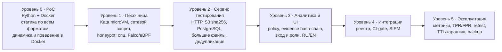
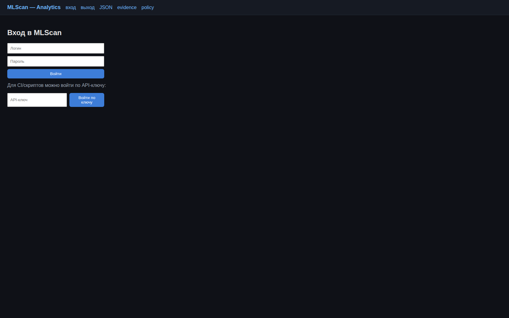
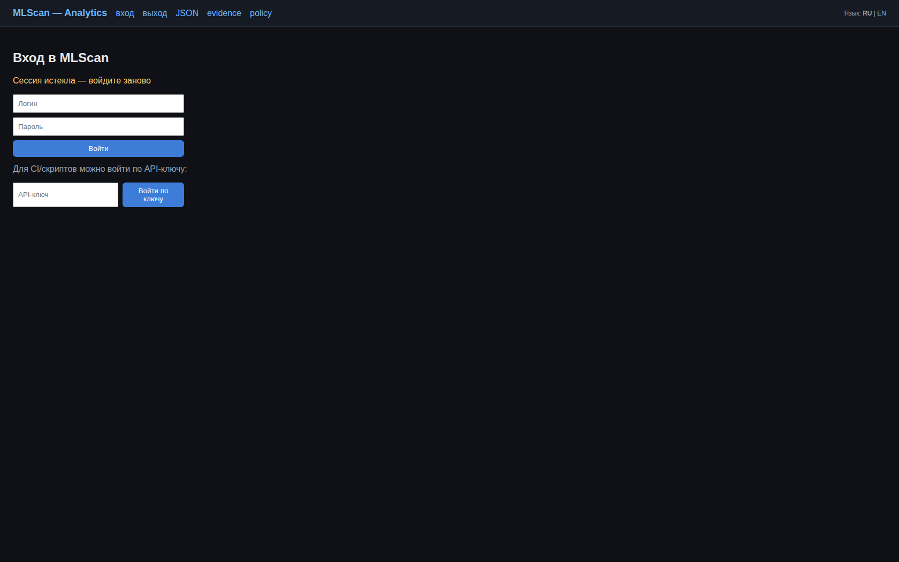
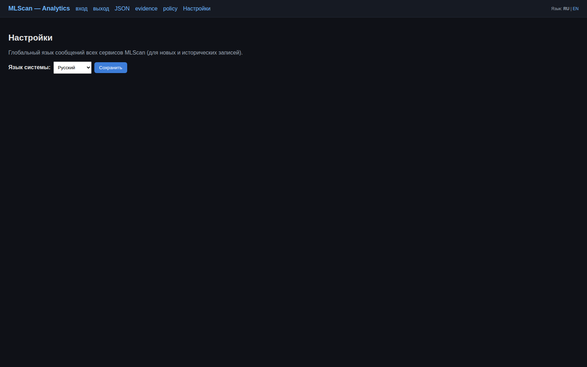
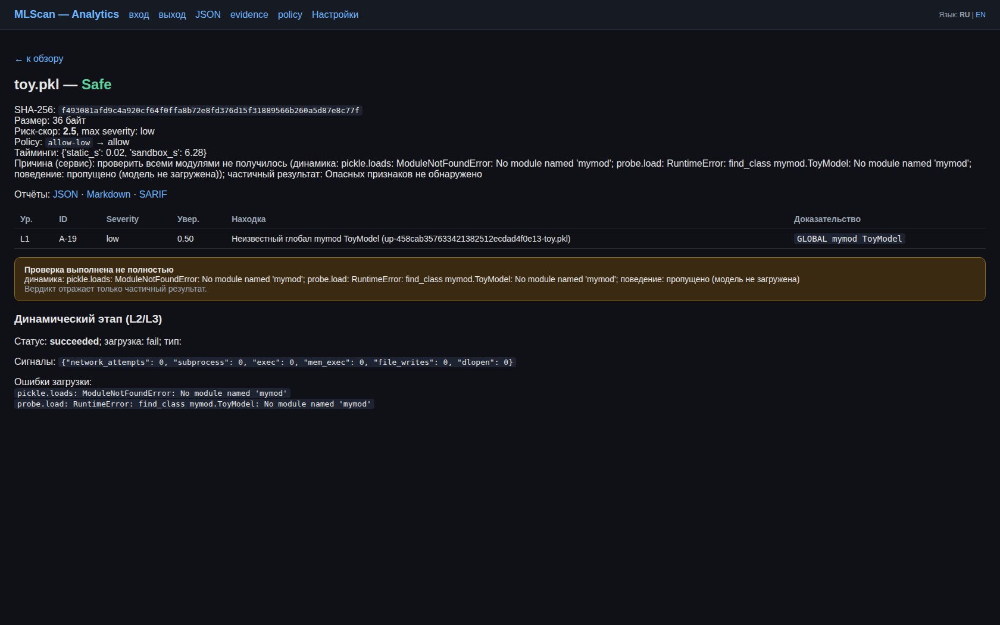
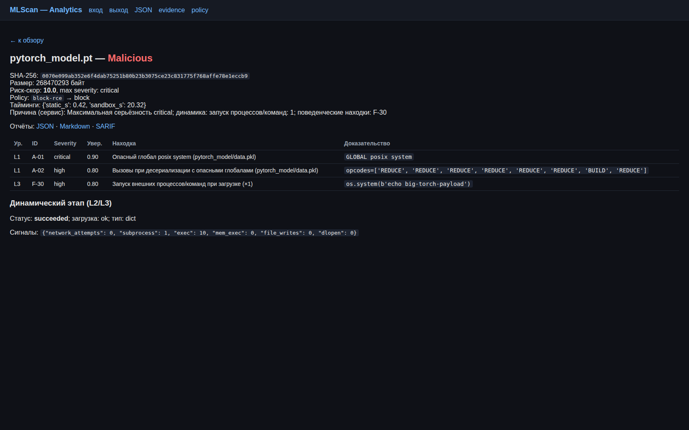
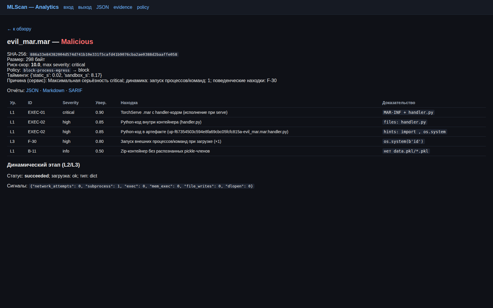

# MLScan

**Русский** | [English](./README.en.md)

**Система анализа безопасности (вредоносности) моделей и данных, используемых в ML/AI.**

Проект отвечает на вопрос: **безопасен ли конкретный ML/AI-артефакт, и что в нём опасного** —
исполняемый при загрузке код, закладки, утечки данных, неконтролируемое поведение,
проблемы целостности и происхождения.

> **Стартовая статья** (фокус, история, ссылки) — [`START.md`](./START.md).
> Детальная техническая документация — [`docs/`](./docs).

---

## Развитие проекта

Проект развивался **инкрементально**: от проверки одного формата к платформе, способной
проверять произвольные ML/AI-артефакты — включая очень большие — в изолированной среде.

| Этап | Что появилось | Ключевая идея |
|------|---------------|---------------|
| **0. PoC** | Один файл `poc/mlscan_poc.py`: статика + динамика в Docker + поведение → Markdown | Проверить, что pickle-модель можно анализировать тремя независимыми методами |
| **1. Песочница** | Kata-микро-ВМ, deception, sinkhole, NetworkPolicy, Falco | Модель = исполняемый код → запускать только в изоляции с наблюдением |
| **2. Сервис тестирования** | Приём артефактов, запуск песочницы, нормализация находок, вердикт | Отделить анализ от процесса загрузки, сделать его сервисом |
| **3. Аналитика + UI** | Скоринг, Policy Engine, append-only Evidence Store (hash-chain), отчёты, веб-UI | Единая точка управления, доказательная база и заключение |
| **4. Интеграции** | Model Registry (SHA-256), CI/CD gate, SIEM-экспорт (NDJSON/CEF), threat-intel | Встроить проверку в конвейеры поставки |
| **5. Эксплуатация** | Метрики, метрики качества (TPR/FPR), retest, red-team, PDB, аттестация | Промышленный контур: контроль качества и непрерывность |
| **v2 — Волна 0** | S3-хранилище (Garage), PostgreSQL, AuthN/Z + audit, наблюдаемость + бэкап | Снять ограничения по размеру и обеспечить аудит/отслеживаемость |
| **v2 — Волны 1–3** | Адаптеры форматов и детекторы (model-as-code, Keras, ONNX, HDF5, GGUF, архивы, XXE, токенизаторы, prompt-injection, agent/MCP), динамика model-as-code, retention/TTL | Расширение за пределы pickle без пересборки ядра |


---

## Схема развёртывания: уровни 0–5

Система разворачивается **поэтапно**: каждый уровень самодостаточен (полностью работоспособен
в рамках своих возможностей анализа), следующий только добавляет возможности и компоненты, а
незавершённость никогда не маскируется — если модуль не смог отработать, вердикт `Inconclusive`
с частичным результатом. Остановиться можно на любом уровне.

План и аргументация — [`docs/13-deployment-plan.md`](./docs/13-deployment-plan.md),
выбор уровня — [`deploy/README.md`](./deploy/README.md),
переход на следующий — [`deploy/upgrade.md`](./deploy/upgrade.md).



| Ур. | Что даёт (анализ и сервис) | Что требует | Установка · проверка |
|-----|----------------------------|-------------|----------------------|
| **0** | **PoC:** статика по всем форматам (pickle/torch/numpy, SafeTensors, ONNX, HDF5/Keras, GGUF, архивы, ноутбуки, скрипты, конфиги/карточки, MCP, HTML/SVG, Dockerfile, датасеты, сжатые payload'ы), динамика L2 и поведение L3 в Docker, отчёт MD/JSON | Python 3.10+, Docker (только для динамики) | `bash deploy/install.sh 0` · `bash deploy/verify.sh 0` |
| **1** | То же, но недоверенный код исполняется в **микро-ВМ (Kata)**: сетевой запрет, honeypot/sinkhole, RO-FS, лимиты; **опционально** — Falco/eBPF (хостовый мониторинг) | Kubernetes на 1 узле, RuntimeClass `kata`/`gvisor`, реестр образов | `bash deploy/install.sh 1` · `bash deploy/verify.sh 1` |
| **2** | **Сервис тестирования:** HTTP-приём (потоково, большие модели), дедупликация в **S3 (Garage)** `sha256/<name>`, метаданные и находки в **PostgreSQL**, оркестрация Job, вердикт с учётом покрытия | Уровень 1 + Garage + PostgreSQL | `bash deploy/install.sh 2` · `bash deploy/verify.sh 2` |
| **3** | **Аналитика:** скоринг, Policy Engine, append-only evidence с hash-chain, отчёты JSON/MD/SARIF, **веб-UI** (вход, роли, переключатель языка, `/settings`, баннер неполной проверки) | Уровни 1–2 + Istio Ingress | `bash deploy/install.sh 3` · `bash deploy/verify.sh 3` |
| **4** | **Интеграции:** реестр моделей по SHA-256, CI-gate `/gate` (allow/block/review + exit-code), экспорт в SIEM (NDJSON/CEF), threat-intel | Уровни 2–3 | `bash deploy/install.sh 4` · `bash deploy/verify.sh 4` |
| **5** | **Эксплуатация:** метрики Prometheus, `/quality` (TPR/FPR), `/sla`, `/retest` по cron, red-team Job, `/alerts`, retention/TTL + карантин, backup/restore с проверкой | Уровни 3–4 | `bash deploy/install.sh 5` · `bash deploy/verify.sh 5` |

Команды идемпотентны: `install.sh N` доустанавливает всё необходимое до уровня N (можно сразу 5),
`verify.sh N` проверяет уровень «извне», а `verify.sh N --full` дополнительно прогоняет
синтетический корпус (141 образец). Форматный анализ **не зависит от уровня**: адаптеры едины
([`poc/formats.py`](./poc/formats.py)), поэтому и PoC, и сервис проверяют один и тот же набор форматов.

```bash
bash deploy/install.sh 3        # поставить уровни 1→2→3 (идемпотентно; можно сразу 5)
bash deploy/verify.sh 3         # проверка уровня «извне»
bash deploy/verify.sh 5 --full  # + полный прогон корпуса (141 образец)
```

---

## Зачем понадобилась более сложная архитектура и Kubernetes

Причина ровно в двух требованиях, которые плохо совмещаются «в одном скрипте на хосте»:

1. **Проверяемые файлы могут быть очень большими** — модели достигают десятков и сотен
   гигабайт.
2. **Проверка обязана идти в изолированной среде** — потому что загрузка и прогон модели
   так или иначе исполняют недоверенный код или разбирают недоверенные данные **нативными
   движками инференса**, а это потенциально небезопасно (см. «Следствие №2»).

### Следствие №1: большие файлы требуют объектного хранилища и потоковой обработки

- Держать модель в памяти или на диске пода нельзя: нужен **S3-совместимый object store**
  (Garage), **content-addressed ключи** `sha256/name` (дедупликация и иммутабельность),
  **потоковая загрузка** с подсчётом SHA-256 «на лету» и **дедупликацией** (повторная
  загрузка того же файла не передаёт данные повторно).
- Метаданные, отпечатки и результаты живут отдельно от «тяжёлого» блоба — в **PostgreSQL**;
  для больших блобов действуют **retention/TTL** и **карантин** вредоносных.
- Артефакт в песочницу доставляется тем же сервисом (`:8090`), поэтому **сетевой доступ
  песочницы не расширяется**.

### Следствие №2: даже «инертный» файл модели исполняется движком — и это тоже недоверенно

Уязвимость не сводится к pickle. Часть форматов действительно исполняет код **напрямую**
(`pickle`/`dill`/`cloudpickle`, model-as-code: `.mar`, `trust_remote_code`/`auto_map`,
`tf.keras` Lambda). Но существенно, что **даже форматы, которые сами по себе код не
исполняют** (SafeTensors, ONNX, GGUF, TFLite, HDF5, датасеты), **не безопасны**: их загрузка и
прогон выполняются движком инференса на недоверенных данных, а значит остаются пути
эксплуатации уязвимостей в самом движке и его окружении:

- **Движок инференса — это нативный код с широкой attack surface.** Загрузку и прогон делают
  ONNX Runtime, PyTorch, TensorFlow, `ggml`/`llama.cpp`, HDF5, protobuf/flatbuffers и т.п.;
  в их парсерах исторически встречаются уязвимости памяти (выход за границы, целочисленные
  переполнения, use-after-free), приводящие к падению, утечке данных или выполнению кода.
- **Custom ops / плагины / delegate-библиотеки.** Модель может ссылаться на нативный код
  (custom operators, `.so`-плагины, TensorRT/OpenVINO extensions), который подгружается
  по имени/ссылке из артефакта.
- **External references.** Внешние данные/ссылки (ONNX `external_data`, HDF5 external links,
  конфиги) → path traversal, SSRF, подгрузка данных или кода из недоверенного источника.
- **Побочные эффекты при загрузке.** Даже «только данные» могут привести к чтению файлов,
  обращению в сеть или изменению окружения, если это делает загрузчик/движок.
- **Шаблоны и конфиги управляют рантаймом.** Jinja `chat_template` (SSTI), токенизаторы,
  tool/MCP-схемы меняют поведение движка — это тоже недоверенные данные, исполняемые окружением.
- **Структурные атаки на ресурсы.** Вложенные контейнеры, огромные тензоры, decompression —
  отказ в обслуживании.
- **Цепочка поставки окружения.** Уязвимые версии движка и зависимостей, небезопасные
  конфигурации и плагины эксплуатируются не из модели, а из её окружения.

Итог: проверка **всегда** означает запуск движка на недоверенных данных, поэтому изоляция нужна
не только для «исполняющих» форматов. Каждый артефакт проверяется **отдельным инстансом**:

- каждый запуск — **микро-ВМ Kata** (своё ядро), **без сети** (кроме sinkhole/артефакт-сервера),
  read-only ФС, `drop ALL`, seccomp, лимиты CPU/RAM/диска, honeypot-файлы, наблюдение
  (внутригостевые audit hooks — обязательно; хостовый Falco/eBPF — опционально, см. [`deploy/README.md`](./deploy/README.md))
  — это ограничивает и прямой payload, и эксплуатацию уязвимости движка;
- среда **гарантированно уничтожается** после проверки, а поведение **наблюдаемо** (файлы,
  процессы, сеть, `ctypes`, изменения `builtins`/import-хуков).

### Почему именно Kubernetes

Совмещение «огромные файлы + изоляция + наблюдаемость + аудит + масштаб» — это уже
**оркестрация**, а не одиночный процесс. Kubernetes даёт ровно те примитивы, которые нужны:

| Требование | Примитив Kubernetes |
|-----------|---------------------|
| Одноразовая изолированная среда на каждый артефакт | `Job` + `runtimeClassName: kata` (микро-ВМ) |
| Разделение доверенной и недоверенной зон | отдельные `Namespace` + Pod Security Admission `restricted` |
| Запрет сети из песочницы | `NetworkPolicy` (Calico): default-deny + только sinkhole/артефакт |
| Лимиты ресурсов и защита от DoS | `cgroups v2`: cpu/memory/pids/io/ephemeral-storage |
| Подъём/уборка среды | жизненный цикл `Job` (create → run → teardown, TTL) |
| Секреты и доступы | `Secret`, `ServiceAccount`, RBAC, монтирование без хост-томов |
| Внешний вход/выход | Ingress (Istio) + egress-allowlist |
| Периодические задачи | `CronJob` (retest, backup, retention) |
| Масштабирование под объём | автоподбор узлов/воркеров, пул GPU (при наличии) |

Без оркестратора пришлось бы вручную поднимать и убивать изолированные ВМ, настраивать
сетевой запрет, лимиты, сбор трасс, хранение больших блобов и аудит — то есть воспроизводить
эти примитивы самому. Kubernetes позволяет реализовать это **декларативно и повторяемо**,
а контрольные плоскости (аналитика, БД, UI) при этом остаются в доверенной зоне.

> Важно: **артефакт никогда не исполняется в доверенной зоне** — только в изолированной
> микро-ВМ, которая после проверки уничтожается целиком. Подробнее — [`docs/03-isolation.md`](./docs/03-isolation.md)
> и [`docs/07-implemented-architecture.md`](./docs/07-implemented-architecture.md).

---

## Текущие возможности

### Форматы

**Модели:** pickle и производные (`.pkl/.pickle`, `.joblib`, `.dill`, `.cloudpickle`,
`.pt/.pth/.bin/.ckpt`), `.npy/.npz`, SafeTensors, ONNX, HDF5/`.keras`, GGUF, TFLite, CoreML,
TorchScript/torch.package, TF SavedModel/`.pb`, PMML, MLflow-модель, model-as-code (`.mar`,
`model.py`), датасеты Parquet/Arrow/Feather.
**Пакеты и данные:** архивы (`.zip/.tar/.tar.gz/.whl`), сжатые payload'ы (`.gz/.bz2/.xz`),
JSONL/CSV/TSV-датасеты, MessagePack, ноутбуки (`.ipynb`), скрипты (`.sh/.ps1/.bat`),
Dockerfile, HTML/SVG-документы, Jinja-шаблоны (`.j2`), XML/YAML/JSON-конфиги, карточки моделей,
tokenizer-артефакты, MCP/agent-манифесты, нативные библиотеки (`.so/.dll/.dylib`), `.pth`-хуки,
неподдерживаемые контейнеры (7z/rar/zstd — честное «разобрать нельзя»).

### Детекторы (чек-иды)

| Группа | Что обнаруживается |
|--------|--------------------|
| `A-*`, `F-*` | RCE при десериализации (`os.system`, `subprocess`, `eval/exec`), сеть, persistence, tampering `builtins`/import-хуков, утечки |
| `EXEC-*` | model-as-code (`.mar`/`model.py`/`MLflow`/`auto_map`/`torch.package`), Keras `Lambda`/`custom_objects`, ONNX `external_data`/custom ops, HDF5 links |
| `INJ-*` | Jinja `chat_template` (SSTI), prompt-injection в карточках и tool-схемах, HTML/JS (XSS) |
| `AGT-*` | MCP/agent-манифесты с запуском команд |
| `BD-*` | токенизаторы (переопределение спец-токенов, ReDoS-regex), веса (NaN/Inf, экстремумы) |
| `FMT-*` | структурные аномалии SafeTensors, архивы (traversal/bomb/symlink), XXE/unsafe-YAML, format mismatch |
| `INT-*` | целостность и supply chain (внешние URL, install-hooks в архивах) |
| `STEG-*` | скрытые каналы (trailing после EOCD, энтропийные blob, полиглот-контейнеры) |
| `D-*` | целостность/подпись/происхождение, «не pickle»-форматы |
| `SEC-*` | утечки секретов и токенов (AWS-ключи, приватные ключи, HF/GitHub/Slack-токены) |

Дополнительно: вложенные архивы разбираются рекурсивно (zip в zip), `INJ-06` — формульные
инъекции в CSV, `FMT-12` — дубликаты записей в архиве (parser differential), `EXEC-08` — нативные
библиотеки. Вердикт учитывает **полноту покрытия**: если модуль проверки не смог отработать
(модель не загрузилась, нет зависимости, таймаут), вместо `Safe` выдаётся `Inconclusive` с
частичным результатом — и в сервисе тестирования, и в аналитике/UI.

Образ песочницы `mlscan-sandbox:v4` (сборка Kaniko) содержит библиотеки для динамического
исполнения и разбора моделей: **PyTorch (CPU), numpy, safetensors, onnxruntime, onnx, h5py, gguf,
pyarrow, PyYAML, joblib, dill, cloudpickle** — поэтому фактически загружаются и исполняются модели
форматов pickle, torch, numpy, model-as-code, а контейнеры safetensors/ONNX/HDF5/GGUF/Keras/
Parquet разбираются профильными библиотеками (mmap/схема).

**Честный вердикт при неполной проверке.** Модулей три (статика L1, динамика L2, поведение L3).
Если модуль не смог отработать — модель не загрузилась (нет зависимости), не хватило ресурсов,
таймаут, песочница не запустилась — результат не считается полноценным: вместо `Safe`
выдаётся **`Inconclusive`** с причиной «проверить всеми модулями не получилось (динамика:
`No module named 'mymod'`); частичный результат: …» и баннером в карточке. Если частичные
данные уже доказывают опасность, вердикт сохраняется, но помечается как неполный.

### Методы проверки

- **L1 статика** — без исполнения: опкоды/глобалы pickle, структурный разбор форматов, ссылки
  на код, external data, шаблоны.
- **L2 динамика** — исполнение в микро-ВМ Kata с полной наблюдаемостью (файлы/процессы/сеть/
  `ctypes`, diff состояния процесса); **model-as-code реально исполняется** и подтверждается
  динамикой.
- **L3 поведение** — интроспекция и probe загруженного объекта.

### Язык интерфейса и сообщений (RU/EN)

UI и сообщения сервисов локализованы (RU/EN): переключатель языка в шапке UI (cookie
`mlscan_lang`), `?lang=en` / заголовок `X-MLScan-Lang` для API и **глобальная настройка языка
всей системы** (`MLSCAN_LANG` при запуске + `POST /settings/language` для администратора,
хранится в БД). Локализуются UI, причины вердиктов, находки (в том числе исторические) и отчёты.
Подробности — [`docs/12-i18n.md`](./docs/12-i18n.md). Английская версия документации —
[`README.en.md`](./README.en.md) и [`docs/en/`](./docs/en).

### Платформа и эксплуатация

S3-хранилище с дедупликацией и retention/карантином, PostgreSQL с hash-chain evidence,
AuthN/Z (API-ключи + RBAC + вход в UI), журнал подключений/загрузок/проверок (`connections`,
`audit_log`), Ingress/Egress-контроль, Model Registry и CI/CD gate, SIEM-экспорт, метрики и
**метрики качества (TPR/FPR)**, непрерывный retest, red-team, бэкап БД с проверкой
восстановления.

### Харденинг платформы

| Мера | Как реализовано | Проверка |
|------|-----------------|----------|
| Изоляция исполнения | Kata microVM на каждый скан, egress allowlist (DNS/sinkhole/артефакт-сервер), RO-FS, drop ALL, seccomp, honeypot, `default-deny` NetworkPolicy | `verify.sh 1`, red-team Job |
| Целостность образа | сборка Kaniko публикует **digest**; Job запускается только как `image@sha256:…`; **Kyverno**-политика требует kata + digest + безопасный securityContext | `verify.sh 1`; Job с чужим образом отклоняется admission |
| Egress платформы | сервисам разрешены только PG/S3/DNS и адрес K8s API (ClusterIP и узел); чужие сервисы и произвольные порты блокируются; манифесты VirtualService/egress разложены по уровням | `verify.sh 3` |
| Квоты и лимиты | `ResourceQuota`/`LimitRange` namespace песочницы; rate limit загрузок (30/мин → `429` + `Retry-After`); лимит 5 сканов «в работе» | flood-тест: 30×`202`, 10×`429` |
| Честность вердикта | неполнота покрытия → `Inconclusive` + баннер; лимит находок (500) с пометкой об усечении | корпус; `verify.sh 2` |
| Защита от подмены результата | harness печатает маркеры **со нонсом скана**; сервис принимает только свои маркеры и сверяет summary/result | образец-спуфер `vuln_result_spoof.pkl` → подделка игнорируется |
| Целостность кода/конфигурации | digest ConfigMap'ов кода и правил передаётся в env; сервис сверяет при старте и работает **fail-closed** (`503`) | `/healthz` → `integrity: true`; тест подмены ConfigMap |
| Evidence | append-only (файл + триггеры БД), hash-chain + **HMAC-подписи** (ключ в Secret, вне БД/PVC), проверка по генерациям, **single-writer** (PG advisory lock) | `/api/evidence/verify` → `ok/signed/generations`; неверный ключ → `HMAC mismatch` |
| Аттестация | CronJob `mlscan-attest` (каждые 6 ч) + результат проверки в `POST /retest` и в метриках `mlscan_evidence_ok/signed/entries` | Job `succeeded`, лог `ATTEST {…}` |
| Доступы | API-ключи с `expires_at` (истёкший → `401`), пользователи UI (PBKDF2, 200k), HMAC-сессии 12 ч, роли `admin/ci-reader/service`, аудит в `audit_log` | тест истёкшего ключа |

Полный разбор сценариев атак и план доработок — [`docs/14-security-review.md`](./docs/14-security-review.md)
(статус: P0 и P1 реализованы; открыты P0-4 — мгновенный `Reject` для сети песочницы, P1-2 — DNS-политика,
P1-8 — аудит изменений, P2).

### Проверка самой системы

Синтетический корпус — [`tests/vulnerabilities/`](./tests/vulnerabilities): **141 образец**
(87 с закладками + 54 безопасных), генераторы, прогонщик и отчёт. Помимо pickle-семейства —
ноутбуки, скрипты, TorchScript/torch.package, MLflow, TF SavedModel, TFLite, CoreML, PMML,
датасеты Parquet/Arrow, ONNX external_data, внешние ссылки HDF5, safetensors-метаданные.
Безопасная часть — реальные файлы этих форматов и **пять образцов ~198 МБ**, генерируемых
на лету и загружаемых сразу в сервис тестирования. **Результат: 87/87 обнаружено, 0 пропусков, 0/54 ложных срабатываний**; крупные
модели — `Safe` с полным покрытием; метрики качества по форматам TPR=1.0, FPR=0.0. Быстрый прогон корпуса на развёрнутом стенде —
`bash deploy/verify.sh <уровень> --full`; генерация и детали — в README корпуса.

---

## Скриншоты (UI)

**Вход** — логин и пароль (сессия в cookie `.mlscan.local`, единый вход для analytics/ops/integrations);
для CI/скриптов — вход по API-ключу:



**Сессия истекла** — если у открытой вкладки закончилась сессия (12 ч), UI сам возвращает на вход
с пояснением, а не показывает молча пустую таблицу:



**Дашборд** — загрузка моделей (в т.ч. больших), статистика по вердиктам/объёму, фильтр по имени
и результату, сортировка по дате/объёму, таблица со SHA-256, размером, прогрессом проверки,
вердиктом, риск-скором и действием policy (в текущем стенде — 3575 проверок):


**Адрес UI:** `http://analytics.mlscan.local:30217` (по умолчанию HTTP; HTTPS — опционально:
`bash deploy/install.sh 3 --with-tls` → `https://analytics.mlscan.local:30921`, самоподписанный
сертификат). Ошибка браузера `SSL_ERROR_RX_RECORD_TOO_LONG` = `https://` на HTTP-порт 30217:
используйте `http://…:30217` или включите TLS. Перед открытием добавьте хост в `/etc/hosts`:
`<NODE_IP> analytics.mlscan.local ops.mlscan.local integrations.mlscan.local api.mlscan.local`.

**Учётные данные UI.** Пользователи создаются при установке уровня 3: `admin` (роль `admin`) и
`analyst` (роль `analyst`). Пароли **печатаются в выводе `bash deploy/install.sh 3`** и хранятся в
`/tmp/mlscan-users.json`; показать позже — `bash deploy/v2/auth/users.sh --show`, задать/сбросить —
`MLSCAN_ADMIN_PASSWORD='...' bash deploy/v2/auth/users.sh`. Повторные запуски установки пароли
**не меняют**. Вход по API-ключу (для CI/скриптов) — `bash deploy/v2/auth/keys.sh`.

**Настройки** — глобальный язык сообщений всей системы (доступно роли `admin`; сохраняется в БД,
применяется ко всем сервисам для новых и исторических записей):



**Карточка неполной проверки** — модель, которую динамика не смогла загрузить
(отсутствует модуль `mymod`): вердикт **Inconclusive** вместо ложного `Safe`, баннер
«Проверка выполнена не полностью» и частичный результат:



**Карточка артефакта** — самая крупная проверенная модель: torch-модель `pytorch_model.pt`
объёмом **268 470 293 байт (≈256 МиБ)**. Видны SHA-256, размер, тайминги (статика 0.42 с /
песочница 20.3 с), риск-скор 10.0, policy `block-rce → block`, находки с доказательствами
(`A-01` critical `posix.system`, `A-02` high, `F-30` high `os.system(...)`) и раздел
**«Динамический этап»**: `загрузка: ok`, `тип: dict`, `subprocess: 1` — модель действительно
загружена и payload исполнен в песочнице:



**Карточка артефакта не-pickle формата** (`evil_mar.mar`, model-as-code): вердикт **Malicious**,
находки `EXEC-01` (critical) и `EXEC-02` (high) из адаптера формата, плюс динамическое
подтверждение `F-30` — в разделе «Динамический этап» видно `subprocess: 1`:



---

## Архитектура системы

Три компоненты (Компоненты 1–3), развёрнутые в отдельных namespace:

1. **Sandbox** — изоляция и запуск моделей, полное наблюдение за поведением (Kata-микро-ВМ).
2. **Testing Service** — подача артефактов в песочницу и безопасное получение результатов.
3. **Analytics Engine + UI** — управление процессом, скоринг, Policy Engine, Evidence Store,
   отчёты и веб-UI. Плюс **Integrations** (registry/gate/SIEM) и **Ops** (метрики/качество/retest).

См. [`docs/05-architecture.md`](./docs/05-architecture.md), [`Concept.md`](./Concept.md),
[`docs/07-implemented-architecture.md`](./docs/07-implemented-architecture.md) (as-built),
[`docs/11-target-architecture-v2.md`](./docs/11-target-architecture-v2.md) (v2).

---

## Содержание репозитория

| Путь | Что это |
|------|---------|
| [`START.md`](./START.md) | Стартовая статья: фокус проекта, история, масштабируемость архитектуры |
| [`tests/vulnerabilities/`](./tests/vulnerabilities) | **Синтетический корпус уязвимостей** + процедура + отчёт о детекции |
| [`deploy/README.md`](./deploy/README.md) | **Выбор уровня развёртывания (0–5)**, матрица возможностей и команд |
| [`deploy/install.sh`](./deploy/install.sh) | Установка выбранного уровня (идемпотентно, с проверкой предпосылок) |
| [`deploy/verify.sh`](./deploy/verify.sh) | Сквозная проверка уровня (`--full` — прогон корпуса) |
| [`deploy/upgrade.md`](./deploy/upgrade.md) | Переход N → N+1: компоненты, миграции, откат |
| [`poc/mlscan_poc.py`](./poc/mlscan_poc.py) | **PoC (уровень 0)** — один Python-файл: статика по всем форматам + динамика/поведение в Docker |
| [`poc/formats.py`](./poc/formats.py) | Адаптеры форматов (stdlib) — единый модуль для PoC и сервиса тестирования |
| [`poc/scan/`](./poc/scan) | Демонстрационные данные (pickle + `formats/`) и генераторы |
| [`deploy/stage1/`](./deploy/stage1) | Этап 1 (уровень 1): песочница Kata, deception, sinkhole, NetworkPolicy; Falco — опционально (`60-falco.sh`) |
| [`deploy/stage2/`](./deploy/stage2) | Этап 2: сервис тестирования |
| [`deploy/stage3/`](./deploy/stage3) | Этап 3: аналитический движок + UI |
| [`deploy/stage4/`](./deploy/stage4) | Этап 4: интеграции (registry/CI-gate/SIEM/threat-intel) |
| [`deploy/stage5/`](./deploy/stage5) | Этап 5: эксплуатация (метрики/качество/retest/red-team) |
| [`deploy/sandbox-image/`](./deploy/sandbox-image) | Образ песочницы `mlscan-sandbox` (torch CPU), сборка Kaniko |
| [`deploy/i18n/`](./deploy/i18n) | Модуль локализации RU/EN (UI, сообщения сервисов, находки) |
| [`deploy/ingress/`](./deploy/ingress) | Ingress (Istio) и egress-allowlist |
| [`deploy/v2/`](./deploy/v2) | **v2:** S3 (Garage), PostgreSQL, AuthN/Z+audit, наблюдаемость, бэкап, lifecycle, детекторы форматов |
| [`docs/`](./docs) | Детальная документация (01–13) |
| [`docs/en/`](./docs/en) | Английская версия документации (01–13) |
| [`README.en.md`](./README.en.md) | English version of this page |

### Документация (кратко)

- `docs/01` чеклист опасностей (A–I) · `docs/02` стратегия тестирования L0–L4 · `docs/03` изоляция
- `docs/04` обработка результатов и решения · `docs/05` архитектура
- `docs/06` план реализации (реализован) · `docs/07` as-built архитектура · `docs/08` тест-гайд
- `docs/09` анализ других форматов/закладок · `docs/10` план расширения (волны) · `docs/11` целевая архитектура v2
- `docs/12` локализация UI и сообщений (RU/EN) — [`docs/12-i18n.md`](./docs/12-i18n.md)
- `docs/13` план поэтапного развёртывания (уровни 0–5) — [`docs/13-deployment-plan.md`](./docs/13-deployment-plan.md)
- `docs/14` анализ ИБ архитектуры и кода + план доработок — [`docs/14-security-review.md`](./docs/14-security-review.md)
- `docs/15` анализ большого файла модели: пошагово — [`docs/15-large-model-analysis.md`](./docs/15-large-model-analysis.md)
- английские версии — [`docs/en/`](./docs/en)

---

## Быстрый старт PoC (уровень 0)

Требования: Python 3.10+ (только stdlib) и **Docker** — только для динамического этапа.
PoC уже умеет статически проверять **все поддерживаемые форматы** (наш «второй глаз» для
расширенного списка — [`poc/README.md`](./poc/README.md)):

```bash
python3 poc/mlscan_poc.py poc/scan/evil0.pkl --out report.md        # статика + динамика + поведение
python3 poc/mlscan_poc.py model.safetensors --static-only           # SafeTensors: только статика
python3 poc/mlscan_poc.py payload.ipynb --static-only --lang en     # ноутбук, отчёт на английском
python3 poc/mlscan_poc.py arch/model.zip --image localhost:32000/mlscan-sandbox:v4  # динамика с библиотеками
cat model.pkl | python3 poc/mlscan_poc.py - --name model.pkl        # ввод из stdin (без файла на диске)
```

Артефакт передаётся в контейнер **без расшаренных каталогов** (stdin + base64-бутстрап harness,
результат — в stdout); вердикт учитывает полноту покрытия (`Inconclusive` + причина, если модуль
не смог отработать).

---

## Статус

Реализованы и проверены: PoC, система для pickle (Этапы 0–5), целевая архитектура v2
(Волна 0: S3/PostgreSQL/AuthN+audit/наблюдаемость+бэкап; волны форматов 1–3: адаптеры и
детекторы, динамика model-as-code; retention/TTL и карантин), метрики качества по форматам
(TPR=1.0, FPR=0.0), синтетический корпус (87/87, 0 FP) и **харденинг платформы** — P0/P1 из ИБ-обзора
([`docs/14`](./docs/14-security-review.md)). UI и сообщения
сервисов локализованы RU/EN, есть глобальная настройка языка.

Контекст: [`deploy/v2/README.md`](./deploy/v2/README.md), план — [`docs/10-plan-new-formats.md`](./docs/10-plan-new-formats.md),
целевая архитектура — [`docs/11-target-architecture-v2.md`](./docs/11-target-architecture-v2.md).

---

## Лицензия

MIT — см. [`LICENSE`](./LICENSE).
