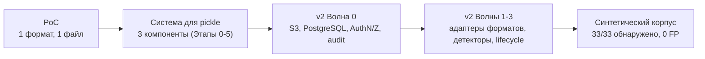
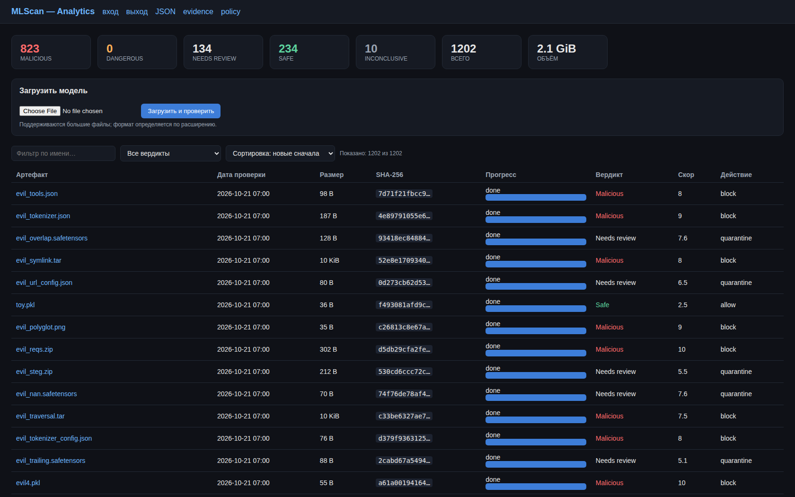
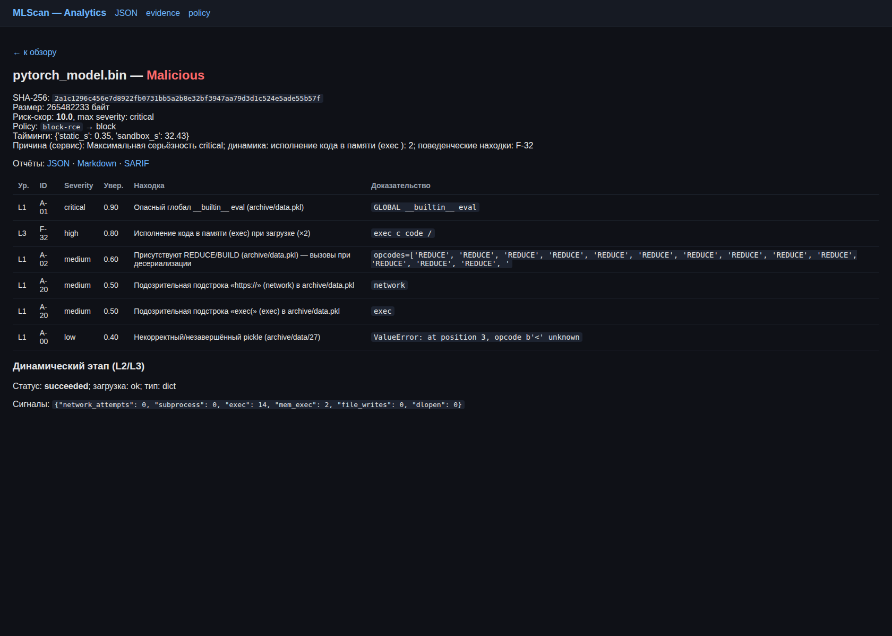

# MLScan

**Система анализа безопасности (вредоносности) моделей и данных, используемых в ML/AI.**

Проект отвечает на вопрос: **безопасен ли конкретный ML/AI-артефакт, и что в нём опасного** —
исполняемый при загрузке код, закладки, утечки данных, неконтролируемое поведение,
проблемы целостности и происхождения.

> **Стартовая статья** (фокус, история, ссылки) — [`START.md`](./START.md).
> Детальная техническая документация — [`docs/`](./docs).

---

## Развитие проекта

Проект развивался **инкрементально**: от проверки одного формата к платформе, способной
проверять произвольные ML/AI-артефакты — включая очень большие — в изолированной среде.

| Этап | Что появилось | Ключевая идея |
|------|---------------|---------------|
| **0. PoC** | Один файл `poc/mlscan_poc.py`: статика + динамика в Docker + поведение → Markdown | Проверить, что pickle-модель можно анализировать тремя независимыми методами |
| **1. Песочница** | Kata-микро-ВМ, deception, sinkhole, NetworkPolicy, Falco | Модель = исполняемый код → запускать только в изоляции с наблюдением |
| **2. Сервис тестирования** | Приём артефактов, запуск песочницы, нормализация находок, вердикт | Отделить анализ от процесса загрузки, сделать его сервисом |
| **3. Аналитика + UI** | Скоринг, Policy Engine, append-only Evidence Store (hash-chain), отчёты, веб-UI | Единая точка управления, доказательная база и заключение |
| **4. Интеграции** | Model Registry (SHA-256), CI/CD gate, SIEM-экспорт (NDJSON/CEF), threat-intel | Встроить проверку в конвейеры поставки |
| **5. Эксплуатация** | Метрики, метрики качества (TPR/FPR), retest, red-team, PDB, аттестация | Промышленный контур: контроль качества и непрерывность |
| **v2 — Волна 0** | S3-хранилище (Garage), PostgreSQL, AuthN/Z + audit, наблюдаемость + бэкап | Снять ограничения по размеру и обеспечить аудит/отслеживаемость |
| **v2 — Волны 1–3** | Адаптеры форматов и детекторы (model-as-code, Keras, ONNX, HDF5, GGUF, архивы, XXE, токенизаторы, prompt-injection, agent/MCP), динамика model-as-code, retention/TTL | Расширение за пределы pickle без пересборки ядра |



---

## Зачем понадобилась более сложная архитектура и Kubernetes

Причина ровно в двух требованиях, которые плохо совмещаются «в одном скрипте на хосте»:

1. **Проверяемые файлы могут быть очень большими** — модели достигают десятков и сотен
   гигабайт.
2. **Проверка обязана идти в изолированной среде** — потому что загрузка и прогон модели
   так или иначе исполняют недоверенный код или разбирают недоверенные данные **нативными
   движками инференса**, а это потенциально небезопасно (см. «Следствие №2»).

### Следствие №1: большие файлы требуют объектного хранилища и потоковой обработки

- Держать модель в памяти или на диске пода нельзя: нужен **S3-совместимый object store**
  (Garage), **content-addressed ключи** `sha256/name` (дедупликация и иммутабельность),
  **потоковая загрузка** с подсчётом SHA-256 «на лету» и **дедупликацией** (повторная
  загрузка того же файла не передаёт данные повторно).
- Метаданные, отпечатки и результаты живут отдельно от «тяжёлого» блоба — в **PostgreSQL**;
  для больших блобов действуют **retention/TTL** и **карантин** вредоносных.
- Артефакт в песочницу доставляется тем же сервисом (`:8090`), поэтому **сетевой доступ
  песочницы не расширяется**.

### Следствие №2: даже «инертный» файл модели исполняется движком — и это тоже недоверенно

Уязвимость не сводится к pickle. Часть форматов действительно исполняет код **напрямую**
(`pickle`/`dill`/`cloudpickle`, model-as-code: `.mar`, `trust_remote_code`/`auto_map`,
`tf.keras` Lambda). Но существенно, что **даже форматы, которые сами по себе код не
исполняют** (SafeTensors, ONNX, GGUF, TFLite, HDF5, датасеты), **не безопасны**: их загрузка и
прогон выполняются движком инференса на недоверенных данных, а значит остаются пути
эксплуатации уязвимостей в самом движке и его окружении:

- **Движок инференса — это нативный код с широкой attack surface.** Загрузку и прогон делают
  ONNX Runtime, PyTorch, TensorFlow, `ggml`/`llama.cpp`, HDF5, protobuf/flatbuffers и т.п.;
  в их парсерах исторически встречаются уязвимости памяти (выход за границы, целочисленные
  переполнения, use-after-free), приводящие к падению, утечке данных или выполнению кода.
- **Custom ops / плагины / delegate-библиотеки.** Модель может ссылаться на нативный код
  (custom operators, `.so`-плагины, TensorRT/OpenVINO extensions), который подгружается
  по имени/ссылке из артефакта.
- **External references.** Внешние данные/ссылки (ONNX `external_data`, HDF5 external links,
  конфиги) → path traversal, SSRF, подгрузка данных или кода из недоверенного источника.
- **Побочные эффекты при загрузке.** Даже «только данные» могут привести к чтению файлов,
  обращению в сеть или изменению окружения, если это делает загрузчик/движок.
- **Шаблоны и конфиги управляют рантаймом.** Jinja `chat_template` (SSTI), токенизаторы,
  tool/MCP-схемы меняют поведение движка — это тоже недоверенные данные, исполняемые окружением.
- **Структурные атаки на ресурсы.** Вложенные контейнеры, огромные тензоры, decompression —
  отказ в обслуживании.
- **Цепочка поставки окружения.** Уязвимые версии движка и зависимостей, небезопасные
  конфигурации и плагины эксплуатируются не из модели, а из её окружения.

Итог: проверка **всегда** означает запуск движка на недоверенных данных, поэтому изоляция нужна
не только для «исполняющих» форматов. Каждый артефакт проверяется **отдельным инстансом**:

- каждый запуск — **микро-ВМ Kata** (своё ядро), **без сети** (кроме sinkhole/артефакт-сервера),
  read-only ФС, `drop ALL`, seccomp, лимиты CPU/RAM/диска, honeypot-файлы, наблюдение
  (audit hooks + Falco) — это ограничивает и прямой payload, и эксплуатацию уязвимости движка;
- среда **гарантированно уничтожается** после проверки, а поведение **наблюдаемо** (файлы,
  процессы, сеть, `ctypes`, изменения `builtins`/import-хуков).

### Почему именно Kubernetes

Совмещение «огромные файлы + изоляция + наблюдаемость + аудит + масштаб» — это уже
**оркестрация**, а не одиночный процесс. Kubernetes даёт ровно те примитивы, которые нужны:

| Требование | Примитив Kubernetes |
|-----------|---------------------|
| Одноразовая изолированная среда на каждый артефакт | `Job` + `runtimeClassName: kata` (микро-ВМ) |
| Разделение доверенной и недоверенной зон | отдельные `Namespace` + Pod Security Admission `restricted` |
| Запрет сети из песочницы | `NetworkPolicy` (Calico): default-deny + только sinkhole/артефакт |
| Лимиты ресурсов и защита от DoS | `cgroups v2`: cpu/memory/pids/io/ephemeral-storage |
| Подъём/уборка среды | жизненный цикл `Job` (create → run → teardown, TTL) |
| Секреты и доступы | `Secret`, `ServiceAccount`, RBAC, монтирование без хост-томов |
| Внешний вход/выход | Ingress (Istio) + egress-allowlist |
| Периодические задачи | `CronJob` (retest, backup, retention) |
| Масштабирование под объём | автоподбор узлов/воркеров, пул GPU (при наличии) |

Без оркестратора пришлось бы вручную поднимать и убивать изолированные ВМ, настраивать
сетевой запрет, лимиты, сбор трасс, хранение больших блобов и аудит — то есть воспроизводить
эти примитивы самому. Kubernetes позволяет реализовать это **декларативно и повторяемо**,
а контрольные плоскости (аналитика, БД, UI) при этом остаются в доверенной зоне.

> Важно: **артефакт никогда не исполняется в доверенной зоне** — только в изолированной
> микро-ВМ, которая после проверки уничтожается целиком. Подробнее — [`docs/03-isolation.md`](./docs/03-isolation.md)
> и [`docs/07-implemented-architecture.md`](./docs/07-implemented-architecture.md).

---

## Текущие возможности

### Форматы

pickle и производные (`.pkl/.pickle`, `.joblib`, `.dill`, `.cloudpickle`, `.pt/.pth/.bin/.ckpt`,
`.npy/.npz`), SafeTensors, ONNX, HDF5/`.keras`, GGUF, архивы (`.zip/.tar`), XML/YAML-конфиги,
карточки моделей, tokenizer-артефакты, MCP/agent-манифесты.

### Детекторы (чек-иды)

| Группа | Что обнаруживается |
|--------|--------------------|
| `A-*`, `F-*` | RCE при десериализации (`os.system`, `subprocess`, `eval/exec`), сеть, persistence, tampering `builtins`/import-хуков, утечки |
| `EXEC-*` | model-as-code (`.mar`/`model.py`/`MLflow`/`auto_map`/`torch.package`), Keras `Lambda`/`custom_objects`, ONNX `external_data`/custom ops, HDF5 links |
| `INJ-*` | Jinja `chat_template` (SSTI), prompt-injection в карточках и tool-схемах, HTML/JS (XSS) |
| `AGT-*` | MCP/agent-манифесты с запуском команд |
| `BD-*` | токенизаторы (переопределение спец-токенов, ReDoS-regex), веса (NaN/Inf, экстремумы) |
| `FMT-*` | структурные аномалии SafeTensors, архивы (traversal/bomb/symlink), XXE/unsafe-YAML, format mismatch |
| `INT-*` | целостность и supply chain (внешние URL, install-hooks в архивах) |
| `STEG-*` | скрытые каналы (trailing после EOCD, энтропийные blob, полиглот-контейнеры) |
| `D-*` | целостность/подпись/происхождение, «не pickle»-форматы |

### Методы проверки

- **L1 статика** — без исполнения: опкоды/глобалы pickle, структурный разбор форматов, ссылки
  на код, external data, шаблоны.
- **L2 динамика** — исполнение в микро-ВМ Kata с полной наблюдаемостью (файлы/процессы/сеть/
  `ctypes`, diff состояния процесса); **model-as-code реально исполняется** и подтверждается
  динамикой.
- **L3 поведение** — интроспекция и probe загруженного объекта.

### Платформа и эксплуатация

S3-хранилище с дедупликацией и retention/карантином, PostgreSQL с hash-chain evidence,
AuthN/Z (API-ключи + RBAC + вход в UI), журнал подключений/загрузок/проверок (`connections`,
`audit_log`), Ingress/Egress-контроль, Model Registry и CI/CD gate, SIEM-экспорт, метрики и
**метрики качества (TPR/FPR)**, непрерывный retest, red-team, бэкап БД с проверкой
восстановления.

### Проверка самой системы

Синтетический корпус уязвимостей — [`tests/vulnerabilities/`](./tests/vulnerabilities):
38 образцов (33 malicious + 5 benign), генератор, прогонщик и отчёт. **Результат: 33/33
обнаружено, 0 пропусков, 0 ложных срабатываний**; метрики качества по форматам TPR=1.0, FPR=0.0.

---

## Скриншоты (UI)

**Дашборд** — загрузка моделей (в т.ч. больших), статистика по вердиктам/объёму, фильтр по имени
и результату, сортировка по дате/объёму, таблица со SHA-256, размером, прогрессом проверки,
вердиктом, риск-скором и действием policy:



**Карточка артефакта** (самая крупная проверенная модель ≈ 253 МБ) — SHA-256, размер, тайминги,
риск-скор, policy-решение, находки с доказательствами, раздел «Динамический этап» и отчёты
JSON/Markdown/SARIF:



---

## Архитектура системы

Три компоненты (Компоненты 1–3), развёрнутые в отдельных namespace:

1. **Sandbox** — изоляция и запуск моделей, полное наблюдение за поведением (Kata-микро-ВМ).
2. **Testing Service** — подача артефактов в песочницу и безопасное получение результатов.
3. **Analytics Engine + UI** — управление процессом, скоринг, Policy Engine, Evidence Store,
   отчёты и веб-UI. Плюс **Integrations** (registry/gate/SIEM) и **Ops** (метрики/качество/retest).

См. [`docs/05-architecture.md`](./docs/05-architecture.md), [`Concept.md`](./Concept.md),
[`docs/07-implemented-architecture.md`](./docs/07-implemented-architecture.md) (as-built),
[`docs/11-target-architecture-v2.md`](./docs/11-target-architecture-v2.md) (v2).

---

## Содержание репозитория

| Путь | Что это |
|------|---------|
| [`START.md`](./START.md) | Стартовая статья: фокус проекта, история, масштабируемость архитектуры |
| [`tests/vulnerabilities/`](./tests/vulnerabilities) | **Синтетический корпус уязвимостей** + процедура + отчёт о детекции |
| [`poc/mlscan_poc.py`](./poc/mlscan_poc.py) | **PoC** — один Python-файл с тремя методами проверки |
| [`poc/scan/`](./poc/scan) | Демонстрационные данные (pickle + `formats/`) и генераторы |
| [`deploy/stage1/`](./deploy/stage1) | Этап 1: укреплённая песочница (Kata, deception, sinkhole, NetworkPolicy, Falco) |
| [`deploy/stage2/`](./deploy/stage2) | Этап 2: сервис тестирования |
| [`deploy/stage3/`](./deploy/stage3) | Этап 3: аналитический движок + UI |
| [`deploy/stage4/`](./deploy/stage4) | Этап 4: интеграции (registry/CI-gate/SIEM/threat-intel) |
| [`deploy/stage5/`](./deploy/stage5) | Этап 5: эксплуатация (метрики/качество/retest/red-team) |
| [`deploy/sandbox-image/`](./deploy/sandbox-image) | Образ песочницы `mlscan-sandbox` (torch CPU), сборка Kaniko |
| [`deploy/ingress/`](./deploy/ingress) | Ingress (Istio) и egress-allowlist |
| [`deploy/v2/`](./deploy/v2) | **v2:** S3 (Garage), PostgreSQL, AuthN/Z+audit, наблюдаемость, бэкап, lifecycle, детекторы форматов |
| [`docs/`](./docs) | Детальная документация (01–11) |

### Документация (кратко)

- `docs/01` чеклист опасностей (A–I) · `docs/02` стратегия тестирования L0–L4 · `docs/03` изоляция
- `docs/04` обработка результатов и решения · `docs/05` архитектура
- `docs/06` план реализации (реализован) · `docs/07` as-built архитектура · `docs/08` тест-гайд
- `docs/09` анализ других форматов/закладок · `docs/10` план расширения (волны) · `docs/11` целевая архитектура v2

---

## Быстрый старт PoC

Требования: Python 3.10+ и **Docker** (для динамического этапа).

```bash
python3 poc/mlscan_poc.py poc/scan/evil0.pkl --out report.md   # статика + динамика + поведение
python3 poc/mlscan_poc.py poc/scan/evil2.pkl --static-only     # только статика
for f in poc/scan/evil*.pkl; do python3 poc/mlscan_poc.py "$f"; done
```

Файл передаётся в контейнер **без расшаренных каталогов** (stdin + base64-бутстрап harness,
результат — в stdout).

---

## Проверка на кластере

Каждый этап/волна разворачивается отдельным скриптом; подробности и команды — в README
соответствующего каталога:

```bash
bash deploy/stage1/apply.sh && bash deploy/stage1/60-falco.sh   # песочница + eBPF
bash deploy/stage2/apply.sh                                      # сервис тестирования
bash deploy/stage3/apply.sh                                      # аналитика + UI
bash deploy/stage4/apply.sh                                      # интеграции
bash deploy/stage5/apply.sh                                      # эксплуатация
bash deploy/v2/data/apply.sh && bash deploy/v2/db/apply.sh       # v2: S3 + PostgreSQL
bash deploy/v2/auth/keys.sh                                      # API-ключи (admin/ci/service)
```

Полный прогон синтетического корпуса (см. [`tests/vulnerabilities/README.md`](./tests/vulnerabilities/README.md)):

```bash
python3 tests/vulnerabilities/gen_corpus.py
python3 tests/vulnerabilities/run_tests.py --url <testing-url> --analytics-url <analytics-url> --key <API_KEY>
```

---

## Статус

Реализованы и проверены: PoC, система для pickle (Этапы 0–5), целевая архитектура v2
(Волна 0: S3/PostgreSQL/AuthN+audit/наблюдаемость+бэкап; волны форматов 1–3: адаптеры и
детекторы, динамика model-as-code; retention/TTL и карантин), метрики качества по форматам
(TPR=1.0, FPR=0.0) и синтетический корпус уязвимостей (33/33, 0 FP).

Контекст: [`deploy/v2/README.md`](./deploy/v2/README.md), план — [`docs/10-plan-new-formats.md`](./docs/10-plan-new-formats.md),
целевая архитектура — [`docs/11-target-architecture-v2.md`](./docs/11-target-architecture-v2.md).

---

## Лицензия

MIT — см. [`LICENSE`](./LICENSE).
