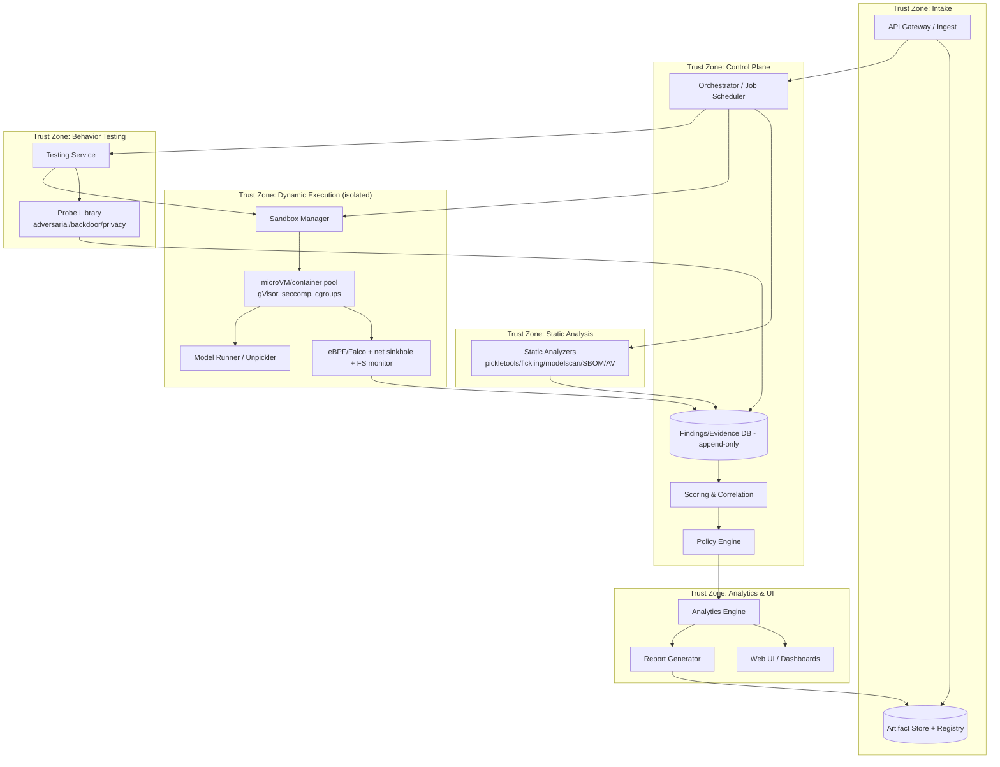
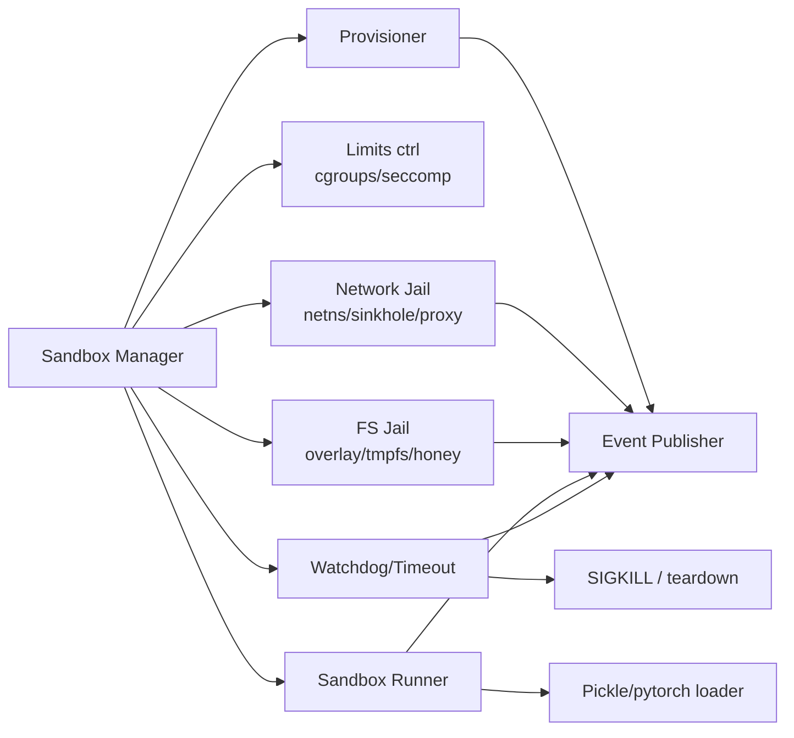
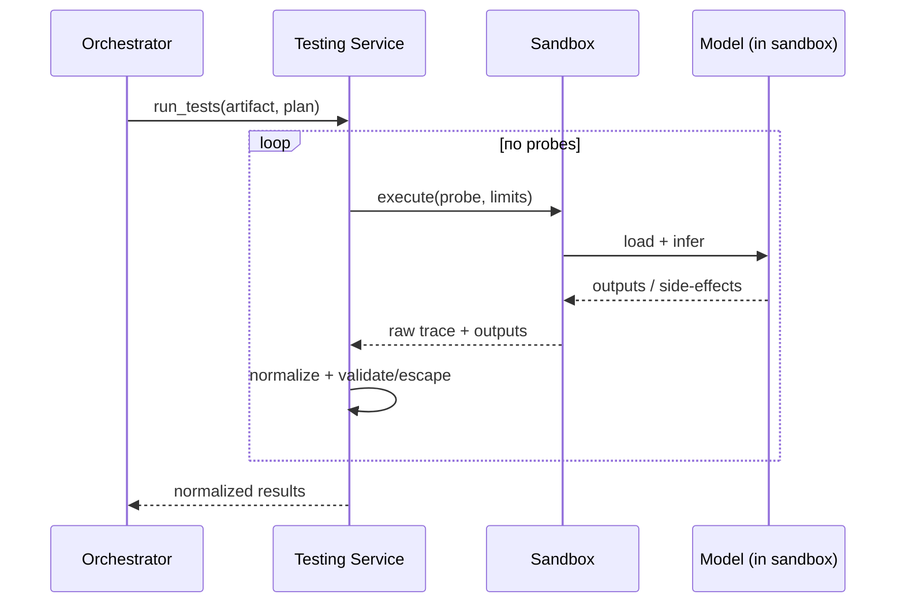
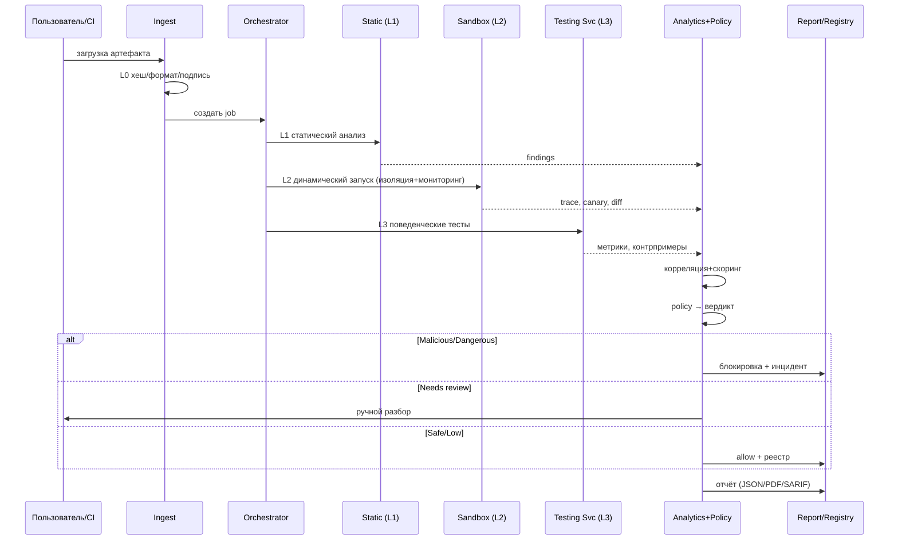
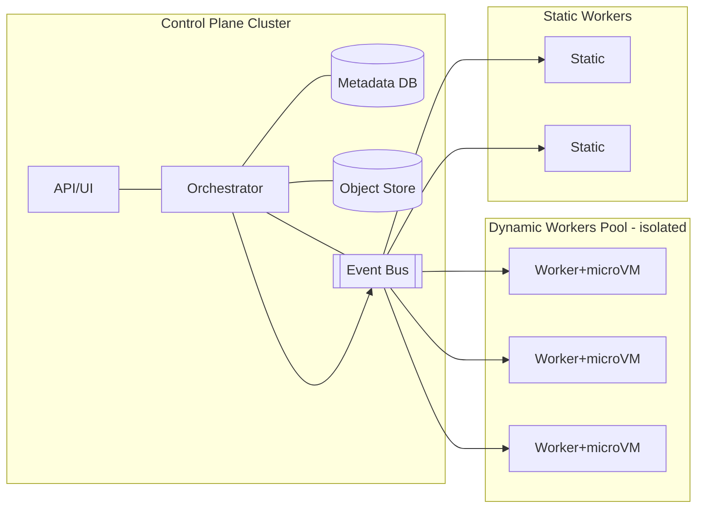

# Архитектура системы автоматического анализа опасности ML-моделей (pickle)

Рабочее название: **MLScanner**. Документ описывает архитектуру системы, состоящей из
трёх обязательных компонент:

1. **Sandbox (Песочница)** — запуск и изоляция моделей, наблюдение за поведением.
2. **Testing Service (Сервис тестирования)** — подача запросов модели и безопасный контроль результатов.
3. **Analytics Engine + UI (Аналитический движок)** — управление процессом, сбор/анализ информации, заключение.

---

## 1. Цели и границы

### 1.1 Цель
Дать организации воспроизводимый, доказуемый и безопасный ответ на вопрос:
**«Безопасна ли данная ML-модель (pickle) для использования, и какие у неё особенности,
уязвимости и вредоносное содержимое?»**

### 1.2 В границах (in scope)
- Приём pickle-совместимых артефактов (`.pkl`, `.pt/.pth`, `.bin`, `.joblib`, `.npy/.npz`, `.h5`, ONNX, zip-контейнеры).
- Статический, динамический и поведенческий анализ.
- Изоляция, мониторинг, сбор доказательств.
- Скоринг риска, вердикт, отчёт, интеграция с CI/CD и реестром моделей.

### 1.3 Вне границ (out of scope, но учитывается)
- Обучение моделей.
- Запуск моделей в продакшене (система только выдаёт вердикт).
- Полноценная защита от всех 0-day гипервизора (даёт best-effort defense in depth).

### 1.4 Нефункциональные требования (NFR)

| NFR | Требование |
|-----|------------|
| Изоляция | Компромисс песочницы невозможен без множественного провала независимых слоёв |
| Наблюдаемость | 100% запусков с полной трассой (syscalls, сеть, ФС, ресурсы) |
| Воспроизводимость | Одинаковый артефакт + профиль → детерминированный отчёт |
| Пропускная способность | Горизонтальное масштабирование воркеров, очередь заданий |
| Время скана | Целевые SLA по уровням (L0/L1 — минуты; L2/L3 — управляемо; L4 — по требованию) |
| Аудит | Append-only журнал, подпись результатов, версионирование правил |
| Безопасность данных | Данные тестирования не покидают контур; минимизация PII в отчётах |
| Расширяемость | Плагинные детекторы, правила, новые форматы |

---

## 2. Общая архитектура (C4-уровень «контейнеры»)



**Разделение плоскостей:**
- **Data plane** (исполнение): Sandbox + Testing Service — недоверенная зона для артефакта.
- **Control plane** (управление): Orchestrator, Policy, Scoring, Analytics/UI — доверенная,
  без прямого доступа к испольняемому коду.
- Между зонами — только односторонняя (one-way) передача результатов через шину событий.

---

## 3. Компонента 1 — Sandbox (Песочница)

### 3.1 Назначение
Герметичный запуск недоверенной модели, полное наблюдение, гарантированное уничтожение.

### 3.2 Обязанности
- Provisioning эфемерного микро-VM/контейнера из immutable-образа.
- Настройка изоляции (см. `03-isolation.md`): gVisor/Kata, seccomp, cgroups v2, netns, overlay ФС.
- Запуск загрузки модели через собственный `sandbox-runner`.
- Мониторинг: eBPF/Falco, сетевые sinkhole, ФС-inotify, процессные события, ресурсы.
- Deception: honeypot-креды, фальшивый IMDS, canary-файлы/URL.
- Формирование **Behavioral Trace** и **canary-отчёта**.
- Teardown и attestation.

### 3.3 Внутренние модули


### 3.4 Интерфейсы (пример)
- `POST /sandbox/run` → `{artifact_ref, profile, limits, deception}` → `{run_id}`.
- `GET /sandbox/runs/{run_id}/trace` → трассы, diff, canary-срабатывания.
- Внутренняя шина: события `syscall`, `network`, `fs`, `process`, `resource`, `canary`.

### 3.5 Профили запуска
- `static-only` — без `execve`, перехват `find_class`.
- `safe-load` — `weights_only=True` / `allow_pickle=False`, где возможно.
- `full-dynamic` — реальный `pickle.load` под максимальным мониторингом (микро-VM).
- `behavior` — загрузка доверенной(после проверки) модели и прогон probe-набора.

---

## 4. Компонента 2 — Testing Service (Сервис тестирования)

### 4.1 Назначение
Управление подачей запросов модели и **безопасное** получение/нормализация результатов
(как от загрузки, так и от инференса), не подвергая риску платформу.

### 4.2 Обязанности
- Формирование набора входов (probe) для каждого класса тестов.
- Постановка задач на исполнение в Sandbox (никогда — исполнение у себя).
- Нормализация выходов модели и ответов окружения в единый контракт.
- Изоляция и валидация результатов: отсечение/экранирование опасных артефактов (огромные
  тензоры, вредоносные строки, «отравленные» выходные файлы) перед передачей в analytics.
- Управление таймаутами, ретраями, квотами.
- Дедупликация и корреляция результатов по прогонам.
- **Потоковый приём артефактов любого размера** (стриминг на хранилище, без буферизации в память).
- **Хранение артефактов** на PVC и **отдача их в песочницу** по одноразовому токенизированному URL
  (Artifact-сервер на отдельном порту).
- **Прогресс** проверки (`state/stage/progress`) и **статистика** (объём, число уникальных хэшей).

### 4.3 Виды тестов (probe-библиотека)
- **Load probes:** попытки загрузки с разными опциями, фиксация поведения, canary.
- **Functional probes:** соответствие контракту ввода/вывода.
- **Adversarial probes:** FGSM/PGD (vision), текстовые атаки (NLP).
- **Backdoor probes:** триггерные паттерны, аномалии активаций, diff с референсом.
- **Privacy probes:** membership inference, model inversion, извлечение PII.
- **Robustness probes:** NaN/Inf, граничные значения, сдвиг распределения.
- **Resource probes:** стресс latency/CPU/GPU/памяти, DoS-устойчивость.

### 4.4 Схема


### 4.5 Безопасность сервиса
- Сервис **не разбирает** содержимое модели у себя — только проксирует в песочницу.
- Валидация входов/выходов, лимиты размера, запрет исполнения сериализованных объектов.
- Собственный least-privilege, без секретов, доступных payload.
- Артефакт передаётся в песочницу **не монтированием**, а скачиванием с Artifact-сервера сервиса
  по токену; в NetworkPolicy это единственное узкое исключение (`sandbox → testing:8090`).

---

## 5. Компонента 3 — Analytics Engine + UI

### 5.1 Назначение
Единая точка управления сканированием, сбора, корреляции, анализа и формирования заключения.

### 5.2 Модули
- **Orchestrator/Scheduler** — управляет пайплайном L0–L4, очередями, ресурсами.
- **Correlation & Scoring** — нормализация, дедуп, риск-скор (см. `04-risk-analysis-decision.md`).
- **Policy Engine** — декларативные правила → вердикт и автодействия.
- **Evidence Store** — append-only БД находок и доказательств (иммутабельно, подписано).
- **Knowledge Base** — библиотека детекторов, правил, baseline-профилей, известных угроз (IrDB: IoC/ATT&CK/ATLAS).
- **Report Generator** — JSON/PDF/HTML/SARIF + подпись.
- **Web UI** — управление, мониторинг, разбор находок, дашборды, ручные решения.
- **Integrations** — CI/CD gate, Model Registry, SOC/SIEM, тикеты.

### 5.3 UI (ключевые экраны)
- **Очередь и статус** сканирований (live).
- **Карточка артефакта**: метаданные, lineage, вердикт, покрытие чеклиста.
- **Findings explorer**: фильтры по категории/severity/уровню, доказательства inline
  (дизасм pickle, трасса, сетевой дамп, diff).
- **Model behavior**: метрики, контрпримеры, backdoor/privacy-результаты.
- **Policy editor**: правила и их версии.
- **Реестр решений**: история вердиктов, аудит, ручные переопределения.
- **Дашборды**: TPR/FPR, покрытие, SLA, топ-рисков.

### 5.4 API (пример)
```
POST /scans                        # запуск сканирования
POST /upload?name=&fmt=            # потоковая загрузка модели (в т.ч. больших файлов)
GET  /scans/{id}                   # статус (state/stage/progress, sha256, size)
GET  /scans/{id}/findings          # находки
GET  /scans/{id}/report?format=   # отчёт
GET  /api/overview                 # список сканов + прогресс + вердикт
GET  /api/progress/{id}            # живой прогресс скана
GET  /api/stats                    # статистика (вердикты, объём, число хэшей)
GET  /artifacts/{hash}             # карточка артефакта и вердикт
POST /artifacts/{hash}/review      # ручное решение + обоснование
GET/PUT /policies                  # управление политиками
```

---

## 6. Сквозной поток (end-to-end)



---

## 7. Модель данных (ключевые сущности)

- **Artifact** — `hash` (sha256), `size`, `format`, `source`, `lineage`, `signature`, `verdict`;
  при загрузке: `state` (`queued/running/done/error`), `stage`, `progress`, `artifact_token`.
- **Scan** — `scan_id`, `artifact_hash`, `profile`, `levels`, `status`, `coverage`, `toolchain_hash`,
  `timings` (`static_s`, `sandbox_s`).
- **Finding** — см. Normalized Finding (`04-risk-analysis-decision.md` §2).
- **Evidence** — тип, содержимое/ссылка, хеш, связь с finding.
- **Trace** — нормализованные системные события (`syscall/network/fs/process/resource`).
- **ModelBehavior** — метрики, контрпримеры, результаты probe-наборов.
- **Policy** и **PolicyVersion** — правила и их версии.
- **Decision** — вердикт, автор (auto/human), обоснование, время, подпись.
- **ThreatIntel** — CVE/CWE/ATT&CK/ATLAS записи, IoC.

Хранение: реляционная БД для сущностей + объектное хранилище (S3/MinIO) для сырых
evidence/trace; иммутабельность через append-only + контрольные суммы.

> **Реализовано (as-built):** БД не используется — файловое хранилище на PVC (JSON/JSONL),
> Evidence Store — append-only с hash-цепочкой; артефакты — на PVC `/artifacts`. Детали:
> `07-implemented-architecture.md` §6.

---

## 8. Развёртывание и масштабирование



- **Kubernetes** для control plane; для исполнения — отдельный пул узлов (node taints/labels),
  желательно bare-metal или VM с микро-ВМ рантаймом (Kata/Firecracker).
- Network policies: исполняющие узлы **не имеют** доступа к control plane и интернету.
- **Ingress:** единая точка входа (Istio Gateway → VirtualServices по хостам), а не per-service
  NodePort; **egress:** allowlist (deny-by-default). Реализация — `deploy/ingress/`.
- Очередь (RabbitMQ/Kafka/NATS) для заданий; autoscaling воркеров.
- GPU-пул отдельно, с MIG/vGPU для изоляции.

---

## 9. Безопасность самой системы (platform security)

- **Разделение trust zones** (см. схему): артефакт никогда не исполняется в control plane.
- **Least privilege**: RBAC, отдельные сервисные аккаунты, никаких общих секретов.
- **Секреты** — только в control plane, недоступны в песочнице; honeypot-версии в песочнице.
- **Иммутабельные образы**, подпись и attestation (Sigstore/cosign), SBOM.
- **Аудит**: append-only логи, подпись решений, версионирование детекторов/политик.
- **Защита каналов**: результаты из песочницы проходят валидацию и экранирование.
- **Изоляция между сканами**: один инстанс = один артефакт, полный teardown.
- **Регулярные red-team/эскейп-тесты** инфраструктуры.

---

## 10. Технологический стек (рекомендации)

| Слой | Варианты |
|------|----------|
| Runtime изоляции | Firecracker / Kata Containers, gVisor, Podman/Docker rootless |
| Наблюдение | Falco/Tetragon (eBPF), auditd, cgroups v2, Проф. netns |
| Статический анализ | pickletools, fickling, picklescan, ModelScan, semgrep, bandit |
| Supply chain | syft/grype, trivy, pip-audit, cosign/sigstore |
| Backend/Control | Python (FastAPI) или Go, PostgreSQL, MinIO/S3, RabbitMQ/Kafka |
| Analytics | Python (pandas/duckdb), правила OPA/Rego, ML для аномалий (опц.) |
| UI | React/Vue + типовой дизайн-система, WebSocket для live-статуса |
| Валидация/инференс | образ песочницы `mlscan-sandbox` (Python 3.12 + PyTorch CPU + numpy/joblib/dill/cloudpickle); сборка — Kaniko |

---

## 11. Расширяемость и плагины

- **Detector plugin API**: единый интерфейс для новых статических/динамических детекторов.
- **Probe plugin API**: новые наборы тестов (backdoor, privacy, robustness).
- **Policy as code**: правила добавляются без релиза ядра.
- **Format adapters**: новые контейнеры моделей (GGUF, TF SavedModel и т.д.).
- **Threat-intel sync**: обновление правил из внешних фидов.

---

## 12. Риски самой архитектуры и их митигции

| Риск | Митигция |
|------|----------|
| Побег из песочницы | Микро-ВМ + gVisor + seccomp + drop caps; эскейп-тесты |
| Sandbox evasion | Рандомизация, deception, множественные прогоны, fuzzing |
| Неполное покрытие | Явное моделирование coverage; `Inconclusive`, не `Safe` |
| Ложные негативы | Эшелонирование, красная команда, обратная связь по инцидентам |
| Утечка данных через каналы | Нормализация таймингов, изоляция, no shared state |
| DoS сканера | cgroups/квоты, таймауты, watchdog, autoscaling |
| Компрометация control plane | Разделение зон, RBAC, аудит, подпись |

---

## 13. Дорожная карта (предложение)

1. **MVP**: L0 (целостность) + L1 (статика: opcode-allowlist, fickling, SBOM) + базовый UI/отчёты.
2. **M2**: Sandbox (L2) с микро-ВМ, eBPF-мониторингом, deception, canary.
3. **M3**: Testing Service (L3) — функциональные/robustness/privacy probes.
4. **M4**: Backdoor-детекция, adversarial, correlation/scoring + Policy Engine.
5. **M5**: L4 red-team автоматизация, CI/CD gate, Model Registry, continuous monitoring.

---

## 14. Связанные документы

- `01-threat-checklist.md` — чеклист опасностей.
- `02-testing-strategy.md` — стратегия тестирования L0–L4.
- `03-isolation.md` — методы изоляции.
- `04-risk-analysis-decision.md` — обработка результатов и принятие решений.
- `Concept.md` — сводный концептуальный документ.
