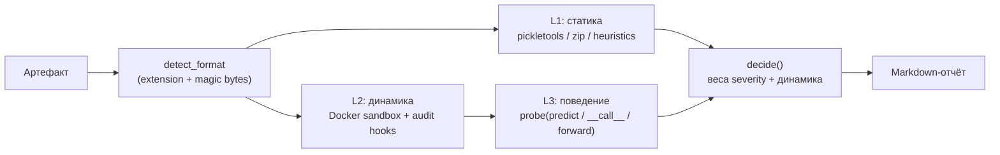

# План реализации MLScanner

Документ описывает пошаговый план реализации системы автоматического анализа опасности
ML-моделей в формате pickle (см. `Concept.md` и `docs/01..05`).

**Первый шаг — минимальный PoC**, реализующий все три метода проверки, со сквозной
наблюдаемостью и Markdown-отчётом. PoC реализован как один Python-файл
[`poc/mlscan_poc.py`](../poc/mlscan_poc.py) и опирается на заранее установленный Docker.

---

## 0. Обзор этапов (roadmap)

| Этап | Название | Ключевой результат | Соответствие архитектуре | Статус |
|------|----------|--------------------|--------------------------|--------|
| **0** | **PoC (первый шаг)** | Один файл: статика + динамика в Docker + поведение → Markdown | Срез всех 3 компонент | ✅ опубликован |
| 1 | Укрепление песочницы | Kata-микро-ВМ, eBPF (Falco), deception/canary, sinkhole, NetworkPolicy | Компонента 1 (Sandbox) | ✅ развёрнут |
| 2 | Сервис тестирования | Полноценные probe-наборы, нормализация результатов, очереди | Компонента 2 (Testing Service) | ✅ развёрнут |
| 3 | Аналитический движок + UI | Корреляция, скоринг, Policy Engine, реестр, отчёты | Компонента 3 (Analytics+UI) | ✅ развёрнут |
| 4 | Интеграции | CI/CD gate, Model Registry, SOC/SIEM, threat-intel | Сквозные | — |
| 5 | Промышленная эксплуатация | GPU-изоляция, масштабирование, SLA, red-team | NFR | — |

Принцип: **каждый этап расширяет работающий срез**, не переписывая предыдущий.

---

## 1. Этап 0 — Минимальный PoC (первый шаг)

### 1.1 Цель

Дать runnable-инструмент, который для одного артефакта:
1. выполняет **статический анализ** (без исполнения);
2. выполняет **динамический анализ** в изолированном Docker-контейнере с наблюдаемостью;
3. выполняет **поведенческое тестирование** загруженного объекта;
4. формирует **вердикт** и **Markdown-отчёт**.

### 1.2 Ограничения и допущения PoC

- Реализация — **один файл** на Python 3.10+ (реализовано на 3.12), без внешних Python-зависимостей
  на хосте (только stdlib: `pickletools`, `zipfile`, `subprocess`, `hashlib`, `json`…).
- Песочница — **заранее установленный и запущенный Docker**; образ по умолчанию
  `python:3.11-slim` (при необходимости — свой образ с `numpy`/`torch`).
- Минимальная песочница: hardening-контейнер (см. 1.5). Микро-ВМ вынесена на этап 1.
- Наблюдаемость: **Python audit hooks** (PEP 578) внутри контейнера + изоляция Docker
  (`--network none`, read-only rootfs, drop capabilities, лимиты cgroups).
- Отчёт — **Markdown** (в stdout или `--out`).
- Проверяются **все поддерживаемые форматы pickle-семейства** (см. 1.7).

### 1.3 Пайплайн PoC



### 1.4 Три метода проверки — что именно реализовано

| Метод | Реализация в PoC | Артефакт результата |
|-------|------------------|---------------------|
| **L1 Статический** | `pickletools.genops` → список opcodes и глобалов; allowlist/denylist модулей и имён; поиск `REDUCE`/`BUILD`; подстроки (`/bin/sh`, `curl`, `169.254.169.254`, `eval(`…); разбор zip-контейнеров (`data.pkl`, `*.pkl`), детект zip-slip | Находки (`check_id`, severity, evidence) |
| **L2 Динамический** | Загрузка в контейнере под audit hook: события `open`, `import`, `exec`, `os.system`, `subprocess.Popen`, `socket.*`, `ctypes.*`, `shutil.*` и др.; попытки сети/процессов/записи/ctypes; таймаут; maxRSS | Трасса событий + summary |
| **L3 Поведенческий** | (а) интерпретация эффектов загрузки (процессы/сеть/`exec <string>`/запись) F-30…F-33; (б) diff состояния процесса: `builtins`, `sys.meta_path`/`path_hooks`, `sys.path`, env, cwd (F-20…F-26); (в) интроспекция объекта + probe callable (`predict`/`__call__`/`forward`/`transform`/`generate`) синтетическими входами, подозрительные строки (F-27) | Поведенческие находки F-20…F-33 + таблица probe |

### 1.5 Песочница PoC (Docker hardening)

**Транспорт без расшаренных каталогов.** Модель подаётся на **stdin** контейнера
(`--interactive`), harness — base64-бутстрапом в `python -c`, результат — в **stdout**
(маркер `MLSCAN_RESULT_JSON:`). Никаких монтирований (`-v`) нет; файл при этом задаётся
обычным путём в командной строке (или потоком: `cat model | mlscan_poc.py - --name model.pt`).

Команда запуска контейнера (формируется в `dynamic_stage`):

```
cat <model> | docker run --rm --interactive --name mlscan-poc-<id> \
  --network none \
  --read-only \
  --cap-drop=ALL \
  --security-opt=no-new-privileges \
  --pids-limit=128 \
  --memory=1g --memory-swap=1g \
  --cpus=1 \
  --tmpfs /tmp:rw,nosuid,nodev,size=<N>m \
  [--runtime runsc]                 # gVisor, если установлен \
  <image> python -X utf8 -B -c '<base64-бутстрап>' "<harness-b64>" <fmt> <name>
```

Размер tmpfs `<N>` подбирается под размер модели (≈ 2×+64 МБ, минимум 128 МБ).

| Мера | Что защищает |
|------|--------------|
| `--network none` | Сеть полностью отсутствует; попытки соединений только фиксируются |
| `--read-only` + tmpfs `/tmp` | Запрет записи в rootfs; модель попадает только в эфемерный tmpfs |
| `--cap-drop=ALL` | Отсутствие любых capabilities |
| `--security-opt=no-new-privileges` | Запрет повышения привилегий |
| `--pids-limit`, `--memory`, `--cpus`, `--tmpfs size` | Защита от форк-бомб, OOM, DoS |
| `--runtime runsc` (опция) | gVisor: перехват syscalls, изоляция ядра |
| Транспорт через stdin/stdout (без `-v`) | Нет общих томов и прав на них; хостовая ФС не видна контейнеру |

> «Самый лёгкий вариант микро-ВМ»: на этапе 0 используется контейнер + опционально gVisor
> (`--runtime runsc`). Полноценная микро-ВМ (Firecracker/Kata) — этап 1.

### 1.6 Наблюдаемость (полноценная для PoC)

Внутри контейнера harness устанавливает `sys.addaudithook` и записывает события с
таймстемпом и фазой (`warmup`/`load`/`probe`):

- **Файлы:** `open` (путь, режим), `os.mkdir/remove/rename/link/symlink`, `shutil.*`.
- **Процессы/код:** `os.system`, `os.exec`, `os.spawn`, `subprocess.Popen`, `exec`, `compile`.
- **Сеть:** `socket.connect/connect_ex/bind/getaddrinfo/gethostbyname/sendto`, `ftplib.connect`,
  `smtplib.connect`, `urllib.Request`.
- **Нативные библиотеки:** `ctypes.dlopen/dlsym/call_function`.
- **Импорты:** `import`.

Ключевые решения для точности сигналов:
1. **Прогрев (`prewarm`)**: библиотеки формата (numpy/torch/joblib/dill/cloudpickle) импортируются
   **до** установки хука, чтобы шум их импорта не приписывался payload.
2. **Фильтрация библиотечного кода**: события `exec`/`compile` от модулей под `sys.prefix`,
   `site-packages`, `dist-packages` и инерционных кадров (`<frozen …>`) отбрасываются; `marshal.loads`
   (шум загрузчика `.pyc`) отбрасывается.
3. **Разделение сигналов**: жёсткие (гейтинг вердикта) — сеть, процессы, запись файлов,
   `ctypes.dlopen` не-`None`, таймаут; информационные — `exec`/`compile`/`import`.
4. **Нормализация аргументов** и лимит событий (5000) для защиты от переполнения отчёта.

Проверено эмпирически: для чистого `pickle` с `os.system` фиксируется `os.system`;
для benign — 0 жёстких сигналов; для numpy-объект-массива без payload — 0 жёстких сигналов.

### 1.7 Поддерживаемые форматы

| Формат | Расширения | L1 (статика) | L2 (динамика) |
|--------|-----------|--------------|---------------|
| pickle | `.pkl`, `.pickle`, `.p` | opcode-анализ | `pickle.loads` + permissive retry |
| joblib | `.joblib`, `.jl` | opcode-анализ | `joblib.load`, фолбэк pickle/zip |
| dill | `.dill` | opcode-анализ | `dill.loads`, фолбэк pickle |
| cloudpickle | `.cloudpickle` | opcode-анализ | `cloudpickle.loads`, фолбэк pickle |
| torch | `.pt`, `.pth`, `.bin`, `.ckpt` | zip: разбор `data.pkl` и `*.pkl` | `torch.load(weights_only=False)`, фолбэк — распаковка zip |
| numpy | `.npy`, `.npz` | извлечение payload за заголовком; opcode-анализ | `np.load(allow_pickle=True)`, фолбэк |
| контейнеры | `.zip`, `.tar` | разбор членов + zip-slip | распаковка pickle-членов |
| HDF5 | `.h5`, `.hdf5` | отмечается как «не pickle» | не применимо |
| SafeTensors | `.safetensors` | ditto | не применимо |
| ONNX | `.onnx` | ditto | не применимо |

Формат определяется по расширению с уточнением по «магическим байтам»
(`\x93NUMPY`, `\x89HDF`, `PK\x03\x04`, pickle PROTO `\x80\x02…\x80\x05`).

### 1.8 Логика вердикта PoC

```
max_severity = max(severity статических находок)
hard_dynamic = сеть>0 или subprocess>0 или dlopen>0 или записи>0 или timeout

critical/high и hard_dynamic → Malicious
critical/high               → Dangerous   (нужно подтверждение динамикой)
hard_dynamic                → Dangerous
динамика пропущена          → Inconclusive («не доказано, что безопасно»)
medium                      → Needs review
иначе                       → Safe
```

### 1.9 Запуск

```bash
# Полный анализ (динамика в Docker)
python3 poc/mlscan_poc.py path/to/model.pt --out report.md

# Только статика (без контейнера)
python3 poc/mlscan_poc.py model.pkl --static-only

# С gVisor и собственным образом
python3 poc/mlscan_poc.py model.pt --runtime runsc --image mlscan-poc:latest --timeout 90

# Ввод из stdin (без файла на диске); --name задаёт расширение для выбора загрузчика
cat model.pt | python3 poc/mlscan_poc.py - --name model.pt
```

Опции: `--out`, `--image` (default `python:3.11-slim`), `--runtime`, `--timeout` (default 60),
`--static-only`, `--name` (имя при вводе из stdin), `--keep`, `--version`.

Опциональный образ PoC (для numpy/torch-форматов; на этапе динамики сеть не нужна):

```dockerfile
FROM python:3.11-slim
RUN pip install --no-cache-dir numpy joblib dill cloudpickle \
 && pip install --no-cache-dir --index-url https://download.pytorch.org/whl/cpu torch
```

### 1.10 Тестовая матрица (приёмочные проверки PoC)

| Образец | Ожидание L1 | Ожидание L2 | Ожидание L3 | Вердикт |
|---------|-------------|-------------|-------------|---------|
| benign `{...}` | нет находок | 0 жёстких сигналов | 0 находок | Safe |
| `os.system` в `__reduce__` | critical A-01 | `os.system` | F-30 | Malicious |
| `subprocess.Popen` | critical A-01 | `subprocess.Popen` | F-30 | Malicious |
| `socket.connect` через `eval` | medium (подстроки) | `socket.*` ≥1 | F-31 (+F-32) | Malicious |
| `exec("<код>")` (builtins tampering) | critical A-01 | `exec <string>` | F-32, F-20 | Malicious |
| запись файла через `open` | — | `file_writes` ≥1 | F-33 | Dangerous |
| torch-zip c `data.pkl`=`os.system` | critical (член `data.pkl`) | `os.system` | F-30 | Malicious |
| `.npy` object-массив с payload | critical | `os.system` | F-30 | Malicious |
| zip с `../evil` | high B-03 (zip-slip) | — | — | Dangerous |
| модель с `predict`, без закладок | нет находок | 0 жёстких сигналов | callable найден, находок нет | Safe |

Проверки матрицы прогнаны при разработке PoC: статика корректна для `.pkl/.joblib/.pt/.npy`;
динамика фиксирует `os.system`, `subprocess.Popen`, `socket.*`, `file writes`; L3 фиксирует
эффекты загрузки и tampering; шум библиотек (numpy) отфильтрован, ложных срабатываний на
benchmark-модели с `predict` нет. Примеры отравлений — в `poc/scan/` (`evil0…evil5.pkl`).

### 1.11 Критерии готовности PoC (Definition of Done)

- [x] Один файл, только stdlib на хосте, Python 3.10+.
- [x] L1/L2/L3 реализованы; L2 — строго в Docker-песочнице с hardening-флагами.
- [x] Наблюдаемость: сеть, процессы, файлы, ctypes, импорты; фильтрация шума; MaxRSS; таймаут.
- [x] Поддержка всех pickle-форматов из 1.7 (+ корректный отказ для HDF5/SafeTensors/ONNX).
- [x] Markdown-отчёт с вердиктом и доказательствами.
- [x] Graceful degradation при недоступном Docker → вердикт `Inconclusive`, не `Safe`.
- [x] Компилируется и проходит тестовую матрицу.

### 1.12 Известные ограничения PoC (и что уходит на этап 1+)

- Наблюдаемость — Python-level + Docker, **не eBPF** и не микро-ВМ → возможен sandbox evasion.
- Вредоносное действие в дочернем процессе (например, запись из `sh -c`) видно как факт
  запуска процесса, но детали его syscalls — нет (нужен eBPF, этап 1).
- Поведенческий probe минимален (нет backdoor/privacy/adversarial-наборов — этап 2).
- Нет скоринга/Policy Engine/реестра (этап 3).
- `weights_only=False` для torch в PoC — намеренно (мы тестируем payload), допустимо только
  внутри песочницы.

---

## 2. Этап 1 — Укрепление песочницы ✅ (реализован)

**Статус:** развёрнут в кластере `rtx-cluster` и проверен. Артефакты — `deploy/stage1/`,
подробности — `deploy/stage1/README.md`.

Реализовано:
- **Микро-ВМ:** RuntimeClass `kata` (собственное ядро на под) вместо gVisor (Kata уже доступен
  в кластере). Namespace `mlscan-sandbox` с Pod Security Admission `restricted`.
- **Hardening пода:** non-root (65532), `readOnlyRootFilesystem`, `allowPrivilegeEscalation:false`,
  `drop: [ALL]`, `seccompProfile: RuntimeDefault`, лимиты CPU/RAM/ephemeral-storage,
  `automountServiceAccountToken:false`, tmpfs `/tmp`.
- **eBPF-мониторинг:** Falco (`modern_ebpf`) в namespace `mlscan-monitoring` + кастомные правила
  `MLScan sandbox *` (exec/egress/write). Для Kata syscalls гостя невидимы — там работает
  внутригостевая инструментация (audit-hooks); для runc-подов Falco даёт хостовый уровень.
- **Deception:** honeypot-файлы (`~/.aws`, `~/.ssh`, `~/.kube`, `.env`, canary), `HOME=/deception`.
- **Сетевой sinkhole:** in-cluster HTTP+TCP «ловушка» вместо egress; Calico NetworkPolicy
  `default-deny` + DNS + `sandbox→sinkhole`. Проверено: внешний egress запрещён, sinkhole доступен.
- **Наблюдаемость:** сохранена полностью (audit-hooks harness + Falco).

Проверки (evidence):
- `run-sandbox.sh evil2.pkl` → Kata-под, `behavior_findings: [F-32, F-20]`.
- `run-sandbox.sh evil6.pkl` → чтение `/deception/.aws/credentials`, sinkhole зафиксировал
  `HTTP GET /exfil-canary?stolen=104`.
- egress-test → `DENY 1.1.1.1:443`, `DENY example.com:80`, `OK sinkhole:8080`.
- Falco → `MLScan sandbox harness exec / egress / write`.

Осталось (в следующих этапах): рандомизация против sandbox evasion, множественные прогоны,
подпись образов (cosign/SBOM/attestation), egress-прокси с восстановлением нагрузки.

Выход: изолированное исполнение с ядерным уровнем наблюдаемости и deception.

## 3. Этап 2 — Сервис тестирования (Testing Service) ✅ (реализован)

**Статус:** развёрнут в `mlscan-testing` и проверен. Артефакты — `deploy/stage2/`,
подробности — `deploy/stage2/README.md`.

Реализовано:
- HTTP-сервис (stdlib, без зависимостей): `POST /scans`, `GET /scans`, `GET /scans/<id>`, `GET /healthz`.
- **L1** выполняется в сервисе (переиспользует `poc/mlscan_poc.py`: `static_stage`, `decide`).
- **L2/L3** — постановка Job в `mlscan-sandbox` (Kata, hardened) через Kubernetes API; артефакт
  передаётся ConfigMap'ом; чтение результата из логов пода (`MLSCAN_RESULT_JSON`).
- **Нормализация**: находки приводятся к контракту (`level` L1/L3, `check_id`, `severity`,
  `confidence`, `evidence`); вердикт — `mlscan_poc.decide`.
- RBAC (SA в `mlscan-testing` → Role в `mlscan-sandbox`), хранение результатов на PVC,
  изоляция прогонов «один инстанс = один артефакт», автоудаление Job/ConfigMap.

Проверки (evidence):
- `evil0` → `Malicious` (L1 A-01/A-02 + L3 F-30); `evil2` → `Malicious` (F-32, F-20);
  `evil6` → `Malicious` (F-31, F-32); `benign` и модель с `predict` → `Safe`.

Осталось (Этап 2+): очередь заданий с ретраями/квотами, полноценная probe-библиотека
(functional/robustness/backdoor/privacy/adversarial), PVC/стриминг для крупных артефактов,
экранирование выходов модели. Текущий транспорт артефакта — ConfigMap (≤ ~900 КиБ).

## 4. Этап 3 — Аналитический движок + UI ✅ (реализован)

**Статус:** развёрнут в `mlscan-analytics` и проверен. Артефакты — `deploy/stage3/`,
подробности — `deploy/stage3/README.md`.

Реализовано (stdlib-only):
- **Сбор результатов** сервиса тестирования (poller + `POST /sync`).
- **Скоринг** (`risk_score = min(10, max_вес + 0.2·Σпрочих)`) и корреляция L1/L3.
- **Policy Engine** (`policy.json`): декларативные правила → `action`/`verdict`
  (`block-rce`, `block-code-exec`, `block-process-egress`, `block-tamper`, `allow-clean`,
  `quarantine-medium`, `allow-low`).
- **Evidence Store**: append-only `/data/evidence.jsonl` с hash-цепочкой + `GET /api/evidence/verify`.
- **Report Generator**: JSON / Markdown / SARIF 2.1.0.
- **Web UI** (dashboard + карточка артефакта, NodePort 30808) и JSON-API.

Проверки (evidence): `evil6` → `Malicious`, score 10.0, policy `block-rce→block`, отчёты
`.md`/`.sarif` валидны; `benign`/`toy` → `Safe`; evidence chain `ok`.

Осталось: OPA/Rego вместо JSON-правил, очередь/retest, Knowledge Base (IoC/baseline),
Model Registry, PDF/HTML-отчёты, auth для UI, человек-в-контуре (feedback в детекторы).

## 5. Этап 4 — Интеграции и эксплуатация

- CI/CD gate (блок сборки при ≥ Dangerous), Model Registry, SOC/SIEM, тикет-системы.
- GPU-изоляция (MIG/vGPU), горизонтальное масштабирование, SLA, непрерывный retest.
- Регулярные red-team/эскейп-тесты; threat-intel sync; метрики качества (TPR/FPR/coverage).

---

## 6. Сквозные требования

- **Тесты**: регресс-набор эталонов (safe/suspicious/malicious), метатесты песочницы,
  мутационное тестирование детекторов.
- **CI**: линт/типизация PoC и сервисов, сборка образов с SBOM, прогон тест-матрицы.
- **Наблюдаемость системы**: метрики, трассировка, аудит решений.
- **Безопасность данных**: изоляция артефактов, минимизация PII в отчётах, хранение evidence.

## 7. Риски плана и митигции

| Риск | Митигция |
|------|----------|
| Побег из контейнера (этап 0) | gVisor/микро-ВМ на этапе 1; эскейп-тесты |
| Sandbox evasion | deception, рандомизация, множественные прогоны, этап 2 |
| Ложные негативы | эшелонирование, red-team, обратная связь по инцидентам |
| Отсутствие Docker в среде | вердикт `Inconclusive` (не `Safe`); инструкция запуска демона |
| Стоимость GPU-тестов | GPU-пул по требованию, приоритезация |

## 8. Связь с документацией

- `Concept.md` — концепция и архитектура.
- `docs/01-threat-checklist.md` — чеклист рисков (покрывается L1/L2/L3).
- `docs/02-testing-strategy.md` — стратегия L0–L4.
- `docs/03-isolation.md` — методы изоляции (этап 1).
- `docs/04-risk-analysis-decision.md` — обработка результатов и решения (этап 3).
- `docs/05-architecture.md` — детальная архитектура.
- `poc/mlscan_poc.py` — реализация первого шага (этот PoC).
