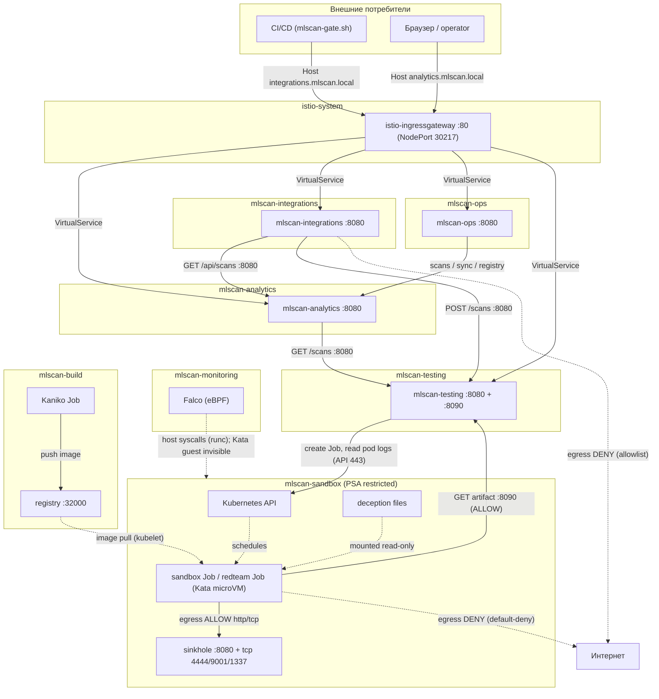
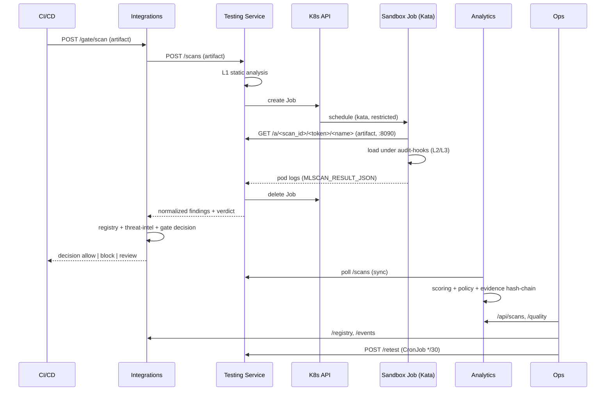

# 07. Реализованная архитектура MLScan (as-built)

Итоговое описание **фактически развёрнутой** в кластере `rtx-cluster` (MicroK8s v1.33,
containerd, Calico, RuntimeClass `kata`) системы MLScan: компонентный состав, схема
сетевого взаимодействия, потоки данных, границы доверия и ограничения.

Источник: `deploy/stage1…stage5/` и `deploy/sandbox-image/`. Концепция — `../Concept.md`,
проектная архитектура — `05-architecture.md`, план — `06-implementation-plan.md`,
тест-гайд — `08-testing-guide.md`.

---

## 1. Обзор

MLScan — система автоматического анализа опасности ML-моделей в формате pickle. Реализована
как набор микросервисов в **семи namespace** (`mlscan-sandbox`, `mlscan-monitoring`,
`mlscan-testing`, `mlscan-analytics`, `mlscan-integrations`, `mlscan-ops` и сборки образа
`mlscan-build`). Все сервисы — на стандартной библиотеке Python (без внешних зависимостей),
образ `python:3.12-slim` (Python 3.12.14); песочница использует отдельный образ
`mlscan-sandbox` с torch/numpy.

Ключевые принципы as-built:
- артефакт **никогда не исполняется** в доверенной зоне — только в микро-ВМ Kata с сетевым
  запретом;
- обмен между сервисами — по HTTP внутри кластера; наружу торчат только NodePort UI/API;
- состояние — на локальных PVC (single-node); Evidence Store — append-only с hash-цепочкой.

### 1.1 Используемые продукты и версии

| Продукт | Версия | Роль в MLScan |
|---------|--------|---------------|
| MicroK8s / Kubernetes | **v1.33.13** (rev 9067) | кластер-платформа |
| `kubectl` (клиент) | v1.28.13 | управление (операции, apply, exec) |
| containerd | **1.7.29** | container runtime узла |
| Kata Containers | **3.32.0** | микро-ВМ песочницы (RuntimeClass `kata`) |
| Ubuntu | 24.04.4 LTS | ОС узла `rtx-cluster` |
| Linux kernel (host) | 7.0.0-38-generic | ядро хоста |
| Linux kernel (Kata guest) | 6.18.35 | ядро гостя микро-ВМ (изоляция) |
| Calico | **v3.29.3** | CNI + NetworkPolicy |
| CoreDNS | 1.12.1 | DNS кластера |
| metrics-server | v0.7.2 | метрики ресурсов (готовность к HPA) |
| hostpath-provisioner (`cdkbot`) | 1.5.0 | StorageClass `microk8s-hostpath` |
| Falco | **0.45.0** (Helm-чарт `falco-9.2.0`), falcoctl 0.14.2 | eBPF runtime-мониторинг (driver `modern_ebpf`) |
| Python | **3.12.14** (образ `python:3.12-slim`) | рантайм всех сервисов и in-sandbox harness — **только стандартная библиотека** |
| PyTorch (CPU) | **2.14.1+cpu** (образ песочницы `mlscan-sandbox`, `deploy/sandbox-image/`) + numpy 2.5.4, joblib, dill, cloudpickle | динамическая загрузка torch-моделей в песочнице |
| Kaniko | executor v1.23.2 | сборка образа песочницы в in-cluster registry |
| `pickletools` / `zipfile` / `sys.addaudithook` | Python 3.12 stdlib | статический разбор (L1) и наблюдаемость (L2/L3) |
| Helm | v3.15.4 | установка Falco |
| OpenSSL | 3.0.13 | утилита узла (доступна) |
| Реестр образов (addon `registry`) | `registry:2.8.3` (NodePort 32000) | приватный реестр; **хранит образ песочницы** `mlscan-sandbox:latest` |
| Istio | addon включён | присутствует; sidecar-инъекция не включена (не используется) |

Все сервисы MLScan — собственный код на Python stdlib поверх образа `python:3.12-slim`;
внешних сервисных зависимостей (БД, очередь, брокеры) нет — состояние в файлах на PVC.

---

## 2. Компонентный состав

### 2.1 `mlscan-sandbox` — изоляция и исполнение (Компонента 1)

| Объект | Тип | Назначение |
|--------|-----|-----------|
| `sinkhole` (Deployment + ClusterIP Service) | :8080 HTTP, :4444/9001/1337 TCP | in-cluster «ловушка»: единственный разрешённый egress; логирует обращения |
| sandbox Job (по запросу) | `runtimeClassName: kata` (Kata 3.32.0), образ `mlscan-sandbox` | запуск harness из PoC над артефактом (torch/numpy) |
| `mlscan-redteam` (Job) | kata | escape-тест изоляции (Этап 5) |
| ConfigMap `mlscan-harness`, `mlscan-samples`, `mlscan-deception*`, `mlscan-sinkhole`, `mlscan-redteam` | — | код harness, демо-данные, honeypot-файлы, sinkhole-сервер, redteam-скрипт |
| NetworkPolicy `default-deny-all`, `allow-dns-egress`, `sandbox-to-sinkhole`, `sinkhole-ingress`, `sandbox-to-testing-artifacts` | — | сетевая изоляция (Calico) |
| PSA `restricted` (namespace label) | — | запрет привилегированных подов |

**Транспорт артефакта:** файл лежит на PVC сервиса тестирования (`/artifacts`); sandbox-Job
скачивает его с Artifact-сервера сервиса тестирования (порт **8090**) по одноразовому токену.
Per-scan ConfigMap-транспорт больше не используется.

### 2.2 `mlscan-monitoring` — eBPF-мониторинг

| Объект | Тип | Назначение |
|--------|-----|-----------|
| `falco` (DaemonSet) | Falco 0.45.0, modern eBPF driver | хостовые syscalls: exec/egress/write; правила `MLScan sandbox *` |

### 2.3 `mlscan-testing` — сервис тестирования (Компонента 2)

| Объект | Тип | Назначение |
|--------|-----|-----------|
| `mlscan-testing` (Deployment + ClusterIP Service :8080 + :8090) | stdlib HTTP | потоковый приём артефактов любого размера (PVC `/artifacts`), L1 (статика), запуск Job, Artifact-сервер (8090, отдача в песочницу по токену), сбор L2/L3, нормализация, вердикт, `/stats` |
| ServiceAccount `mlscan-testing` + Role/RoleBinding в `mlscan-sandbox` | RBAC | create/delete Jobs, get pods/logs в песочнице |
| PVC `mlscan-testing-data` | hostpath 1Gi | записи сканов (`/data/scans/*.json`) |
| PVC `mlscan-artifacts` | hostpath 20Gi | загруженные модели (`/artifacts/<scan_id>/<name>`) |
| ConfigMap `mlscan-poc-lib`, `mlscan-testing-code` | — | общий анализ (PoC) + код сервиса |

### 2.4 `mlscan-analytics` — аналитический движок + UI (Компонента 3)

| Объект | Тип | Назначение |
|--------|-----|-----------|
| `mlscan-analytics` (Deployment + NodePort Service :30808) | stdlib HTTP | сбор результатов, скоринг, Policy Engine, evidence, отчёты, веб-UI |
| PVC `mlscan-analytics-data` | hostpath 1Gi | `/data/evidence.jsonl` (hash-chain) |
| ConfigMap `mlscan-analytics-code`, `mlscan-policy` | — | код движка + `policy.json` |

### 2.5 `mlscan-integrations` — интеграции (Этап 4)

| Объект | Тип | Назначение |
|--------|-----|-----------|
| `mlscan-integrations` (Deployment + NodePort Service :30809) | stdlib HTTP | Model Registry, CI/CD gate, SIEM-экспорт, threat-intel |
| PVC `mlscan-integrations-data` | hostpath 512Mi | `registry.json`, `events.jsonl` |
| ConfigMap `mlscan-integrations-code`, `mlscan-intel` | — | код сервиса + seed threat-intel |

### 2.6 `mlscan-ops` — эксплуатация (Этап 5)

| Объект | Тип | Назначение |
|--------|-----|-----------|
| `mlscan-ops` (Deployment + NodePort Service :30810) | stdlib HTTP | метрики Prometheus, здоровье стека, качество (TPR/FPR), SLA, retest |
| CronJob `mlscan-retest` | `*/30 * * * *` | непрерывный retest golden-набора |
| PDB `*-pdb` | — | PodDisruptionBudget для testing/analytics/integrations |
| ConfigMap `mlscan-ops-code`, `mlscan-golden`, `mlscan-golden-samples` | — | код, golden-метки и образцы |

### 2.8 `mlscan-build` — сборка образа песочницы

| Объект | Тип | Назначение |
|--------|-----|-----------|
| `mlscan-sandbox-build` (Job, Kaniko) | executor v1.23.2 | сборка образа `mlscan-sandbox` и публикация в in-cluster registry |
| ConfigMap `mlscan-sandbox-build` | — | `Dockerfile` контекста сборки |

Образ: `python:3.12-slim` + **torch 2.14.1+cpu** + numpy/joblib/dill/cloudpickle. Сборка без
Docker на хосте (Kaniko); результат — `localhost:32000/mlscan-sandbox:latest` (для kubelet).

---

## 3. Схема сетевого взаимодействия

**Направления и протоколы:**
- Внешний доступ — **единая точка входа Istio Ingress Gateway** (HTTP NodePort `30217`), маршрутизация по хостам `analytics|integrations|ops|api.mlscan.local`; у сервисов MLScan NodePort нет (ClusterIP).
- Внутренние вызовы — HTTP `:8080` по кластерному DNS (`<svc>.<ns>.svc.cluster.local`).
- `TEST → Kubernetes API` — HTTPS `:443` (создание Job, чтение `pods/log`).
- `Kata-Job → testing:8090` — скачивание СВОЕГО артефакта по токену (allow);
- `Kata-Job → sinkhole` — разрешённый канал; наружу — запрет (NetworkPolicy default-deny).
- `Falco` наблюдает хостовые syscalls; syscalls **внутри Kata-микро-ВМ ему не видны**
  (там работает внутригостевая инструментация harness).
- Образ песочницы собирается Kaniko в `mlscan-build` и публикуется в in-cluster registry;
  kubelet подтягивает его при создании Job.
- **Egress платформы** — allowlist (deny-by-default + DNS + кластерные CIDR); внешний egress услуг запрещён.

---

## 4. Модель сетевого доступа и политики

### 4.1 NetworkPolicy в `mlscan-sandbox` (Calico v3.29.3)

| Политика | Тип | Эффект |
|----------|-----|--------|
| `default-deny-all` | Ingress+Egress | весь трафик запрещён по умолчанию |
| `allow-dns-egress` | Egress | DNS к `kube-dns` (UDP/TCP 53) |
| `sandbox-to-sinkhole` | Egress | `app=mlscan-sandbox → app=sinkhole` (любые порты) |
| `sinkhole-ingress` | Ingress | в sinkhole — только от `app=mlscan-sandbox` |
| `sandbox-to-testing-artifacts` | Egress | `mlscan-sandbox → mlscan-testing:8090` (скачивание СВОЕГО артефакта по токену) |

Проверено: `1.1.1.1:443` и `example.com:80` → **DENY** (timeout), `sinkhole:8080` → **OK**.

### 4.2 Внешняя экспозиция

Единая точка входа — **Istio Ingress Gateway** (внешние сервисы MLScan — ClusterIP):

| Хост (Host header) | Gateway | Назначение |
|--------------------|---------|-----------|
| `analytics.mlscan.local` | `mlscan-ingress/mlscan-gateway` | веб-UI + JSON API |
| `integrations.mlscan.local` | тот же | gate/registry/SIEM/intel |
| `ops.mlscan.local` | тот же | метрики/качество/SLA |
| `api.mlscan.local` | тот же | API тестирования |

Шлюз: `istio-ingressgateway` (ns `istio-system`), HTTP NodePort **30217** (HTTPS 30921).
Сервисы `mlscan-testing` (ClusterIP :8080+:8090) и `sinkhole` — внутренние.

### 4.3 Egress-контроль (переход с «открытого» egress на allowlist)

| Namespace | Политика egress | Разрешено |
|-----------|-----------------|-----------|
| `mlscan-testing` | `mlscan-egress` | DNS; кластерные CIDR (8080/8090/443); Kubernetes API (`192.168.20.116:16443`) |
| `mlscan-analytics` | `mlscan-egress` | DNS; кластерные CIDR (8080/8090) |
| `mlscan-integrations` | `mlscan-egress` | DNS; кластерные CIDR (8080) |
| `mlscan-ops` | `mlscan-egress` | DNS; кластерные CIDR (8080) |
| `mlscan-sandbox` | `default-deny-all` + allow | DNS; sinkhole; `testing:8090` (артефакт) |

Внешний egress платформенных сервисов **запрещён** (проверено: `1.1.1.1:443 → DENY`).
Toчечный доступ к внешним ресурсам — через FQDN-allowlist (Calico) или Egress Gateway (план).

---

## 5. Сквозной поток (scan + gate)

---

## 6. Хранилища, конфигурация, RBAC

| Компонент | PVC | Файлы состояния |
|-----------|-----|-----------------|
| testing | `mlscan-testing-data` (1Gi), `mlscan-artifacts` (20Gi) | `/data/scans/<id>.json`; `/artifacts/<scan_id>/<name>` |
| analytics | `mlscan-analytics-data` (1Gi) | `/data/evidence.jsonl` (hash-chain) |
| integrations | `mlscan-integrations-data` (512Mi) | `/data/registry.json`, `/data/events.jsonl` |
| ops | — (stateless) | состояние в памяти |

Конфигурация — ConfigMap'ы (код сервисов, `policy.json`, `intel.json`, `golden.json`, harness,
deception, sinkhole). Аттестация целостности evidence — `deploy/stage5/60-attest.sh` (HMAC-SHA256).

### 6.1 Как устроено хранилище аналитических данных

**Отдельной СУБД нет.** Аналитическая информация хранится **файлами на PVC**
(`microk8s-hostpath`), загружается в память при старте и отдаётся по HTTP API. Ни SQL, ни
индексов на диске, ни движка запросов не используется.

| Хранилище | Файл(ы) | Формат / семантика |
|-----------|---------|--------------------|
| Сервис тестирования (`mlscan-testing`) | `/data/scans/<scan_id>.json` | один JSON на скан; функции `save_scan`/`load_scan`/`list_scans` |
| Аналитический движок (`mlscan-analytics`) — **основное хранилище аналитики** | `/data/evidence.jsonl` | **append-only JSONL**; строка = `{"prev","hash","record"}`, где `hash = sha256(prev + json(record))` → **tamper-evident hash-цепочка** |
| Интеграции (`mlscan-integrations`) | `/data/registry.json`, `/data/events.jsonl` | реестр `sha256 → entry` (dict) + append-only события gate/SIEM |
| Ops (`mlscan-ops`) | — | stateless; читает остальные по API |

**Механика аналитического движка:**
- при старте `_load_store()` проигрывает `evidence.jsonl` и строит **in-memory индекс**
  `scan_id → record`;
- запись — `_append()` под `threading.Lock`: считает `hash` от `prev + record`, дописывает
  строку и обновляет `last_hash` (append-only, без изменения прошлых записей);
- чтение — только через API: `/api/scans`, `/api/scans/<id>`, `/reports/<id>.json|.md|.sarif`;
- контроль целостности — `GET /api/evidence/verify` (пересчёт всей цепочки);
- запись `record` включает исходные данные скана (`static`, `sandbox` с трассой событий,
  нормализованные `findings`, `score`, `policy`, `verdict`), поэтому файлы сканов могут
  достигать десятков КБ.

**Фактическое состояние (пример):** `evidence.jsonl` ≈ 228 КБ (~102 записи), `/data/scans/` — 101 файл,
`/artifacts` ≈ 618 МБ (загруженные модели), `registry.json` — 17 записей, `events.jsonl` — 5 строк.

**Свойства и ограничения:**
- **один писатель**: сервисы развёрнуты `replicas=1` с RWO-PVC; запись сериализуется
  `threading.Lock` в пределах процесса; конкурентная запись из нескольких реплик не поддерживается;
- покрытие/архивация/ретенция не реализованы; объём ограничен размером PVC;
- нет произвольных запросов (только предопределённые API-выборки/фильтры в коде);
- загруженные артефакты сохраняются на PVC `mlscan-artifacts` (`/artifacts/<scan_id>/<name>`);
  per-scan ConfigMap-транспорт не используется; очистка старых артефактов — по ретенции (план);
- **точки роста** (см. `05-architecture.md` §7): внешняя **PostgreSQL** (в кластере доступен
  addon CloudNativePG), `sqlite/duckdb` для запросов, объектное хранилище (S3/MinIO) для
  сырых evidence/трасс, ретенция и компактификация.

RBAC: единственная cross-namespace связка — SA `mlscan-testing` (ns `mlscan-testing`) с Role
в `mlscan-sandbox` (Jobs/ConfigMaps create·delete·get, pods/logs get). Остальные сервисы
работают без доступа к Kubernetes API.

---

## 7. Границы доверия и изоляция

| Зона | Доверие | Изоляция |
|------|---------|----------|
| `mlscan-sandbox` (исполнение артефакта) | **недоверенная** | Kata 3.32.0 (микро-ВМ), PSA restricted, non-root 65532, read-only rootfs, drop ALL, seccomp, лимиты, default-deny egress, deception |
| `mlscan-monitoring` | доверенная (мониторинг) | DaemonSet, modern eBPF |
| `mlscan-testing` / `mlscan-analytics` / `mlscan-integrations` / `mlscan-ops` | доверенная | PSA restricted, non-root, read-only rootfs, drop ALL, без лишних прав |

Артефакт передаётся в песочницу **без расшаренных каталогов** (ConfigMap + stdin), невидим
для других namespace; секреты платформы (SA-токены и т.п.) в песочницу не монтируются.

---

## 8. Порты и внутренние адреса (DNS)

| Сервис | DNS (внутри кластера) | Порт |
|--------|----------------------|------|
| testing | `mlscan-testing.mlscan-testing.svc.cluster.local` | 8080 (API), 8090 (artifact) |
| analytics | `mlscan-analytics.mlscan-analytics.svc.cluster.local` | 8080 |
| integrations | `mlscan-integrations.mlscan-integrations.svc.cluster.local` | 8080 |
| ops | `mlscan-ops.mlscan-ops.svc.cluster.local` | 8080 |
| sinkhole | `sinkhole.mlscan-sandbox.svc.cluster.local` | 8080, 4444, 9001, 1337 |

Основные эндпоинты: `/scans` (testing), `/api/scans|/reports|/policy` (analytics),
`/registry|/gate|/gate/scan|/events|/export/cef|/intel` (integrations),
`/metrics|/health/stack|/quality|/sla|/retest` (ops).

---

## 9. Наблюдаемость

- **В песочнице:** audit-hooks harness (L2/L3: файлы/процессы/сеть/ctypes, diff состояния) —
  работает и внутри Kata.
- **Хост:** Falco (modern eBPF), правила `MLScan sandbox *` (exec/egress/write) для runc-подов.
- **Стек:** `/metrics` (Prometheus `mlscan_*`), `/health/stack`, `/quality` (TPR/FPR), `/sla`.

Проверенные показатели: red-team — 7/7 PASS; quality — TPR=1.0, FPR=0.0 (tp=7, fp=0, tn=2, fn=0);
evidence-chain — ok.

---

## 10. Ограничения (single-node) и точки роста

- **GPU:** `nvidia.com/gpu: 0` — GPU-изоляция не применялась; шаблон GPU-пода готов после
  установки NVIDIA device plugin.
- **Масштабирование:** сервисы с RWO-PVC и файловым состоянием не масштабируются горизонтально
  корректно; нужны RWX/внешняя БД и stateless-поды. Ops-сервис stateless.
- **Аттестация:** HMAC (для прода — Sigstore/cosign, подпись образов).
- **eBPF в Kata:** host-eBPF не видит syscalls гостя — нужен внутригостевой сенсор (harness
  уже выполняет эту роль).
- Внешние SIEM/тикеты — через `/export/cef` и `/events` (интеграция на стороне потребителя).
- **Динамика:** torch/numpy-модели и pickle в стиле Python 2 (`__builtin__`) теперь исполняются
  в песочнице (образ `mlscan-sandbox` + совместимость harness).
- **Артефакты:** хранятся на PVC `mlscan-artifacts` (20Gi) без авто-ретенции — рост диска;
  в плане — ретенция/очистка.
- **GPU** — по-прежнему недоступен (см. выше).

---

## 11. Связанные документы

- `../Concept.md` — концепция и целевая архитектура.
- `01-threat-checklist.md`, `02-testing-strategy.md`, `03-isolation.md`, `04-risk-analysis-decision.md`, `05-architecture.md`, `06-implementation-plan.md`.
- `../deploy/stage1…stage5/README.md`, `../deploy/sandbox-image/README.md`, `../deploy/ingress/README.md` — операционные описания стадий, образа песочницы и перехода на Ingress/Egress.
- `08-testing-guide.md` — что протестировать и куда подключаться.
- `../poc/README.md` — однофайловый PoC.
