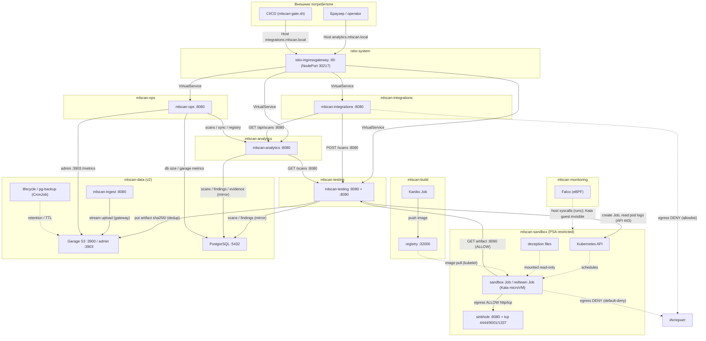
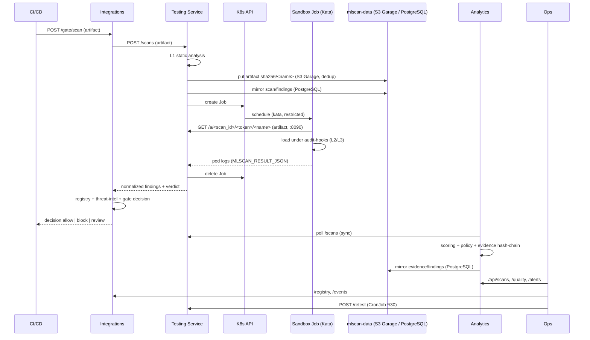

# 07. Реализованная архитектура MLScan (as-built)

Итоговое описание **фактически развёрнутой** в кластере `<CLUSTER>` (MicroK8s v1.33,
containerd, Calico, RuntimeClass `kata`) системы MLScan: компонентный состав, схема
сетевого взаимодействия, потоки данных, границы доверия и ограничения.

Описание включает и базовую систему для pickle (Этапы 0–5), и **v2**: объектное хранилище,
PostgreSQL, аутентификацию/авторизацию с аудитом и локализацию RU/EN.

Источник: `deploy/stage1…stage5/`, `deploy/v2/`, `deploy/sandbox-image/`, `deploy/i18n/`,
`deploy/ingress/`. Концепция — `../Concept.md`, проектная архитектура — `05-architecture.md`,
план — `06-implementation-plan.md`, тест-гайд — `08-testing-guide.md`, целевая архитектура
v2 — `11-target-architecture-v2.md`, локализация — `12-i18n.md`.

---

## 1. Обзор

MLScan — система автоматического анализа опасности ML/AI-артефактов (ядро — pickle, далее
адаптеры форматов). Реализована как набор микросервисов в **девяти namespace**:
`mlscan-sandbox`, `mlscan-monitoring`, `mlscan-testing`, `mlscan-analytics`,
`mlscan-integrations`, `mlscan-ops`, `mlscan-data` (v2: объектное хранилище, PostgreSQL,
ingest, retention/backup), `mlscan-build` (сборка образа песочницы) и `mlscan-ingress`
(Istio Gateway/VirtualServices и egress-политики). Все сервисы — на стандартной библиотеке
Python (без внешних зависимостей), образ `python:3.12-slim` (Python 3.12.14); песочница
использует отдельный образ `mlscan-sandbox` (torch CPU и библиотеки форматов).

Ключевые принципы as-built:
- артефакт **никогда не исполняется** в доверенной зоне — только в микро-ВМ Kata с сетевым
  запретом;
- обмен между сервисами — по HTTP внутри кластера; внешний доступ — через единую точку входа
  Istio Ingress Gateway (маршрутизация по хостам);
- **два слоя хранения**: объектное хранилище **S3 (Garage)** для артефактов (ключ
  `sha256/<name>`, дедупликация) и **PostgreSQL** для метаданных, находок, evidence,
  пользователей/ключей, аудита и системных настроек; файловые PVC сохранены как локальный
  hash-chain evidence и как fallback;
- Evidence Store — append-only с hash-цепочкой (файл на PVC **и** зеркало в PostgreSQL);
- UI и сообщения сервисов локализованы **RU/EN**; язык задаётся глобально (`MLSCAN_LANG` при
  запуске либо настройкой в БД) — см. `12-i18n.md`.

### 1.1 Используемые продукты и версии

| Продукт | Версия | Роль в MLScan |
|---------|--------|---------------|
| Kubernetes (MicroK8s) | 1.33 | кластер-платформа |
| `kubectl` | — | управление (apply, exec, port-forward) |
| containerd | — | container runtime узла |
| Kata Containers | — | микро-ВМ песочницы (RuntimeClass `kata`) |
| ОС узла | Ubuntu LTS | операционная система |
| Kata-микро-ВМ | своё ядро на под | изоляция песочницы |
| Calico | — | CNI + NetworkPolicy |
| CoreDNS | — | DNS кластера |
| metrics-server | — | метрики ресурсов (готовность к HPA) |
| hostpath-provisioner | — | StorageClass (локальный том) |
| Falco | driver `modern_ebpf` | eBPF runtime-мониторинг |
| Python | **3.12.14** (образ `python:3.12-slim`) | рантайм всех сервисов и in-sandbox harness — **только стандартная библиотека** |
| PyTorch (CPU) | **2.14.1+cpu** (образ песочницы `mlscan-sandbox:v2`, `deploy/sandbox-image/`) + numpy 2.5.4, safetensors 0.8.0, onnxruntime 1.31.0, h5py 3.16.0, gguf, joblib, dill, cloudpickle | динамическая загрузка и исполнение моделей pickle/torch/numpy/model-as-code в песочнице |
| Garage | **v1.0.1** (`dxflrs/garage:v1.0.1`) | S3-совместимое объектное хранилище артефактов (`sha256/<name>`, дедупликация) |
| PostgreSQL | **16** (`postgres:16-alpine`) | метаданные, находки, evidence (hash-chain), пользователи, API-ключи, `audit_log`, настройки (`settings`) |
| Kaniko | executor v1.23.2 | сборка образа песочницы в in-cluster registry |
| `pickletools` / `zipfile` / `sys.addaudithook` | Python 3.12 stdlib | статический разбор (L1) и наблюдаемость (L2/L3) |
| Helm | — | установка Falco |
| Реестр образов (OCI) | — | приватный реестр; **хранит образ песочницы** `mlscan-sandbox:v2` |
| Модуль локализации `deploy/i18n/i18n.py` | — | каталог RU/EN и правила локализации сообщений/находок (ConfigMap `mlscan-i18n` → `/opt/i18n`) |
| Istio | — | **используется для Ingress** (Gateway + VirtualServices); sidecar-инъекция (mTLS/mesh) не включена; есть egress-gateway |

Все сервисы MLScan — собственный код на Python stdlib поверх образа `python:3.12-slim`;
внешних сервисных зависимостей (БД, очередь, брокеры) нет — состояние в файлах на PVC.

---

## 2. Компонентный состав

### 2.1 `mlscan-sandbox` — изоляция и исполнение (Компонента 1)

| Объект | Тип | Назначение |
|--------|-----|-----------|
| `sinkhole` (Deployment + ClusterIP Service) | :8080 HTTP, :4444/9001/1337 TCP | in-cluster «ловушка»: единственный разрешённый egress; логирует обращения |
| sandbox Job (по запросу) | `runtimeClassName: kata` (Kata 3.32.0), образ `mlscan-sandbox:v2` | запуск harness из PoC над артефактом (pickle/torch/numpy/model-as-code) |
| `mlscan-redteam` (Job) | kata | escape-тест изоляции (Этап 5) |
| ConfigMap `mlscan-harness`, `mlscan-samples`, `mlscan-deception*`, `mlscan-sinkhole`, `mlscan-redteam` | — | код harness, демо-данные, honeypot-файлы, sinkhole-сервер, redteam-скрипт |
| NetworkPolicy `default-deny-all`, `allow-dns-egress`, `sandbox-to-sinkhole`, `sinkhole-ingress`, `sandbox-to-testing-artifacts` | — | сетевая изоляция (Calico) |
| PSA `restricted` (namespace label) | — | запрет привилегированных подов |

**Транспорт артефакта:** файл лежит на PVC сервиса тестирования (`/artifacts`); sandbox-Job
скачивает его с Artifact-сервера сервиса тестирования (порт **8090**) по одноразовому токену.
Per-scan ConfigMap-транспорт больше не используется.

### 2.2 `mlscan-monitoring` — eBPF-мониторинг (опциональный компонент)

Falco — **опциональный** компонент уровня 1: он даёт хостовый runtime-мониторинг (exec/egress/write
для **runc**-подов и событий хоста, правила `MLScan sandbox *`). Базовая изоляция и наблюдение за
поведением модели работают **без него** (внутригостевые audit-hooks harness); syscalls внутри
Kata-микро-ВМ хостовому eBPF не видны (см. §10). Установка: `bash deploy/stage1/60-falco.sh`
(или `bash deploy/install.sh 1 --with-falco`); проверка: `bash deploy/verify.sh 1`.

| Объект | Тип | Назначение |
|--------|-----|-----------|
| `falco` (DaemonSet) | Helm chart `falco` 9.2.0, Falco 0.45.0, driver `modern_ebpf` (в текущем стенде установлен) | хостовые syscalls: exec/egress/write; правила `MLScan sandbox *` |

### 2.3 `mlscan-testing` — сервис тестирования (Компонента 2)

| Объект | Тип | Назначение |
|--------|-----|-----------|
| `mlscan-testing` (Deployment + ClusterIP Service :8080 + :8090) | stdlib HTTP | потоковый приём артефактов любого размера, L1 (статика), запуск Job, Artifact-сервер (8090, отдача в песочницу по токену), сбор L2/L3, нормализация, вердикт, `/stats`; **запись артефакта в S3 (Garage)** по ключу `sha256/<name>` с проверкой дедупликации; дублирование метаданных и находок в **PostgreSQL**; сообщения на языке запроса (RU/EN) |
| ServiceAccount `mlscan-testing` + Role/RoleBinding в `mlscan-sandbox` | RBAC | create/delete Jobs, get pods/logs в песочнице |
| PVC `mlscan-testing-data` | hostpath 1Gi | записи сканов (`/data/scans/*.json`) |
| PVC `mlscan-artifacts` | hostpath 20Gi | загруженные модели (`/artifacts/<scan_id>/<name>`) |
| ConfigMap `mlscan-poc-lib`, `mlscan-testing-code`, `mlscan-formats`, `mlscan-s3client`, `mlscan-pgclient`, `mlscan-authz`, `mlscan-i18n` | — | общий анализ (PoC), код сервиса, адаптеры форматов, S3- и PG-клиенты, аутентификация/авторизация, локализация |

Чтение сканов: список (`/scans`) и агрегаты (`/stats`) отдаются **из PostgreSQL**
(`scans JOIN artifacts`; ~0.1 с на 1900+ записей вместо чтения тысяч JSON-файлов), а файлы
`/data/scans/*.json` остаются фолбэком (если БД недоступна) и хранилищем деталей скана
(`/scans/<id>`: `static`, `sandbox`, трасса). Запись идёт в оба места (файл + БД), прогресс
скана зеркалируется в БД. При старте сервис помечает прерванные сканы (`queued`/`running`)
как `error` — очереди нет, обработка идёт в потоке процесса. Исторические записи связываются
с артефактами (`scans.artifact_id`) скриптом `deploy/v2/db/backfill_scans.py`.

**Полнота покрытия (обязательно учитывается в вердикте).** Модулей проверки три: статика (L1),
динамика (L2, загрузка/исполнение в песочнице) и поведение (L3, probe). Модуль считается
выполненным, только если отработал **без ошибок**: статика — без исключения; динамика —
Job `succeeded` **и** модель загрузилась (`load.ok`); поведение — объект загружен и probe
выполнен. Если модуль не смог отработать (нет зависимости, не хватило ресурсов, таймаут,
повреждённый файл, песочница не запустилась), результат **не считается полноценным**:

* вердикт `Safe`/`Needs review` заменяется на **`Inconclusive`**, а причина формируется как
  «проверить всеми модулями не получилось (динамика: <причина>; поведение: <причина>);
  частичный результат: <что нашли>»;
* если частичные данные **уже доказывают** опасность (`critical`/`high` или жёсткие
  динамические сигналы), вердикт сохраняется, но к причине добавляется
  «проверка неполная (<модули>)»;
* в записи скана хранится структурное поле `coverage` (`modules`, `failed`, `complete`),
  оно показывается баннером в карточке артефакта и попадает в отчёты (JSON/Markdown).

Волна 7 добавила сжатые payload'ы и датасеты: **`.gz/.bz2/.xz`** распаковываются (ограничение
64 МБ) и разбираются по содержимому — pickle внутри gzip десериализуется в песочнице (поведение
сохраняется), текст `protocol 0` распознаётся по опкодам, вложенный zip обрабатывается рекурсивно;
**JSONL** (`INJ-03`) и **CSV/TSV** (`INJ-06` — формульные инъекции `=cmd|…/HYPERLINK/DDE`);
**MessagePack** (pickle-поток внутри → `EXEC-02`); **утечки секретов** в конфигах, карточках и
датасетах (`SEC-01`: AWS-ключи, приватные ключи, HF/GitHub/Slack-токены); **дубликаты записей в
архиве** (`FMT-12` — parser differential); **tar-bomb** по заявленному размеру (`FMT-04`);
**несоответствие расширения** (`FMT-02`); **неподдерживаемые контейнеры** (7z/rar/zstd) явно
сообщаются как «разбор невозможен» с неполным покрытием. Побочно исправлено: архив с `config.json`
больше не считается Keras, а `.gz` — tar-архивом.

Волна 6 добавила документы и сборочные артефакты: **HTML/SVG** в пакете модели (`INJ-05` —
XSS при рендере карточки; namespace `www.w3.org` внешним источником не считается),
**Dockerfile/Containerfile** (`EXEC-02` — скачивание и запуск кода при сборке), **GGUF с Jinja
chat_template** (`INJ-01` — SSTI, `INJ-02` — требуется разбор), **вложенные архивы** (zip в zip
разбираются рекурсивно до 2 уровней — `EXEC-02`/`INT-04`), **текстовый pickle protocol 0** и
**битые контейнеры** (`FMT-01`: некорректный заголовок safetensors, повреждённый tar,
нечитаемый JSON ноутбука), а также реальные **ONNX с кастомными операциями** (`EXEC-06`).

Волна 5 добавила пути доставки кода и служебные форматы: **wheel** со site-packages-хуком
(`.pth`), **текстовые `.pth`**, **нативные библиотеки** (.so/.dll/.dylib, `EXEC-08`),
**Jinja-шаблоны промптов** (SSTI, `INJ-01`), одиночные **frozen graph `.pb`**, **индексы
safetensors** и реальные **Keras/HDF5 с Lambda** (`EXEC-05`). Уточнено поведение: обычный
`import ...` и наличие `.py` в архиве больше не являются находкой (маркеры сужены до опасных
вызовов; в архиве без опасного кода — только `info`), а `.pth` трактуется как install-хук
лишь при наличии кода внутри. Поведенческие проверки покрыты примерами (`F-20/F-21/F-23/F-25/
F-26/F-27/F-30/F-31/F-33`) и ошибки контейнеров (`B-01/B-02/B-03`, `A-00`, `FMT-01`).

Дополнительно (Волна 4) поддержаны **ноутбуки** (.ipynb), **скрипты** (.sh/.ps1/.bat и др.),
**MLflow-модель** (zip с `MLmodel`), **TensorFlow SavedModel** (`saved_model.pb`),
**TFLite** (`TFL3`), **CoreML** (`.mlmodel`), **PMML**, **датасеты Parquet/Arrow/Feather**
(pyarrow) и **TorchScript/torch.package** (`archive/code/…`). Для них статика проверяет
исполняемый код, внешние ссылки и pickle-потоки в метаданных, а динамика разбирает контейнер
(структурная загрузка/схема). Имена членов архивов нормализуются (`archive/` — служебный
префикс torch), TorchScript-код отделяется от произвольного Python, а для форматов-данных
`exec` библиотек-парсеров (pyarrow/onnxruntime и т.п.) не засчитывается как исполнение payload.
Внешние ссылки HDF5 определяются динамикой на этапе загрузки (находка `EXEC-07`).

Динамика загружает не только pickle: harness умеет читать **safetensors** (mmap), **ONNX**
(onnxruntime + пробный инференс), **HDF5** (h5py), **Keras `.keras`** (zip: `config.json` +
`weights.h5` в памяти — без временных файлов), **GGUF**, архивы `.zip`/`.tar*`, текстовые
артефакты и изображения (проверка сигнатур/целостности). Поэтому «динамика не применима»
больше не выдаётся за ошибку — модуль реально проверяет контейнер. Формат передаётся в
песочницу из адаптера (`sandbox_fmt`), библиотеки — в образе `mlscan-sandbox:v3`.

**Крупные файлы.** Статика читает префикс (64 МБ, `MAX_STATIC_BYTES`) — иначе анализ
200-МБ модели упирался в память сервиса (был `OOMKilled` при `limits.memory=1Gi`).
Лимиты: сервис тестирования — **3Gi**, sandbox-Job — **3Gi** (`JOB_MEMORY`). Полное тело
читает динамика (mmap там, где это поддерживает библиотека).

Аналитика применяет то же правило: если `coverage.complete = false`, то `Safe`/`Needs review`
от Policy Engine заменяется на **`Inconclusive`** с причиной «проверить всеми модулями не
получилось (…); частичный результат: …», а `Malicious`/`Dangerous` сохраняется с пометкой
«проверка неполная». Поле `coverage` попадает в запись и в баннер карточки. Исторические записи
(проанализированные до внедрения учёта покрытия) пересчитываются при синхронизации:
`POST /sync?backfill=<N>` добавляет в append-only evidence исправленную запись (история не
перезаписывается) — так, после включения пересчёта 3449 записей получили корректный вердикт.

Причина по каждому модулю берётся из песочницы: например
`pickle.loads: ModuleNotFoundError: No module named 'mymod'` (модель не загружена) или
`формат safetensors не является pickle; динамика не применима`. Логика — `poc.coverage_of()`
и `poc.decide()`; харнесс песочницы раскладывается ConfigMap `mlscan-harness`
(`deploy/stage1/gen_configmaps.py` — **перегенерировать при изменении `HARNESS_SRC`**).

### 2.4 `mlscan-analytics` — аналитический движок + UI (Компонента 3)

| Объект | Тип | Назначение |
|--------|-----|-----------|
| `mlscan-analytics` (Deployment + ClusterIP Service :8080; внешне — Ingress `analytics.mlscan.local`) | stdlib HTTP | сбор результатов, скоринг, Policy Engine, evidence (файл + зеркало в PostgreSQL), отчёты, веб-UI с переключателем языка **RU/EN**, вход в UI (пользователи/API-ключи), страница `/settings` (глобальный язык; роль `admin`) |
| PVC `mlscan-analytics-data` | hostpath 1Gi | `/data/evidence.jsonl` (hash-chain) |
| ConfigMap `mlscan-analytics-code`, `mlscan-policy`, `mlscan-authz`, `mlscan-pgclient`, `mlscan-i18n` | — | код движка, `policy.json`, аутентификация/авторизация, PG-клиент, локализация |

Производительность дашборда: выборки, обращающиеся к сервису тестирования (`/api/overview`,
`/api/stats`), кэшируются в аналитике на 5 с (кэш сервиса тестирования — 30 с со сбросом при
записи нового скана). UI рисует таблицу сразу после `/api/overview`, а карточки статистики —
после отдельного `/api/stats`, поэтому список сканов отображается через ~0.2 с.

### 2.5 `mlscan-integrations` — интеграции (Этап 4)

| Объект | Тип | Назначение |
|--------|-----|-----------|
| `mlscan-integrations` (Deployment + ClusterIP Service :8080; внешне — Ingress `integrations.mlscan.local`) | stdlib HTTP | Model Registry, CI/CD gate, SIEM-экспорт, threat-intel |
| PVC `mlscan-integrations-data` | hostpath 512Mi | `registry.json`, `events.jsonl` |
| ConfigMap `mlscan-integrations-code`, `mlscan-intel`, `mlscan-authz`, `mlscan-pgclient`, `mlscan-i18n` | — | код сервиса, seed threat-intel, аутентификация/авторизация, PG-клиент, локализация (PG подключён для вынесения реестра) |

### 2.6 `mlscan-ops` — эксплуатация (Этап 5)

| Объект | Тип | Назначение |
|--------|-----|-----------|
| `mlscan-ops` (Deployment + ClusterIP Service :8080; внешне — Ingress `ops.mlscan.local`) | stdlib HTTP | метрики Prometheus, здоровье стека, качество (TPR/FPR), SLA, retest, алерты хранилищ (`/alerts`), настройки языка (`/settings`, `POST /settings/language`) |
| CronJob `mlscan-retest` | `*/30 * * * *` | непрерывный retest golden-набора |
| PDB `*-pdb` | — | PodDisruptionBudget для testing/analytics/integrations |
| ConfigMap `mlscan-ops-code`, `mlscan-golden`, `mlscan-golden-samples`, `mlscan-authz`, `mlscan-pgclient`, `mlscan-i18n` | — | код, golden-метки и образцы, аутентификация/авторизация, PG-клиент, локализация |
| Доступ к хранилищам | env `PGHOST…`, `GARAGE_ADMIN_URL/TOKEN` | чтение размеров БД и метрик Garage для алертов |

### 2.7 `mlscan-data` — хранилища и служебные задачи (v2)

| Объект | Тип | Назначение |
|--------|-----|-----------|
| `garage` (StatefulSet + Services :3900 API, :3903 admin; PVC `data-garage-0` 800Gi) | Garage v1.0.1 | **S3-совместимое объектное хранилище** артефактов; ключи `sha256/<name>`; admin-API для метрик и ключей |
| `postgres` (StatefulSet + Service :5432; PVC `data-postgres-0` 20Gi, бэкапы в `mlscan-backups` 10Gi) | PostgreSQL 16 | реляционное хранилище (`artifacts`, `scans`, `findings`, `evidence`, `users`, `api_keys`, `audit_log`, `settings`, …); схема — `deploy/v2/db/10-schema.yaml`; триггеры append-only на `evidence` и `audit_log` |
| `mlscan-ingest` (Deployment + Service :8080) | stdlib HTTP | шлюз потоковой загрузки в S3 с дедупликацией (для внешних поставщиков), контроль размера, аудит |
| CronJob `mlscan-lifecycle` | `30 3 * * *` | **retention/TTL**: удаление просроченных артефактов из S3, tombstones, очистка карантина |
| CronJob `mlscan-pg-backup` | `0 2 * * *` | резервное копирование PostgreSQL с проверкой восстановления |
| Secret `mlscan-s3`, `garage-secrets`, `mlscan-pg` | — | доступы к S3, кластеру Garage и PostgreSQL |
| ConfigMap `mlscan-s3client`, `mlscan-pgclient`, `mlscan-authz`, `mlscan-i18n`, `mlscan-pg-init`, `mlscan-lifecycle` | — | stdlib-клиенты (SigV4, SCRAM), авторизация, локализация, схема БД, задачи обслуживания |

### 2.8 `mlscan-ingress` — внешняя точка входа (v2)

| Объект | Тип | Назначение |
|--------|-----|-----------|
| `mlscan-gateway` (Gateway) + VirtualServices | Istio | маршрутизация по хостам `analytics|integrations|ops|api.mlscan.local` на ClusterIP-сервисы MLScan |
| NetworkPolicy egress-allowlist | Calico | для платформенных namespace: DNS + кластерные CIDR; внешний egress запрещён |

### 2.9 `mlscan-build` — сборка образа песочницы

| Объект | Тип | Назначение |
|--------|-----|-----------|
| `mlscan-sandbox-build` (Job, Kaniko) | executor v1.23.2 | сборка образа `mlscan-sandbox` и публикация в in-cluster registry |
| ConfigMap `mlscan-sandbox-build` | — | `Dockerfile` контекста сборки |

Образ: `python:3.12-slim` + **torch 2.14.1+cpu** + numpy, safetensors, onnxruntime, h5py,
gguf, joblib, dill, cloudpickle. Сборка без Docker на хосте (Kaniko); результат —
`localhost:32000/mlscan-sandbox:v2` (для kubelet). Тег задаётся аргументом
(`bash deploy/sandbox-image/build.sh v2`) и передаётся сервису тестирования через
`SANDBOX_IMAGE`.

---

## 3. Схема сетевого взаимодействия

**Направления и протоколы:**
- Внешний доступ — **единая точка входа Istio Ingress Gateway** (HTTP NodePort `30217`), маршрутизация по хостам `analytics|integrations|ops|api.mlscan.local`; у сервисов MLScan NodePort нет (ClusterIP).
- Внутренние вызовы — HTTP `:8080` по кластерному DNS (`<svc>.<ns>.svc.cluster.local`).
- `TEST → Kubernetes API` — HTTPS `:443` (создание Job, чтение `pods/log`).
- `Kata-Job → testing:8090` — скачивание СВОЕГО артефакта по токену (allow);
- `Kata-Job → sinkhole` — разрешённый канал; наружу — запрет (NetworkPolicy default-deny).
- `Falco` наблюдает хостовые syscalls; syscalls **внутри Kata-микро-ВМ ему не видны**
  (там работает внутригостевая инструментация harness).
- Образ песочницы собирается Kaniko в `mlscan-build` и публикуется в in-cluster registry;
  kubelet подтягивает его при создании Job.
- **Egress платформы** — allowlist (deny-by-default + DNS + кластерные CIDR); внешний egress услуг запрещён.
- **Артефакты** — `TEST → Garage S3` (`sha256/<name>`, дедупликация по наличию ключа), локальная
  копия на PVC остаётся как fallback; **метаданные/находки/evidence** зеркалируются в PostgreSQL.
- **Retention** — CronJob `mlscan-lifecycle` удаляет просроченные объекты S3, ведёт tombstones
  и очищает карантин; `mlscan-pg-backup` делает резервную копию БД с проверкой восстановления.

---

## 4. Модель сетевого доступа и политики

### 4.1 NetworkPolicy в `mlscan-sandbox` (Calico v3.29.3)

| Политика | Тип | Эффект |
|----------|-----|--------|
| `default-deny-all` | Ingress+Egress | весь трафик запрещён по умолчанию |
| `allow-dns-egress` | Egress | DNS к `kube-dns` (UDP/TCP 53) |
| `sandbox-to-sinkhole` | Egress | `app=mlscan-sandbox → app=sinkhole` (любые порты) |
| `sinkhole-ingress` | Ingress | в sinkhole — только от `app=mlscan-sandbox` |
| `sandbox-to-testing-artifacts` | Egress | `mlscan-sandbox → mlscan-testing:8090` (скачивание СВОЕГО артефакта по токену) |

Проверено: `1.1.1.1:443` и `example.com:80` → **DENY** (timeout), `sinkhole:8080` → **OK**.

### 4.2 Внешняя экспозиция

Единая точка входа — **Istio Ingress Gateway** (внешние сервисы MLScan — ClusterIP):

| Хост (Host header) | Gateway | Назначение |
|--------------------|---------|-----------|
| `analytics.mlscan.local` | `mlscan-ingress/mlscan-gateway` | веб-UI + JSON API |
| `integrations.mlscan.local` | тот же | gate/registry/SIEM/intel |
| `ops.mlscan.local` | тот же | метрики/качество/SLA |
| `api.mlscan.local` | тот же | API тестирования |

Шлюз: `istio-ingressgateway` (ns `istio-system`), HTTP NodePort **30217** (HTTPS 30921).
Сервисы `mlscan-testing` (ClusterIP :8080+:8090) и `sinkhole` — внутренние.

### 4.3 Egress-контроль (переход с «открытого» egress на allowlist)

| Namespace | Политика egress | Разрешено |
|-----------|-----------------|-----------|
| `mlscan-testing` | `mlscan-egress` | DNS; кластерные CIDR (8080/8090/443); Kubernetes API (`<API_ENDPOINT>`) |
| `mlscan-analytics` | `mlscan-egress` | DNS; кластерные CIDR (8080/8090) |
| `mlscan-integrations` | `mlscan-egress` | DNS; кластерные CIDR (8080) |
| `mlscan-ops` | `mlscan-egress` | DNS; кластерные CIDR (8080) |
| `mlscan-sandbox` | `default-deny-all` + allow | DNS; sinkhole; `testing:8090` (артефакт) |

Внешний egress платформенных сервисов **запрещён** (проверено: `1.1.1.1:443 → DENY`).
Toчечный доступ к внешним ресурсам — через FQDN-allowlist (Calico) или Egress Gateway (план).

---

## 5. Сквозной поток (scan + gate)

---

## 6. Хранилища, конфигурация, RBAC

| Компонент | Хранилище | Что хранится |
|-----------|-----------|--------------|
| **S3 (Garage), ns `mlscan-data`** | объектное (`data-garage-0`, 800Gi), `sha256/<name>` | **артефакты** (тела моделей) для testing/ingest; дедупликация по ключу |
| **PostgreSQL, ns `mlscan-data`** | StatefulSet + PVC (`data-postgres-0` 20Gi; бэкапы `mlscan-backups` 10Gi) | `artifacts`, `scans`, `findings`, `evidence`, `users`, `api_keys`, `audit_log`, `uploads`, `connections`, `settings` |
| testing | PVC `mlscan-testing-data` (1Gi), `mlscan-artifacts` (20Gi) | `/data/scans/<id>.json`; локальные копии артефактов (fallback, если S3 недоступен) |
| analytics | PVC `mlscan-analytics-data` (1Gi) | `/data/evidence.jsonl` (hash-chain) |
| integrations | PVC `mlscan-integrations-data` (512Mi) | `/data/registry.json`, `/data/events.jsonl` |
| ops | — (stateless) | состояние в памяти |

Конфигурация — ConfigMap'ы (код сервисов, `policy.json`, `intel.json`, `golden.json`, harness,
deception, sinkhole, а также общие модули `mlscan-authz`, `mlscan-pgclient`, `mlscan-s3client`,
`mlscan-i18n`). Аттестация целостности evidence — `deploy/stage5/60-attest.sh` (HMAC-SHA256).

### 6.1 Слой S3 (Garage) — артефакты

**Объектное хранилище** `garage` (ns `mlscan-data`, S3 API `:3900`, admin `:3903`).

- Ключ объекта — `sha256/<filename>`: content-addressed, поэтому повторная загрузка того же
  файла **дедуплицируется** (проверка существования ключа до загрузки).
- Пишут: сервис тестирования (`POST /scans/upload`) и шлюз `mlscan-ingest` (`POST /upload`,
  для внешних поставщиков). Читают: сервис тестирования (отдача артефакта в песочницу по
  одноразовому токену) и `mlscan-lifecycle` (удаление по TTL).
- Клиент — stdlib `s3client.py` (SigV4, потоковая передача), доставка в песочницу — через
  сервис тестирования (порт 8090), поэтому сетевой доступ песочницы не расширяется.
- Retention: CronJob `mlscan-lifecycle` (`30 3 * * *`) удаляет просроченные объекты,
  ведёт `artifact_deletions` (tombstones) и очищает карантин. Репликация между зонами
  (RF) — эксплуатационный параметр Garage (в single-node RF=1).

### 6.2 Слой PostgreSQL — метаданные, evidence, доступы

**СУБД нет в базовом контуре (Этапы 0–5); в v2 она добавлена** и используется сервисами
как основное реляционное хранилище (схема — `deploy/v2/db/10-schema.yaml`, клиент —
stdlib `pgclient.py` со SCRAM-аутентификацией).

| Таблица | Кто пишет | Содержимое |
|---------|-----------|-----------|
| `artifacts`, `artifact_fingerprints` | testing, analytics | дедуплицированные артефакты (sha256, размер, формат, `s3_key`), отпечатки |
| `scans`, `findings` | testing (сразу), analytics (зеркало) | статус/стадии/вердикт/причина, нормализованные находки |
| `evidence` | analytics | **append-only hash-chain**: `prev_hash`, `hash`, `payload` |
| `users`, `api_keys` | управление доступом | пользователи UI (PBKDF2-хэши) и API-ключи (хэши), роли |
| `audit_log`, `uploads`, `connections` | все сервисы (через `authz`) | аудит действий, журнал загрузок, журнал HTTP-подключений |
| `settings` | admin (страница `/settings` / API) | системные настройки, в т.ч. **глобальный язык** (`language`) |
| `policies`, `decisions` | — | схема готова; фактически политика задаётся `policy.json` (ConfigMap) |

Чтение горячих путей сервиса тестирования (`/scans`, `/stats`) выполняется из этих таблиц
(join `scans`+`artifacts`), поэтому список и статистика не зависят от количества файлов на PVC;
запись — двойная (файл + БД).

Целостность: на `evidence` и `audit_log` навешены триггеры, запрещающие `UPDATE/DELETE`
(append-only «на уровне БД»), дополнительно к hash-цепочке. Резервное копирование —
CronJob `mlscan-pg-backup` (`0 2 * * *`) с проверкой восстановления.

### 6.3 Файловые хранилища (сохранены)

- **Analytics:** `/data/evidence.jsonl` — append-only JSONL; строка = `{"prev","hash","record"}`,
  где `hash = sha256(prev + json(record))` → **tamper-evident hash-цепочка** (читается при
  старте в in-memory индекс `scan_id → record`; контроль — `GET /api/evidence/verify`).
  В PostgreSQL тот же evidence зеркалируется (двойная запись).
- **Testing:** `/data/scans/<id>.json` — карточка скана; `/artifacts/<scan_id>/<name>` —
  локальная копия артефакта (fallback при недоступности S3).
- **Integrations:** `/data/registry.json` (реестр `sha256 → entry`) и `/data/events.jsonl`
  (append-only события gate/SIEM).

**Фактическое состояние (на момент актуализации):** `scans=1442`, `findings=7399`,
`evidence=1422`, `artifacts=70`, `audit_log=6302`, `users=2`, `settings=1` (язык);
`/data/evidence.jsonl` ≈ 3.7 МБ.

### 6.4 RBAC

- Единственная cross-namespace связка — SA `mlscan-testing` (ns `mlscan-testing`) с Role в
  `mlscan-sandbox` (Jobs/ConfigMaps create·delete·get, pods/logs get). Остальные сервисы
  работают без доступа к Kubernetes API.
- Доступ к API/UI — `authz` (`mlscan-authz`): статические API-ключи из Secret `mlscan-keys`
  (роли `admin`/`ci-reader`/`service`) и пользователи UI из таблицы `users` (сессия в cookie);
  проверки ролей на эндпоинтах, аудит в `audit_log`.

---

## 7. Границы доверия и изоляция

| Зона | Доверие | Изоляция |
|------|---------|----------|
| `mlscan-sandbox` (исполнение артефакта) | **недоверенная** | Kata 3.32.0 (микро-ВМ), PSA restricted, non-root 65532, read-only rootfs, drop ALL, seccomp, лимиты, default-deny egress, deception |
| `mlscan-monitoring` | доверенная (мониторинг) | DaemonSet, modern eBPF |
| `mlscan-testing` / `mlscan-analytics` / `mlscan-integrations` / `mlscan-ops` | доверенная | PSA restricted, non-root, read-only rootfs, drop ALL, без лишних прав |
| `mlscan-data` (S3/Garage, PostgreSQL, ingest) | доверенная | PSA restricted, PVC StatefulSet, доступ по Secret; артефакт **не исполняется** |
| `mlscan-ingress` (Gateway, VirtualServices, egress-политики) | доверенная (конфигурация) | объекты Istio/Calico; кода не исполняет |

Артефакт передаётся в песочницу **без расшаренных каталогов и без содержимого в манифестах**:
Job скачивает свой файл с Artifact-сервера сервиса тестирования (`:8090`) по одноразовому
токену; секреты платформы (SA-токены, доступы к S3/БД) в песочницу не монтируются.

---

## 8. Порты и внутренние адреса (DNS)

| Сервис | DNS (внутри кластера) | Порт |
|--------|----------------------|------|
| testing | `mlscan-testing.mlscan-testing.svc.cluster.local` | 8080 (API), 8090 (artifact) |
| analytics | `mlscan-analytics.mlscan-analytics.svc.cluster.local` | 8080 |
| integrations | `mlscan-integrations.mlscan-integrations.svc.cluster.local` | 8080 |
| ops | `mlscan-ops.mlscan-ops.svc.cluster.local` | 8080 |
| sinkhole | `sinkhole.mlscan-sandbox.svc.cluster.local` | 8080, 4444, 9001, 1337 |
| Garage (S3) | `garage.mlscan-data.svc.cluster.local` | 3900 (S3 API), 3903 (admin) |
| PostgreSQL | `postgres.mlscan-data.svc.cluster.local` | 5432 |
| ingest (шлюз S3) | `mlscan-ingest.mlscan-data.svc.cluster.local` | 8080 |

Внешний доступ — Ingress: `analytics|integrations|ops|api.mlscan.local` через `:30217`.
Основные эндпоинты: `/scans`, `/scans/upload?lang=` (testing),
`/`, `/artifact/<id>`, `/lang`, `/settings`, `/settings/language`, `/api/scans|/api/overview|
/api/stats|/reports|/policy` (analytics),
`/registry|/gate|/gate/scan|/events|/export/cef|/intel` (integrations),
`/metrics|/health/stack|/quality|/sla|/alerts|/settings|/settings/language|/retest` (ops),
`/upload` (ingest).

**Egress-allowlist и Kubernetes API.** Платформенные namespace получают deny-by-default
egress-политику; доступ к K8s API разрешается правилом для реального адреса API-сервера, который
`deploy/ingress/apply.sh` определяет через EndpointSlice (в k8s 1.33 устаревшие `Endpoints` удалены).
Ошибочно оставшийся плейсхолдер блокирует API → сканы падают с `TimeoutError` на этапе создания Job
песочницы; скрипт теперь завершается с ошибкой, если плейсхолдер остался применённым. Манифесты
ingress разделены по уровням (`20/21/22` — VirtualServices, `30/31/32` — egress).

Язык ответа выбирается так: `?lang=ru|en` → cookie `mlscan_lang` → `X-MLScan-Lang`/
`Accept-Language` → глобальная настройка (таблица `settings`) → `MLSCAN_LANG` при запуске.

---

## 9. Наблюдаемость

- **В песочнице:** audit-hooks harness (L2/L3: файлы/процессы/сеть/ctypes, diff состояния) —
  работает и внутри Kata.
- **Хост:** Falco (modern eBPF), правила `MLScan sandbox *` (exec/egress/write) для runc-подов.
- **Харденинг:** `mlscan_integrity_ok{service}` (целостность кода сервисов), `mlscan_evidence_ok/signed/entries`,
  `mlscan_scans_inconclusive_ratio`; алерты `integrity_<service>`, `coverage_low`, `evidence_broken`;
  CronJob `mlscan-attest` (проверка цепочки evidence каждые 6 ч).
- **Стек:** `/metrics` (Prometheus `mlscan_*`), `/health/stack`, `/quality` (TPR/FPR), `/sla`,
  `/alerts` (состояние PostgreSQL/Garage и целостности evidence — сообщения на языке запроса).

Проверенные показатели: red-team — 7/7 PASS; quality — TPR=1.0, FPR=0.0 (tp=7, fp=0, tn=2, fn=0);
evidence-chain — ok.

---

## 10. Ограничения (single-node) и точки роста

- **GPU:** `nvidia.com/gpu: 0` — GPU-изоляция не применялась; шаблон GPU-пода готов после
  установки NVIDIA device plugin.
- **Масштабирование:** сервисы с RWO-PVC и файловым состоянием не масштабируются горизонтально
  корректно; нужны RWX/внешняя БД и stateless-поды. Ops-сервис stateless.
- **Аттестация:** HMAC (для прода — Sigstore/cosign, подпись образов).
- **eBPF в Kata:** host-eBPF не видит syscalls гостя — нужен внутригостевой сенсор (harness
  уже выполняет эту роль).
- Внешние SIEM/тикеты — через `/export/cef` и `/events` (интеграция на стороне потребителя).
- **Динамика:** torch/numpy-модели и pickle в стиле Python 2 (`__builtin__`) теперь исполняются
  в песочнице (образ `mlscan-sandbox` + совместимость harness).
- **Хранилища (v2, реализовано):** артефакты — в **S3 (Garage)** с дедупликацией и
  retention/TTL (CronJob `mlscan-lifecycle`); метаданные/находки/evidence — в **PostgreSQL**
  (+ append-only триггеры, бэкап с проверкой восстановления). Локальные PVC сохранены как
  fallback и как источник hash-chain evidence; файловое хранилище аналитики по-прежнему
  **один писатель** (`replicas=1`), произвольных SQL-запросов из UI нет.
- **Доступ (v2, реализовано):** аутентификация/авторизация (API-ключи из Secret + пользователи
  UI в БД + сессия), роли `admin`/`ci-reader`/`service`, аудит в `audit_log`. Не реализованы
  OIDC/Keycloak и mTLS (Istio sidecar не включён).
- **Отказоустойчивость хранилищ:** single-node — Garage без репликации (RF=1), PostgreSQL без
  реплики; DR/резервное копирование вынесено в CronJob и внешние процедуры.
- **GPU** — по-прежнему недоступен (см. выше).
- **Локализация:** локализуются UI, сообщения сервисов, находки и отчёты; канонические
  идентификаторы (`verdict`, `severity`, `policy.action`, `check_id`) не переводятся.

---

## 12. Харденинг платформы (реализовано)

Меры защиты самой системы (подробный разбор и план — [`14-security-review.md`](./14-security-review.md)):

| Мера | Реализация | Подтверждение |
|------|-----------|---------------|
| Изоляция | Kata microVM, egress allowlist (DNS/sinkhole/artifact), RO-FS, drop ALL, seccomp, honeypot, `default-deny` | red-team Job, `verify.sh 1` |
| Образ | digest после сборки Kaniko; Job только `@sha256:`; Kyverno `mlscan-sandbox-jobs` (Enforce): kata + digest + безопасный SC | Job с чужим образом отклонён admission'ом |
| Egress платформы | только PG/S3/DNS + адрес K8s API (ClusterIP и узел); чужие сервисы/порты заблокированы; манифесты по уровням | из пода testing: PG/S3 — OK, `istio-ingressgateway:443` — недоступен |
| Квоты | `ResourceQuota`/`LimitRange` песочницы; rate limit 30/мин → `429`; лимит 5 сканов «в работе» | flood: 30×`202`, 10×`429`; квота 4/12 подов |
| Покрытие и находки | `Inconclusive` + баннер при неполной проверке; лимит 500 находок с пометкой | корпус; усечение 600→500 |
| Подмена результата | маркеры harness со нонсом скана; приём только своих маркеров; сверка summary/result | спуфер `vuln_result_spoof.pkl` игнорируется |
| Код/конфигурация | digest CM в env; сверка при старте; fail-closed `503` | `/healthz` `integrity: true`; тест подмены CM |
| Evidence | append-only + hash-chain + HMAC-подписи (ключ в Secret), проверка по генерациям, single-writer (advisory lock) | `verify` → ok/signed/generations 2; неверный ключ → `HMAC mismatch` |
| Аттестация | CronJob `mlscan-attest` (6 ч) + результат в `/retest` и метриках `mlscan_evidence_*` | Job `succeeded`, `ATTEST {…}` |
| Ключи | API-ключи с `expires_at`; истёкший → `401` | тест истёкшего ключа |

## 11. Связанные документы

- `../Concept.md` — концепция и целевая архитектура.
- `01-threat-checklist.md`, `02-testing-strategy.md`, `03-isolation.md`, `04-risk-analysis-decision.md`, `05-architecture.md`, `06-implementation-plan.md`.
- `../deploy/stage1…stage5/README.md`, `../deploy/sandbox-image/README.md`, `../deploy/ingress/README.md` — операционные описания стадий, образа песочницы и перехода на Ingress/Egress.
- `08-testing-guide.md` — что протестировать и куда подключаться.
- `09-formats-and-backdoors-analysis.md` — анализ других форматов ML/AI и видов закладок.
- `10-plan-new-formats.md` — план доработок под новые форматы.
- `11-target-architecture-v2.md` — целевая архитектура v2 (большие модели, S3/БД, скорость).
- `12-i18n.md` — локализация UI и сообщений (RU/EN): уровни выбора языка, глобальная настройка.
- `../deploy/v2/README.md` — v2 (S3/PostgreSQL/AuthN+audit/наблюдаемость/бэкап/lifecycle/детекторы).
- `../deploy/i18n/README.md` — модуль локализации; `../deploy/ingress/README.md` — Ingress/Egress.
- `../README.en.md`, `./en/` — англоязычные версии документации.
- `../poc/README.md` — однофайловый PoC.
