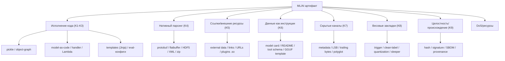

# 09. Анализ форматов ML/AI-моделей и данных: что ещё нужно проверять на безопасность

Статус: **основная часть проанализированных форматов реализована** (волны форматов 1–7:
model-as-code, Keras, ONNX, HDF5, GGUF, архивы, XXE/unsafe-YAML, токенизаторы, prompt-injection,
agent/MCP, ноутбуки, скрипты, MLflow, TF SavedModel, TFLite, CoreML, PMML, датасеты Parquet/Arrow,
TorchScript, wheel/`.pth`, нативные библиотеки, Jinja, HTML/SVG, Dockerfile, сжатые payload'ы,
JSONL/CSV, MessagePack, утечки секретов, дубликаты записей, tar-bomb). Цель документа — определить,
**какие ещё форматы** моделей и данных в ML/AI требуют анализа на безопасность, **какие закладки**
в них бывают и **что именно** надо проверять. Что реализовано — [`07-implemented-architecture.md`](./07-implemented-architecture.md),
план — [`10-plan-new-formats.md`](./10-plan-new-formats.md).

---

## 0. Резюме

1. Опасность формата определяется не расширением, а **тем, что делает загрузчик**:
   десериализация объектов, вызов пользовательского кода, загрузка нативных библиотек,
   исполнение шаблонов/скриптов, разрешение внешних ссылок.
2. Помимо pickle-класса (RCE при десериализации), существуют ещё **шесть** классов
   рисков: нативные парсеры (memory-corruption/DoS), данные/DoS, целостность/происхождение,
   prompt-injection как «данные», закладки в весах/токенизаторе/графе, закладки в
   runtime/serving.
3. Наибольшее внимание требуют: **model-as-code** (TorchServe `.mar`, MLflow, `trust_remote_code`,
   spaCy/Paddle wheels), **Keras Lambda/`config.json`**, **ONNX external data**, **HDF5 links/plugins**,
   **GGUF/Jinja chat-templates**, **tokenizer-артефакты**, **model/dataset cards как носители
   prompt-injection**, **agent/MCP-манифесты**.
4. Многие «безопасные» форматы (safetensors, GGUF, Arrow/Parquet) безопасны только в части
   *исполнения кода*; они остаются носителями DoS, стеганографии, целостностных атак и
   prompt-injection, а самый частый практический вектор — **подмена расширения/полиглот**
   (объявили `.safetensors`, а загрузчик вызвал pickle-путь).

---

## 1. Что значит «опасный формат» (критерии)

Формат считаем требующим анализа, если он обладает любым из свойств:

| # | Свойство | Следствие |
|---|----------|-----------|
| K1 | Десериализация исполняемых объектов (pickle/`__reduce__`, объектные графы) | RCE при загрузке |
| K2 | Ссылки на **код** (модули/классы/функции/хуки/плагины по имени или по пути) | RCE/импорт произвольного кода |
| K3 | **Пользовательский код внутри артефакта** (скрипты, handler'ы, шаблоны) | RCE по определению |
| K4 | **Нативный парсер/protobuf/fb** | memory-corruption, OOB, DoS |
| K5 | **Внешние ссылки/пути** (файлы, URL, плагины) | path traversal, SSRF, загрузка кода |
| K6 | **Данные как инструкции** (карточки, шаблоны, tool-схемы) | prompt-injection, обход guardrails |
| K7 | **Скрытые каналы** (метаданные, младшие биты, trailing-данные) | стеганография, smuggling |
| K8 | Возможность **весовых/алгоритмических закладок** | трояны, обход авторизации модели |
| K9 | Отсутствие **целостности/происхождения** | tampering, typosquatting |

---

## 2. Таксономия рисков (сводно)

---

## 3. Каталог форматов

### 3.1 Python-сериализация и расширения (базовый класс)

| Формат | Структура | Ключевые риски | Что проверять |
|--------|-----------|----------------|---------------|
| `.pkl/.pickle`, протоколы 0–5 | pickle VM | RCE (K1,K2), out-of-band buffers (P5) | opcodes, `find_class`, buffers, trailing |
| `joblib` (`.joblib`) | pickle + numpy/memmap | RCE, mmap-раскрытие/запись | pickle-члены, `mmap_mode`, пути |
| `dill`/`cloudpickle` | pickle + код/замыкания | RCE, сериализованный **код** | code-объекты, `co_code` |
| NumPy `.npy/.npz` с `allow_pickle` | массив/объектный массив | RCE через object-array; zip-бомба | `dtype=object`, вложенный pickle, размеры |
| pandas `.pkl`, `to_pickle` | pickle | RCE | как pickle |
| PyTorch `.pt/.pth/.bin/.ckpt` | zip + `data.pkl` / legacy pickle | RCE (в т.ч. обход `weights_only`) | `data.pkl`, `_rebuild_*`, storage |
| TorchScript `.pt` (архив) | zip + `code/` (TorchScript pickle) | RCE через unpickling кода | `code/*`, `constants.pkl` |
| `torch.package` (`.pt`) | zip + Python-модули | **RCE при импорте** (package loader) | `.py` в пакете, import hooks |
| PaddlePaddle `.pdparams` | pickle | RCE | как pickle |
| MXNet `.params` + `symbol.json` | бинарь + JSON | RCE (историч.), custom ops | pickle-части, `op` ссылки |
| Gensim `.model` (Word2Vec и др.) | pickle-подобный | RCE | pickle-члены |
| fastText `.bin` | собственный/редко pickle | parser, safe-ish | версия/структура |
| CatBoost `.cbm`, `.pkl` | CBM/JSON/pickle | pickle-вариант → RCE | формат и вложенный pickle |

### 3.2 Контейнеры весов и тензоров

| Формат | Структура | Риски | Что проверять |
|--------|-----------|-------|---------------|
| **SafeTensors** `.safetensors` | 8B длина + JSON-заголовок + буферы тензоров | «безопасен» только от исполнения: **DoS** (огромный заголовок/тензоры), **перекрытия/OOB** смещений, **trailing-данные**, **полиглоты/подмена расширения**, **стеганография** в `__metadata__`, unicode-ключи | размер заголовка, границы/перекрытия, trailing-байты, соответствие расширения сигнатуре, аномалии `__metadata__` |
| NumPy `.npy/.npz` | массив / zip | object-array→pickle; zip-бомба | см. 3.1 |
| HDF5 `.h5/.hdf5`, Keras `.h5` | иерархия групп/датасетов | **External/Soft/Virtual links** (доступ к внешним файлам/путям), **filter plugins** (загрузка `.so` по имени), object-датасеты (pickle), DoS | links (external/soft/virtual), filter pipeline, attrs, размеры |
| Keras `.keras` (v3) | zip: `config.json`, `metadata.json`, `model.weights.h5` | `class_name`/`build_config` → резолвинг классов; **Lambda** (см. ниже); произвольные метаданные | `class_name`, `Lambda`, `custom_objects`, `metadata` |
| `.ckpt`/`.ckpt-*` (JAX/Flax Orbax) | msgpack + numpy | реконструкция объектов/`ext` типов, custom `PyTree` | msgpack `ext`, зарегистрированные типы |
| `msgpack` модели | msgpack | реконструкция, parser | `ext`, глубина, размеры |

### 3.3 Model-as-code / serving bundles (**высокий риск, код по определению**)

| Формат | Структура | Риски |
|--------|-----------|-------|
| TorchServe **`.mar`** | zip: `MAR-INF/MANIFEST.json` + `*.py` handler | **RCE при serve** — handler/`model.py` исполняется |
| MLflow model | `MLmodel` + `python_model.pkl`/`python_function` | pickle + импорт `loader_module` (произвольный модуль) |
| KServe / Seldon `model.py` | Python | RCE |
| BentoML `bentofile`+`service.py` | Python | RCE |
| HF `trust_remote_code`, `auto_map` | репозиторные `modeling_*.py` | **RCE при `from_pretrained`** |
| spaCy/paddle/FastText модели как **pip-wheel** | wheel/sdist + `__init__.py`, hooks | RCE при `pip install` (особенно sdist/`build`) |
| Gradio/Streamlit/Space `app.py` | Python | RCE |
| `torch.hub` `hubconf.py` | Python | RCE при `torch.hub.load` |
| Dataset loading scripts (`datasets` legacy) | Python | RCE |

### 3.4 Графы / компилированные модели (native parse + custom ops)

| Формат | Структура | Риски | Что проверять |
|--------|-----------|-------|---------------|
| **ONNX** `.onnx` | protobuf | parser/OOB, **external data** (path traversal/URL), custom ops (`domain`), `FunctionProto`-раздувание, DoS | `external_data` (`location`, `offset/length`), custom-домены, `opset`, размеры, дубликаты |
| TF **SavedModel** | `saved_model.pb` + `variables/` + `assets/` | custom ops, `assets` (произвольные файлы), концерны TF1-hub кода | ops, `assets`, функции, ссылки |
| TF **GraphDef** `.pb/.pbtxt` | protobuf | parser, ops | ops, размеры |
| **TFLite/LiteRT** `.tflite` | flatbuffer | custom ops, **flex delegate** (исполнение TF-ops), DoS | `custom_code`, delegate libs, shapes |
| **TensorRT** `.engine/.plan` | проприетарный | **plugins `.so`** (RCE/загрузка библиотек) | plugin libs, версия |
| **OpenVINO IR** `.xml`+`.bin` | XML+бинарь | **XXE** (XML), custom layers `.so` | XML-сущности, extension libs |
| **CoreML** `.mlmodel/.mlpackage` | protobuf | custom layers (Swift runtime), парсер | `MLCustomLayer`, версии |
| **ExecuTorch** `.pte` | flatbuffer | custom ops/delegates `.so` | custom ops, delegates |
| Caffe `.caffemodel` (protobuf), Caffe2 `.pb` | protobuf | custom layer types | `type`, `layer` |
| PMML `.pmml` | XML | **XXE** | XML-сущности |
| TensorFlow.js `model.json`+`*.bin` | JSON+бинарь | custom JS-слои, загрузка по URL (SSRF) | `weightsManifest.paths`, custom layers |

### 3.5 Квантованные / edge-форматы

| Формат | Структура | Риски | Что проверять |
|--------|-----------|-------|---------------|
| **GGUF/GGML** `.gguf` | KV-метаданные + тензоры | **`chat_template` (Jinja) → SSTI** в ряде серверов; метаданные → **prompt-injection**; спец-токены; DoS; стеганография | `tokenizer.chat_template`, `tokenizer.ggml.*`, `general.*`, размеры |
| NCNN `.param`+`.bin` | текст+бинарь | custom layers/`.so` | layer types, custom libs |
| MNN/TNN | собственные | custom ops | — |

### 3.6 Данные и датасеты

| Формат | Риски | Что проверять |
|--------|-------|---------------|
| HuggingFace Datasets `.arrow`, Parquet/Feather | DoS, отравление данных (poisoning), «данные как инструкции»; parser | размеры/схемы, ненормальные вложения, инструкции в текстовых полях |
| WebDataset/`.tar` шарды | path traversal, symlink/hardlink, бомбы, polyglot | имена/типы членов, размеры |
| TFRecord | protobuf parser, DoS | размеры/схемы |
| Zarr | chunked-кодеки по имени (lookup codec/`numcodecs`) → потенциальная загрузка; object-dtype pickle; DoS | `codecs`, `dtype=object`, число чанков |
| Lance | формат-парсер, размеры | структура |
| `.jsonl`/`.csv`/`.txt` датасеты | **prompt-injection**, спец-токены, формулы (CSV injection `=cmd`), огромные поля | инструкции, control tokens, формулы, размеры |
| LMDB/LevelDB/embeddings-хранилища | parser, DoS, tampering | размеры/целостность |
| FAISS/Annoy/HNSW-индексы | parser/OOB, огромные индексы, crafted-математика | структура, размеры |

### 3.7 Токенайзеры и prompt-артефакты

| Артефакт | Риски | Что проверять |
|----------|-------|---------------|
| SentencePiece `.model` | protobuf parser; спец-токены | число токенов, спец-символы |
| HF `tokenizer.json` (fast) | `added_tokens`, `PostProcessor`, `normalizer` с regex/`Replace` (ReDoS), `template_handlebars` | переопределение спец-токенов, ReDoS-regex, шаблоны |
| `vocab.json`/`merges.txt` | крафтинг merge-правил, обход фильтров | аномальные пары/объёмы |
| `tokenizer_config.json`, `special_tokens_map.json` | **Jinja `chat_template` → SSTI**, переопределение ролей/маркеров | шаблон (Jinja), спец-токены |
| Списки стоп-слов/`config.json` промптов | обход safety, инъекции | инструкции |

### 3.8 Конфиги, метаданные, карточки

| Артефакт | Риски | Что проверять |
|----------|-------|---------------|
| `config.json`, `generation_config.json` | ссылки на код (`auto_map`), URL, `revision`; инъекции | `auto_map`, URL, поля-инструкции |
| `requirements.txt`, `conda.yaml`, `environment.yml` | dependency confusion, `--extra-index-url`, **unsafe YAML** (`!!python/object`) | источники, YAML-теги |
| `setup.py`/`pyproject.toml` | **код при установке** (sdist/build hooks) | hooks, команды |
| Model/Dataset **card** (README.md, `metadata`) | **prompt-injection в агентов**, XSS (HTML/SVG/<script>) | инструкции, HTML/JS, ссылки |
| `MLmodel`, `keras_metadata.pb` | ссылки на модули/классы | loader-поля |

### 3.9 Архивы и упаковки

| Формат | Риски |
|--------|-------|
| zip/tar/tgz | path traversal (`../`, абсолютные пути), symlink/hardlink, bomb, polyglot |
| wheel/sdist/deb/rpm | код при установке (`setup.py`, `pre/post-install`) |
| Docker/OCI-образы как «модель» | Dockerfile RUN/ENTRYPOINT = RCE; OCI-подписи/attestation |
| `.mar` | см. 3.3 |
| 7z/rar + «loader» | traversal/bomb |

### 3.10 Индексы/хранилища/embeddings

FAISS/Annoy/HNSW, SQLite/DuckDB, LMDB/LevelDB, векторные БД: parser/OOB, DoS, tampering,
в DuckDB — автозагрузка **extensions** (загрузка кода по имени/URL).

### 3.11 Agent/MCP/tooling-артефакты (новый класс)

| Артефакт | Риски |
|----------|-------|
| MCP-серверы, `mcp.json`, tool-манифесты | **tool description injection**, произвольные команды |
| OpenAPI/function schemas (`tools`) | описания как инъекции; параметры, ведущие к RCE у потребителя |
| System/developer prompts (`.txt/.json`) | инъекции, «sleeper»-промпты |
| LLM-выходы как код | агент/consumer исполняет вывод модели → RCE |

---

## 4. Закладки (backdoors) различных видов

### 4.1 Код-исполнение (execution backdoors)
- **Serialization-закладки:** pickle/`__reduce__`, object-graph, TorchScript-код, `torch.package` импорт, `dill/cloudpickle` код.
- **Ops/handlers:** custom ops, `.mar`/`model.py`, `Lambda` (в т.ч. **Keras Lambda с маршализованным байткодом** — исторический RCE), `custom_objects`, delegate/plugin `.so`.
- **Templates/eval:** Jinja `chat_template` (SSTI), unsafe YAML, `eval` в конфигах, ReDoS через regex в нормалайзерах.
- **Внешние ссылки:** `auto_map`/`trust_remote_code`, URL в конфигах, `external_data`, HDF5 links, plugin-загрузка по имени.

### 4.2 Весовые (нейронные) трояны
| Тип | Признак | Обнаружение |
|-----|---------|-------------|
| Trigger-backdoor (BadNets и аналоги) | резкая смена выхода только на триггере | триггер-скан, аномалии активаций, diff с референсом |
| Clean-label backdoor | яд без меток, скрыт в представлении | influence-анализ, robust-training-тесты |
| Adversarial-weight backdoor | «невидимые» возмущения весов | анализ распределений весов, спектр, sensitivity |
| Quantization-induced backdoor | активируется после квантования | сравнение FP/quant-выходов на триггерах |
| Sleeper agents (LLM) | отложенное поведение по дате/фразе | probing, red-team, длинные сценарии |
| Router/MoE backdoor | активация скрытого эксперта | анализ маршрутизации |
| Multi-trigger/stealth | редкие триггеры, имитация «нормы» | множественные триггеры, статтесты |

### 4.3 Токенайзер / граф / формат-уровень
- **Спец-токены/`added_tokens`:** переопределение `<|endoftext|>`/ролей → снятие ограничений.
- **Крафт merge-правил** BPE → скрытые «слова-триггеры».
- **Chat-template закладки:** скрытый system-блок, инъекция ролей.
- **Граф-уровень:** extra-пути (subgraph) в ONNX/TF, «мёртвые» ветки, активируемые триггером.
- **Формат-уровень:** object-array, external links, polyglot.

### 4.4 Стеганография / скрытые каналы
- Метаданные (`__metadata__`, GGUF KV, HDF5 attrs, safetensors padding, EXIF-подобное).
- Младшие биты мантисс, шум квантования, порядок тензоров.
- **Trailing-данные** после валидного формата (smuggling), **полиглоты**.
- Каналы через **tokenizer** (нераскрытые токены), через **сортировку/имена тензоров**.

### 4.5 «Данные как инструкции» (prompt-injection)
- **Model/Dataset cards** и README как носители инъекций для агентов, читающих каталоги.
- **GGUF/tokenizer `chat_template`** и промпты: скрытые инструкции/роли.
- **Tool/MCP-описания** и OpenAPI: инъекции в описаниях инструментов.
- **Данные датасетов** с инструкциями и control-токенами; CSV-формулы.
- **LLM-выход** как исполняемая инструкция (агент исполняет текст).

### 4.6 Supply-chain / целостность
- Подмена/typosquatting, компрометация аккаунта, dependency confusion.
- **Полиглоты/подмена расширения** (`.safetensors`, который реально pickle).
- Отсутствие подписи/provenance/SBOM; разъезд `format`-метаданных и содержимого.
- Подмена артефакта при доставке (hash/trailing-байты).

### 4.7 Runtime / serving
- Handler'ы и warmup-хуки, скачивание кода при старте.
- **Prompt-инъекции, выполняемые serving-стеком** (Jinja-шаблоны, output-фильтры).
- Логирование/утечки, отравление общего кэша/конфигов между инстансами.

### 4.8 GPU / kernel уровень
- Малициозные **PTX/cubin**, custom CUDA-плагины, TensorRT plugins.
- GPU-based payloads (исследовательский класс), side-channels.
- Эксплуатация **драйвера/рантайма** через crafted-модели (native parser → kernel).

---

## 5. Признаки (observables) и методы обнаружения

| Класс | Observables | Метод в MLScan |
|-------|-------------|----------------|
| K1/K2 (RCE) | опасные глобалы/opcodes, маршализованный код, `auto_map`, custom ops | L1 опкоды/allowlist (PoC уже есть); добавить парсеры форматов |
| K3 (model-as-code) | `.py`/handler/`Lambda` в артефакте | статический AST-скан + Sandbox (L2) c сетевым запретом |
| K4 (native) | malformed structures, глубина, размеры | fuzzing-подобные проверки в sandbox, лимиты |
| K5 (ссылки) | external data/links/URLs/plugins | статический разбор ссылок + sandbox-наблюдение за FS/сетью |
| K6 (инъекции) | инструкции в card/template/tool-schema | текстовые эвристики + LLM-ассистент-детектор (осторожно) |
| K7 (стего) | trailing-байты, аномалии метаданных/битов | бинарный diff-анализ, энтропия, сверка `format` |
| K8 (веса) | аномалии выхода на триггерах | поведенческие probe (L3), diff с референсом |
| K9 (целостность) | hash/signature/SBOM | L0 (уже реализовано) + подпись образов/cosign |

Принцип остаётся: **не исполнять в доверенной зоне**, «не доказано — не безопасно»,
эшелонирование статика → sandbox → поведение, доказательства и вердикт.

---

## 6. Матрица «формат × класс риска» (сокращённо)

| Формат | K1 | K2 | K3 | K4 | K5 | K6 | K7 | K8 | K9 |
|--------|----|----|----|----|----|----|----|----|----|
| pickle/`.pt` | ● | ● | ○ | ○ | ○ | ○ | ● | ○ | ● |
| safetensors | ○ | ○ | ○ | ● | ○ | ○ | ● | ● | ● |
| HDF5/`.h5` | ● | ● | ○ | ● | ● | ○ | ● | ○ | ● |
| Keras `.keras`/`.h5` | ● | ● | ● | ● | ○ | ○ | ○ | ○ | ● |
| ONNX | ○ | ● | ○ | ● | ● | ○ | ● | ● | ● |
| TFLite/TensorRT/OpenVINO | ○ | ● | ○ | ● | ● | ○ | ○ | ○ | ● |
| GGUF/GGML | ○ | ○ | ○ | ● | ○ | ● | ● | ● | ● |
| SavedModel | ○ | ● | ○ | ● | ● | ○ | ○ | ● | ● |
| `.mar`/`.py`/MLflow | ● | ● | ● | ○ | ● | ○ | ○ | ○ | ● |
| tokenizer-артефакты | ○ | ○ | ○ | ● | ○ | ● | ● | ● | ● |
| datasets (arrow/parquet/tar) | ○ | ○ | ○ | ● | ● | ● | ● | ● | ● |
| model/dataset card | ○ | ○ | ○ | ○ | ● | ● | ○ | ○ | ○ |
| MCP/tool-манифесты | ○ | ● | ● | ○ | ● | ● | ○ | ○ | ○ |

● — основной риск, ○ — второстепенный/возможный.

---

## 7. Приоритизация расширения MLScan

**Волна 1 (код-исполнение, максимальный эффект/риск):**
1. **model-as-code**: `.mar`, `model.py`, MLflow `python_function`, `trust_remote_code`/`auto_map`,
   `torch.package`, `hubconf.py` — статический AST-скан + sandbox.
2. **Keras/SavedModel**: `Lambda` (в т.ч. маршализованный код), `custom_objects`, `class_name`.
3. **ONNX external data / custom ops** и **HDF5 external links / filter plugins**.
4. **Jinja `chat_template` (tokenizer/GGUF)** — SSTI-скан.

**Волна 2 (native/данные/целостность):**
5. Парсеры-риски: ONNX/TFLite/TFRecord/HDF5/XML(XXE)/zip-tar — size/depth/OOB-проверки, fuzzing.
6. **SafeTensors/GGUF**: trailing-байты, границы, полиглоты, `format`-мисматч, стего-метаданные.
7. **Архивы/упаковки**: traversal/symlink/bomb/wheel-hooks.

**Волна 3 (поведение/закладки/agent):**
8. **Весовые трояны**: обобщить probe (триггеры, quant-сравнение, мощные diff-наборы).
9. **Tokenzier/спец-токены** и **prompt-injection**-скан (cards/tools/MCP).
10. **GPU/kernel**: PTX/cubin/plugins (по возможности).

Для каждой волны: правило/детектор (L1) → sandbox-прогон (L2) → поведенческий тест (L3) →
сенсор/метрики (Этап 5), с публикацией правил и обновлением чеклиста/матрицы рисков.

---

## 8. Ограничения и открытые вопросы

- **Native-парсеры** (protobuf/flatbuffer/HDF5/XML/zip) требуют fuzzing/санитайзеров —
  вне чистой статики; нужен аккуратный sandbox и лимиты.
- **Весовые закладки** принципиально неполно детектируемы; нужен риск-подход и референсы.
- **prompt-injection** — не бинарная уязвимость; детекция эвристична (риск ложных срабатываний).
- **model-as-code** нельзя «обезвредить» одним allowlist — только изоляция + ревью.
- **Стеганография/полиглоты** требуют бинарной нормализации и свёрки реального формата.
- Юридически/политически: анализ чужих карточек/данных может затрагивать лицензии и PII.

## 9. Что предлагается сделать далее в репозитории

Дорожная карта с задачами, критериями и волнами — в [`10-plan-new-formats.md`](./10-plan-new-formats.md).

- Расширить `docs/01-threat-checklist.md` новыми категориями (форматы, закладки, agent).
- Добавить в MLScan **адаптеры форматов** (статический разбор + выбор профиля sandbox)
  и **правила** для волн 1–2; **probe-наборы** для волны 3.
- Обновить `docs/02` (стратегия), `docs/04` (скоринг/policy для новых чек-идов),
  `docs/05`/`07` (архитектура: адаптеры, профили).
