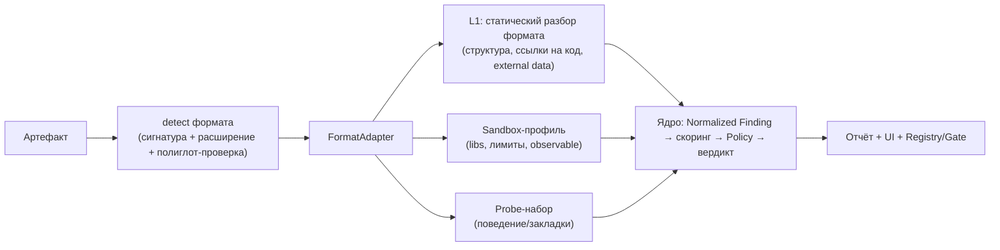
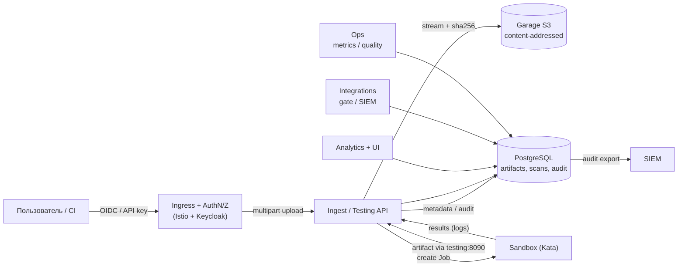

# 10. План доработок: расширение MLScan на новые форматы ML/AI

Дорожная карта развития MLScan за пределы pickle. Основание — анализ форматов и закладок в
[`09-formats-and-backdoors-analysis.md`](./09-formats-and-backdoors-analysis.md).
Предыдущий план (Этапы 0–5) — [`06-implementation-plan.md`](./06-implementation-plan.md) —
**реализован** (см. отметку в нём).

Статус: предлагаемый план (черновик для согласования).

---

## 1. Принцип расширения: формат-агностичное ядро + адаптеры

Ядро MLScan (три компоненты, уровни L0–L4, единый контракт находок, скоринг, Policy Engine,
evidence, отчёты, UI) **не меняется**. Расширение на новый формат = добавление
**адаптера формата** и **пакета правил/проб**, зарегистрированных в ядре.



**Интерфейс адаптера (предлагаемый):**
```
FormatAdapter:
  name, extensions[], magic_signatures[]
  detect(bytes) -> {format, confidence, mismatches[]}
  integrity(bytes) -> findings[]      # формат-мисматч, trailing, полиглоты, размеры
  static_scan(bytes) -> findings[]    # структура, ссылки на код/данные, external refs
  sandbox_profile() -> {image, env, limits, observable[]}
  probes(ctx) -> results[]            # поведенческие/backdoor-тесты
  report_section() -> html/md
```

---

## 2. Архитектурные доработки (сквозные, до волн)

| # | Доработка | Компонента | Результат |
|---|-----------|-----------|-----------|
| A1 | `adapters/` — реестр и API адаптеров форматов | testing/static | добавление форматов без правки ядра |
| A2 | Расширение **L0**: определение реального формата, формат-мисматч, полиглоты, trailing-байты, границы/OOB | testing (L0) | детект подмены расширения и smuggling |
| A3 | **Профили sandbox**: набор образов (torch/numpy; onnx/h5py; tf/keras; gguf-раннер) и лимиты под формат | sandbox (L2) | исполнение payload'ов разных стеков |
| A4 | **Пакеты правил** (rule packs) по категориям и версионирование | analytics/static | управляемые детекторы + версии в evidence |
| A5 | **Новые чек-иды и категории** (см. §6) и обновление Policy | docs/04, analytics | вердикты по новым рискам |
| A6 | **Probe-библиотеки** (закладки, токенизаторы, prompt-injection) | testing (L3) | поведенческие проверки |
| A7 | **UI**: тип формата, использованный адаптер, доказательства по формату | analytics UI | прозрачность проверки |
| A8 | **Метрики качества** по форматам (TPR/TPR/FPR, покрытие чеклиста) | ops | контроль расширения |
| A9 | **Тестовые корпуса** (safe/evil) по каждому формату | repo, ops | регресс детекторов |

### 2.1 Большие модели: S3-хранилище вместо PVC

**Проблема.** Текущий транспорт хранит артефакт на PVC (`mlscan-artifacts`, 20Gi) и в `/tmp`
пода. Модели могут быть **десятки–сотни ГБ**, а PVC ограничен узлом и не масштабируется.

**Решение.** Ввести **S3-совместимое объектное хранилище** и убрать артефакты с PVC.

- Использовать **S3-совместимое хранилище** (например, **Garage** или **MinIO**). Вариант —
  выделенный инстанс/бакет для MLScan либо отдельный бакет на уже имеющемся хранилище
  (по согласованию с владельцем).
- **Content-addressed ключи:** `s3://mlscan-artifacts/<sha256>/<filename>` → дедупликация,
  иммутабельность, воспроизводимость (один объект = один отпечаток).
- **Потоковая multipart-загрузка** (chunk 64–256 МиБ) с вычислением SHA-256 «на лету»;
  лимит объекта конфигурируемый (например, до 100 ГиБ), квоты на пользователя/тенант.
- **Доставка в песочницу:** Testing Service берёт объект из S3 по внутренним кредам и отдаёт
  в Job по уже существующему токенизированному URL `:8090` → **сетевой доступ песочницы не
  расширяется** (остаётся `sandbox → testing:8090`). Presigned-URL напрямую в Garage —
  альтернатива, но требует нового egress-разрешения.
- **Retention/жизненный цикл:** TTL, soft-delete, refcount по `sha256` (удаление только при
  отсутствии ссылок), очистка «осиротевших» объектов.
- **Надёжность:** Garage RF (на single-node RF=1); для HA — 3+ узла/OpenEBS/Rook (addon'ы
  доступны), бэкап в внешний S3; шифрование диска/бакета.
- PVC остаётся только для эфемерных/служебных данных (или полностью заменяется БД).

### 2.2 СУБД вместо JSON/JSONL: PostgreSQL (CloudNativePG)

**Проблема.** Сейчас состояние — файлы на PVC (`scans/*.json`, `evidence.jsonl`,
`registry.json`) с in-memory индексом и одним писателем. Нет запросов, транзакций,
ретенции и надёжной истории.

**Решение.** Перейти на **PostgreSQL** (addon `cloudnative-pg` доступен; для теста — 1 инстанс,
для HA — 3).

Предлагаемая схема (ключевое):

| Таблица | Назначение |
|---------|-----------|
| `artifacts` | `sha256` (unique), `blake3`, `size`, `format`, `filename`, `s3_key`, `source`, `uploader_id`, `created_at`, `metadata jsonb` |
| `artifact_fingerprints` | отпечатки: `sha256/blake3/sha512`, «модельный» fingerprint (shape/dtype/статистика тензоров), токенизаторный fingerprint |
| `scans` | `artifact_id`, `status/stage/progress`, `adapter`, `toolchain_version`, `verdict`, `risk_score`, `policy_id`, `reason`, тайминги |
| `findings` | нормализованные находки (level, check_id, category, severity, confidence, evidence `jsonb`) |
| `evidence` | append-only `{prev_hash, hash, payload}` — hash-chain переносится в БД |
| `policies` / `decisions` | версии политик и решения (auto/human) с обоснованием |
| `users` / `api_keys` | субъекты, роли, ключи CI (hash, scopes, expiry) |
| `uploads` | журнал загрузок: `artifact_id`, `user_id`, `request_id`, `ip`, `user_agent`, байты, статус |
| `connections` | журнал подключений: `user_id`, `request_id`, `ip`, `user_agent`, `path`, `method`, `status`, `ts` |
| `audit_log` | append-only журнал действий (см. §2.3) с hash-chain |

- **«Слепки/отпечатки» моделей** — это `sha256` + `blake3` (быстрый), опционально `sha512`,
  плюс **структурный fingerprint** (формы/dtype/статистика тензоров, хэш токенизатора) для
  поиска вариантов/пересжатий одной модели и дедупликации.
- **Миграция:** one-time importer JSON/JSONL → БД; период dual-write; JSON-экспорт сохраняется.
- **Доступ:** DSN в Secret, отдельные роли writer/reader, пул соединений; evidence-таблица —
  append-only (триггеры, запрет UPDATE/DELETE).
- **Преимущества:** запросы/фильтры/агрегаты, транзакции, история версий, ретенция,
  корреляция upload → scan → findings → decision.

### 2.3 Аутентификация на входе и журнал загрузок/проверок

**Проблема.** Сейчас UI/API без аутентификации; журналы — файловые и не связаны между собой.

**Решение.**

- **OIDC через Keycloak** (в кластере уже есть) + **Istio RequestAuthentication /
  AuthorizationPolicy** на Ingress; для CI — клиентские ключи/`client_credentials` (JWT) или
  API-ключи, валидируемые на входе. Браузерный вход — Keycloak login (при необходимости
  `oauth2-proxy`).
- **RBAC-роли:** `admin`, `analyst`, `uploader`, `ci-reader`; авторизация по маршрутам
  (загрузка, просмотр, ручные решения, политики).
- **Сквозной correlation-id:** `X-Request-ID` генерируется на входе, передаётся между
  сервисами (и `traceparent`); сохраняется в `connections`, `uploads`, `scans`, `audit_log` —
  так загрузка, проверка и результат связываются в один след.
- **Журнал (audit):** аутентификация/подключения, загрузки (sha256, размер, IP, User-Agent,
 идентификация пользователя), запуск проверок, стадии/результаты, вердикты, изменения политик, ручные
  переопределения, скачивание отчётов.
- **Целостность журнала:** append-only + hash-chain, ретенция; экспорт в SIEM через уже
  существующий `/export/cef` и `/events`.
- **Секреты/PII:** Keycloak-секреты в k8s Secret, редакция PII в логах, минимизация.

### 2.4 Целевая схема (с S3, БД, аутентификацией)



### 2.5 Волна 0 — инфраструктурные доработки (предусловие)

| Задача | Результат | Критерий готовности |
|--------|-----------|---------------------|
| I1. S3 (Garage) | бакет `mlscan-artifacts`, content-addressed, multipart, dedup | загрузка файла ≥ 50 ГБ (или лимита) без PVC; sha256/размер в БД |
| I2. PostgreSQL (CloudNativePG) | схема §2.2, миграция, dual-write | upload→scan→findings→decision в БД; JSON-экспорт сохраняется |
| I3. AuthN/Z + audit | Keycloak OIDC + Istio + RBAC; журнал с correlation-id | вход по OIDC; в журнале есть пользователь, IP/UA, sha256, результат |
| I4. Наблюдаемость хранилищ | метрики S3/БД, алерты, бэкап | дашборд/алерты; проверка восстановления |

**Статус:** I1 — ✅ выполнено (`deploy/v2`: Garage S3, Ingest Gateway, content-addressed, дедуп; проверено 1 ГиБ). I1b — ✅ сервис тестирования переведён на S3 (`:8090` отдаёт из S3; проверено evil0 и 512 МиБ). I2 — ✅ развёрнут PostgreSQL (12 таблиц, append-only); ✅ stdlib-клиент (SCRAM); ✅ сервис тестирования и ✅ аналитический движок пишут в БД (artifacts/fingerprints/scans/findings/evidence hash-chain). I3–I4 — запланированы.

Целевая схема и детали (загрузка/передача/анализ/жизненный цикл больших файлов) — в
`11-target-architecture-v2.md`. Волна 0 выполняется **до/параллельно** волнам 1–3: она снимает ограничения по размеру,
обеспечивает хранение отпечатков и аудит, на которые опираются остальные проверки.


---

## 3. Волна 1 — Код-исполнение (наибольший риск)

**Цель:** закрыть форматы, где загрузка = исполнение чужого кода.

| Задача | Форматы | Метод | Критерий готовности |
|--------|---------|-------|---------------------|
| 1.1 model-as-code | `.mar`, `model.py`, MLflow, `hubconf.py`, `torch.package`, `trust_remote_code`/`auto_map` | статический AST-скан + sandbox-прогон с сетевым запретом | находки `EXEC-01` в отчёте; sandbox фиксирует запуск кода |
| 1.2 Keras/SavedModel | `.keras`, `.h5`, SavedModel | разбор `config.json`/`Lambda`/`custom_objects`/`assets` | детект `Lambda` (в т.ч. маршализованный код) |
| 1.3 ONNX | `.onnx` | external data, custom ops/домены, `FunctionProto`, размеры | детект `external_data` и custom-домена |
| 1.4 HDF5 | `.h5/.hdf5` | external/soft/virtual links, filter plugins, object-датасеты | детект ссылок и фильтров |
| 1.5 Шаблоны | tokenizer/GGUF `chat_template` | SSTI-скан Jinja | детект опасных выражений шаблона |

## 4. Волна 2 — Нативные парсеры, данные, целостность

| Задача | Форматы | Метод | Критерий |
|--------|---------|-------|----------|
| 2.1 Нативный парсинг | ONNX/TFLite/TFRecord/HDF5/XML/zip/tar | size/depth/OOB, fuzzing-подобные прогоны под лимитами | отказ/находка на malformed; без падения платформы |
| 2.2 SafeTensors/GGUF | `.safetensors`, `.gguf` | границы/перекрытия, trailing, полиглот, `format`-мисматч, стего-метаданные | детект аномалий `FMT-02` |
| 2.3 Архивы/упаковки | zip/tar/wheel/deb/OCI | traversal/symlink/bomb, install-hooks | детект `FMT-05` |
| 2.4 XXE/unsafe | OpenVINO `.xml`, PMML, YAML-конфиги | XML-сущности, `!!python/object` | детект `FMT-06` |
| 2.5 Целостность | все | подпись/SBOM/attestation артефакта и образа | `INT-*` в вердикте |

## 5. Волна 3 — Поведение, закладки, agent

| Задача | Объект | Метод | Критерий |
|--------|--------|-------|----------|
| 3.1 Весовые трояны | веса моделей | триггер-скан, аномалии активаций, diff с референсом, quant-сравнение | детект `BD-01` на тестовом корпусе |
| 3.2 Токенизаторы | `tokenizer.json`, `vocab/merges`, спец-токены | переопределения, крафт merge, ReDoS-regex | детект `BD-02` |
| 3.3 Prompt-injection | model/dataset cards, tool/MCP-схемы, GGUF-шаблоны | эвристики + LLM-ассистент-детектор | детект `INJ-*`; отчёт с доказательствами |
| 3.4 Steganography | метаданные/биты/trailing | бинарный diff, энтропия, сверка формата | детект `STEG-*` |
| 3.5 Agent/MCP | манифесты, tool-схемы | статика + sandbox | детект `AGT-*` |

---

## 6. Новые категории и чек-иды (предложение)

| Префикс | Категория | Примеры |
|---------|-----------|---------|
| `FMT-*` | Формат/парсинг | mismatch, trailing, polyglot, traversal, XXE, DoS |
| `EXEC-*` | Исполнение кода | handler/Lambda/custom op/external ref |
| `BD-*` | Закладки | весовые трояны, токенизатор/граф, спец-токены |
| `STEG-*` | Скрытые каналы | metadata/LSB/trailing |
| `INJ-*` | Данные как инструкции | cards/templates/tool-схемы |
| `INT-*` | Целостность/SC | подпись, SBOM, provenance |

Каждому чек-иду — severity/confidence, правило (rule pack) и, где возможно, probe.

---

## 7. Definition of Done для нового формата

1. Есть **адаптер** (detect/integrity/static/profile/probes) и он зарегистрирован.
2. Есть **тестовый корпус** (safe + evil) и регресс в CI.
3. **Правила** и **чанк отчёта**; обновлены чеклист (docs/01) и policy (docs/04).
4. Прогон в sandbox с профилем и наблюдаемостью; доказательства собираются.
5. Есть **UI-отображение** (тип/адаптер/доказательства).
6. Метрики качества по формату (TPR/FPR) измерены на корпусе.
7. Документация обновлена (docs/02, docs/05/07, test-guide).
8. Артефакт хранится в **S3** (content-addressed), отпечатки/результаты — в **PostgreSQL**.
9. Загрузка → проверка → решение связаны **correlation-id** и записаны в **audit-журнал**
   вместе с субъектом (пользователь/сервис), IP/UA и результатом.

---

## 8. Матрица «формат → волна»

| Формат | Волна |
|--------|-------|
| `.mar`/`model.py`/MLflow/`auto_map`/`torch.package` | 1 |
| Keras `.keras`/`.h5`, SavedModel | 1 |
| ONNX, HDF5 | 1 |
| GGUF/tokenizer templates | 1, 3 |
| SafeTensors, TFLite, TensorRT, OpenVINO, CoreML | 2 |
| zip/tar/wheel/deb/OCI, XML/PMML/YAML | 2 |
| Arrow/Parquet/WebDataset/Zarr/TFRecord | 2, 3 |
| веса (трояны), токенизаторы | 3 |
| model/dataset cards, MCP/tool-схемы | 3 |

---

## 9. Оценки, зависимости, риски

- **Зависимости:** образы sandbox под стеки (torch/onnx/tf/gguf), библиотеки-парсеры в
  изолированных образах, корпуса данных; см. `deploy/sandbox-image/`.
  Инфраструктура: **S3-совместимое хранилище** (Garage/MinIO) — выделенное или существующее;
  **PostgreSQL** (напр., через оператор CloudNativePG); **OIDC-провайдер** (напр., Keycloak)
  + Istio AuthN/Z.
- **Риски:** native-парсеры (нужен fuzzing/лимиты), ложные срабатывания prompt-injection,
  принципиальная неполнота детекции весовых троянов, ресурсоёмкость больших моделей.
- **Приоритет:** Волна 0 (S3/БД/Auth+audit) — предусловие → Волна 1 (код-исполнение) →
  Волна 2 (native/целостность) → Волна 3 (поведение/agent). Внутри волны — от «дешёвых и
  точных» правил к дорогим probe-наборам.
- **Риски инфраструктуры:** single-node Garage (RF=1) и PostgreSQL без HA — репликация/бэкап;
  миграция JSON→БД (dual-write, сверка); rollout аутентификации (не сломать CI — API-ключи);
  рост объёмов и стоимость хранения (ретенция/дедуп).

---

## 10. Связанные документы

- `11-target-architecture-v2.md` — **целевая архитектура v2** (большие модели, S3/БД, скорость).

- `09-formats-and-backdoors-analysis.md` — анализ форматов и закладок (источник задач).
- `06-implementation-plan.md` — реализованный план (Этапы 0–5), отметка о завершении.
- `01-threat-checklist.md`, `02-testing-strategy.md`, `04-risk-analysis-decision.md`,
  `05-architecture.md`, `07-implemented-architecture.md`.
