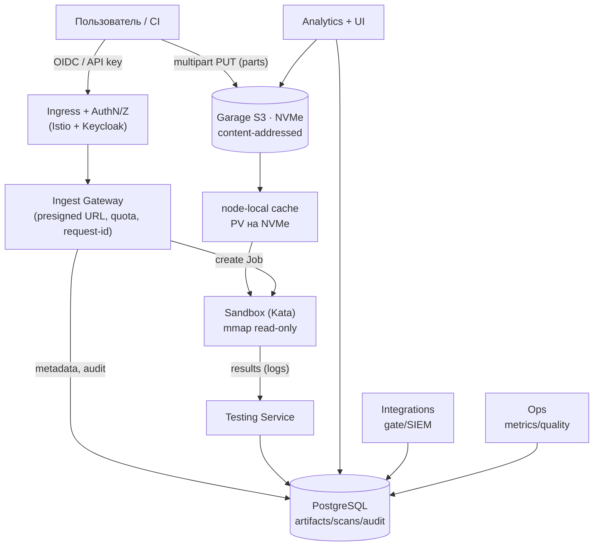
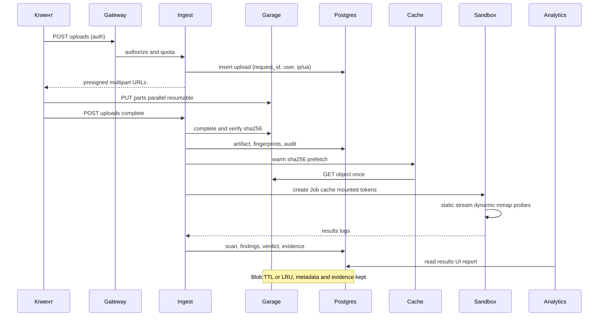

# 11. Целевая архитектура MLScan v2 (новые форматы, очень большие модели)

Описание целевой архитектуры новой версии системы, развивающей текущую MLScan (см.
[`07-implemented-architecture.md`](./07-implemented-architecture.md)) на другие форматы ML/AI и на
**очень большие модели**. План разработки — [`10-plan-new-formats.md`](./10-plan-new-formats.md),
анализ форматов — [`09-formats-and-backdoors-analysis.md`](./09-formats-and-backdoors-analysis.md).

Статус: проектный документ (to-be).

---

## 1. Цели и НФТ

| НФТ | Значение |
|-----|----------|
| Размер модели | до **1,5 ТБ** и более (пошагово), без буферизации в память |
| Приём | прямой **multipart**-аплоад в объектное хранилище, параллельные части |
| Передача на анализ | без сетевого копирования «через сервис», по возможности **mmap с NVMe** |
| Анализ | статика — потоково (один проход), динамика — mmap, поведение — ограниченные probe |
| Идемпотентность | контент-адресация по `sha256` → **повторная загрузка мгновенна**, повторный скан по хэшу пропускается |
| Наблюдаемость/аудит | журнал загрузок/проверок, correlation-id, сохранение отпечатков и результатов |
| Изоляция | микро-ВМ Kata, egress только к хранилищу/артефакт-серверу |
| Ретенция | метаданные/отпечатки/evidence — постоянно; большие блобы — TTL + карантин |

---

## 2. Доступная ёмкость (найденное место)

| Устройство | Точка | Размер | Свободно | Комментарий |
|-----------|-------|--------|----------|-------------|
| `/dev/nvme0n1p1` (NVMe) | `/kuber` | 1,9 ТБ | **≈1,5 ТБ** | **сюда** ложатся PV обоих StorageClass |
| `/dev/sda2` (SSD) | `/` | 218 ГБ | ≈42 ГБ | здесь `/var/snap/microk8s/.../kubelet` → `emptyDir`/`/tmp` подов |

Ключевые выводы:
- **`microk8s-hostpath` (default)**: PV размещаются в `/var/snap/microk8s/common/default-storage`,
  а это **bind-mount того же NVMe (`/kuber`)** → PVC уже на быстром диске.
- **`ssd-hostpath`**: параметр `pvDir=/kuber` → PV прямо на NVMe.
- **Критично:** `emptyDir`/`/tmp` подов живут на `/` (всего 42 ГБ) — **нельзя** складывать большие
  модели в `/tmp` пода. Нужен **NVMe-том** (PVC) и отказ от промежуточных копий.

**Предлагаемое распределение NVMe (~1,5 ТБ свободно):**

| Том | StorageClass | Размер | Назначение |
|-----|--------------|--------|-----------|
| `garage-data` | `ssd-hostpath` | ~1,1 ТиБ | объектное хранилище моделей (content-addressed) |
| `mlscan-cache` | `ssd-hostpath` | ~300 ГиБ | node-local кэш «горячих» моделей для mmap |
| резерв | — | ~100 ГиБ | запас/БД/служебное |

---

## 3. Компонентная схема (v2)

---

## 4. Загрузка (максимально быстрая)

**Схема «direct-to-S3» (рекомендуемая).** Сервис не участвует в передаче байтов — только
выдаёт разрешения и фиксирует метаданные:

1. **`POST /uploads`** (AuthN/Z) → сервис вычисляет/принимает намерение, проверяет квоты и
   выдаёт **presigned multipart URL** на объект `s3://mlscan-artifacts/<sha256>/<filename>`
   и `upload_id`; в БД пишется запись `uploads` c `request_id`, `user_id`, IP/UA.
2. Клиент/CI грузит **параллельными частями** (8–32 потока, часть 64–256 МиБ) прямо в Garage.
   Для очень больших каналов — `s3`-клиент с конкурентностью и авто-ретраями (resumable).
3. **`POST /uploads/{id}/complete`** → сервис завершает multipart, сверяет `sha256`/размер,
   получает «отпечатки» (`sha256`, `blake3`, размер, формат) и создаёт `artifacts`-запись.
4. **Дедупликация:** если `sha256` уже существует — загрузка **не нужна**: сервис отвечает
   «объект есть, скан №…», клиент не тратит трафик.

**Почему быстро:**
- Гараж и клиент по возможности в одной быстрой сети/на одном узле; при аплоаде извне —
  TLS-терминирование на входе, параллельные части, отсутствие узкого места «через сервис».
- Контрольные суммы считаются **на лету** (клиентом или при `complete` — один проход по NVMe,
  а не двойное чтение).
- Контент-адресация + дедуп убирают повторные загрузки.

**Если direct-to-S3 невозможен** (жёсткие политики сети): резервный режим — **proxy-streaming**
через Ingest (chunked, без буферизации), с той же content-addressed схемой; в этом случае
аплоад ограничен пропускной способностью сервиса (документируется как fallback).

---

## 5. Передача на анализ (без копирования)

**Проблема:** `emptyDir`/`/tmp` пода на `/` (42 ГБ) — не подходит для больших моделей, а
`hostPath` запрещён политикой `restricted`.

**Решение — node-local кэш на NVMe + read-only монтирование в Kata:**

1. **`mlscan-cache` (PVC, `ssd-hostpath`, NVMe)** — общий узел-локальный кэш, монтируется
   **read-only** в sandbox-Job по пути `/model`.
2. **Cache Daemon (`mlscan-cache` DaemonSet)** следит за очередью и **пре-фетчит** объект из
   Garage в кэш по `sha256` (однократно, идемпотентно), проверяя целостность по хэшу.
3. Sandbox-Job стартует только когда объект в кэше; **в гостя файл не копируется** — читается
   через volume **по mmap** (virtio-fs/9p), без промежуточного `/tmp`.
4. **Альтернатива без кэша:** пресигнованный GET из Garage. Тогда в NetworkPolicy добавляется
   **единственное разрешение** `sandbox → garage:3900`; иначе сохраняем текущую модель
   (Testing Service отдаёт артефакт по токену `:8090`).

**Почему быстро:** нет копирования «Garage → pod tmp → guest»; чтение идёт прямо с NVMe;
повторные сканы того же `sha256` берут файл из кэша без сети.

---

## 6. Анализ (оптимизация под размер)

- **L0 (приёмка):** `sha256/blake3`, реальный формат, формат-мисматч, границы — по метаданным
  и сигнатурам, **без полного чтения** (выборочные чтения заголовков).
- **L1 (статика) — потоково:** pickle-опкоды и структура читаются **одним проходом** по
  mmap-региону, без материализации объектов; для zip/`data.pkl` — по индексу zip.
- **L2 (динамика) — mmap:** `safetensors`/`torch.load(weights_only=True, mmap=True)` — страницы
  подгружаются лениво; жёсткие лимиты RAM; при превышении — переход в «анализ по частям».
- **L3 (поведение) — выборочно:** для очень больших моделей probe применяются к срезу/выборке
  (напр., подграфу/подмножеству блоков), если полный прогон не укладывается в бюджет.
- **Fast-path:** при критической статической находке (RCE-конструкция) вердикт может выдаваться
  **до полной динамики** (настраиваемо), с отметкой «динамика не завершена» в отчёте.
- **Повторное использование:** если `sha256` уже проходил проверку под **той же версией правил**
  — результат берётся из БД **мгновенно** (со ссылкой на прежний evidence), полный прогон не
  выполняется; иначе — целенаправленная перепроверка.
- **Параллелизм:** статические шарды (архивы/части) — параллельно; загрузка отдельных тензоров
  (safetensors) — параллельно через mmap.
- **Бюджеты времени/ресурсов:** таймауты по уровням, лимиты CPU/RAM/IO; прерывание и вердикт
  `Inconclusive` при невозможности завершить (не «Safe»).

---

## 7. Что происходит с очень большими файлами после анализа

**Принцип:** «тяжёлый блоб» — временный, «лёгкие следы» — постоянные.

| Артефакт | Где | Срок | Комментарий |
|----------|-----|------|-------------|
| Блоб модели | Garage (NVMe) | по TTL (напр. 90 дней) / до достижения квоты | content-addressed, дедуп по `sha256` |
| «Горячая» копия | `mlscan-cache` (NVMe) | LRU (напр. 7–30 дней) | ускоряет повторные проверки/probe |
| Метаданные, отпечатки, findings, evidence, аудит | PostgreSQL | **постоянно** | «слепки» моделей и результаты |
| Отчёты | аналитика (JSON/MD/SARIF) | постоянно (малые) | ссылки на `sha256` |
| Malicious/карантин | Garage (+ object-lock/WORM) | продлённый/по решению | для форензики/юридических нужд |

- **Ссылочная модель:** блоб удаляется, когда `refcount=0` и истёк TTL; в БД остаётся
  **tombstone** (`deleted_at`, причина) — аудит и история сохраняются.
- **Восстановление:** при необходимости блоб повторно достаётся из источника по `sha256`
  (или из внешнего бэкапа/cold-тира).
- **Тиринг:** NVMe cache (hot) → Garage (warm) → внешний S3/холод (cold) → purge.
- **Дедуп:** одна модель = один блоб; несколько проверок/версий правил — несколько
  `scans`-записей, один блоб.
- **Квоты и admission:** приём блокируется/предупреждает при заполнении NVMe выше порога
  (напр. 90 %), с политикой вытеснения LRU/TTL.

---

## 8. Сквозной поток (большая модель)

---

## 9. Оптимизации скорости (сводно)

| Область | Оптимизация | Эффект |
|---------|-------------|--------|
| Аплоад | direct-to-S3 + multipart (8–32 части) | упор в сеть/диск, а не в сервис |
| Аплоад | content-addressed + дедуп | повторная загрузка = 0 байт |
| Аплоад | checksum «на лету» на `complete` | без двойного чтения |
| Передача | node-local NVMe cache + RO-mount | нет копий Garage→pod→guest |
| Анализ | mmap (`safetensors`, `weights_only`) | ленивые страницы, меньше RAM |
| Анализ | потоковая статика (один проход) | O(n) чтение, без материализации |
| Анализ | пропуск повторного скана по `sha256`+версии правил | мгновенный результат |
| Анализ | fast-path на критичной статике | ранний вердикт |
| Хранилище | NVMe (не `/`), лимиты/квоты | нет OOM/переполнения `/` |
| Инфра | warm images, лимиты, приоритеты | предсказуемая latency |

---

## 10. Безопасность и изоляция (для больших файлов)

- **Egress песочницы:** либо только `sandbox → testing:8090` (артефакт через сервис), либо
  **единственное** дополнительное разрешение `sandbox → garage:3900` (presigned GET). Иных
  egress нет (default-deny сохраняется).
- **Аутентификация на входе** (OIDC/API-ключи) + **журнал**: подключения, загрузки (sha256,
  размер, IP/UA, пользователь), стадии/результаты, вердикты, изменения политик — append-only
  hash-chain + экспорт в SIEM.
- **DoS-ограничения:** лимит размера объекта, квоты на пользователя/тенант, rate-limit на
  gateway, таймауты скана, ограничение параллельных загрузок; прерывание при переполнении.
- **Целостность:** сверка `sha256`; иммутабельность блобов; object-lock для карантина; подпись
  образов/артефактов (cosign) и SBOM.

---

## 11. Миграция и фазы

Соответствует **Волне 0** плана ([`10-plan-new-formats.md`](./10-plan-new-formats.md) §2.5):

1. **I1. Garage (NVMe, ~1,1 ТиБ)** — бакет `mlscan-artifacts`, content-addressed, multipart;
   Ingest Gateway с presigned URL; отказ от PVC `/artifacts`.
2. **I2. PostgreSQL (CloudNativePG)** — схема (artifacts/fingerprints/scans/findings/evidence/
   uploads/connections/audit); миграция JSON/JSONL → БД (dual-write); JSON-экспорт остаётся.
3. **I3. AuthN/Z + audit** — Keycloak OIDC + Istio; RBAC; correlation-id; журнал.
4. **I4. Кэш и производительность** — `mlscan-cache` DaemonSet + PVC; mmap-профили sandbox;
   бенчмарки на модели ~100–500 ГБ; настройка лимитов.
5. Далее — волны форматов (1–3) поверх новой инфраструктуры.

Обратная совместимость: старые сканы/evidence переносятся; API сохраняет существующие
эндпоинты, добавляются `/uploads`, `/api/fingerprints`, `/api/audit`.

---

## 12. Открытые вопросы

- Внешний источник больших моделей: допускается ли `direct-to-S3` из внешней сети (TLS,
  маршрутизация) или нужен proxy-streaming?
- Карантин/object-lock: требуемый срок хранения malicious-блобов и юридические ограничения.
- Ретенция: TTL по умолчанию для больших блобов и политика вытеснения при заполнении NVMe.
- Бэкап/DR: внешний S3 или репликация Garage; RPO/RTO.
- GPU: когда появится (сейчас `nvidia.com/gpu=0`) — профили ускоренной динамики.
- Аутентификация: единый Keycloak (существующий) или отдельный realm для MLScan.
