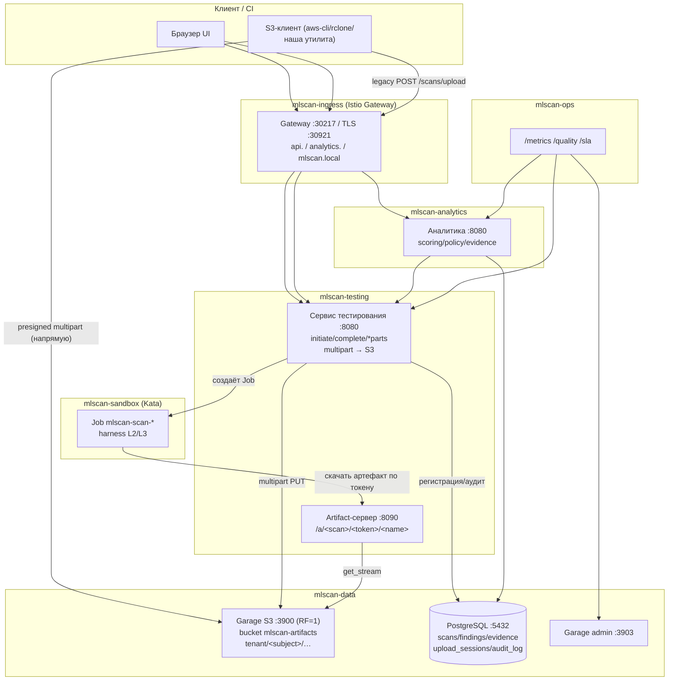
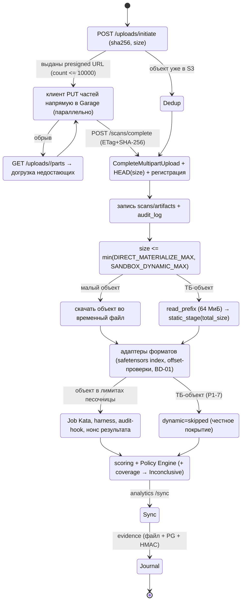

# 15. Анализ большого файла модели: пошаговое описание процесса

Документ отвечает на вопрос «что физически происходит, когда в систему приходит очень большой
файл модели», от чтения у источника до вердикта и накопления статистики. Описано **как реализовано
сейчас**; там, где чего-то нет — это явно помечено `[план]` с предложением.

Обозначения: `[реализовано]` — работает в текущем стенде; `[план]` — предложение к разработке.
Связанные документы: [`07-implemented-architecture.md`](./07-implemented-architecture.md) (as-built),
[`13-deployment-plan.md`](./13-deployment-plan.md) (уровни развёртывания),
[`14-security-review.md`](./14-security-review.md) (ИБ-обзор и харденинг).

---

## 0. Кратко: путь файла

```
рабочая станция / файловое хранилище / [план: другой S3]
        │  HTTP/1.1 POST /scans/upload (chunked, 1 МиБ)          ← до 20 ГиБ, SHA-256 на лету
        ▼
сервис тестирования (mlscan-testing, доверенная зона)
        │  потоковая запись объекта в S3: ключ sha256/<name>      ← дедупликация
        ▼
S3 (Garage, mlscan-data): bucket mlscan-artifacts
        │  отдача в песочницу по одноразовому токену             ← :8090 /a/<scan_id>/<token>/<name>
        ▼
Job в mlscan-sandbox (Kata microVM): harness (L2/L3)
        │  маркеры MLSCAN_SUMMARY/MLSCAN_RESULT_JSON с нонсом скана
        ▼
сервис тестирования: normalize → findings → вердикт+coverage → файл + PostgreSQL
        │  запись артефакта/скана/находок в БД
        ▼
аналитика (mlscan-analytics): оценка, Policy Engine, evidence (файл + PG + HMAC), отчёты, UI
        │  append-only журнал, аттестация по cron
        ▼
ops: метрики, качество (TPR/FPR), retest, retention/TTL, бэкап
```

---

## 1. Шаг 1. Чтение огромного файла у источника

### 1.1 Что есть на рабочей станции

`[реализовано]` Специального клиента S3 **на рабочей станции не установлено** — это осознанно:
источником может быть локальный файл, сетевая шара или S3, поэтому система не требует ставить
что-то на сторону пользователя. Годится любой штатный инструмент:

* браузер — страница UI (загрузка через `XMLHttpRequest` с индикатором прогресса);
* `curl`/`wget` — потоковая отправка файла;
* `aws s3`/`rclone`/`mc` — если файл уже в S3 (см. `[план]` про импорт «из другого S3»).

### 1.2 Где и какой S3-клиент установлен в системе

`[реализовано]` S3-клиент — **свой, на стандартной библиотеке Python**:
[`deploy/v2/data/s3/s3client.py`](../deploy/v2/data/s3/s3client.py) (SigV4, path-style, потоковые
`put_stream`/`get_stream` без чтения объекта в память). Он раскладывается ConfigMap’ом
`mlscan-s3client` и монтируется в `/opt/s3` там, где нужен:

| Где | Путь | Назначение |
|-----|------|-----------|
| сервис тестирования (`mlscan-testing`) | `/opt/s3/s3client.py` | запись артефакта в S3, чтение для отдачи в песочницу |
| шлюз загрузки (`mlscan-ingest`, `mlscan-data`) | `/opt/s3/s3client.py` | внешний шлюз потоковой загрузки в S3 |
| ops (`mlscan-ops`) | — (только admin-API Garage `GARAGE_ADMIN_URL:3903`) | метрики/алёрты по хранилищу |
| аналитика (`mlscan-analytics`) | — | работает с S3 косвенно (через API тестирования) и с PostgreSQL |

Наличие клиента в системе проверяется smoke-задачей `deploy/v2/data/30-s3-smoke.yaml` (`s3-smoke`:
PUT/GET/HEAD) — она запускается при развёртывании уровня 2.

### 1.3 Если файл лежит в другом S3

`[план]` Прямого «возьми объект из чужого S3» сейчас нет: чтобы просканировать такой файл, его
сначала выкачивают на рабочую станцию и отправляют в MLScan. Предлагается добавить (без изменения
архитектуры доверия):

1. **Импорт по URL с server-side copy** — `POST /import {url, name, fmt}`: сервис тестирования
   (или ingest) по presigned-ссылке забирает объект **потоково** в свой S3 (`put_stream`), не
   проксируя тело через браузер;
2. **Резюмируемая загрузка** — `POST /uploads` + `PATCH /uploads/<id>` (offset) для сетей, где
   длинный POST рвётся; состояние — в таблице `uploads`;
3. **Прямая загрузка в S3 (presigned multipart)** — сервис выдаёт presigned-части, клиент заливает
   в Garage напрямую, затем вызывает `POST /scans/complete` с ETag/checksum; это снимает нагрузку с
   сервиса на файлах в сотни ГиБ и ограничение `max-body`.
   Требование безопасности: server-side copy/presigned — только для адресов из allowlist,
   обязательная проверка `Content-MD5`/`x-amz-checksum-sha256` и повторный пересчёт SHA-256 при
   регистрации артефакта.

---

## 2. Шаг 2. Передача в систему: протокол и ограничения

`[реализовано]` Приём ведёт сервис тестирования (`mlscan-testing`, namespace `mlscan-testing`).

| Параметр | Значение |
|----------|----------|
| Протокол | HTTP/1.1 `POST /scans/upload?name=<имя>&fmt=<формат>` (алиасы: `/scans`, `/upload`) |
| Аутентификация | `Authorization: Bearer <API-ключ>` (роли `admin`/`ci-reader`/`service`) или cookie-сессия UI |
| Внешний вход | Istio Ingress → `http://api.mlscan.local:30217` (HTTPS `:30921`, если включён TLS) |
| Тело | обязательно с `Content-Length`; сервис читает тело **чанками по 1 МиБ** (`self.rfile.read(1<<20)`) и сразу пишет в файл/S3 — файл целиком в память не берётся |
| Хэш | SHA-256 считается **на лету** в том же проходе |
| Лимит размера | `MAX_UPLOAD` (по умолчанию **20 ГиБ**) → иначе `413 artifact too large` |
| Анти-флуд | rate limit `30` загрузок/мин на клиента → `429` + `Retry-After`; лимит `5` сканов «в работе» |
| Локальная копия | `/artifacts/<scan_id>/<name>` (PVC `mlscan-artifacts`, 20Gi) — fallback, если S3 недоступен |
| Дедупликация | ключ объекта = `sha256/<name>`; если объект уже есть — тело **не перезаписывается** (`dedup=true`) |

Примеры:

```bash
# напрямую из командной строки (рекомендуется для больших файлов)
curl --noproxy '*' -X POST -H "Authorization: Bearer $MLSCAN_KEY" \
     --upload-file ./pytorch_model.pt \
     "http://api.mlscan.local:30217/scans/upload?name=pytorch_model.pt&fmt=torch"

# через UI: браузер шлёт тот же POST с индикатором прогресса
#   http://analytics.mlscan.local:30217  → «Загрузить модель»
```

Ответ — `202 {"scan_id": "...", "state": "queued", "size": N, "sha256": "...", "s3_key": "sha256/<name>"}`;
дальше всё асинхронно (скан идёт в фоне, UI показывает прогресс).

`[план]` для файлов >20 ГиБ: резюмируемая/прямая загрузка (см. §1.3) и лимит на стороне ingress.

---

## 3. Шаг 3. Хранение и отдача в песочницу

* `[реализовано]` **S3 (Garage)**: namespace `mlscan-data`, Service `garage.mlscan-data.svc:3900`
  (S3 API), `:3903` (admin), bucket `mlscan-artifacts`, креды — Secret `mlscan-s3`
  (`ACCESS_KEY`/`SECRET_KEY`). Объект неизменяем (content-addressed ключ), retention — §6.
* `[реализовано]` **Отдача в песочницу**: Artifact-сервер сервиса тестирования на порту `8090`,
  путь `GET /a/<scan_id>/<token>/<name>`, где `token` — **одноразовый токен конкретного скана**
  (`artifact_token` в записи скана). Песочница **не видит** PVC и S3: файл отдаётся потоково
  (чанки 1 МиБ) либо из S3 (`get_stream`), либо из локальной копии. Сетевой доступ песочницы открыт
  ровно на этот адрес (плюс DNS/sinkhole).
* `[реализовано]` Внутри Job’а файл попадает в `/tmp` (emptyDir, размер ограничен
  `JOB_EPHEMERAL`, по умолчанию 8Gi).

---

## 4. Шаг 4. Модули анализа: где запускаются, из чего состоят, как расширяются

Три независимых метода (L1/L2/L3), два места исполнения.

### 4.1 L1 — статика в доверенной зоне (без исполнения артефакта)

* Где: **сервис тестирования** (`mlscan-testing`), синхронно в потоке обработки скана.
* Из чего состоит:
  * `mlscan-poc-lib` → `/opt/mlscan/mlscan_poc.py` — `static_stage()` (pickle-опкоды, опасные
    глобалы, подозрительные подстроки, zip/tar-контейнеры и их члены);
  * `mlscan-formats` → `/opt/formats/detector.py` (исходник [`poc/formats.py`](../poc/formats.py)) —
    адаптеры форматов: safetensors, ONNX, HDF5/Keras, GGUF, TFLite, CoreML, PMML, MLflow,
    SavedModel, TorchScript, ноутбуки, скрипты, Dockerfile, HTML/SVG, Jinja, JSONL/CSV, MessagePack,
    архивы (в т.ч. вложенные), сжатые payload’ы, датасеты, нативные библиотеки, `.pth`-хуки.
* Ограничения на **большие** файлы (защита доверенной зоны):
  * `MAX_STATIC_BYTES = 64 МиБ` — статика читает **префикс** файла (сигнатуры/заголовки/опкоды);
  * чтение членов архивов — `_read_member()`: **32 МиБ** на член, **128 МиБ** на архив, лимит числа
    членов; детекторы `FMT-04` (bomb) и `FMT-11/FMT-12` работают по заголовкам.
* Как расширяется: новый формат — ветка в `detect()` + сканер `_scan_<fmt>()`; новая проверка —
  `_f("XX-NN", "текст", "severity", confidence, evidence)`; затем добавить образец в корпус
  (`tests/vulnerabilities`) и (при необходимости) правило перевода в i18n.

### 4.2 L2/L3 — динамика и поведение в песочнице

* Где: namespace `mlscan-sandbox`, **отдельный Job на скан**, `runtimeClassName: kata` (микро-ВМ).
  Job создаёт сервис тестирования по Kubernetes API (RBAC: create/delete Job, get pods/logs).
* Из чего состоит Job:
  * образ `mlscan-sandbox@sha256:…` (по digest, проверяется Kyverno);
  * `mlscan-harness` (ConfigMap, генерируется из `HARNESS_SRC` в [`poc/mlscan_poc.py`](../poc/mlscan_poc.py));
  * секретов не монтируется (`automountServiceAccountToken: false`), FS read-only, drop ALL, seccomp;
  * honeypot-файлы (`~/.aws`, `~/.ssh`, `~/.kube`) и sinkhole-адреса — «приманки» для payload’а;
  * env: `ARTIFACT_URL` (внутри — токен скана), `MODEL_NAME`, `MODEL_FMT`, `MLSCAN_NONCE`;
  * лимиты: `JOB_MEMORY=2Gi`, `JOB_EPHEMERAL=8Gi`, `JOB_TIMEOUT=600s`.
* Что делает harness:
  1. скачивает артефакт по токену в `/tmp`;
  2. **загружает** модель загрузчиком по формату: pickle/torch/numpy/joblib/dill/cloudpickle,
     safetensors (mmap), onnxruntime (+пробный инференс), h5py, Keras, GGUF, архивы, текст/картинки,
     датасеты (pyarrow), сжатые payload’ы, нативные библиотеки;
  3. ставит **audit-hook** (open/exec/compile/subprocess/socket/dlopen/`os.system`), снимает
     состояние `builtins`/`sys.path`/`os.environ`/cwd до и после;
  4. выполняет **поведенческие пробы** (вызовы callable-объектов, поиск подозрительных строк);
  5. формирует `summary` (сеть/процессы/exec/mem_exec/запись файлов/dlopen/импорты) и
     `coverage` (какие модули реально отработали);
  6. печатает результат строками `MLSCAN_SUMMARY:<nonce>:{…}` и `MLSCAN_RESULT_JSON:<nonce>:{…}`;
  7. среда уничтожается вместе с Job’ом.
* Как расширяется: новый загрузчик — ветка в `load_target()` + `prewarm()`; новая поведенческая
  проверка — функция в harness + идентификатор `F-NN`; «данные-без-кода» форматы получают
  структурную загрузку (без исполнения).

---

## 5. Шаг 5. Агрегация результатов и событий

`[реализовано]`

1. **Нормализация**: `normalize()` сводит находки L1/L2/L3 в единый список
   (`level, check_id, category, severity, confidence, title, evidence`). Число находок
   ограничено (`MAX_FINDINGS=500`), при усечении причина дополняется пометкой.
2. **Вердикт и покрытие**: `poc.decide()` даёт базовый вердикт; `poc.coverage_of()` определяет,
   какие модули отработали. Если модуль не смог (модель не загрузилась, нет библиотеки, таймаут) —
   вердикт становится **`Inconclusive`** с перечнем непроверенного («частичный результат»).
3. **События активности**: `summary` (наблюдаемое поведение) + `sandbox.events` (сырые события с
   таймстемпами и фазой `load`/`probe`), плюс события sinkhole/Falco на уровне хоста.
4. **Куда пишется**:
   * файл скана `/data/scans/<id>.json` (полная запись: `static`, `sandbox`, `findings`, `coverage`);
   * **PostgreSQL** (`mlscan-data`): `artifacts`, `artifact_fingerprints`, `scans`, `findings`,
     `uploads` (двойная запись «файл + БД»);
   * S3-ключ артефакта — в записи артефакта (`s3_key`).
5. **Аналитика** (`mlscan-analytics`) забирает результаты через `GET /scans` (поллинг; `/sync`
   принудительно), прогоняет `analyze()`: скоринг, Policy Engine, локализация, — и делает
   `_append()`: строка в **append-only evidence** (`/data/evidence.jsonl` **и** зеркало в таблице
   `evidence`) с **HMAC-подписью** звена.
6. **Потребители**: UI аналитика (карточка артефакта), отчёты JSON/Markdown/SARIF, Integrations
   (реестр + CI-gate + SIEM), ops (метрики/качество), внешние системы через API.

---

## 6. Шаг 6. Где и как накапливается статистика

`[реализовано]`

| Слой | Что накапливается | Где смотреть |
|------|-------------------|--------------|
| PostgreSQL (`mlscan-data`) | `scans`, `findings`, `evidence`, `artifacts`, `uploads`, `connections`, `audit_log`, `settings` | SQL, отчёты, `/api/overview` |
| Аналитика | сводка по вердиктам и объёму, список сканов, прогресс | `GET /api/stats` (`by_verdict`, `total_bytes`), `GET /api/overview`, страница UI |
| ops | Prometheus-метрики `mlscan_*`; качество на golden-наборе; SLA | `/metrics`, `/quality` (TPR/FPR), `/sla` |
| Харденинг-метрики | `mlscan_integrity_ok{service}`, `mlscan_evidence_ok/signed/entries`, `mlscan_scans_inconclusive_ratio` | `/metrics` |
| Хранилище | размер БД, число строк таблиц, размер Garage | ops `/metrics` (PG напрямую, Garage admin API) |
| Хранение данных | TTL артефактов/карантина, tombstones | CronJob `mlscan-lifecycle` (TTL 90 д, карантин 365 д), таблица `artifact_deletions` |
| Резервные копии | дампы БД с проверкой восстановления | CronJob `mlscan-pg-backup`, PVC `mlscan-backups` |

Качество считается сравнением вердиктов с метками golden-набора (38 образцов): `POST /retest`
заново прогоняет набор, `GET /quality` возвращает `tp/fp/tn/fn, tpr, fpr, precision, accuracy`;
CronJob `mlscan-retest` делает это регулярно.

---

## 7. Шаг 7. Где принимается решение и как его кастомизировать

`[реализовано]` Решение принимается в **аналитике** в два шага:

1. **Скоринг** (`scoring`): по тяжести находок считается `risk_score` и `max_severity`
   (`critical/high/medium/low/info`), собирается `by_severity` и `active_checks`.
2. **Policy Engine** (`apply_policy`): правила из `policy.json` (ConfigMap `mlscan-policy`,
   путь `POLICY_PATH=/etc/mlscan/policy.json`) применяются по порядку; правило вида

   ```json
   {"id": "block-rce",
    "when": {"check_id_in": ["A-01","A-13"], "min_confidence": 0.8},
    "action": "block", "verdict": "Malicious",
    "reason": "RCE-конструкции десериализации"}
   ```

   даёт `action` (`block|quarantine|allow`) и вердикт; сверху накладывается **поправка на
   покрытие** — при неполной проверке `Safe/Needs review` превращается в `Inconclusive`.

**Как кастомизировать:**

* правка `policy.json` (страница `/policy` в UI показывает текущую политику; применяется через
  ConfigMap `mlscan-policy` + `kubectl rollout restart deploy/mlscan-analytics`);
* добавление новых чек-идов: они автоматически «доступны» правилам (`check_id_in`);
* изменение порогов и действий без правки кода;
* внешняя сторона: CI-gate (`POST /gate` в integrations) использует реестр по `sha256` и
  `action/verdict`, возвращая решение и код выхода для пайплайна; экспорт в SIEM (NDJSON/CEF);
* версионирование правил: всё изменение политики фиксируется в `audit_log` (по субъекту и времени).

`[план]` Подписывать `policy.json` (HMAC/подпись) и проверять при загрузке, чтобы политику нельзя
было подменить (см. `docs/14`, P1-5-совместимое расширение).

---

## 8. Шаг 8. Механизмы, делающие вердикт надёжным и нефальсифицируемым

`[реализовано]` (подробный разбор — [`14-security-review.md`](./14-security-review.md)):

| Механизм | Против чего | Как работает |
|----------|-------------|--------------|
| Изоляция Kata + `default-deny` + RO-FS + drop ALL + seccomp + honeypot | прямой payload, эксплуатация движка, выход из песочницы | скан идёт в микро-ВМ без сети (кроме sinkhole/DNS/артефакта), среда уничтожается |
| Образ по digest + Kyverno-admission | подмена образа песочницы, запуск чужого Job | Job только `image@sha256:…`, kata, безопасный securityContext |
| **Нонс результата** + сверка summary/result | подделка «чистого» результата payload’ом | harness печатает маркеры с нонсом скана; сервис принимает только свои маркеры и сверяет поля |
| **Покрытие → `Inconclusive`** | ложный «Safe» при сбое модуля | неполнота отражается явно, с перечнем непроверенного |
| Лимит находок (500) с пометкой | «взрыв находок», раздувание БД/UI | усечение фиксируется в причине |
| **Digest конфигурации кода** + fail-closed | подмена детекторов/правил в ConfigMap | сервис сверяет digest при старте, при расхождении отвечает `503` |
| **Evidence append-only + HMAC + генерации + single-writer** | подмена/переупаковка журнала, гонки записи | триггеры БД запрещают UPDATE/DELETE, HMAC-цепочка подписывает звенья (ключ вне БД/PVC), проверка по генерациям, `pg_try_advisory_lock` у одного писателя |
| **Аттестация по cron** + алёрты | тихая деградация целостности | CronJob `mlscan-attest` (6 ч) проверяет цепочку и падает при нарушении; алёрты `integrity_<service>`, `evidence_broken`, `coverage_low` |
| Срок жизни ключей (`expires_at`) | использование утёкшего ключа | истёкший ключ → `401` |
| Сужение egress сервисов, квоты, rate limit | lateral movement и перегрузка кластера | только нужные адреса/порты; `ResourceQuota`/`LimitRange`; `429` при флуде |
| Аудит (`audit_log`, append-only) | неотслеживаемые действия | все решения/изменения политики и загрузки фиксируются |

`[осталось по плану ИБ]` Мгновенный `Reject` для сети песочницы вместо таймаута (P0-4 — блокирует
`calico-node` 0/1 Ready и pre-DNAT семантика Calico), DNS-политика песочницы (P1-2), аудит изменений
policy/harness в SIEM (P1-8), fuzzing парсеров, подпись образа/SBOM, mTLS/OIDC, WORM-копия evidence,
rate limit на ingress (P2).

---

## 9. Приложение: сквозной пример большого файла (фактические числа стенда)

Модель: torch-модель `pytorch_model.pt`, **268 470 293 байт (≈256 МиБ)**, внутрь добавлен payload
`os.system(...)`.

| Этап | Что происходит | Числа/наблюдение |
|------|----------------|------------------|
| Передача | `POST /scans/upload`, чанки 1 МиБ, SHA-256 на лету | `202`, `size=268470293`, `sha256=0070e0…`, `s3_key=sha256/pytorch_model.pt` |
| Хранение | объект в Garage, дедупликация по ключу | повторная загрузка того же файла — `dedup=true`, тело не перезаписывается |
| L1 статика | префикс 64 МиБ: сигнатуры/опкоды | `static_s = 0.42` |
| L2 динамика | Kata-Job: скачивание по токену, загрузка torch, аудит-хук | `sandbox_s = 20.32`, `load.ok=true`, `type=dict` |
| Находки | статика + динамика | `A-01 critical (posix.system)`, `A-02 high`, `F-30 high (os.system)`; `subprocess=1` |
| Вердикт | скоринг + policy | `Malicious`, `risk_score=10.0`, policy `block-rce → block` |
| Журнал | evidence: файл + БД + HMAC | звено подписано; `/api/evidence/verify` → `ok/signed/generations` |
| Статистика | метрики/качество | `mlscan_scans_total`, `…_inconclusive_ratio`, TPR/FPR на golden-наборе |

Проверка: прогон корпуса `87/87 обнаружено, 0/54 ложных`; крупные безопасные модели (по 198 МБ,
safetensors/npz/hdf5/torch/onnx) — `Safe` с полным покрытием.

---

## 10. План доработок, вытекающий из этого описания

> Подробный, приоритизированный план под **прод-сценарий (сеть ≥ 10 Гбит/с, ёмкость хранилища
> достаточна для моделей 1 ТБ и больше)** — в §11.6. Ниже — сводка.

1. **`[план]` Импорт из другого S3 и очень большие файлы** (§1.3, §11.6 P0): server-side copy по
   presigned-URL, **multipart в `s3client.py`**, прямая multipart-загрузка в Garage в партицию
   `tenant/<user|ci>/` с проверкой checksum, резюмируемая загрузка, прогресс/возобновление в UI,
   снятие ограничения `max-body` и таймаутов на ingress, подъём `MAX_UPLOAD`.
2. **`[план]` Статика без префикса**: потоковый разбор больших контейнеров (mmap/итераторы) вместо
   чтения первых 64 МиБ там, где это безопасно (safetensors/ONNX-заголовки — полный обход индекса,
   старт статики на ранних частях; pickle-сканы — по префиксу осознанно).
3. **`[план]` Подпись политики и harness** (P1-5-совместимо), аудит изменений в SIEM (P1-8).
4. **`[план]` P0-4/P1-2** (мгновенный `Reject`, DNS-политика песочницы) после починки Calico.
5. **`[план]` P2-блок**: fuzzing парсеров, подпись образа/SBOM, mTLS/OIDC, WORM-копия evidence.

---

## 11. Оценка времени загрузки файла 1 ТБ (safetensors)

Условия (прод): **1 ТБ = 1024 ГиБ = 1.0995·10¹² байт = 8.80 Тбит**; safetensors — несжатый
контейнер (JSON-заголовок + сырые тензоры), поэтому ни сжатие, ни дедупликация по содержимому объём
передачи не уменьшают. Принято, что **ёмкость хранилища в проде достаточна для моделей 1 ТБ и
больше** (размер текущего раздела Garage — не ограничитель), а **сеть клиент→кластер ≥ 10 Гбит/с**.
В этих условиях узкое место — уже не канал, а одно-поточность и лишние проходы.

Оценка — «время провода» (`S/BW`) с КПД, плюс дисковые/ingest-этапы. Справочно: 1 ТБ по «голому»
каналу = 8.80 Тбит, т.е. 14 м 40 с при 10 Гбит/с, 5 м 52 с при 25 Гбит/с, 1 м 28 с при 100 Гбит/с.

### 11.1 Текущая архитектура: 10 Гбит/с используются на четверть

Ёмкостные лимиты (`MAX_UPLOAD=20 ГиБ`, `tmp`/ephemeral, PVC сервиса) — это настройки, которые в
проде поднимаются (см. §11.6); как только они сняты, ограничителями становятся особенности пути.
Путь в коде — **два последовательных, не перекрывающихся прохода** (`mlscan_testing.py:717-741`):
сначала приём в `tmp` (сеть клиент→сервис + запись на диск узла), затем отдельно чтение `tmp` и
**одиночный** PUT в Garage (`s3client.put_stream`, чанки 1 МиБ по одному TCP-соединению).
Диски узла пишутся **дважды** (tmp + Garage), читаются один раз.

При ≥10 Гбит/с побайтовое время канала перестаёт быть главным; предел задают:
одно-поточная передача (~0.5–1 ГБ/с на Python `http.server` и на одиночный PUT), двойная запись
диска и последовательность фаз.

```
T_current ≈ S / min(BW_link, BW_python_одиночный)   +   S / BW_s3_одиночный
            └──────── фаза 1: приём в tmp ────────┘       └─ фаза 2: PUT в Garage ─┘
```

| Канал клиент→кластер | Фаза 1 (приём→tmp) | Фаза 2 (tmp→Garage, одиночный PUT) | **Итого** | КПД канала |
|----------------------|--------------------|------------------------------------|-----------|------------|
| 10 Гбит/с | 18–24 м | 18–37 м | **~35–60 м** | ~25–40 % |
| 25 Гбит/с | 18–24 м | 18–37 м | **~35–60 м** | ~10–17 % |
| 100 Гбит/с | 18–24 м | 18–37 м | **~35–60 м** | ~3–4 % |

**Ключевое:** при ≥10 Гбит/с HTTP-путь «залипает» на **сквозных ~0.3–0.5 ГБ/с** (эквивалент
~2.5–4 Гбит/с) — 10 GbE используется примерно на четверть, а 25/100 GbE не дают ничего. Узкое
место — фаза 2 (`tmp → Garage`, одиночный поток): файл уже принят, но скан не начат, и всё это время
1 ТБ держит ephemeral-storage и диск узла.

### 11.2 Прямая загрузка по S3 в партицию пользователя/CI

Сценарий: у клиента (браузер с S3-клиентом, `aws-cli`, `rclone`) есть доступ по presigned-multipart
прямо в Garage, в выделенный префикс/бакет `tenant/<user|ci>/…`. Сервис тестирования в передаче
данных не участвует — только выдаёт presigned-части и потом регистрирует объект
(`POST /scans/complete` с ETag+SHA-256).

```
T_direct ≈ S / min( BW_link(параллельные части), BW_garage(агрегированный ingest), BW_диск_клиента )
```

Одна передача, один проход диска (локальное чтение у клиента + запись в Garage), нет второго хопа
через сервис и нет `tmp`-копии.

| Канал клиент→Garage | При ingest 1 ГБ/с | При ingest 2 ГБ/с | КПД канала |
|---------------------|-------------------|--------------------|------------|
| 10 Гбит/с | 1 100 с (**18 м**, Garage) | 977 с (**16 м**, канал) | ~80–100 % |
| 25 Гбит/с | 1 100 с (**18 м**, Garage) | 550 с (**9 м**, Garage) | ~40–90 % |
| 100 Гбит/с | 1 100 с (**18 м**, Garage) | 550 с (**9 м**, Garage) | Garage-bound |

Узкое место — **min(канал, агрегированный ingest Garage)**. При 10 GbE и ingest ≥1 ГБ/с канал
используется почти полностью; выше 25 GbE предел задаёт Garage, и его надо масштабировать
(параллелизм записи, второй узел/шардинг — см. §11.6, но уже по производительности, не по объёму).

### 11.3 Сравнение и что даёт каждый вариант (≥10 Гбит/с, ёмкость достаточна)

| Аспект | Текущий HTTP-путь | Прямая загрузка по S3 |
|--------|-------------------|-----------------------|
| Передач по сети | 2 (клиент→сервис, сервис→Garage) | 1 (клиент→Garage) |
| Запись на диск узла | 2× (tmp + Garage) | 1× (Garage) |
| Перекрытие этапов | нет (фазы последовательны) | да (multipart + параллельно) |
| 10 Гбит/с | ~35–60 м | **~9–18 м** |
| 25 Гбит/с | ~35–60 м (не ускоряется) | ~9–18 м |
| 100 Гбит/с | ~35–60 м (не ускоряется) | ~9–18 м |
| Сквозная пропускная | 2.5–4 Гбит/с (0.3–0.5 ГБ/с) | 8–16 Гбит/с (1–2 ГБ/с) |
| Ёмкость/лимиты | `MAX_UPLOAD`/`tmp`/PVC — поднять | сервис вне пути данных |
| Изоляция | все артефакты на одном PVC сервиса | партиция `tenant/<user\|ci>` на пользователя/CI |

**Ускорение от прямого S3 при 10 Гбит/с — ~3–4×**, и именно оно делает 10 GbE (и выше) полезным:
HTTP-путь утилизирует канал на четверть, прямой — почти полностью. Главное — снимаются два прохода
диска, `tmp`-копия и лишний хоп, появляются резюмируемость и tenant-изоляция.

### 11.4 Про RTT (важно для межсайтовых передач)

Одиночный TCP-поток ограничен произведением «окно × RTT» (BDP). В прод-ЛВС RTT мал и на 10 GbE
поток близок к линии, но при межсайтовой передаче (10 Гбит/с, RTT десятки мс) один поток рушится:

| RTT | Потолок одного потока | Время 1 ТБ (один поток) |
|-----|-----------------------|-------------------------|
| 30 мс | ~1.07 Гбит/с | ~2 ч 17 м |
| 60 мс | ~0.53 Гбит/с | **~4 ч 35 м** |
| 100 мс | ~0.32 Гбит/с | **~7 ч 38 м** |

Параллельные multipart-части (16–64 потока) этот барьер снимают — поэтому даже при «10 Гбит/с
минимум» прямая S3-загрузка обязательна для межсайтовых сценариев, где 10 Гбит/с — это паспорт
канала, а не достижимая скорость одного соединения.

### 11.5 Анализ 1 ТБ *после* загрузки (важное следствие)

Сама загрузка — не единственная проблема. После неё:

* **L1 статика** работает по префиксу 64 МиБ — для 1 ТБ это по-прежнему мгновенно, но сканируется
  только начало; полноценный проход header’ов safetensors реализуем (mmap + постраничное чтение
  тензор-блоков) — `[план]` §11.6;
* **L2 динамика невыполнима**: Job имеет `JOB_EPHEMERAL=8Gi` и `JOB_MEMORY=2Gi`, а файл 1 ТБ
  (даже 1.1 ТБ) в песочницу не влезет; скачивание `Garage → Job` в лучшем случае ~9–18 м на скан;
* практический вывод: для ТБ-моделей применяется **статический mmap-анализ + выборочная проверка
  срезов**, а полная динамическая загрузка — только для моделей, влезающих в лимит песочницы.

### 11.6 План доработок под прод-сценарий (≥ 10 Гбит/с, ёмкость достаточна)

Ёмкость больше не сдерживает — план переориентирован на **пропускную способность и архитектуру пути
данных**. Приоритет — убрать одно-поточные места и второй хоп; остальное вытекает из §11.1–11.3.

**P0 — основной выигрыш (обязательно):**

1. **Multipart в `s3client.py`** (сейчас одиночный PUT): 8–64 части параллельно,
   `CreateMultipartUpload`/`UploadPart`/`CompleteMultipartUpload`, ETag по частям. Снимает потолок
   фазы 2 (§11.1) — главный одно-поточный барьер.
2. **Presigned multipart напрямую в Garage** в партицию `tenant/<user|ci>/` + `POST /scans/complete`
   (список ETag + SHA-256). Убирает второй хоп через сервис и `tmp`-копию; сервис выходит из пути
   данных. При 10 GbE даёт **~3–4×** (§11.3).
3. **Резюмируемая загрузка** (`uploads`, offset + ETag): устойчивость длинных передач к обрывам.
4. **Ingress/лимиты**: снять `max-body` и прокси-таймауты на длинные загрузки; поднять `MAX_UPLOAD`
   (20 ГиБ) и квоты ephemeral-storage.

**P1 — утилизация каналов >10 Гбит/с и корректный анализ ТБ-моделей:**

5. **Масштабирование ingest Garage** (по производительности, не по объёму): параллелизм записи, при
   упоре — второй узел/шардинг, т.к. при 25 GbE и выше предел задаёт Garage (§11.2). Дополнительно
   **RF>1** — уже не про объём, а про отказоустойчивость (RF=1 — единая точка).
6. **Потоковый статический анализ**: mmap-обход **полного** заголовка/индекса safetensors (не только
   префикса 64 МиБ) и **старт статики на ранних частях** — не ждать окончания всей загрузки; для
   safetensors чтение указателей тензоров доступно сразу (§11.5).
7. **Песочница для ТБ-моделей**: модель «static-only + выборочный dynamic»; либо поднять
   `JOB_EPHEMERAL`/стримить объект из S3 в read-only (с отдельной оценкой ИБ, т.к. это меняет
   изоляцию). Полная динамика — только для моделей в пределах лимитов.

**P2 — дальнейшее:**

8. **WAN/утилизация**: адаптивный размер части, параллелизм 16–64, retry/checkpoint — для межсайтовых
   10 Гбит/с, где один поток ограничен BDP (§11.4).
9. **Метрики пути данных**: сквозная пропускная (ГБ/с) и время по фазам (приём / Garage / регистрация)
   — чтобы видеть утилизацию канала и деградацию Garage.

---

## 12. Реализация плана §11.6 (as-built)

Все этапы P0–P2 реализованы, развёрнуты в кластере и покрыты тестами (модульные, e2e, UI в
браузере). Соответствие «этап → изменения → тесты»:

| Этап | Что сделано | Ключевые файлы | Тесты |
|------|-------------|----------------|-------|
| P0-1 | Multipart-загрузка в S3 параллельными частями (Create/UploadPart/Complete), дедуп | `deploy/v2/data/s3/s3client.py`, `deploy/stage2/service/mlscan_testing.py`, `deploy/v2/ingest/service/ingest.py` | `tests/s3/test_multipart.py`, `tests/e2e/run_multipart_e2e.sh` |
| P0-2 | Прямая presigned-multipart загрузка клиентом в партицию `tenant/<субъект>/`, `/uploads/initiate` + `/scans/complete` | `s3client.presign*`, `mlscan_testing.py` (`_uploads_initiate`, `_scans_complete`) | `tests/s3` (presign), `tests/e2e/run_direct_upload_e2e.sh` |
| P0-3 | Возобновляемая загрузка: `ListParts`, сессия в БД `upload_sessions`, `/uploads/<id>/parts`, abort | `s3client.list_parts`, `mlscan_testing.py` (`_uploads_*`), `deploy/v2/db/10-schema.yaml` | `tests/s3` (list_parts), `tests/e2e/run_resume_e2e.sh` |
| P0-4 | Снят потолок размера: `MAX_UPLOAD=1 ТиБ`, `ephemeral-storage=1Ti`, таймаут маршрута ingress `24h` | `deploy/stage2/30-service.yaml`, `deploy/ingress/20-virtualservices.yaml` | `tests/e2e/ingress_limits_check.sh` |
| P1-5 | Параллелизм/размер частей env-driven; бенчмарк ingest; зафиксировано узкое место Garage (single-node ~32–43 МБ/с) | `deploy/stage2/30-service.yaml`, `deploy/v2/data/10-garage-config.yaml` | `tests/perf/run_garage_bench.sh` (+ `garage_ingest_result.json`) |
| P1-6 | Потоковая статика по префиксу (`static_stage(total_size=…)`, `read_prefix`); границы safetensors считаются от реального размера | `poc/mlscan_poc.py`, `poc/formats.py`, `mlscan_testing.py` | `tests/formats/test_static_prefix.py`, `tests/e2e/prefix_static_e2e.sh` |
| P1-7 | Политика «static-only + выборочная динамика» для моделей > `SANDBOX_DYNAMIC_MAX_BYTES`; динамика помечается `skipped` | `mlscan_testing.py` (`_materialize_and_scan`) | `tests/e2e/prefix_static_e2e.sh` |
| P2-8 | Retry частей с backoff; адаптивный размер части (≤ 10000 частей) | `s3client.py` (`_multipart_upload`, `adaptive_part_size`) | `tests/s3/test_multipart.py` |
| P2-9 | Метрики пути данных (приём / Garage / регистрация, МБ/с) в `/stats` и Prometheus `mlscan_upload_*` в ops | `mlscan_testing.py` (`pipe_*`), `deploy/stage5/service/mlscan_ops.py` | `tests/e2e/pipeline_metrics_e2e.sh` |

Новые API сервиса тестирования:
`POST /uploads/initiate` → presigned-части; `GET /uploads/<id>/parts` → загруженные части + свежие URL
(возобновление); `DELETE /uploads/<id>` → отмена; `POST /scans/complete` → регистрация объекта.

Фактические замеры (стенд): прямой upload 1 ГиБ-класса — десятки МБ/с, ограничение — ingest Garage
(single-node). Итог бенчмарка: `tests/perf/garage_ingest_result.json`.

---

## 13. Диаграмма развёртывания (deployment)

Компоненты и потоки данных для загрузки/анализа крупных артефактов (после §11.6):



Партиционирование и изоляция: каждый пользователь/CI грузит в свой префикс `tenant/<subject>/`;
песочница видит только Artifact-сервер (по одноразовому токену), но не S3/PVC; Job закреплён по
digest и допускается Kyverno-политикой.

Внешний доступ к S3 (АРМ/CI): Garage вынесен через Istio-гейтвей **TCP-passthrough** (`mlscan-gateway` server `tcp-s3:31400` → nodePort **31317** → `garage:3900`, VirtualService `mlscan-data/mlscan-s3`). Presigned-URL формируются на внешний адрес `S3_PUBLIC_ENDPOINT` (на стенде `http://<NODE_IP>:31317`; в среде с DNS — `http://s3.mlscan.local:31317`). Passthrough сохраняет заголовок `Host`, поэтому подпись SigV4 проверяется в Garage. Примечание: здесь TLS не терминируется (при необходимости — TLS-listener/passthrough или VPN). Проверка с АРМ — `tests/e2e/run_direct_upload_arm_e2e.sh`.

---

## 14. Диаграммы состояния (state)

### 14.1 Загрузка и анализ модели 1 ТБ (safetensors)



Примечание: ниже лимита `SANDBOX_DYNAMIC_MAX_BYTES` (≈6 ГиБ) выполняется полная динамика; выше —
статический анализ по префиксу и явная пометка `dynamic=skipped` (модель «static-only + выборочная
динамика», P1-7). Метрики пути данных (приём/Garage/регистрация, МБ/с) видны в `/stats` и
Prometheus (`mlscan_upload_*`).

### 14.2 Комплексный анализ огромного архива (1 ТБ) со всеми форматами

```mermaid
stateDiagram-v2
  [*] --> Receive
  Receive : загрузка (legacy POST или прямой presigned, tenant/<subject>/)
  Receive --> Store : объект в S3 (content-addressed)
  Store --> DetectFmt
  DetectFmt : detector: zip/tar/... (в т.ч. вложенные)
  DetectFmt --> Enumerate
  Enumerate : лимиты (32 МиБ/член, 128 МиБ/архив, число членов)
  Enumerate --> Members

  state Members {
    [*] --> Member
    Member --> MemberFmt : detector(detect)
    MemberFmt --> MemberStatic : pickle/safetensors/onnx/hdf5/gguf/python/...
    MemberStatic --> DynDecision
    DynDecision --> MemberDyn : член в лимитах песочницы
    DynDecision --> Skip : ТБ-члены / неисполняемые данные
    MemberDyn --> MemberAgg
    Skip --> MemberAgg
    MemberAgg : находки члена (EXEC/INJ/FMT/...)
    MemberAgg --> Member : следующий
    Member --> [*] : все члены обработаны
  }

  Members --> Nested
  Nested : рекурсивный разбор вложений (лимиты глубины/размера)
  Nested --> AggArchive
  AggArchive : normalize + cap_findings (<=500, пометка усечения)
  AggArchive --> ArchiveVerdict
  ArchiveVerdict : max_severity/risk_score + policy; coverage → Inconclusive при сбое модулей
  ArchiveVerdict --> Journal
  Journal : evidence (HMAC), отчёты JSON/MD/SARIF, метрики
  Journal --> [*]
```



Особенности: архив 1 ТБ обрабатывается потоково — по членам, с жёсткими лимитами чтения и
отказом от полной динамики для сверхбольших членов (честное покрытие и `Inconclusive` вместо
ложного «Safe»). Итоговый вердикт учитывает наиболее опасный член (max severity) и правила политики.
