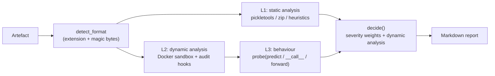

[Русский](../06-implementation-plan.md) | **English**

# MLScanner implementation plan

> ✅ **Status: IMPLEMENTED.** Stages 0–5 and the transition to Ingress/Egress have been completed,
> deployed in the `<CLUSTER>` cluster and verified (see the "✅" marks in the sections and
> `./07-implemented-architecture.md`).
> Further development — expansion to new ML/AI formats — has been moved to a separate plan:
> [`10-plan-new-formats.md`](./10-plan-new-formats.md).

The document describes a step-by-step implementation plan for the system of automatic danger
analysis of ML models in pickle format (see `../../Concept.md` and `./01..05`).

**The first step is a minimal PoC** that implements all three verification methods, with end-to-end
observability and a Markdown report. The PoC is implemented as a single Python file
[`poc/mlscan_poc.py`](../../poc/mlscan_poc.py) and relies on a pre-installed Docker.

---

## 0. Overview of stages (roadmap)

| Stage | Name | Key result | Correspondence to architecture | Status |
|------|----------|--------------------|--------------------------|--------|
| **0** | **PoC (first step)** | One file: static analysis + dynamic analysis in Docker + behaviour → Markdown | A slice of all 3 components | ✅ published |
| 1 | Sandbox hardening | Kata microVM, eBPF (Falco), deception/canary, sinkhole, NetworkPolicy | Component 1 (Sandbox) | ✅ deployed |
| 2 | Testing Service | Full-fledged probe sets, normalisation of results, queues | Component 2 (Testing Service) | ✅ deployed |
| 3 | Analytics Engine + UI | Correlation, scoring, Policy Engine, registry, reports | Component 3 (Analytics+UI) | ✅ deployed |
| 4 | Integrations | CI/CD gate, Model Registry, SOC/SIEM, threat-intel | End-to-end | ✅ deployed |
| 5 | Production operation | GPU isolation, scaling, SLA, red-team | NFR | ✅ deployed (GPU — node limitation) |

Principle: **each stage extends a working slice**, without rewriting the previous one.

---

## 1. Stage 0 — Minimal PoC (first step)

### 1.1 Goal

To provide a runnable tool that, for a single artefact:
1. performs **static analysis** (without execution);
2. performs **dynamic analysis** in an isolated Docker container with observability;
3. performs **behavioural testing** of the loaded object;
4. forms a **verdict** and a **Markdown report**.

### 1.2 Limitations and assumptions of the PoC

- Implementation — **a single file** in Python 3.10+ (implemented on 3.12), with no external Python
  dependencies on the host (only stdlib: `pickletools`, `zipfile`, `subprocess`, `hashlib`, `json`…).
- Sandbox — **a pre-installed and running Docker**; the default image
  `python:3.11-slim` (if needed — a custom image with `numpy`/`torch`).
- A minimal sandbox: a hardened container (see 1.5). The microVM is deferred to stage 1.
- Observability: **Python audit hooks** (PEP 578) inside the container + Docker isolation
  (`--network none`, read-only rootfs, drop capabilities, cgroups limits).
- Report — **Markdown** (to stdout or `--out`).
- **All supported formats of the pickle family** are checked (see 1.7).

### 1.3 PoC pipeline



### 1.4 The three verification methods — what exactly is implemented

| Method | Implementation in the PoC | Result artefact |
|-------|------------------|---------------------|
| **L1 Static** | `pickletools.genops` → a list of opcodes and globals; allowlist/denylist of modules and names; search for `REDUCE`/`BUILD`; substrings (`/bin/sh`, `curl`, `169.254.169.254`, `eval(`…); parsing of zip containers (`data.pkl`, `*.pkl`), zip-slip detection | Findings (`check_id`, severity, evidence) |
| **L2 Dynamic** | Loading in a container under an audit hook: events `open`, `import`, `exec`, `os.system`, `subprocess.Popen`, `socket.*`, `ctypes.*`, `shutil.*` and others; attempts at network/processes/writes/ctypes; timeout; maxRSS | Event trace + summary |
| **L3 Behavioural** | (a) interpretation of loading effects (processes/network/`exec <string>`/write) F-30…F-33; (b) diff of process state: `builtins`, `sys.meta_path`/`path_hooks`, `sys.path`, env, cwd (F-20…F-26); (c) introspection of the object + probe callable (`predict`/`__call__`/`forward`/`transform`/`generate`) with synthetic inputs, suspicious strings (F-27) | Behavioural findings F-20…F-33 + probe table |

### 1.5 PoC sandbox (Docker hardening)

**Transport without shared directories.** The model is fed to the container's **stdin**
(`--interactive`), the harness — as a base64 bootstrap into `python -c`, the result — to **stdout**
(marker `MLSCAN_RESULT_JSON:`). There are no mounts (`-v`); the file is specified at the same time by
an ordinary path on the command line (or as a stream: `cat model | mlscan_poc.py - --name model.pt`).

The container launch command (formed in `dynamic_stage`):

```
cat <model> | docker run --rm --interactive --name mlscan-poc-<id> \
  --network none \
  --read-only \
  --cap-drop=ALL \
  --security-opt=no-new-privileges \
  --pids-limit=128 \
  --memory=1g --memory-swap=1g \
  --cpus=1 \
  --tmpfs /tmp:rw,nosuid,nodev,size=<N>m \
  [--runtime runsc]                 # gVisor, if installed \
  <image> python -X utf8 -B -c '<base64-bootstrap>' "<harness-b64>" <fmt> <name>
```

The tmpfs size `<N>` is chosen based on the model size (≈ 2×+64 MB, minimum 128 MB).

| Measure | What it protects |
|------|--------------|
| `--network none` | The network is completely absent; connection attempts are only recorded |
| `--read-only` + tmpfs `/tmp` | Writes to the rootfs are prohibited; the model lands only in an ephemeral tmpfs |
| `--cap-drop=ALL` | Absence of any capabilities |
| `--security-opt=no-new-privileges` | Prohibition of privilege escalation |
| `--pids-limit`, `--memory`, `--cpus`, `--tmpfs size` | Protection against fork bombs, OOM, DoS |
| `--runtime runsc` (option) | gVisor: syscall interception, kernel isolation |
| Transport via stdin/stdout (without `-v`) | No shared volumes or permissions on them; the host filesystem is not visible to the container |

> "The lightest microVM option": at stage 0 a container is used + optionally gVisor
> (`--runtime runsc`). A full-fledged microVM (Firecracker/Kata) — stage 1.

### 1.6 Observability (full-fledged for the PoC)

Inside the container the harness installs `sys.addaudithook` and records events with a
timestamp and phase (`warmup`/`load`/`probe`):

- **Files:** `open` (path, mode), `os.mkdir/remove/rename/link/symlink`, `shutil.*`.
- **Processes/code:** `os.system`, `os.exec`, `os.spawn`, `subprocess.Popen`, `exec`, `compile`.
- **Network:** `socket.connect/connect_ex/bind/getaddrinfo/gethostbyname/sendto`, `ftplib.connect`,
  `smtplib.connect`, `urllib.Request`.
- **Native libraries:** `ctypes.dlopen/dlsym/call_function`.
- **Imports:** `import`.

Key decisions for signal accuracy:
1. **Warm-up (`prewarm`)**: format libraries (numpy/torch/joblib/dill/cloudpickle) are imported
   **before** the hook is installed, so that the noise of their import is not attributed to the payload.
2. **Filtering of library code**: `exec`/`compile` events from modules under `sys.prefix`,
   `site-packages`, `dist-packages` and inert frames (`<frozen …>`) are discarded; `marshal.loads`
   (noise from the `.pyc` loader) is discarded.
3. **Signal separation**: hard (gating the verdict) — network, processes, file writes,
   non-`None` `ctypes.dlopen`, timeout; informational — `exec`/`compile`/`import`.
4. **Argument normalisation** and an event limit (5000) to protect against report overflow.

Verified empirically: for a clean `pickle` with `os.system`, `os.system` is recorded;
for benign — 0 hard signals; for a numpy object array without a payload — 0 hard signals.

### 1.7 Supported formats

| Format | Extensions | L1 (static analysis) | L2 (dynamic analysis) |
|--------|-----------|--------------|---------------|
| pickle | `.pkl`, `.pickle`, `.p` | opcode analysis | `pickle.loads` + permissive retry |
| joblib | `.joblib`, `.jl` | opcode analysis | `joblib.load`, pickle/zip fallback |
| dill | `.dill` | opcode analysis | `dill.loads`, pickle fallback |
| cloudpickle | `.cloudpickle` | opcode analysis | `cloudpickle.loads`, pickle fallback |
| torch | `.pt`, `.pth`, `.bin`, `.ckpt` | zip: parsing of `data.pkl` and `*.pkl` | `torch.load(weights_only=False)`, fallback — unzipping |
| numpy | `.npy`, `.npz` | extraction of the payload after the header; opcode analysis | `np.load(allow_pickle=True)`, fallback |
| containers | `.zip`, `.tar` | parsing of members + zip-slip | unpacking of pickle members |
| HDF5 | `.h5`, `.hdf5` | marked as "not pickle" | not applicable |
| SafeTensors | `.safetensors` | ditto | not applicable |
| ONNX | `.onnx` | ditto | not applicable |

The format is determined by extension with refinement by "magic bytes"
(`\x93NUMPY`, `\x89HDF`, `PK\x03\x04`, pickle PROTO `\x80\x02…\x80\x05`).

### 1.8 PoC verdict logic

```
max_severity = max(severity of static findings)
hard_dynamic = network>0 or subprocess>0 or dlopen>0 or writes>0 or timeout

critical/high and hard_dynamic → Malicious
critical/high               → Dangerous   (dynamic confirmation required)
hard_dynamic                → Dangerous
dynamics skipped            → Inconclusive ("not proven safe")
medium                      → Needs review
otherwise                   → Safe
```

### 1.9 Running

```bash
# Full analysis (dynamics in Docker)
python3 poc/mlscan_poc.py path/to/model.pt --out report.md

# Static only (no container)
python3 poc/mlscan_poc.py model.pkl --static-only

# With gVisor and a custom image
python3 poc/mlscan_poc.py model.pt --runtime runsc --image mlscan-poc:latest --timeout 90

# Input from stdin (no file on disk); --name sets the extension used to pick the loader
cat model.pt | python3 poc/mlscan_poc.py - --name model.pt
```

Options: `--out`, `--image` (default `python:3.11-slim`), `--runtime`, `--timeout` (default 60),
`--static-only`, `--name` (name when reading from stdin), `--keep`, `--version`.

Optional PoC image (for numpy/torch formats; no network is needed at the dynamic analysis stage):

```dockerfile
FROM python:3.11-slim
RUN pip install --no-cache-dir numpy joblib dill cloudpickle \
 && pip install --no-cache-dir --index-url https://download.pytorch.org/whl/cpu torch
```

### 1.10 Test matrix (PoC acceptance checks)

| Sample | L1 expectation | L2 expectation | L3 expectation | Verdict |
|---------|-------------|-------------|-------------|---------|
| benign `{...}` | no findings | 0 hard signals | 0 findings | Safe |
| `os.system` in `__reduce__` | critical A-01 | `os.system` | F-30 | Malicious |
| `subprocess.Popen` | critical A-01 | `subprocess.Popen` | F-30 | Malicious |
| `socket.connect` via `eval` | medium (substrings) | `socket.*` ≥1 | F-31 (+F-32) | Malicious |
| `exec("<code>")` (builtins tampering) | critical A-01 | `exec <string>` | F-32, F-20 | Malicious |
| file write via `open` | — | `file_writes` ≥1 | F-33 | Dangerous |
| torch-zip with `data.pkl`=`os.system` | critical (member `data.pkl`) | `os.system` | F-30 | Malicious |
| `.npy` object array with a payload | critical | `os.system` | F-30 | Malicious |
| zip with `../evil` | high B-03 (zip-slip) | — | — | Dangerous |
| model with `predict`, without backdoors | no findings | 0 hard signals | callable found, no findings | Safe |

The matrix checks were run during PoC development: static analysis is correct for `.pkl/.joblib/.pt/.npy`;
dynamic analysis records `os.system`, `subprocess.Popen`, `socket.*`, `file writes`; L3 records the
loading effects and tampering; library noise (numpy) is filtered out, there are no false positives on a
benchmark model with `predict`. Examples of poisoning — in `../../poc/scan/` (`evil0…evil5.pkl`).

### 1.11 PoC readiness criteria (Definition of Done)

- [x] A single file, only stdlib on the host, Python 3.10+.
- [x] L1/L2/L3 implemented; L2 — strictly in a Docker sandbox with hardening flags.
- [x] Observability: network, processes, files, ctypes, imports; noise filtering; MaxRSS; timeout.
- [x] Support for all pickle formats from 1.7 (+ correct refusal for HDF5/SafeTensors/ONNX).
- [x] Markdown report with a verdict and evidence.
- [x] Graceful degradation when Docker is unavailable → verdict `Inconclusive`, not `Safe`.
- [x] Compiles and passes the test matrix.

### 1.12 Known limitations of the PoC (and what is deferred to stage 1+)

- Observability — Python-level + Docker, **not eBPF** and not a microVM → sandbox evasion is possible.
- A malicious action in a child process (for example, a write from `sh -c`) is visible as the fact of
  a process launch, but the details of its syscalls are not (eBPF is needed, stage 1).
- The behavioural probe is minimal (no backdoor/privacy/adversarial sets — stage 2).
- No scoring/Policy Engine/registry (stage 3).
- `weights_only=False` for torch in the PoC — intentional (we are testing the payload), permissible only
  inside the sandbox.

---

## 2. Stage 1 — Sandbox hardening ✅ (implemented)

**Status:** deployed in the `<CLUSTER>` cluster and verified. Artefacts — `../../deploy/stage1/`,
details — `../../deploy/stage1/README.md`.

Implemented:
- **microVM:** RuntimeClass `kata` (its own kernel per pod) instead of gVisor (Kata is already available
  in the cluster). Namespace `mlscan-sandbox` with Pod Security Admission `restricted`.
- **Pod hardening:** non-root (65532), `readOnlyRootFilesystem`, `allowPrivilegeEscalation:false`,
  `drop: [ALL]`, `seccompProfile: RuntimeDefault`, limits CPU/RAM/ephemeral-storage,
  `automountServiceAccountToken:false`, tmpfs `/tmp`.
- **eBPF monitoring:** Falco (`modern_ebpf`) in the namespace `mlscan-monitoring` + custom rules
  `MLScan sandbox *` (exec/egress/write). For Kata the guest syscalls are invisible — there, in-guest
  instrumentation works (audit-hooks); for runc pods Falco provides the host level.
- **Deception:** honeypot files (`~/.aws`, `~/.ssh`, `~/.kube`, `.env`, canary), `HOME=/deception`.
- **Network sinkhole:** an in-cluster HTTP+TCP "trap" instead of egress; Calico NetworkPolicy
  `default-deny` + DNS + `sandbox→sinkhole`. Verified: external egress is prohibited, the sinkhole is accessible.
- **Observability:** preserved in full (audit-hooks harness + Falco).

Checks (evidence):
- `run-sandbox.sh evil2.pkl` → Kata pod, `behavior_findings: [F-32, F-20]`.
- `run-sandbox.sh evil6.pkl` → reading of `/deception/.aws/credentials`, the sinkhole recorded
  `HTTP GET /exfil-canary?stolen=104`.
- egress-test → `DENY 1.1.1.1:443`, `DENY example.com:80`, `OK sinkhole:8080`.
- Falco → `MLScan sandbox harness exec / egress / write`.

Remaining (in the following stages): randomisation against sandbox evasion, multiple runs,
image signing (cosign/SBOM/attestation), an egress proxy with load restoration.

Outcome: isolated execution with kernel-level observability and deception.

## 3. Stage 2 — Testing Service ✅ (implemented)

**Status:** deployed in `mlscan-testing` and verified. Artefacts — `../../deploy/stage2/`,
details — `../../deploy/stage2/README.md`.

Implemented:
- An HTTP service (stdlib, no dependencies): `POST /scans`, `GET /scans`, `GET /scans/<id>`, `GET /healthz`.
- **L1** is performed in the service (reuses `../../poc/mlscan_poc.py`: `static_stage`, `decide`).
- **L2/L3** — scheduling a Job in `mlscan-sandbox` (Kata, hardened) via the Kubernetes API; the artefact
  is passed as a ConfigMap; the result is read from the pod logs (`MLSCAN_RESULT_JSON`).
- **Normalisation**: findings are reduced to a contract (`level` L1/L3, `check_id`, `severity`,
  `confidence`, `evidence`); the verdict — `mlscan_poc.decide`.
- RBAC (an SA in `mlscan-testing` → a Role in `mlscan-sandbox`), storage of results on a PVC,
  isolation of runs "one instance = one artefact", auto-deletion of Job/ConfigMap.

Checks (evidence):
- `evil0` → `Malicious` (L1 A-01/A-02 + L3 F-30); `evil2` → `Malicious` (F-32, F-20);
  `evil6` → `Malicious` (F-31, F-32); `benign` and a model with `predict` → `Safe`.

**Enhancement (upload/progress/statistics):** streaming upload of models of any
size is implemented (PVC `/artifacts` + Artifact server :8090, tokenised delivery to the sandbox),
progress (`state/stage/progress`, timings), `GET /stats`; the sandbox image `mlscan-sandbox`
(torch CPU) is built with Kaniko.

Remaining (Stage 2+): a job queue with retries/quotas, a full-fledged probe library
(functional/robustness/backdoor/privacy/adversarial), escaping of model outputs.

## 4. Stage 3 — Analytics Engine + UI ✅ (implemented)

**Status:** deployed in `mlscan-analytics` and verified. Artefacts — `../../deploy/stage3/`,
details — `../../deploy/stage3/README.md`.

Implemented (stdlib-only):
- **Collection of results** from the testing service (poller + `POST /sync`).
- **Scoring** (`risk_score = min(10, max_weight + 0.2·Σothers)`) and L1/L3 correlation.
- **Policy Engine** (`policy.json`): declarative rules → `action`/`verdict`
  (`block-rce`, `block-code-exec`, `block-process-egress`, `block-tamper`, `allow-clean`,
  `quarantine-medium`, `allow-low`).
- **Evidence Store**: append-only `/data/evidence.jsonl` with a hash chain + `GET /api/evidence/verify`.
- **Report Generator**: JSON / Markdown / SARIF 2.1.0.
- **Web UI** (dashboard + artefact card; external access — Ingress `analytics.mlscan.local`) and a JSON API.

Checks (evidence): `evil6` → `Malicious`, score 10.0, policy `block-rce→block`, the reports
`.md`/`.sarif` are valid; `benign`/`toy` → `Safe`; evidence chain `ok`.

**UI enhancement:** upload of model files (including large ones) via a web form (a streaming proxy
to the testing service), check progress (auto-refresh), statistics by verdicts/volume/hashes,
a filter by name and result, sorting by date and volume, an artefact card with a "Dynamic stage" section.

Remaining: OPA/Rego instead of JSON rules, a Knowledge Base (IoC/baseline), PDF/HTML reports,
auth for the UI, human-in-the-loop (feedback into detectors).

## 5. Stage 4 — Integrations ✅ (implemented)

**Status:** deployed in `mlscan-integrations` and verified. Artefacts — `../../deploy/stage4/`,
details — `../../deploy/stage4/README.md`.

Implemented (stdlib-only):
- **Model Registry** — decisions on artefacts (key SHA-256): verdict, action, risk score, checks;
  synchronisation from Analytics (`poller` / `POST /sync`).
- **CI/CD Gate** — `GET /gate?sha256=|?name=` (by the registry) and `POST /gate/scan` (on-demand scan);
  the helper `mlscan-gate.sh` with exit codes (0 allow / 1 block / 2 review); an example workflow.
- **SIEM/SOC Export** — NDJSON (`/events`) and CEF (`/export/cef`).
- **Threat Intel** — `known_bad_sha256` (seed: demo samples) and `watch_checks`; taken into account in the gate decision.

Checks (evidence): `/gate?sha256=<evil0>` → **403 block** (threat-intel); `/gate?name=benign` → **200 allow**;
`mlscan-gate.sh evil4.pkl` → **exit 1 BLOCK**, `mlscan-gate.sh benign.pkl` → **exit 0 ALLOW**; CEF lines are generated.

Remaining (Stage 5): GPU isolation, scaling, SLA, continuous retest, ticketing systems,
registry signing/attestation, external threat-intel feeds, an admission controller.

---

## 6. Stage 5 — Production operation ✅ (implemented)

**Status:** deployed in `mlscan-ops` and verified. Artefacts — `../../deploy/stage5/`,
details — `../../deploy/stage5/README.md`.

Implemented (stdlib-only):
- **Observability**: an ops service with `/metrics` (Prometheus `mlscan_*`), `/health/stack`, `/healthz`.
- **Quality metrics**: `/quality` — TP/FP/TN/FN and TPR/FPR/precision/accuracy on the golden set.
- **SLA**: `/sla` (retest counters, evidence chain length, registry size).
- **Continuous retest**: CronJob `mlscan-retest` (`*/30 * * * *`) → `POST /retest`.
- **Red-team/escape tests**: Job `mlscan-redteam` (Kata) with 7 isolation checks.
- **HA groundwork**: PodDisruptionBudgets for testing/analytics/integrations.
- **Attestation**: `60-attest.sh` — HMAC-SHA256 signature of the sha256 of the Evidence Store.

Checks (evidence): red-team — all 7 checks `PASS` (no SA token, read-only rootfs,
external egress blocked, sinkhole accessible, `/etc/shadow` inaccessible, no docker.sock,
`CapEff=0`, guest kernel 6.18); retest — 9 samples in ~9 s; **quality: TPR=1.0, FPR=0.0,
precision=1.0, accuracy=1.0** (tp=7, fp=0, tn=2, fn=0); metrics and attestation are generated.

Limitations: **GPU** — the node reports `nvidia.com/gpu: 0` (the device plugin does not publish a GPU),
GPU isolation was not applied (the template is ready); **horizontal scaling** of services
with RWO storage is limited (RWX/external DB is needed); attestation — HMAC (cosign for prod).

## 7. Cross-cutting requirements

- **Tests**: a regression set of reference samples (safe/suspicious/malicious), sandbox meta-tests,
  mutation testing of detectors.
- **CI**: linting/typing of the PoC and services, image builds with SBOM, running the test matrix.
- **System observability**: metrics, tracing, audit of decisions.
- **Data security**: isolation of artefacts, minimisation of PII in reports, storage of evidence.

## 8. Risks of the plan and mitigations

| Risk | Mitigation |
|------|----------|
| Container escape (stage 0) | gVisor/microVM at stage 1; escape tests |
| Sandbox evasion | deception, randomisation, multiple runs, stage 2 |
| False negatives | layering, red-team, feedback from incidents |
| Absence of Docker in the environment | verdict `Inconclusive` (not `Safe`); daemon launch instructions |
| Cost of GPU tests | a GPU pool on demand, prioritisation |

## 9. Relation to the documentation

- `../../Concept.md` — concept and architecture.
- `./01-threat-checklist.md` — risk checklist (covered by L1/L2/L3).
- `./02-testing-strategy.md` — L0–L4 strategy.
- `./03-isolation.md` — isolation methods (stage 1).
- `./04-risk-analysis-decision.md` — processing of results and decisions (stage 3).
- `./05-architecture.md` — detailed architecture.
- `./07-implemented-architecture.md` — implemented architecture (as-built): components and network diagram.
- `./08-testing-guide.md` — what can be tested and where to connect.
- `../../poc/mlscan_poc.py` — the implementation of the first step (this PoC).
