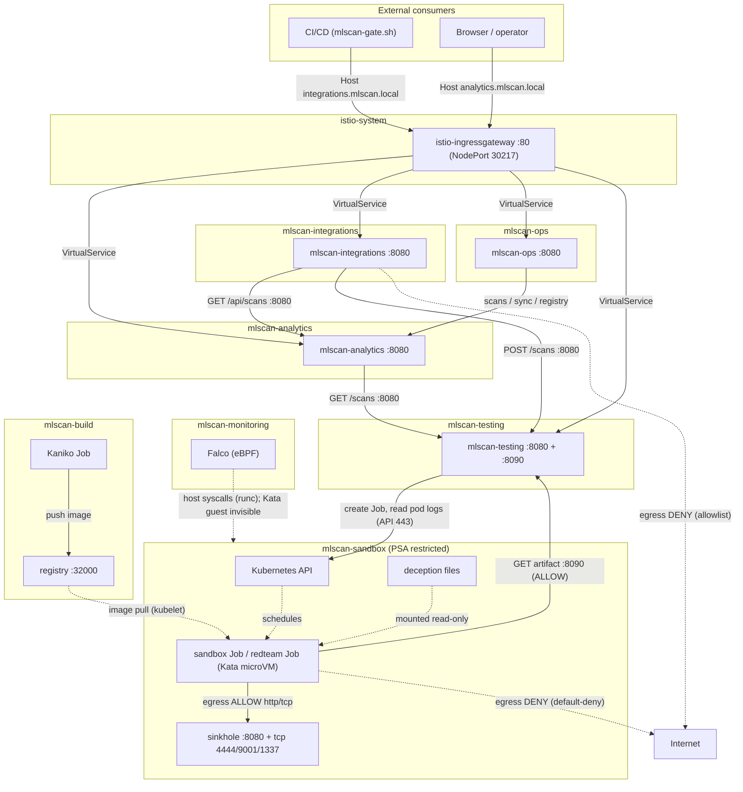
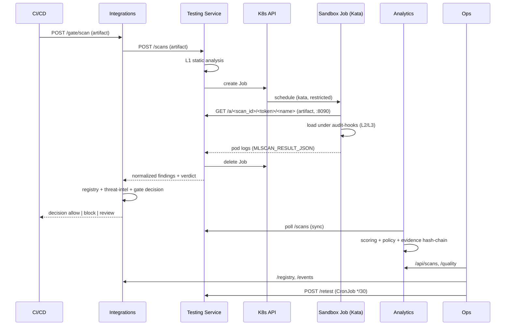

[Русский](../07-implemented-architecture.md) | **English**

# 07. Implemented MLScan architecture (as-built)

Final description of the MLScan system **actually deployed** in the cluster `<CLUSTER>` (MicroK8s
v1.33, containerd, Calico, RuntimeClass `kata`): component composition, network interaction diagram,
data flows, trust boundaries and limitations.

Source: `deploy/stage1…stage5/` and `deploy/sandbox-image/`. Concept — `../../Concept.md`, design
architecture — `./05-architecture.md`, plan — `./06-implementation-plan.md`, test guide —
`./08-testing-guide.md`.

---

## 1. Overview

MLScan is a system for automatic danger analysis of ML models in pickle format. It is implemented
as a set of microservices in **seven namespaces** (`mlscan-sandbox`, `mlscan-monitoring`,
`mlscan-testing`, `mlscan-analytics`, `mlscan-integrations`, `mlscan-ops` and the image build
`mlscan-build`). All services use the Python standard library (no external dependencies), the image
`python:3.12-slim` (Python 3.12.14); the sandbox uses a separate image `mlscan-sandbox` with
torch/numpy.

Key as-built principles:
- the artifact is **never executed** in the trusted zone — only in a Kata microVM with network
  egress denied;
- services exchange over HTTP inside the cluster; external access is through the single entry point
  Istio Ingress Gateway (host-based routing);
- state is on local PVCs (single-node); the Evidence Store is append-only with a hash chain.

### 1.1 Products and versions used

| Product | Version | Role in MLScan |
|---------|--------|---------------|
| Kubernetes (MicroK8s) | 1.33 | cluster platform |
| `kubectl` | — | management (apply, exec, port-forward) |
| containerd | — | node container runtime |
| Kata Containers | — | sandbox microVM (RuntimeClass `kata`) |
| Node OS | Ubuntu LTS | operating system |
| Kata microVM | its own kernel per pod | sandbox isolation |
| Calico | — | CNI + NetworkPolicy |
| CoreDNS | — | cluster DNS |
| metrics-server | — | resource metrics (HPA readiness) |
| hostpath-provisioner | — | StorageClass (local volume) |
| Falco | driver `modern_ebpf` | eBPF runtime monitoring |
| Python | **3.12.14** (image `python:3.12-slim`) | runtime of all services and the in-sandbox harness — **standard library only** |
| PyTorch (CPU) | **2.14.1+cpu** (sandbox image `mlscan-sandbox`, `deploy/sandbox-image/`) + numpy 2.5.4, joblib, dill, cloudpickle | dynamic loading of torch models in the sandbox |
| Kaniko | executor v1.23.2 | building the sandbox image in the in-cluster registry |
| `pickletools` / `zipfile` / `sys.addaudithook` | Python 3.12 stdlib | static parsing (L1) and observability (L2/L3) |
| Helm | — | Falco installation |
| Image registry (OCI) | — | private registry; **stores the sandbox image** `mlscan-sandbox:latest` |
| Istio | — | **used for Ingress** (Gateway + VirtualServices); sidecar injection (mTLS/mesh) not enabled; there is an egress gateway |

All MLScan services are our own Python stdlib code on top of the `python:3.12-slim` image; there are
no external service dependencies (DB, queue, brokers) — state is in files on PVCs.

---

## 2. Component composition

### 2.1 `mlscan-sandbox` — isolation and execution (Component 1)

| Object | Type | Purpose |
|--------|-----|-----------|
| `sinkhole` (Deployment + ClusterIP Service) | :8080 HTTP, :4444/9001/1337 TCP | in-cluster "trap": the only allowed egress; logs the requests |
| sandbox Job (on demand) | `runtimeClassName: kata` (Kata 3.32.0), image `mlscan-sandbox` | run the harness from the PoC over the artifact (torch/numpy) |
| `mlscan-redteam` (Job) | kata | isolation escape test (Stage 5) |
| ConfigMap `mlscan-harness`, `mlscan-samples`, `mlscan-deception*`, `mlscan-sinkhole`, `mlscan-redteam` | — | harness code, demo data, honeypot files, sinkhole server, redteam script |
| NetworkPolicy `default-deny-all`, `allow-dns-egress`, `sandbox-to-sinkhole`, `sinkhole-ingress`, `sandbox-to-testing-artifacts` | — | network isolation (Calico) |
| PSA `restricted` (namespace label) | — | prohibition of privileged pods |

**Artifact transport:** the file resides on the PVC of the testing service (`/artifacts`); the
sandbox Job downloads it from the Artifact server of the testing service (port **8090**) using a
one-time token. The per-scan ConfigMap transport is no longer used.

### 2.2 `mlscan-monitoring` — eBPF monitoring

| Object | Type | Purpose |
|--------|-----|-----------|
| `falco` (DaemonSet) | Falco 0.45.0, modern eBPF driver | host syscalls: exec/egress/write; rules `MLScan sandbox *` |

### 2.3 `mlscan-testing` — testing service (Component 2)

| Object | Type | Purpose |
|--------|-----|-----------|
| `mlscan-testing` (Deployment + ClusterIP Service :8080 + :8090) | stdlib HTTP | streaming ingestion of artifacts of any size (PVC `/artifacts`), L1 (static analysis), launching the Job, Artifact server (8090, serves to the sandbox by token), collecting L2/L3, normalization, verdict, `/stats` |
| ServiceAccount `mlscan-testing` + Role/RoleBinding in `mlscan-sandbox` | RBAC | create/delete Jobs, get pods/logs in the sandbox |
| PVC `mlscan-testing-data` | hostpath 1Gi | scan records (`/data/scans/*.json`) |
| PVC `mlscan-artifacts` | hostpath 20Gi | uploaded models (`/artifacts/<scan_id>/<name>`) |
| ConfigMap `mlscan-poc-lib`, `mlscan-testing-code` | — | shared analysis (PoC) + service code |

### 2.4 `mlscan-analytics` — analytics engine + UI (Component 3)

| Object | Type | Purpose |
|--------|-----|-----------|
| `mlscan-analytics` (Deployment + ClusterIP Service :8080; externally — Ingress `analytics.mlscan.local`) | stdlib HTTP | collection of results, scoring, Policy Engine, evidence, reports, web UI |
| PVC `mlscan-analytics-data` | hostpath 1Gi | `/data/evidence.jsonl` (hash-chain) |
| ConfigMap `mlscan-analytics-code`, `mlscan-policy` | — | engine code + `policy.json` |

### 2.5 `mlscan-integrations` — integrations (Stage 4)

| Object | Type | Purpose |
|--------|-----|-----------|
| `mlscan-integrations` (Deployment + ClusterIP Service :8080; externally — Ingress `integrations.mlscan.local`) | stdlib HTTP | Model Registry, CI/CD gate, SIEM export, threat-intel |
| PVC `mlscan-integrations-data` | hostpath 512Mi | `registry.json`, `events.jsonl` |
| ConfigMap `mlscan-integrations-code`, `mlscan-intel` | — | service code + seed threat-intel |

### 2.6 `mlscan-ops` — operations (Stage 5)

| Object | Type | Purpose |
|--------|-----|-----------|
| `mlscan-ops` (Deployment + ClusterIP Service :8080; externally — Ingress `ops.mlscan.local`) | stdlib HTTP | Prometheus metrics, stack health, quality (TPR/FPR), SLA, retest |
| CronJob `mlscan-retest` | `*/30 * * * *` | continuous retest of the golden set |
| PDB `*-pdb` | — | PodDisruptionBudget for testing/analytics/integrations |
| ConfigMap `mlscan-ops-code`, `mlscan-golden`, `mlscan-golden-samples` | — | code, golden labels and samples |

### 2.8 `mlscan-build` — building the sandbox image

| Object | Type | Purpose |
|--------|-----|-----------|
| `mlscan-sandbox-build` (Job, Kaniko) | executor v1.23.2 | building the `mlscan-sandbox` image and publishing it to the in-cluster registry |
| ConfigMap `mlscan-sandbox-build` | — | `Dockerfile` of the build context |

Image: `python:3.12-slim` + **torch 2.14.1+cpu** + numpy/joblib/dill/cloudpickle. Built without
Docker on the host (Kaniko); the result is `localhost:32000/mlscan-sandbox:latest` (for kubelet).

---

## 3. Network interaction diagram

**Directions and protocols:**
- External access — **the single entry point Istio Ingress Gateway** (HTTP NodePort `30217`),
  host-based routing `analytics|integrations|ops|api.mlscan.local`; MLScan services have no NodePort
  (ClusterIP).
- Internal calls — HTTP `:8080` via cluster DNS (`<svc>.<ns>.svc.cluster.local`).
- `TEST → Kubernetes API` — HTTPS `:443` (creating a Job, reading `pods/log`).
- `Kata-Job → testing:8090` — downloading ITS OWN artifact by token (allow);
- `Kata-Job → sinkhole` — the allowed channel; to the outside — deny (NetworkPolicy default-deny).
- `Falco` observes host syscalls; syscalls **inside the Kata microVM are invisible to it**
  (in-guest harness instrumentation works there).
- The sandbox image is built by Kaniko in `mlscan-build` and published to the in-cluster registry;
  kubelet pulls it when the Job is created.
- **Platform egress** — allowlist (deny-by-default + DNS + cluster CIDRs); external egress of
  services is prohibited.

---

## 4. Network access model and policies

### 4.1 NetworkPolicy in `mlscan-sandbox` (Calico v3.29.3)

| Policy | Type | Effect |
|----------|-----|--------|
| `default-deny-all` | Ingress+Egress | all traffic denied by default |
| `allow-dns-egress` | Egress | DNS to `kube-dns` (UDP/TCP 53) |
| `sandbox-to-sinkhole` | Egress | `app=mlscan-sandbox → app=sinkhole` (any ports) |
| `sinkhole-ingress` | Ingress | into sinkhole — only from `app=mlscan-sandbox` |
| `sandbox-to-testing-artifacts` | Egress | `mlscan-sandbox → mlscan-testing:8090` (downloading ITS OWN artifact by token) |

Verified: `1.1.1.1:443` and `example.com:80` → **DENY** (timeout), `sinkhole:8080` → **OK**.

### 4.2 External exposure

The single entry point is the **Istio Ingress Gateway** (external MLScan services are ClusterIP):

| Host (Host header) | Gateway | Purpose |
|--------------------|---------|-----------|
| `analytics.mlscan.local` | `mlscan-ingress/mlscan-gateway` | web UI + JSON API |
| `integrations.mlscan.local` | the same | gate/registry/SIEM/intel |
| `ops.mlscan.local` | the same | metrics/quality/SLA |
| `api.mlscan.local` | the same | testing API |

Gateway: `istio-ingressgateway` (ns `istio-system`), HTTP NodePort **30217** (HTTPS 30921).
The services `mlscan-testing` (ClusterIP :8080+:8090) and `sinkhole` are internal.

### 4.3 Egress control (migration from "open" egress to allowlist)

| Namespace | Egress policy | Allowed |
|-----------|-----------------|-----------|
| `mlscan-testing` | `mlscan-egress` | DNS; cluster CIDRs (8080/8090/443); Kubernetes API (`<API_ENDPOINT>`) |
| `mlscan-analytics` | `mlscan-egress` | DNS; cluster CIDRs (8080/8090) |
| `mlscan-integrations` | `mlscan-egress` | DNS; cluster CIDRs (8080) |
| `mlscan-ops` | `mlscan-egress` | DNS; cluster CIDRs (8080) |
| `mlscan-sandbox` | `default-deny-all` + allow | DNS; sinkhole; `testing:8090` (artifact) |

External egress of platform services is **prohibited** (verified: `1.1.1.1:443 → DENY`).
Point access to external resources — via an FQDN allowlist (Calico) or an Egress Gateway (planned).

---

## 5. End-to-end flow (scan + gate)

---

## 6. Storages, configuration, RBAC

| Component | PVC | State files |
|-----------|-----|-----------------|
| testing | `mlscan-testing-data` (1Gi), `mlscan-artifacts` (20Gi) | `/data/scans/<id>.json`; `/artifacts/<scan_id>/<name>` |
| analytics | `mlscan-analytics-data` (1Gi) | `/data/evidence.jsonl` (hash-chain) |
| integrations | `mlscan-integrations-data` (512Mi) | `/data/registry.json`, `/data/events.jsonl` |
| ops | — (stateless) | state in memory |

Configuration — ConfigMaps (service code, `policy.json`, `intel.json`, `golden.json`, harness,
deception, sinkhole). Evidence integrity attestation — `deploy/stage5/60-attest.sh` (HMAC-SHA256).

### 6.1 How the analytics data storage is arranged

**There is no separate DBMS.** Analytical information is stored **as files on a PVC**
(local volume), loaded into memory at startup and served over the HTTP API. Neither SQL, nor
on-disk indexes, nor a query engine is used.

| Storage | File(s) | Format / semantics |
|-----------|---------|--------------------|
| Testing service (`mlscan-testing`) | `/data/scans/<scan_id>.json` | one JSON per scan; functions `save_scan`/`load_scan`/`list_scans` |
| Analytics engine (`mlscan-analytics`) — **the main analytics storage** | `/data/evidence.jsonl` | **append-only JSONL**; a line = `{"prev","hash","record"}`, where `hash = sha256(prev + json(record))` → **tamper-evident hash chain** |
| Integrations (`mlscan-integrations`) | `/data/registry.json`, `/data/events.jsonl` | registry `sha256 → entry` (dict) + append-only gate/SIEM events |
| Ops (`mlscan-ops`) | — | stateless; reads the others via API |

**Mechanics of the analytics engine:**
- at startup `_load_store()` replays `evidence.jsonl` and builds an **in-memory index**
  `scan_id → record`;
- writing — `_append()` under `threading.Lock`: computes `hash` from `prev + record`, appends the
  line and updates `last_hash` (append-only, without modifying past records);
- reading — only via API: `/api/scans`, `/api/scans/<id>`, `/reports/<id>.json|.md|.sarif`;
- integrity control — `GET /api/evidence/verify` (recomputation of the whole chain);
- the `record` entry includes the source scan data (`static`, `sandbox` with the event trace,
  normalized `findings`, `score`, `policy`, `verdict`), so scan files can reach tens of KB.

**Actual state (example):** `evidence.jsonl` ≈ 228 KB (~102 records), `/data/scans/` — 101 files,
`/artifacts` ≈ 618 MB (uploaded models), `registry.json` — 17 records, `events.jsonl` — 5 lines.

**Properties and limitations:**
- **single writer**: services are deployed with `replicas=1` with RWO-PVC; writing is serialized by
  `threading.Lock` within the process; concurrent writing from multiple replicas is not supported;
- coverage/archiving/retention are not implemented; the volume is limited by the PVC size;
- there are no arbitrary queries (only predefined API selections/filters in the code);
- uploaded artifacts are stored on the PVC `mlscan-artifacts` (`/artifacts/<scan_id>/<name>`);
  the per-scan ConfigMap transport is not used; cleanup of old artifacts — by retention (planned);
- **growth points** (see `./05-architecture.md` §7): external **PostgreSQL** (the CloudNativePG
  addon is available in the cluster), `sqlite/duckdb` for queries, object storage (S3/MinIO) for
  raw evidence/traces, retention and compaction.

RBAC: the only cross-namespace link is the SA `mlscan-testing` (ns `mlscan-testing`) with a Role
in `mlscan-sandbox` (Jobs/ConfigMaps create·delete·get, pods/logs get). The other services
work without access to the Kubernetes API.

---

## 7. Trust boundaries and isolation

| Zone | Trust | Isolation |
|------|---------|----------|
| `mlscan-sandbox` (artifact execution) | **untrusted** | Kata 3.32.0 (microVM), PSA restricted, non-root 65532, read-only rootfs, drop ALL, seccomp, limits, default-deny egress, deception |
| `mlscan-monitoring` | trusted (monitoring) | DaemonSet, modern eBPF |
| `mlscan-testing` / `mlscan-analytics` / `mlscan-integrations` / `mlscan-ops` | trusted | PSA restricted, non-root, read-only rootfs, drop ALL, no excess privileges |

The artifact is transferred to the sandbox **without shared directories** (ConfigMap + stdin),
invisible to other namespaces; platform secrets (SA tokens, etc.) are not mounted into the sandbox.

---

## 8. Ports and internal addresses (DNS)

| Service | DNS (inside the cluster) | Port |
|--------|----------------------|------|
| testing | `mlscan-testing.mlscan-testing.svc.cluster.local` | 8080 (API), 8090 (artifact) |
| analytics | `mlscan-analytics.mlscan-analytics.svc.cluster.local` | 8080 |
| integrations | `mlscan-integrations.mlscan-integrations.svc.cluster.local` | 8080 |
| ops | `mlscan-ops.mlscan-ops.svc.cluster.local` | 8080 |
| sinkhole | `sinkhole.mlscan-sandbox.svc.cluster.local` | 8080, 4444, 9001, 1337 |

External access — Ingress: `analytics|integrations|ops|api.mlscan.local` via `:30217`.
Main endpoints: `/scans` (testing), `/api/scans|/reports|/policy` (analytics),
`/registry|/gate|/gate/scan|/events|/export/cef|/intel` (integrations),
`/metrics|/health/stack|/quality|/sla|/retest` (ops).

---

## 9. Observability

- **In the sandbox:** audit-hooks harness (L2/L3: files/processes/network/ctypes, state diff) —
  also works inside Kata.
- **Host:** Falco (modern eBPF), rules `MLScan sandbox *` (exec/egress/write) for runc pods.
- **Stack:** `/metrics` (Prometheus `mlscan_*`), `/health/stack`, `/quality` (TPR/FPR), `/sla`.

Verified metrics: red-team — 7/7 PASS; quality — TPR=1.0, FPR=0.0 (tp=7, fp=0, tn=2, fn=0);
evidence-chain — ok.

---

## 10. Limitations (single-node) and growth points

- **GPU:** `nvidia.com/gpu: 0` — GPU isolation was not applied; the GPU pod template is ready after
  installing the NVIDIA device plugin.
- **Scaling:** services with RWO-PVC and file-based state do not scale horizontally correctly;
  RWX/external DB and stateless pods are needed. The Ops service is stateless.
- **Attestation:** HMAC (for prod — Sigstore/cosign, image signing).
- **eBPF in Kata:** host-eBPF does not see the guest's syscalls — an in-guest sensor is needed (the
  harness already performs this role).
- External SIEM/tickets — via `/export/cef` and `/events` (integration on the consumer side).
- **Dynamic analysis:** torch/numpy models and Python 2-style pickle (`__builtin__`) are now
  executed in the sandbox (`mlscan-sandbox` image + harness compatibility).
- **Artifacts:** stored on the PVC `mlscan-artifacts` (20Gi) without auto-retention — large models
  are limited by the PVC size. Planned (`./10-plan-new-formats.md`, Wave 0): **S3 (Garage)**,
  **PostgreSQL** instead of files, **AuthN/Z + audit log**.
- **GPU** — still unavailable (see above).

---

## 11. Related documents

- `../../Concept.md` — concept and target architecture.
- `./01-threat-checklist.md`, `./02-testing-strategy.md`, `./03-isolation.md`, `./04-risk-analysis-decision.md`, `./05-architecture.md`, `./06-implementation-plan.md`.
- `../../deploy/stage1…stage5/README.md`, `../../deploy/sandbox-image/README.md`, `../../deploy/ingress/README.md` — operational descriptions of the stages, the sandbox image and the migration to Ingress/Egress.
- `./08-testing-guide.md` — what to test and where to connect.
- `./09-formats-and-backdoors-analysis.md` — analysis of other ML/AI formats and types of backdoors.
- `./10-plan-new-formats.md` — plan of enhancements for new formats.
- `./11-target-architecture-v2.md` — target architecture v2 (large models, S3/DB, speed).
- `../../poc/README.md` — single-file PoC.
