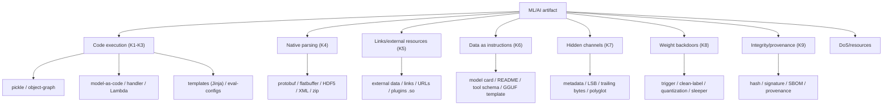

[Русский](../09-formats-and-backdoors-analysis.md) | **English**

# 09. Analysis of ML/AI model and data formats: what else needs to be checked for security

Status: **most of the analysed formats are implemented** (format waves 1-7: model-as-code, Keras,
ONNX, HDF5, GGUF, archives, XXE/unsafe YAML, tokenizers, prompt injection, agent/MCP, notebooks,
scripts, MLflow, TF SavedModel, TFLite, CoreML, PMML, Parquet/Arrow datasets, TorchScript,
wheel/`.pth`, native libraries, Jinja, HTML/SVG, Dockerfile, compressed payloads, JSONL/CSV,
MessagePack, secret leaks, duplicate entries, tar bombs). What is implemented is in
[`07-implemented-architecture.md`](./07-implemented-architecture.md), the plan in
[`10-plan-new-formats.md`](./10-plan-new-formats.md). The goal is to determine **which other formats** of models and data
in ML/AI require security analysis, **which backdoors** occur in them, and **exactly what**
needs to be checked, so that MLScan can then be extended.

---

## 0. Summary

1. The danger of a format is determined not by its extension, but by **what the loader does**:
   deserialization of objects, invocation of user code, loading of native libraries,
   execution of templates/scripts, resolution of external links.
2. Besides the pickle class (RCE during deserialization), there are **six** more classes
   of risk: native parsers (memory-corruption/DoS), data/DoS, integrity/provenance,
   prompt-injection as "data", backdoors in weights/tokenizer/graph, backdoors in
   runtime/serving.
3. The most attention is required by: **model-as-code** (TorchServe `.mar`, MLflow, `trust_remote_code`,
   spaCy/Paddle wheels), **Keras Lambda/`config.json`**, **ONNX external data**, **HDF5 links/plugins**,
   **GGUF/Jinja chat-templates**, **tokenizer artifacts**, **model/dataset cards as carriers
   of prompt-injection**, **agent/MCP manifests**.
4. Many "safe" formats (safetensors, GGUF, Arrow/Parquet) are safe only with respect to
   *code execution*; they remain carriers of DoS, steganography, integrity attacks and
   prompt-injection, and the most common practical vector is **extension substitution/polyglot**
   (declared `.safetensors`, but the loader invoked the pickle path).

---

## 1. What "dangerous format" means (criteria)

We consider a format to require analysis if it has any of the properties:

| # | Property | Consequence |
|---|----------|-------------|
| K1 | Deserialization of executable objects (pickle/`__reduce__`, object graphs) | RCE at load |
| K2 | References to **code** (modules/classes/functions/hooks/plugins by name or by path) | RCE/import of arbitrary code |
| K3 | **User code inside the artifact** (scripts, handlers, templates) | RCE by definition |
| K4 | **Native parser/protobuf/fb** | memory-corruption, OOB, DoS |
| K5 | **External links/paths** (files, URL, plugins) | path traversal, SSRF, code loading |
| K6 | **Data as instructions** (cards, templates, tool schemes) | prompt-injection, guardrail bypass |
| K7 | **Hidden channels** (metadata, least significant bits, trailing data) | steganography, smuggling |
| K8 | Possibility of **weight/algorithmic backdoors** | trojans, bypass of model authorization |
| K9 | Absence of **integrity/provenance** | tampering, typosquatting |

---

## 2. Risk taxonomy (consolidated)

---

## 3. Format catalog

### 3.1 Python serialization and extensions (base class)

| Format | Structure | Key risks | What to check |
|--------|-----------|-----------|---------------|
| `.pkl/.pickle`, protocols 0–5 | pickle VM | RCE (K1,K2), out-of-band buffers (P5) | opcodes, `find_class`, buffers, trailing |
| `joblib` (`.joblib`) | pickle + numpy/memmap | RCE, mmap disclosure/write | pickle members, `mmap_mode`, paths |
| `dill`/`cloudpickle` | pickle + code/closures | RCE, serialized **code** | code objects, `co_code` |
| NumPy `.npy/.npz` with `allow_pickle` | array/object array | RCE via object-array; zip bomb | `dtype=object`, nested pickle, sizes |
| pandas `.pkl`, `to_pickle` | pickle | RCE | as pickle |
| PyTorch `.pt/.pth/.bin/.ckpt` | zip + `data.pkl` / legacy pickle | RCE (including bypass of `weights_only`) | `data.pkl`, `_rebuild_*`, storage |
| TorchScript `.pt` (archive) | zip + `code/` (TorchScript pickle) | RCE via unpickling of code | `code/*`, `constants.pkl` |
| `torch.package` (`.pt`) | zip + Python modules | **RCE on import** (package loader) | `.py` in the package, import hooks |
| PaddlePaddle `.pdparams` | pickle | RCE | as pickle |
| MXNet `.params` + `symbol.json` | binary + JSON | RCE (histor.), custom ops | pickle parts, `op` references |
| Gensim `.model` (Word2Vec etc.) | pickle-like | RCE | pickle members |
| fastText `.bin` | proprietary/rarely pickle | parser, safe-ish | version/structure |
| CatBoost `.cbm`, `.pkl` | CBM/JSON/pickle | pickle variant → RCE | format and nested pickle |

### 3.2 Weight and tensor containers

| Format | Structure | Risks | What to check |
|--------|-----------|-------|---------------|
| **SafeTensors** `.safetensors` | 8B length + JSON header + tensor buffers | "safe" only from execution: **DoS** (huge header/tensors), **overlaps/OOB** of offsets, **trailing data**, **polyglots/extension substitution**, **steganography** in `__metadata__`, unicode keys | header size, bounds/overlaps, trailing bytes, extension-to-signature match, `__metadata__` anomalies |
| NumPy `.npy/.npz` | array / zip | object-array→pickle; zip bomb | see 3.1 |
| HDF5 `.h5/.hdf5`, Keras `.h5` | hierarchy of groups/datasets | **External/Soft/Virtual links** (access to external files/paths), **filter plugins** (loading `.so` by name), object datasets (pickle), DoS | links (external/soft/virtual), filter pipeline, attrs, sizes |
| Keras `.keras` (v3) | zip: `config.json`, `metadata.json`, `model.weights.h5` | `class_name`/`build_config` → class resolution; **Lambda** (see below); arbitrary metadata | `class_name`, `Lambda`, `custom_objects`, `metadata` |
| `.ckpt`/`.ckpt-*` (JAX/Flax Orbax) | msgpack + numpy | reconstruction of objects/`ext` types, custom `PyTree` | msgpack `ext`, registered types |
| `msgpack` models | msgpack | reconstruction, parser | `ext`, depth, sizes |

### 3.3 Model-as-code / serving bundles (**high risk, code by definition**)

| Format | Structure | Risks |
|--------|-----------|-------|
| TorchServe **`.mar`** | zip: `MAR-INF/MANIFEST.json` + `*.py` handler | **RCE on serve** — handler/`model.py` is executed |
| MLflow model | `MLmodel` + `python_model.pkl`/`python_function` | pickle + import of `loader_module` (arbitrary module) |
| KServe / Seldon `model.py` | Python | RCE |
| BentoML `bentofile`+`service.py` | Python | RCE |
| HF `trust_remote_code`, `auto_map` | repository `modeling_*.py` | **RCE on `from_pretrained`** |
| spaCy/paddle/FastText models as **pip-wheel** | wheel/sdist + `__init__.py`, hooks | RCE on `pip install` (especially sdist/`build`) |
| Gradio/Streamlit/Space `app.py` | Python | RCE |
| `torch.hub` `hubconf.py` | Python | RCE on `torch.hub.load` |
| Dataset loading scripts (`datasets` legacy) | Python | RCE |

### 3.4 Graphs / compiled models (native parse + custom ops)

| Format | Structure | Risks | What to check |
|--------|-----------|-------|---------------|
| **ONNX** `.onnx` | protobuf | parser/OOB, **external data** (path traversal/URL), custom ops (`domain`), `FunctionProto` bloat, DoS | `external_data` (`location`, `offset/length`), custom domains, `opset`, sizes, duplicates |
| TF **SavedModel** | `saved_model.pb` + `variables/` + `assets/` | custom ops, `assets` (arbitrary files), TF1-hub code concerns | ops, `assets`, functions, links |
| TF **GraphDef** `.pb/.pbtxt` | protobuf | parser, ops | ops, sizes |
| **TFLite/LiteRT** `.tflite` | flatbuffer | custom ops, **flex delegate** (execution of TF ops), DoS | `custom_code`, delegate libs, shapes |
| **TensorRT** `.engine/.plan` | proprietary | **plugins `.so`** (RCE/library loading) | plugin libs, version |
| **OpenVINO IR** `.xml`+`.bin` | XML+binary | **XXE** (XML), custom layers `.so` | XML entities, extension libs |
| **CoreML** `.mlmodel/.mlpackage` | protobuf | custom layers (Swift runtime), parser | `MLCustomLayer`, versions |
| **ExecuTorch** `.pte` | flatbuffer | custom ops/delegates `.so` | custom ops, delegates |
| Caffe `.caffemodel` (protobuf), Caffe2 `.pb` | protobuf | custom layer types | `type`, `layer` |
| PMML `.pmml` | XML | **XXE** | XML entities |
| TensorFlow.js `model.json`+`*.bin` | JSON+binary | custom JS layers, loading by URL (SSRF) | `weightsManifest.paths`, custom layers |

### 3.5 Quantized / edge formats

| Format | Structure | Risks | What to check |
|--------|-----------|-------|---------------|
| **GGUF/GGML** `.gguf` | KV metadata + tensors | **`chat_template` (Jinja) → SSTI** in a number of servers; metadata → **prompt-injection**; special tokens; DoS; steganography | `tokenizer.chat_template`, `tokenizer.ggml.*`, `general.*`, sizes |
| NCNN `.param`+`.bin` | text+binary | custom layers/`.so` | layer types, custom libs |
| MNN/TNN | proprietary | custom ops | — |

### 3.6 Data and datasets

| Format | Risks | What to check |
|--------|-------|---------------|
| HuggingFace Datasets `.arrow`, Parquet/Feather | DoS, data poisoning, "data as instructions"; parser | sizes/schemes, abnormal attachments, instructions in text fields |
| WebDataset/`.tar` shards | path traversal, symlink/hardlink, bombs, polyglot | names/types of members, sizes |
| TFRecord | protobuf parser, DoS | sizes/schemes |
| Zarr | chunked codecs by name (lookup codec/`numcodecs`) → potential loading; object-dtype pickle; DoS | `codecs`, `dtype=object`, number of chunks |
| Lance | format parser, sizes | structure |
| `.jsonl`/`.csv`/`.txt` datasets | **prompt-injection**, special tokens, formulas (CSV injection `=cmd`), huge fields | instructions, control tokens, formulas, sizes |
| LMDB/LevelDB/embeddings stores | parser, DoS, tampering | sizes/integrity |
| FAISS/Annoy/HNSW indexes | parser/OOB, huge indexes, crafted math | structure, sizes |

### 3.7 Tokenizers and prompt artifacts

| Artifact | Risks | What to check |
|----------|-------|---------------|
| SentencePiece `.model` | protobuf parser; special tokens | number of tokens, special characters |
| HF `tokenizer.json` (fast) | `added_tokens`, `PostProcessor`, `normalizer` with regex/`Replace` (ReDoS), `template_handlebars` | overriding of special tokens, ReDoS regex, templates |
| `vocab.json`/`merges.txt` | crafting of merge rules, bypass of filters | anomalous pairs/volumes |
| `tokenizer_config.json`, `special_tokens_map.json` | **Jinja `chat_template` → SSTI**, overriding of roles/markers | template (Jinja), special tokens |
| Stop-word lists/`config.json` of prompts | bypass of safety, injections | instructions |

### 3.8 Configs, metadata, cards

| Artifact | Risks | What to check |
|----------|-------|---------------|
| `config.json`, `generation_config.json` | references to code (`auto_map`), URL, `revision`; injections | `auto_map`, URL, instruction fields |
| `requirements.txt`, `conda.yaml`, `environment.yml` | dependency confusion, `--extra-index-url`, **unsafe YAML** (`!!python/object`) | sources, YAML tags |
| `setup.py`/`pyproject.toml` | **code at install** (sdist/build hooks) | hooks, commands |
| Model/Dataset **card** (README.md, `metadata`) | **prompt-injection into agents**, XSS (HTML/SVG/<script>) | instructions, HTML/JS, links |
| `MLmodel`, `keras_metadata.pb` | references to modules/classes | loader fields |

### 3.9 Archives and packages

| Format | Risks |
|--------|-------|
| zip/tar/tgz | path traversal (`../`, absolute paths), symlink/hardlink, bomb, polyglot |
| wheel/sdist/deb/rpm | code at install (`setup.py`, `pre/post-install`) |
| Docker/OCI images as a "model" | Dockerfile RUN/ENTRYPOINT = RCE; OCI signatures/attestation |
| `.mar` | see 3.3 |
| 7z/rar + "loader" | traversal/bomb |

### 3.10 Indexes/stores/embeddings

FAISS/Annoy/HNSW, SQLite/DuckDB, LMDB/LevelDB, vector DBs: parser/OOB, DoS, tampering,
in DuckDB — autoloading of **extensions** (loading code by name/URL).

### 3.11 Agent/MCP/tooling artifacts (new class)

| Artifact | Risks |
|----------|-------|
| MCP servers, `mcp.json`, tool manifests | **tool description injection**, arbitrary commands |
| OpenAPI/function schemas (`tools`) | descriptions as injections; parameters leading to RCE at the consumer |
| System/developer prompts (`.txt/.json`) | injections, "sleeper" prompts |
| LLM outputs as code | agent/consumer executes the model output → RCE |

---

## 4. Backdoors of various kinds

### 4.1 Code execution (execution backdoors)
- **Serialization backdoors:** pickle/`__reduce__`, object-graph, TorchScript code, `torch.package` import, `dill/cloudpickle` code.
- **Ops/handlers:** custom ops, `.mar`/`model.py`, `Lambda` (including **Keras Lambda with marshalled bytecode** — historical RCE), `custom_objects`, delegate/plugin `.so`.
- **Templates/eval:** Jinja `chat_template` (SSTI), unsafe YAML, `eval` in configs, ReDoS via regex in normalizers.
- **External references:** `auto_map`/`trust_remote_code`, URL in configs, `external_data`, HDF5 links, plugin loading by name.

### 4.2 Weight (neural) trojans
| Type | Sign | Detection |
|-----|---------|-------------|
| Trigger-backdoor (BadNets and analogues) | sharp change of output only on the trigger | trigger scan, activation anomalies, diff with a reference |
| Clean-label backdoor | poison without labels, hidden in the representation | influence analysis, robust-training tests |
| Adversarial-weight backdoor | "invisible" perturbations of weights | analysis of weight distributions, spectrum, sensitivity |
| Quantization-induced backdoor | activated after quantization | comparison of FP/quant outputs on triggers |
| Sleeper agents (LLM) | deferred behaviour by date/phrase | probing, red-team, long scenarios |
| Router/MoE backdoor | activation of a hidden expert | routing analysis |
| Multi-trigger/stealth | rare triggers, imitation of "norm" | multiple triggers, statistical tests |

### 4.3 Tokenizer / graph / format level
- **Special tokens/`added_tokens`:** overriding of `<|endoftext|>`/roles → removal of restrictions.
- **Crafting of BPE merge rules** → hidden "trigger words".
- **Chat-template backdoors:** hidden system block, role injection.
- **Graph level:** extra paths (subgraph) in ONNX/TF, "dead" branches activated by a trigger.
- **Format level:** object-array, external links, polyglot.

### 4.4 Steganography / hidden channels
- Metadata (`__metadata__`, GGUF KV, HDF5 attrs, safetensors padding, EXIF-like).
- Least significant bits of mantissas, quantization noise, tensor order.
- **Trailing data** after a valid format (smuggling), **polyglots**.
- Channels via the **tokenizer** (undisclosed tokens), via **sorting/tensor names**.

### 4.5 "Data as instructions" (prompt-injection)
- **Model/Dataset cards** and README as carriers of injections for agents that read catalogs.
- **GGUF/tokenizer `chat_template`** and prompts: hidden instructions/roles.
- **Tool/MCP descriptions** and OpenAPI: injections in tool descriptions.
- **Dataset data** with instructions and control tokens; CSV formulas.
- **LLM output** as an executable instruction (the agent executes the text).

### 4.6 Supply chain / integrity
- Substitution/typosquatting, account compromise, dependency confusion.
- **Polyglots/extension substitution** (a `.safetensors` that is really pickle).
- Absence of signature/provenance/SBOM; divergence of `format` metadata from the content.
- Substitution of the artifact during delivery (hash/trailing bytes).

### 4.7 Runtime / serving
- Handlers and warmup hooks, downloading code at startup.
- **Prompt injections executed by the serving stack** (Jinja templates, output filters).
- Logging/leaks, poisoning of a shared cache/configs between instances.

### 4.8 GPU / kernel level
- Malicious **PTX/cubin**, custom CUDA plugins, TensorRT plugins.
- GPU-based payloads (research class), side-channels.
- Exploitation of the **driver/runtime** via crafted models (native parser → kernel).

---

## 5. Observables and detection methods

| Class | Observables | Method in MLScan |
|-------|-------------|----------------|
| K1/K2 (RCE) | dangerous globals/opcodes, marshalled code, `auto_map`, custom ops | L1 opcodes/allowlist (PoC already exists); add format parsers |
| K3 (model-as-code) | `.py`/handler/`Lambda` in the artifact | static AST scan + Sandbox (L2) with network denial |
| K4 (native) | malformed structures, depth, sizes | fuzzing-like checks in the sandbox, limits |
| K5 (links) | external data/links/URLs/plugins | static parsing of links + sandbox observation of FS/network |
| K6 (injections) | instructions in card/template/tool-schema | text heuristics + LLM assistant detector (carefully) |
| K7 (stego) | trailing bytes, anomalies of metadata/bits | binary diff analysis, entropy, verification of `format` |
| K8 (weights) | output anomalies on triggers | behavioural probe (L3), diff with a reference |
| K9 (integrity) | hash/signature/SBOM | L0 (already implemented) + image signing/cosign |

The principle remains: **do not execute in the trusted zone**, "not proven — not safe",
layered static analysis → sandbox → behaviour, evidence and verdict.

---

## 6. "Format × risk class" matrix (abbreviated)

| Format | K1 | K2 | K3 | K4 | K5 | K6 | K7 | K8 | K9 |
|--------|----|----|----|----|----|----|----|----|----|
| pickle/`.pt` | ● | ● | ○ | ○ | ○ | ○ | ● | ○ | ● |
| safetensors | ○ | ○ | ○ | ● | ○ | ○ | ● | ● | ● |
| HDF5/`.h5` | ● | ● | ○ | ● | ● | ○ | ● | ○ | ● |
| Keras `.keras`/`.h5` | ● | ● | ● | ● | ○ | ○ | ○ | ○ | ● |
| ONNX | ○ | ● | ○ | ● | ● | ○ | ● | ● | ● |
| TFLite/TensorRT/OpenVINO | ○ | ● | ○ | ● | ● | ○ | ○ | ○ | ● |
| GGUF/GGML | ○ | ○ | ○ | ● | ○ | ● | ● | ● | ● |
| SavedModel | ○ | ● | ○ | ● | ● | ○ | ○ | ● | ● |
| `.mar`/`.py`/MLflow | ● | ● | ● | ○ | ● | ○ | ○ | ○ | ● |
| tokenizer artifacts | ○ | ○ | ○ | ● | ○ | ● | ● | ● | ● |
| datasets (arrow/parquet/tar) | ○ | ○ | ○ | ● | ● | ● | ● | ● | ● |
| model/dataset card | ○ | ○ | ○ | ○ | ● | ● | ○ | ○ | ○ |
| MCP/tool manifests | ○ | ● | ● | ○ | ● | ● | ○ | ○ | ○ |

● — primary risk, ○ — secondary/possible.

---

## 7. Prioritization of MLScan extension

**Wave 1 (code execution, maximum effect/risk):**
1. **model-as-code**: `.mar`, `model.py`, MLflow `python_function`, `trust_remote_code`/`auto_map`,
   `torch.package`, `hubconf.py` — static AST scan + sandbox.
2. **Keras/SavedModel**: `Lambda` (including marshalled code), `custom_objects`, `class_name`.
3. **ONNX external data / custom ops** and **HDF5 external links / filter plugins**.
4. **Jinja `chat_template` (tokenizer/GGUF)** — SSTI scan.

**Wave 2 (native/data/integrity):**
5. Parser risks: ONNX/TFLite/TFRecord/HDF5/XML(XXE)/zip-tar — size/depth/OOB checks, fuzzing.
6. **SafeTensors/GGUF**: trailing bytes, bounds, polyglots, `format` mismatch, stego metadata.
7. **Archives/packages**: traversal/symlink/bomb/wheel-hooks.

**Wave 3 (behaviour/backdoors/agent):**
8. **Weight trojans**: generalize the probe (triggers, quant comparison, powerful diff sets).
9. **Tokenzier/special tokens** and **prompt-injection** scan (cards/tools/MCP).
10. **GPU/kernel**: PTX/cubin/plugins (where possible).

For each wave: rule/detector (L1) → sandbox run (L2) → behavioural test (L3) →
sensor/quality metrics (Stage 5), with publication of rules and updating of the checklist/risk matrix.

---

## 8. Limitations and open questions

- **Native parsers** (protobuf/flatbuffer/HDF5/XML/zip) require fuzzing/sanitizers —
  outside pure static analysis; a careful sandbox and limits are needed.
- **Weight backdoors** are fundamentally not fully detectable; a risk approach and references are needed.
- **prompt-injection** is not a binary vulnerability; detection is heuristic (risk of false positives).
- **model-as-code** cannot be "neutralized" by a single allowlist — only isolation + review.
- **Steganography/polyglots** require binary normalization and comparison of the real format.
- Legally/politically: analysis of third-party cards/data may touch on licenses and PII.

## 9. What is proposed to do next in the repository

The roadmap with tasks, criteria and waves is in [`10-plan-new-formats.md`](./10-plan-new-formats.md).

- Extend `docs/01-threat-checklist.md` with new categories (formats, backdoors, agent).
- Add to MLScan **format adapters** (static parsing + selection of the sandbox profile)
  and **rules** for waves 1–2; **probe sets** for wave 3.
- Update `docs/02` (strategy), `docs/04` (scoring/policy for new check IDs),
  `docs/05`/`07` (architecture: adapters, profiles).
