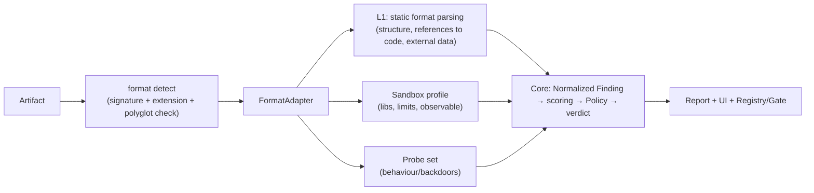
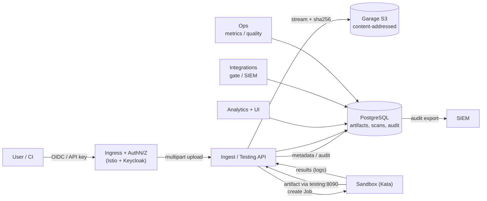

[Русский](../10-plan-new-formats.md) | **English**

# 10. Improvement plan: extending MLScan to new ML/AI formats

A roadmap for the development of MLScan beyond pickle. The basis is the analysis of formats and backdoors in
[`09-formats-and-backdoors-analysis.md`](./09-formats-and-backdoors-analysis.md).
The previous plan (Stages 0–5) — [`06-implementation-plan.md`](./06-implementation-plan.md) —
is **implemented** (see the note in it).

Status: proposed plan (draft for approval).

---

## 1. Extension principle: format-agnostic core + adapters

The MLScan core (three components, levels L0–L4, a unified finding contract, scoring, Policy Engine,
evidence, reports, UI) **does not change**. Extension to a new format = adding a
**format adapter** and a **package of rules/probes** registered in the core.



**Adapter interface (proposed):**
```
FormatAdapter:
  name, extensions[], magic_signatures[]
  detect(bytes) -> {format, confidence, mismatches[]}
  integrity(bytes) -> findings[]      # format mismatch, trailing data, polyglots, sizes
  static_scan(bytes) -> findings[]    # structure, references to code/data, external refs
  sandbox_profile() -> {image, env, limits, observable[]}
  probes(ctx) -> results[]            # behavioural/backdoor tests
  report_section() -> html/md
```

---

## 2. Architectural improvements (cross-cutting, before the waves)

| # | Improvement | Component | Result |
|---|-----------|-----------|-----------|
| A1 | `adapters/` — registry and API of format adapters | testing/static | adding formats without modifying the core |
| A2 | Extension of **L0**: detection of the real format, format mismatch, polyglots, trailing bytes, bounds/OOB | testing (L0) | detection of extension substitution and smuggling |
| A3 | **Sandbox profiles**: a set of images (torch/numpy; onnx/h5py; tf/keras; gguf runner) and limits per format | sandbox (L2) | execution of payloads of different stacks |
| A4 | **Rule packs** by categories and versioning | analytics/static | manageable detectors + versions in evidence |
| A5 | **New check IDs and categories** (see §6) and Policy update | docs/04, analytics | verdicts on new risks |
| A6 | **Probe libraries** (backdoors, tokenizers, prompt-injection) | testing (L3) | behavioural checks |
| A7 | **UI**: format type, adapter used, evidence per format | analytics UI | transparency of the check |
| A8 | **Quality metrics** per format (TPR/TPR/FPR, checklist coverage) | ops | control of the extension |
| A9 | **Test corpora** (safe/evil) for each format | repo, ops | regression of detectors |

### 2.1 Large models: S3 storage instead of PVC

**Problem.** The current transport stores the artifact on a PVC (`mlscan-artifacts`, 20Gi) and in `/tmp`
of the pod. Models can be **tens–hundreds of GB**, while the PVC is limited by the node and does not scale.

**Solution.** Introduce an **S3-compatible object storage** and remove artifacts from the PVC.

- Use **S3-compatible storage** (for example, **Garage** or **MinIO**). An option is a dedicated
  instance/bucket for MLScan or a separate bucket on an existing storage
  (in agreement with the owner).
- **Content-addressed keys:** `s3://mlscan-artifacts/<sha256>/<filename>` → deduplication,
  immutability, reproducibility (one object = one fingerprint).
- **Streaming multipart upload** (chunk 64–256 MiB) with SHA-256 computed "on the fly";
  the object limit is configurable (for example, up to 100 GiB), quotas per user/tenant.
- **Delivery to the sandbox:** the Testing Service takes the object from S3 using internal credentials and serves
  it to the Job via the already existing tokenized URL `:8090` → **the sandbox's network access is not
  expanded** (remains `sandbox → testing:8090`). A presigned URL directly to Garage is an
  alternative, but requires a new egress permission.
- **Retention/lifecycle:** TTL, soft-delete, refcount by `sha256` (deletion only when
  there are no references), cleanup of "orphaned" objects.
- **Reliability:** Garage RF (on single-node RF=1); for HA — 3+ nodes/OpenEBS/Rook (addons
  available), backup to an external S3; disk/bucket encryption.
- The PVC remains only for ephemeral/auxiliary data (or is fully replaced by the DB).

### 2.2 DBMS instead of JSON/JSONL: PostgreSQL (CloudNativePG)

**Problem.** Currently the state is files on a PVC (`scans/*.json`, `evidence.jsonl`,
`registry.json`) with an in-memory index and a single writer. There are no queries, transactions,
retention and reliable history.

**Solution.** Move to **PostgreSQL** (the addon `cloudnative-pg` is available; for testing — 1 instance,
for HA — 3).

Proposed schema (key parts):

| Table | Purpose |
|---------|-----------|
| `artifacts` | `sha256` (unique), `blake3`, `size`, `format`, `filename`, `s3_key`, `source`, `uploader_id`, `created_at`, `metadata jsonb` |
| `artifact_fingerprints` | fingerprints: `sha256/blake3/sha512`, a "model" fingerprint (shape/dtype/tensor statistics), a tokenizer fingerprint |
| `scans` | `artifact_id`, `status/stage/progress`, `adapter`, `toolchain_version`, `verdict`, `risk_score`, `policy_id`, `reason`, timings |
| `findings` | normalized findings (level, check_id, category, severity, confidence, evidence `jsonb`) |
| `evidence` | append-only `{prev_hash, hash, payload}` — the hash-chain is transferred to the DB |
| `policies` / `decisions` | versions of policies and decisions (auto/human) with justification |
| `users` / `api_keys` | subjects, roles, CI keys (hash, scopes, expiry) |
| `uploads` | upload journal: `artifact_id`, `user_id`, `request_id`, `ip`, `user_agent`, bytes, status |
| `connections` | connection journal: `user_id`, `request_id`, `ip`, `user_agent`, `path`, `method`, `status`, `ts` |
| `audit_log` | append-only journal of actions (see §2.3) with a hash-chain |

- **"Snapshots/fingerprints" of models** — this is `sha256` + `blake3` (fast), optionally `sha512`,
  plus a **structural fingerprint** (shapes/dtype/tensor statistics, tokenizer hash) for
  finding variants/re-compressions of the same model and deduplication.
- **Migration:** one-time importer JSON/JSONL → DB; a dual-write period; JSON export is preserved.
- **Access:** DSN in a Secret, separate writer/reader roles, connection pool; the evidence table —
  append-only (triggers, prohibition of UPDATE/DELETE).
- **Advantages:** queries/filters/aggregates, transactions, version history, retention,
  correlation of upload → scan → findings → decision.

### 2.3 Authentication at the entry point and a log of uploads/checks

**Problem.** Currently the UI/API is without authentication; the logs are file-based and not linked to each other.

**Solution.**

- **OIDC via Keycloak** (already present in the cluster) + **Istio RequestAuthentication /
  AuthorizationPolicy** on the Ingress; for CI — client keys/`client_credentials` (JWT) or
  API keys validated at the entry point. Browser login — Keycloak login (if necessary,
  `oauth2-proxy`).
- **RBAC roles:** `admin`, `analyst`, `uploader`, `ci-reader`; authorization by routes
  (upload, view, manual decisions, policies).
- **End-to-end correlation-id:** `X-Request-ID` is generated at the entry point, passed between
  services (and `traceparent`); stored in `connections`, `uploads`, `scans`, `audit_log` —
  this way upload, check and result are linked into a single trace.
- **Log (audit):** authentication/connections, uploads (sha256, size, IP, User-Agent,
 user identification), start of checks, stages/results, verdicts, policy changes, manual
  overrides, download of reports.
- **Log integrity:** append-only + hash-chain, retention; export to SIEM via the already
  existing `/export/cef` and `/events`.
- **Secrets/PII:** Keycloak secrets in a k8s Secret, PII redaction in logs, minimization.

### 2.4 Target scheme (with S3, DB, authentication)



### 2.5 Wave 0 — infrastructure improvements (precondition)

| Task | Result | Readiness criterion |
|--------|-----------|---------------------|
| I1. S3 (Garage) | bucket `mlscan-artifacts`, content-addressed, multipart, dedup | upload of a file ≥ 50 GB (or the limit) without PVC; sha256/size in the DB |
| I2. PostgreSQL (CloudNativePG) | schema §2.2, migration, dual-write | upload→scan→findings→decision in the DB; JSON export is preserved |
| I3. AuthN/Z + audit | Keycloak OIDC + Istio + RBAC; log with correlation-id | login via OIDC; the log contains the user, IP/UA, sha256, result |
| I4. Storage observability | S3/DB metrics, alerts, backup | dashboard/alerts; restore verification |

**Status:** I1 — ✅ done (`deploy/v2`: Garage S3, Ingest Gateway, content-addressed, dedup; verified with 1 GiB). I1b — ✅ the testing service has been moved to S3 (`:8090` serves from S3; verified evil0 and 512 MiB). I2 — ✅ PostgreSQL deployed (12 tables, append-only); ✅ stdlib client (SCRAM); ✅ the testing service and ✅ the analytics engine write to the DB (artifacts/fingerprints/scans/findings/evidence hash-chain). I3 — ✅ implemented: API keys at all entry points (analytics/testing/integrations/ingest/ops), RBAC by roles, UI login via cookie, correlation-id, connections/audit_log log (hash-chain), service-to-service via an internal key. OIDC/Istio JWT — optional. **Wave 1 (static detectors)** — ✅ implemented: format adapters (`deploy/v2/formats`), check IDs `EXEC-01…07`, `INJ-01/02`, `FMT-*`; policy `block-code-artifact`/`block-template-injection`; demo samples `poc/scan/formats`. Sandbox profiles for dynamic confirmation — later (Wave 1b).

**Wave 2 (static analysis)** — ✅ implemented: SafeTensors structure (`FMT-02/11`), archives (`FMT-03/04/05`), XXE/unsafe-YAML (`FMT-06`), policy `block-native-risk`, demo samples; verified (traversal/symlink/XXE → Malicious, overlap/bomb/trailing → Needs review, benign → Safe).

**Wave 1b (dynamic analysis)** — ✅ model-as-code is executed in the sandbox (harness), confirmation by dynamic analysis (`evil_mar.mar` → `subprocess=1` → Malicious). Framework-specific dynamic analysis (Keras/TF/ONNX) — a limitation (images are needed).

**Wave 2.5/3.4 (INT-*/STEG-*)** — ✅ integrity (`INT-03` external URL, `INT-04` install files) and steganography (`STEG-01` trailing after EOCD, `STEG-02` entropy blobs, `STEG-03` polyglot images); policy `block-install-hooks`/`block-steg-polyglot`; demo samples; verified.

**A8 (quality metrics per format)** — ✅ the golden set has been extended to all formats (32 samples); `/quality` = TPR 1.0 / FPR 0.0; `/retest` rescans the entire set.

**Wave 3 (static analysis/heuristics)** — ✅ implemented: `BD-01` (weights: NaN/Inf/extremes), `BD-02` (tokenizers), `INJ-03/04/05` (cards/tools/XSS), `AGT-01` (MCP); policy `block-agent`/`block-prompt-injection`/`block-tokenizer-backdoor`; demo samples; verified.

**Wave 0 completed:** I1 (S3), I1b (testing→S3), I2/I2b/I2c (PostgreSQL + services + hash-chain), I3a/I3b (AuthN/Z + RBAC + audit), I4 (storage metrics, alerts, backup+restore). Next — format waves 1–3.

The target scheme and details (upload/transfer/analysis/lifecycle of large files) — in
`11-target-architecture-v2.md`. Wave 0 is performed **before/in parallel with** waves 1–3: it removes size limitations,
provides storage of fingerprints and audit, on which the remaining checks rely.


---

## 3. Wave 1 — Code execution (highest risk)

**Goal:** close formats where loading = execution of third-party code.

| Task | Formats | Method | Readiness criterion |
|--------|---------|-------|---------------------|
| 1.1 model-as-code | `.mar`, `model.py`, MLflow, `hubconf.py`, `torch.package`, `trust_remote_code`/`auto_map` | static AST scan + sandbox run with network denial | findings `EXEC-01` in the report; the sandbox records the execution of code |
| 1.2 Keras/SavedModel | `.keras`, `.h5`, SavedModel | parsing of `config.json`/`Lambda`/`custom_objects`/`assets` | detection of `Lambda` (including marshalled code) |
| 1.3 ONNX | `.onnx` | external data, custom ops/domains, `FunctionProto`, sizes | detection of `external_data` and a custom domain |
| 1.4 HDF5 | `.h5/.hdf5` | external/soft/virtual links, filter plugins, object datasets | detection of links and filters |
| 1.5 Templates | tokenizer/GGUF `chat_template` | Jinja SSTI scan | detection of dangerous template expressions |

## 4. Wave 2 — Native parsers, data, integrity

| Task | Formats | Method | Criterion |
|--------|---------|-------|----------|
| 2.1 Native parsing | ONNX/TFLite/TFRecord/HDF5/XML/zip/tar | size/depth/OOB, fuzzing-like runs under limits | failure/finding on malformed; no platform crash |
| 2.2 SafeTensors/GGUF | `.safetensors`, `.gguf` | bounds/overlaps, trailing, polyglot, `format` mismatch, stego metadata | detection of `FMT-02` anomalies |
| 2.3 Archives/packages | zip/tar/wheel/deb/OCI | traversal/symlink/bomb, install-hooks | detection of `FMT-05` |
| 2.4 XXE/unsafe | OpenVINO `.xml`, PMML, YAML configs | XML entities, `!!python/object` | detection of `FMT-06` |
| 2.5 Integrity | all | signature/SBOM/attestation of the artifact and image | `INT-*` in the verdict |

## 5. Wave 3 — Behaviour, backdoors, agent

| Task | Object | Method | Criterion |
|--------|--------|-------|----------|
| 3.1 Weight trojans | model weights | trigger scan, activation anomalies, diff with a reference, quant comparison | detection of `BD-01` on the test corpus |
| 3.2 Tokenizers | `tokenizer.json`, `vocab/merges`, special tokens | overrides, merge crafting, ReDoS regex | detection of `BD-02` |
| 3.3 Prompt-injection | model/dataset cards, tool/MCP schemas, GGUF templates | heuristics + LLM assistant detector | detection of `INJ-*`; report with evidence |
| 3.4 Steganography | metadata/bits/trailing | binary diff, entropy, format verification | detection of `STEG-*` |
| 3.5 Agent/MCP | manifests, tool schemas | static analysis + sandbox | detection of `AGT-*` |

---

## 6. New categories and check IDs (proposal)

| Prefix | Category | Examples |
|---------|-----------|---------|
| `FMT-*` | Format/parsing | mismatch, trailing, polyglot, traversal, XXE, DoS |
| `EXEC-*` | Code execution | handler/Lambda/custom op/external ref |
| `BD-*` | Backdoors | weight trojans, tokenizer/graph, special tokens |
| `STEG-*` | Hidden channels | metadata/LSB/trailing |
| `INJ-*` | Data as instructions | cards/templates/tool schemas |
| `INT-*` | Integrity/SC | signature, SBOM, provenance |

Each check ID — severity/confidence, a rule (rule pack) and, where possible, a probe.

---

## 7. Definition of Done for a new format

1. There is an **adapter** (detect/integrity/static/profile/probes) and it is registered.
2. There is a **test corpus** (safe + evil) and a regression in CI.
3. **Rules** and a **report chunk**; the checklist (docs/01) and policy (docs/04) are updated.
4. A run in the sandbox with a profile and observability; evidence is collected.
5. There is **UI display** (type/adapter/evidence).
6. Quality metrics per format (TPR/FPR) measured on the corpus.
7. Documentation updated (docs/02, docs/05/07, test-guide).
8. The artifact is stored in **S3** (content-addressed), fingerprints/results — in **PostgreSQL**.
9. Upload → check → decision are linked by **correlation-id** and recorded in the **audit log**
   together with the subject (user/service), IP/UA and result.

---

## 8. "Format → wave" matrix

| Format | Wave |
|--------|-------|
| `.mar`/`model.py`/MLflow/`auto_map`/`torch.package` | 1 |
| Keras `.keras`/`.h5`, SavedModel | 1 |
| ONNX, HDF5 | 1 |
| GGUF/tokenizer templates | 1, 3 |
| SafeTensors, TFLite, TensorRT, OpenVINO, CoreML | 2 |
| zip/tar/wheel/deb/OCI, XML/PMML/YAML | 2 |
| Arrow/Parquet/WebDataset/Zarr/TFRecord | 2, 3 |
| weights (trojans), tokenizers | 3 |
| model/dataset cards, MCP/tool schemas | 3 |

---

## 9. Estimates, dependencies, risks

- **Dependencies:** sandbox images for stacks (torch/onnx/tf/gguf), parser libraries in
  isolated images, data corpora; see `deploy/sandbox-image/`.
  Infrastructure: **S3-compatible storage** (Garage/MinIO) — dedicated or existing;
  **PostgreSQL** (e.g., via the CloudNativePG operator); an **OIDC provider** (e.g., Keycloak)
  + Istio AuthN/Z.
- **Risks:** native parsers (fuzzing/limits needed), false positives of prompt-injection,
  fundamental incompleteness of detection of weight trojans, resource intensity of large models.
- **Priority:** Wave 0 (S3/DB/Auth+audit) — precondition → Wave 1 (code execution) →
  Wave 2 (native/integrity) → Wave 3 (behaviour/agent). Within a wave — from "cheap and
  precise" rules to expensive probe sets.
- **Infrastructure risks:** single-node Garage (RF=1) and PostgreSQL without HA — replication/backup;
  JSON→DB migration (dual-write, reconciliation); authentication rollout (don't break CI — API keys);
  growth of volumes and storage cost (retention/dedup).

---

## 10. Related documents

- `11-target-architecture-v2.md` — **target architecture v2** (large models, S3/DB, speed).

- `09-formats-and-backdoors-analysis.md` — analysis of formats and backdoors (source of tasks).
- `06-implementation-plan.md` — implemented plan (Stages 0–5), completion note.
- `01-threat-checklist.md`, `02-testing-strategy.md`, `04-risk-analysis-decision.md`,
  `05-architecture.md`, `07-implemented-architecture.md`.
