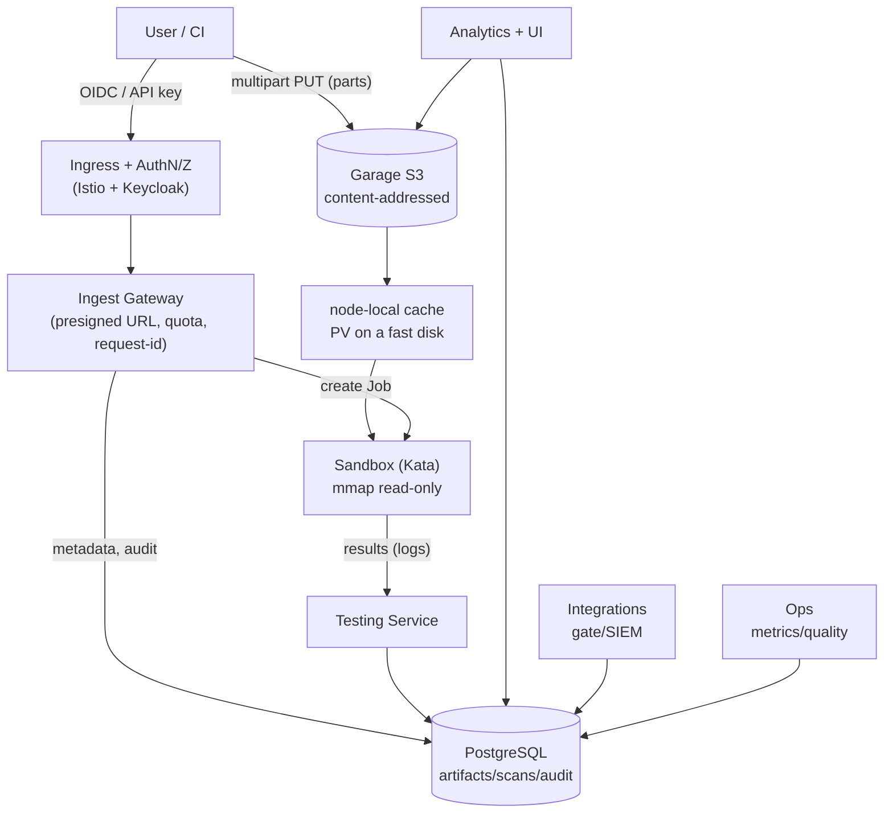
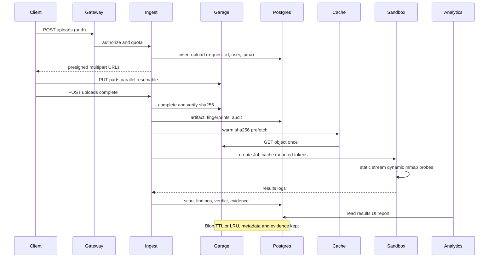

[Русский](../11-target-architecture-v2.md) | **English**

# 11. Target architecture of MLScan v2 (new formats, very large models)

Description of the target architecture of the new version of the system, which extends the current
MLScan (see [`07-implemented-architecture.md`](./07-implemented-architecture.md)) to other ML/AI
formats and to **very large models**. Development plan — [`10-plan-new-formats.md`](./10-plan-new-formats.md),
format analysis — [`09-formats-and-backdoors-analysis.md`](./09-formats-and-backdoors-analysis.md).

Status: **Wave 0 (S3/PostgreSQL/AuthN+audit/observability+backup) and format waves 1–3 are
implemented**; the target architecture and the remaining steps are described below. The actual
state — [`07-implemented-architecture.md`](./07-implemented-architecture.md), the plan —
[`10-plan-new-formats.md`](./10-plan-new-formats.md).

What is already in the perimeter (as-built, see §11):

| v2 element | State |
|------------|-----------|
| S3 (Garage) for artefacts, `sha256/<name>`, deduplication | ✅ (`deploy/v2/data`, `mlscan-data`) |
| Ingest Gateway: streaming upload to S3 | ✅ (`deploy/v2/ingest`) |
| PostgreSQL: metadata/findings/evidence, append-only triggers | ✅ (schema `deploy/v2/db/10-schema.yaml`) |
| AuthN/Z + audit (API keys, UI users, roles, `audit_log`) | ✅ (`deploy/v2/auth`) |
| Storage observability and backup (`/alerts`, `pg_dump` + check) | ✅ (`deploy/stage5`, `mlscan-pg-backup`) |
| Retention/TTL and quarantine | ✅ (`deploy/v2/lifecycle`, `mlscan-lifecycle`) |
| Format adapters and detectors (model-as-code, Keras, ONNX, HDF5, GGUF, archives, XXE, tokenizers, prompt-injection, agent/MCP) | ✅ (`deploy/v2/formats`) |
| Localisation of the UI and messages RU/EN, global language setting | ✅ (`deploy/i18n`, [`12-i18n.md`](./12-i18n.md)) |
| Multipart/presigned direct-to-S3, mmap profiles, object-lock quarantine, Keycloak/mTLS | ⏳ plan |

---

## 1. Goals and NFRs

| NFR | Value |
|-----|----------|
| Model size | tens to hundreds of GB and more, without buffering into memory |
| Ingestion | direct **multipart** upload into object storage, parallel parts |
| Transfer for analysis | without network copying "through the service", where possible **mmap from a fast local disk** |
| Analysis | static analysis — streaming (single pass), dynamic analysis — mmap, behaviour — bounded probes |
| Idempotency | content-addressing by `sha256` → **re-upload is instant**, a repeated scan by hash is skipped |
| Observability/audit | log of uploads/checks, correlation-id, storing fingerprints and results |
| Isolation | Kata microVM, egress only to the storage/artifact server |
| Retention | metadata/fingerprints/evidence — permanently; large blobs — TTL + quarantine |

---

## 2. Storage requirements

- **Volume** — sufficient for ingesting models of "tens to hundreds of GB and more" + temporary
  copies; set by quotas and controlled at the input (admission).
- **Fast local disk** (SSD/NVMe) for the object storage and the node-local cache.
- **The default `emptyDir`/`/tmp` of pods are not suitable** for artifacts: they reside on the
  node's system disk and are limited. For large models we use object storage and **node-local
  volumes (PVC)** on a fast disk, rather than intermediate copies in `/tmp`.
- **Environment check before rollout** (for self-deployment):
  - how much space is available for the object storage and the cache (`df -h` on the corresponding
    volume);
  - where the pods' `emptyDir`/`ephemeral-storage` are physically located (StorageClass/kubelet
    root) and whether there is enough space there;
  - whether there is a StorageClass/PV with sufficient capacity and a fast disk.
- Specific paths, devices and sizes depend on the installation and **are not fixed in the
  repository** — placeholders and deployment parameters are used (`deploy/`).

## 3. Component diagram (v2)

---

## 4. Upload (as fast as possible)

**The "direct-to-S3" scheme (recommended).** The service does not participate in transferring bytes
— it only issues permissions and records metadata:

1. **`POST /uploads`** (AuthN/Z) → the service computes/accepts the intent, checks quotas and issues
   a **presigned multipart URL** for the object `s3://mlscan-artifacts/<sha256>/<filename>` and an
   `upload_id`; a record `uploads` with `request_id`, `user_id`, IP/UA is written to the DB.
2. The client/CI uploads **in parallel parts** (8–32 streams, part 64–256 MiB) directly to Garage.
   For very large channels — an `s3` client with concurrency and auto-retries (resumable).
3. **`POST /uploads/{id}/complete`** → the service completes the multipart upload, verifies
   `sha256`/size, obtains "fingerprints" (`sha256`, `blake3`, size, format) and creates an
   `artifacts` record.
4. **Deduplication:** if the `sha256` already exists — the upload is **not needed**: the service
   responds "the object exists, scan No. …", the client spends no traffic.

**Why it is fast:**
- Garage and the client are, where possible, on the same fast network/node; for external uploads —
  TLS termination at the entry, parallel parts, no "through the service" bottleneck.
- Checksums are computed **on the fly** (by the client or at `complete` — a single pass over the
  local disk, not a double read).
- Content-addressing + dedup eliminate repeated uploads.

**If direct-to-S3 is impossible** (strict network policies): the fallback mode is
**proxy-streaming** through Ingest (chunked, without buffering), with the same content-addressed
scheme; in this case the upload is limited by the service's throughput (documented as a fallback).

---

## 5. Transfer for analysis (without copying)

**Problem:** the pod's `emptyDir`/`/tmp` usually reside on the node's system disk and are limited
in size — they are not suitable for large models, and `hostPath` is prohibited by the `restricted`
policy.

**Solution — a node-local cache on a fast disk + read-only mounting into Kata:**

1. **`mlscan-cache` (PVC on a fast disk)** — a shared node-local cache, mounted **read-only** into
   the sandbox Job at the path `/model`.
2. **Cache Daemon (`mlscan-cache` DaemonSet)** watches the queue and **pre-fetches** the object from
   Garage into the cache by `sha256` (once, idempotently), verifying integrity by hash.
3. The sandbox Job starts only when the object is in the cache; **the file is not copied into the
   guest** — it is read through the volume **via mmap** (virtio-fs/9p), without an intermediate
   `/tmp`.
4. **Alternative without a cache:** a presigned GET from Garage. Then a **single permission**
   `sandbox → garage:3900` is added to the NetworkPolicy; otherwise we keep the current model
   (the Testing Service serves the artifact by token on `:8090`).

**Why it is fast:** there is no "Garage → pod tmp → guest" copying; reading goes directly from the
local disk; repeated scans of the same `sha256` take the file from the cache without the network.

---

## 6. Analysis (size-oriented optimization)

- **L0 (acceptance):** `sha256/blake3`, real format, format mismatch, boundaries — by metadata and
  signatures, **without full reading** (selective header reads).
- **L1 (static analysis) — streaming:** pickle opcodes and structure are read **in a single pass**
  over the mmap region, without materializing objects; for zip/`data.pkl` — via the zip index.
- **L2 (dynamic analysis) — mmap:** `safetensors`/`torch.load(weights_only=True, mmap=True)` — pages
  are loaded lazily; hard RAM limits; if exceeded — switch to "chunked analysis".
- **L3 (behaviour) — selectively:** for very large models probes are applied to a slice/sample
  (e.g., a subgraph/subset of blocks) if a full run does not fit into the budget.
- **Fast-path:** with a critical static finding (RCE construct) the verdict may be issued **before
  the full dynamic analysis** (configurable), with a note "dynamic analysis not completed" in the
  report.
- **Reuse:** if the `sha256` has already been checked under **the same rule version** — the result
  is taken from the DB **instantly** (with a reference to the previous evidence), and no full run is
  performed; otherwise — a targeted re-check.
- **Parallelism:** static shards (archives/parts) — in parallel; loading individual tensors
  (safetensors) — in parallel via mmap.
- **Time/resource budgets:** per-level timeouts, CPU/RAM/IO limits; interruption and the
  `Inconclusive` verdict when completion is impossible (not "Safe").

---

## 7. What happens to very large files after analysis

**Principle:** the "heavy blob" is temporary, the "light traces" are permanent.

| Artifact | Where | Lifetime | Comment |
|----------|-----|------|-------------|
| Model blob | Garage (fast disk) | by TTL (e.g. 90 days) / until the quota is reached | content-addressed, dedup by `sha256` |
| "Hot" copy | `mlscan-cache` (fast disk) | LRU (e.g. 7–30 days) | speeds up repeated checks/probes |
| Metadata, fingerprints, findings, evidence, audit | PostgreSQL | **permanently** | "imprints" of models and results |
| Reports | analytics (JSON/MD/SARIF) | permanently (small) | references to `sha256` |
| Malicious/quarantine | Garage (+ object-lock/WORM) | extended/by decision | for forensics/legal needs |

- **Reference model:** the blob is deleted when `refcount=0` and the TTL has expired; a **tombstone**
  remains in the DB (`deleted_at`, reason) — audit and history are preserved.
- **Recovery:** if needed, the blob is retrieved again from the source by `sha256` (or from an
  external backup/cold tier).
- **Tiering:** fast cache (hot) → Garage (warm) → external S3/cold (cold) → purge.
- **Dedup:** one model = one blob; several checks/rule versions — several `scans` records, one blob.
- **Implemented:** retention/TTL + quarantine of malicious files + tombstones
  (`deploy/v2/lifecycle`, CronJob).
- **Quotas and admission:** ingestion is blocked/warns when the storage is filled above the
  threshold (e.g. 90%), with an LRU/TTL eviction policy.

---

## 8. End-to-end flow (large model)

---

## 9. Speed optimizations (summary)

| Area | Optimization | Effect |
|---------|-------------|--------|
| Upload | direct-to-S3 + multipart (8–32 parts) | bottleneck is the network/disk, not the service |
| Upload | content-addressed + dedup | re-upload = 0 bytes |
| Upload | checksum "on the fly" at `complete` | no double read |
| Transfer | node-local cache on a fast disk + RO mount | no Garage→pod→guest copies |
| Analysis | mmap (`safetensors`, `weights_only`) | lazy pages, less RAM |
| Analysis | streaming static analysis (single pass) | O(n) reading, without materialization |
| Analysis | skipping a repeated scan by `sha256`+rule version | instant result |
| Analysis | fast-path on critical static analysis | early verdict |
| Storage | fast disk (not the system one), limits/quotas | no OOM/overflow of the system disk |
| Infra | warm images, limits, priorities | predictable latency |

---

## 10. Security and isolation (for large files)

- **Sandbox egress:** either only `sandbox → testing:8090` (artifact through the service), or a
  **single** additional permission `sandbox → garage:3900` (presigned GET). There are no other
  egresses (default-deny is preserved).
- **Authentication at the entry** (OIDC/API keys) + **log**: connections, uploads (sha256, size,
  IP/UA, user), stages/results, verdicts, policy changes — append-only hash-chain + export to SIEM.
- **DoS limits:** object size limit, per-user/tenant quotas, rate limit at the gateway, scan
  timeouts, limiting concurrent uploads; interruption on overflow.
- **Integrity:** `sha256` verification; blob immutability; object-lock for quarantine; signing of
  images/artifacts (cosign) and SBOM.

---

## 11. Migration and phases

Corresponds to **Wave 0** of the plan ([`10-plan-new-formats.md`](./10-plan-new-formats.md) §2.5):

1. **I1/I1b. Object storage (S3) on a fast disk** — ✅ implemented (`deploy/v2`): Garage + the bucket
   `mlscan-artifacts`, content-addressed, Ingest Gateway (streaming upload, dedup); **the testing
   service has been moved to S3** (the Artifact server `:8090` serves from S3). Abandoning the PVC
   `/artifacts`. Next: parallel multipart / presigned direct-to-S3.
2. **I2. PostgreSQL** (implemented without an operator; a schema of 12 tables with append-only
   `evidence`/`audit_log`; a stdlib SCRAM client; the testing service and analytics write to the DB,
   the evidence hash-chain is in the DB; verification via the DB) — schema
   (artifacts/fingerprints/scans/findings/evidence/uploads/connections/audit); migration
   JSON/JSONL → DB (dual-write); the JSON export remains.
3. **I3. AuthN/Z + audit** — ✅ implemented: API keys at all entry points + role-based RBAC, UI login
   by cookie, correlation-id, the `connections`/`audit_log` log (hash-chain), service-to-service by
   an internal key; OIDC/Istio JWT is an optional extension.
4. **I4. Storage observability and backup** — ✅ implemented: PG/S3 metrics in ops, `/alerts`, the
   `pg_dump` CronJob + restore check. (Cache/mmap profiles are an optimization for the next step.)
5. Next — format waves (1–3) on top of the new infrastructure.

Backward compatibility: old scans/evidence are migrated; the API preserves the existing endpoints
and adds `/uploads`, `/api/fingerprints`, `/api/audit`.

---

## 12. Open questions

- External source of large models: is `direct-to-S3` from an external network allowed (TLS, routing)
  or is proxy-streaming needed?
- Quarantine/object-lock: the required retention period for malicious blobs and legal constraints.
- Retention: the default TTL for large blobs and the eviction policy when the storage is filled.
- Backup/DR: external S3 or Garage replication; RPO/RTO.
- GPU: when it appears (currently `nvidia.com/gpu=0`) — accelerated dynamic analysis profiles.
- Authentication: a single Keycloak (existing) or a separate realm for MLScan.
