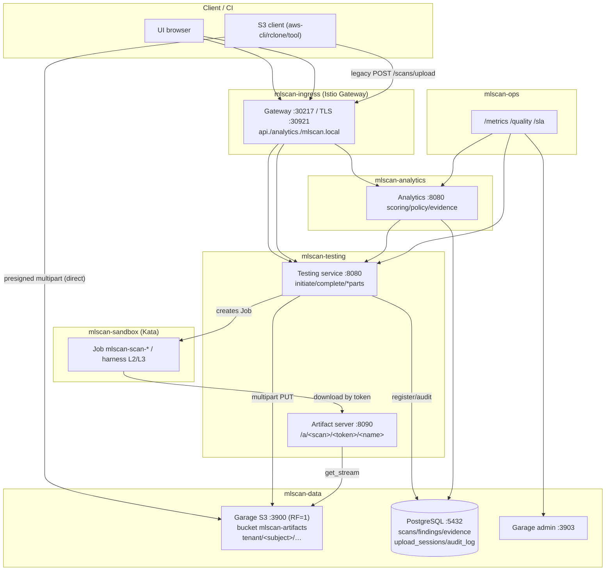
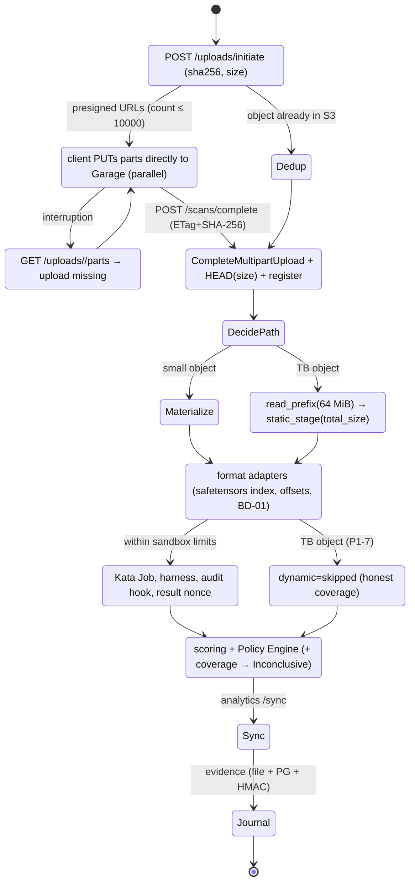

# 15. Analyzing a large model file: step-by-step

This document answers "what physically happens when a very large model file enters the system",
from reading it at the source to the verdict and statistics accumulation. It describes **how it is
implemented now**; anything missing is explicitly marked `[planned]` with a proposal.

Legend: `[implemented]` — works in the current stand; `[planned]` — a proposal.
Related: [`07-implemented-architecture.md`](./07-implemented-architecture.md) (as-built),
[`13-deployment-plan.md`](./13-deployment-plan.md) (deployment levels),
[`14-security-review.md`](./14-security-review.md) (security review and hardening).

---

## 0. In short: the path of the file

```
workstation / file share / [planned: another S3]
        │  HTTP/1.1 POST /scans/upload (chunked, 1 MiB)          ← up to 20 GiB, SHA-256 on the fly
        ▼
testing service (mlscan-testing, trusted zone)
        │  streaming object write to S3: key sha256/<name>        ← deduplication
        ▼
S3 (Garage, mlscan-data): bucket mlscan-artifacts
        │  served into the sandbox via a one-time token          ← :8090 /a/<scan_id>/<token>/<name>
        ▼
Job in mlscan-sandbox (Kata microVM): harness (L2/L3)
        │  markers MLSCAN_SUMMARY/MLSCAN_RESULT_JSON with the scan nonce
        ▼
testing service: normalize → findings → verdict+coverage → file + PostgreSQL
        │  artifact/scan/findings records in the DB
        ▼
analytics (mlscan-analytics): scoring, Policy Engine, evidence (file + PG + HMAC), reports, UI
        │  append-only journal, cron attestation
        ▼
ops: metrics, quality (TPR/FPR), retest, retention/TTL, backup
```

---

## 1. Step 1. Reading a huge file at the source

### 1.1 What the workstation has

`[implemented]` **No dedicated S3 client is installed on the workstation** — by design: the source
may be a local file, a network share, or S3, so the system does not require installing anything on
the user side. Any standard tool works:

* a browser — the UI page (upload via `XMLHttpRequest` with a progress indicator);
* `curl`/`wget` — streaming file upload;
* `aws s3`/`rclone`/`mc` — if the file is already in S3 (see `[planned]` on "import from another S3").

### 1.2 Where the S3 client is installed inside the system

`[implemented]` The S3 client is **our own, standard-library Python**:
[`deploy/v2/data/s3/s3client.py`](../deploy/v2/data/s3/s3client.py) (SigV4, path-style, streaming
`put_stream`/`get_stream`, never loading an object into memory). It is shipped as the
`mlscan-s3client` ConfigMap and mounted at `/opt/s3` where needed:

| Where | Path | Purpose |
|-------|------|---------|
| testing service (`mlscan-testing`) | `/opt/s3/s3client.py` | write the artifact to S3, read it to serve into the sandbox |
| ingest gateway (`mlscan-ingest`, `mlscan-data`) | `/opt/s3/s3client.py` | external gateway for streaming uploads to S3 |
| ops (`mlscan-ops`) | — (Garage admin API only, `GARAGE_ADMIN_URL:3903`) | storage metrics/alerts |
| analytics (`mlscan-analytics`) | — | works with S3 indirectly (via the testing API) and with PostgreSQL |

Client presence is verified by the smoke task `deploy/v2/data/30-s3-smoke.yaml` (`s3-smoke`:
PUT/GET/HEAD), run at deployment level 2.

### 1.3 If the file lives in another S3

`[planned]` There is no direct "take an object from a foreign S3" today: to scan such a file you
first download it to a workstation and upload it to MLScan. Proposed (without changing the trust
architecture):

1. **URL import with server-side copy** — `POST /import {url, name, fmt}`: the testing service (or
   ingest) pulls the object **streaming** into its own S3 (`put_stream`) via a presigned link,
   without proxying the body through a browser;
2. **Resumable upload** — `POST /uploads` + `PATCH /uploads/<id>` (offset) for networks where a long
   POST breaks; state in the `uploads` table;
3. **Direct-to-S3 upload (presigned multipart)** — the service issues presigned parts, the client
   uploads to Garage directly, then calls `POST /scans/complete` with ETag/checksum; this removes the
   service load for multi-hundred-GiB files and the `max-body` limit.
   Security requirement: server-side copy/presigned only for allowlisted addresses, mandatory
   `Content-MD5`/`x-amz-checksum-sha256` verification and a re-computed SHA-256 on artifact registration.

---

## 2. Step 2. Transfer into the system: protocol and limits

`[implemented]` The testing service accepts uploads (`mlscan-testing` namespace).

| Parameter | Value |
|-----------|-------|
| Protocol | HTTP/1.1 `POST /scans/upload?name=<name>&fmt=<format>` (aliases: `/scans`, `/upload`) |
| Auth | `Authorization: Bearer <API key>` (roles `admin`/`ci-reader`/`service`) or UI cookie session |
| External entry | Istio Ingress → `http://api.mlscan.local:30217` (HTTPS `:30921` if TLS enabled) |
| Body | `Content-Length` required; the service reads the body **in 1 MiB chunks** (`self.rfile.read(1<<20)`) and writes straight to file/S3 — never holding the file in memory |
| Hash | SHA-256 computed **on the fly** in the same pass |
| Size limit | `MAX_UPLOAD` (default **20 GiB**) otherwise `413 artifact too large` |
| Anti-flood | rate limit `30` uploads/min per client → `429` + `Retry-After`; `5` in-flight scans |
| Local copy | `/artifacts/<scan_id>/<name>` (PVC `mlscan-artifacts`, 20Gi) — fallback if S3 is down |
| Deduplication | object key = `sha256/<name>`; if it exists the body is **not overwritten** (`dedup=true`) |

Examples:

```bash
# from the command line (recommended for large files)
curl --noproxy '*' -X POST -H "Authorization: Bearer $MLSCAN_KEY" \
     --upload-file ./pytorch_model.pt \
     "http://api.mlscan.local:30217/scans/upload?name=pytorch_model.pt&fmt=torch"

# via the UI: the browser sends the same POST with a progress indicator
#   http://analytics.mlscan.local:30217  → "Upload model"
```

The response is `202 {"scan_id": "...", "state": "queued", "size": N, "sha256": "...", "s3_key": "sha256/<name>"}`;
everything after that is asynchronous (the scan runs in the background, the UI shows progress).

`[planned]` for >20 GiB: resumable/direct upload (see §1.3) and an ingress-side limit.

---

## 3. Step 3. Storage and serving into the sandbox

* `[implemented]` **S3 (Garage)**: `mlscan-data` namespace, Service `garage.mlscan-data.svc:3900`
  (S3 API), `:3903` (admin), bucket `mlscan-artifacts`, credentials in Secret `mlscan-s3`
  (`ACCESS_KEY`/`SECRET_KEY`). Objects are immutable (content-addressed keys), retention — §6.
* `[implemented]` **Serving into the sandbox**: the testing service's artifact server on port `8090`,
  `GET /a/<scan_id>/<token>/<name>`, where `token` is a **one-time token of that specific scan**
  (`artifact_token` in the scan record). The sandbox **cannot see** the PVC or S3: the file is
  streamed (1 MiB chunks) either from S3 (`get_stream`) or from the local copy. Sandbox network egress
  is open to exactly that address (plus DNS/sinkhole).
* `[implemented]` Inside the Job the file lands in `/tmp` (emptyDir, capped by `JOB_EPHEMERAL`,
  default 8Gi).

---

## 4. Step 4. Analysis modules: where they run, what they contain, how to extend them

Three independent methods (L1/L2/L3), two execution sites.

### 4.1 L1 — static analysis in the trusted zone (no artifact execution)

* Where: the **testing service** (`mlscan-testing`), synchronously in the scan-processing thread.
* What it contains:
  * `mlscan-poc-lib` → `/opt/mlscan/mlscan_poc.py` — `static_stage()` (pickle opcodes, dangerous
    globals, suspicious substrings, zip/tar containers and their members);
  * `mlscan-formats` → `/opt/formats/detector.py` (source [`poc/formats.py`](../poc/formats.py)) —
    format adapters: safetensors, ONNX, HDF5/Keras, GGUF, TFLite, CoreML, PMML, MLflow, SavedModel,
    TorchScript, notebooks, scripts, Dockerfile, HTML/SVG, Jinja, JSONL/CSV, MessagePack, archives
    (incl. nested), compressed payloads, datasets, native libraries, `.pth` hooks.
* Limits for **large** files (protecting the trusted zone):
  * `MAX_STATIC_BYTES = 64 MiB` — static analysis reads the **prefix** (signatures/headers/opcodes);
  * archive member reads — `_read_member()`: **32 MiB** per member, **128 MiB** per archive, capped
    member count; `FMT-04` (bomb) and `FMT-11/FMT-12` detectors work on headers.
* How to extend: new format — a branch in `detect()` + a `_scan_<fmt>()` scanner; new check —
  `_f("XX-NN", "text", "severity", confidence, evidence)`; then add a sample to the corpus
  (`tests/vulnerabilities`) and an i18n translation if needed.

### 4.2 L2/L3 — dynamic and behavioral analysis in the sandbox

* Where: `mlscan-sandbox` namespace, **one Job per scan**, `runtimeClassName: kata` (microVM).
  The testing service creates the Job via the Kubernetes API (RBAC: create/delete Job, get pods/logs).
* What the Job contains:
  * image `mlscan-sandbox@sha256:…` (by digest, verified by Kyverno);
  * `mlscan-harness` (ConfigMap generated from `HARNESS_SRC` in [`poc/mlscan_poc.py`](../poc/mlscan_poc.py));
  * no secrets mounted (`automountServiceAccountToken: false`), read-only FS, drop ALL, seccomp;
  * honeypot files (`~/.aws`, `~/.ssh`, `~/.kube`) and sinkhole addresses — bait for payloads;
  * env: `ARTIFACT_URL` (contains the scan token), `MODEL_NAME`, `MODEL_FMT`, `MLSCAN_NONCE`;
  * limits: `JOB_MEMORY=2Gi`, `JOB_EPHEMERAL=8Gi`, `JOB_TIMEOUT=600s`.
* What the harness does:
  1. downloads the artifact by token into `/tmp`;
  2. **loads** the model with the format loader: pickle/torch/numpy/joblib/dill/cloudpickle,
     safetensors (mmap), onnxruntime (+trial inference), h5py, Keras, GGUF, archives, text/images,
     datasets (pyarrow), compressed payloads, native libraries;
  3. installs an **audit hook** (open/exec/compile/subprocess/socket/dlopen/`os.system`), snapshots
     `builtins`/`sys.path`/`os.environ`/cwd before and after;
  4. runs **behavioral probes** (invoking callables, scanning for suspicious strings);
  5. builds `summary` (network/processes/exec/mem_exec/file writes/dlopen/imports) and `coverage`
     (which modules actually ran);
  6. prints the result as `MLSCAN_SUMMARY:<nonce>:{…}` and `MLSCAN_RESULT_JSON:<nonce>:{…}`;
  7. the environment is destroyed with the Job.
* How to extend: new loader — a branch in `load_target()` + `prewarm()`; new behavioral check — a
  function in the harness plus an `F-NN` id; "data-without-code" formats get structural loading
  (no execution).

---

## 5. Step 5. Aggregating results and events

`[implemented]`

1. **Normalization**: `normalize()` merges L1/L2/L3 findings into one list
   (`level, check_id, category, severity, confidence, title, evidence`). The finding count is capped
   (`MAX_FINDINGS=500`) and truncation is recorded in the reason.
2. **Verdict and coverage**: `poc.decide()` yields a base verdict; `poc.coverage_of()` determines
   which modules ran. If a module could not run (model failed to load, missing library, timeout) the
   verdict becomes **`Inconclusive`** listing what was not checked ("partial result").
3. **Activity events**: `summary` (observed behavior) + `sandbox.events` (raw timestamped events with
   the `load`/`probe` phase), plus host-level sinkhole/Falco events.
4. **Where it is written**:
   * scan file `/data/scans/<id>.json` (full record: `static`, `sandbox`, `findings`, `coverage`);
   * **PostgreSQL** (`mlscan-data`): `artifacts`, `artifact_fingerprints`, `scans`, `findings`,
     `uploads` (dual write "file + DB");
   * the artifact S3 key in the artifact record (`s3_key`).
5. **Analytics** (`mlscan-analytics`) pulls results via `GET /scans` (polling; `/sync` to force), runs
   `analyze()`: scoring, Policy Engine, localization, and calls `_append()`: a line into the
   **append-only evidence** (`/data/evidence.jsonl` **and** the `evidence` table mirror) with an
   **HMAC signature** of the link.
6. **Consumers**: the analytics UI (artifact card), JSON/Markdown/SARIF reports, Integrations
   (registry + CI gate + SIEM), ops (metrics/quality), external systems via the API.

---

## 6. Step 6. Where and how statistics accumulate

`[implemented]`

| Layer | What accumulates | Where to look |
|-------|------------------|---------------|
| PostgreSQL (`mlscan-data`) | `scans`, `findings`, `evidence`, `artifacts`, `uploads`, `connections`, `audit_log`, `settings` | SQL, reports, `/api/overview` |
| Analytics | verdict/volume summary, scan list, progress | `GET /api/stats` (`by_verdict`, `total_bytes`), `GET /api/overview`, UI page |
| ops | Prometheus metrics `mlscan_*`; quality on the golden set; SLA | `/metrics`, `/quality` (TPR/FPR), `/sla` |
| Hardening metrics | `mlscan_integrity_ok{service}`, `mlscan_evidence_ok/signed/entries`, `mlscan_scans_inconclusive_ratio` | `/metrics` |
| Storage | DB size, table row counts, Garage size | ops `/metrics` (PG directly, Garage admin API) |
| Data retention | artifact/quarantine TTL, tombstones | CronJob `mlscan-lifecycle` (TTL 90 d, quarantine 365 d), `artifact_deletions` table |
| Backups | DB dumps with restore verification | CronJob `mlscan-pg-backup`, PVC `mlscan-backups` |

Quality is computed by comparing verdicts with golden-set labels (38 samples): `POST /retest`
re-runs the set, `GET /quality` returns `tp/fp/tn/fn, tpr, fpr, precision, accuracy`; CronJob
`mlscan-retest` does this regularly.

---

## 7. Step 7. Where the decision is made and how to customize it

`[implemented]` The decision is made in **analytics** in two steps:

1. **Scoring** (`scoring`): from finding severities it computes `risk_score` and `max_severity`
   (`critical/high/medium/low/info`), plus `by_severity` and `active_checks`.
2. **Policy Engine** (`apply_policy`): rules from `policy.json` (ConfigMap `mlscan-policy`, path
   `POLICY_PATH=/etc/mlscan/policy.json`) are applied in order; a rule like

   ```json
   {"id": "block-rce",
    "when": {"check_id_in": ["A-01","A-13"], "min_confidence": 0.8},
    "action": "block", "verdict": "Malicious",
    "reason": "RCE deserialization constructs"}
   ```

   yields an `action` (`block|quarantine|allow`) and a verdict; on top of it the **coverage
   correction** applies — on an incomplete check `Safe/Needs review` becomes `Inconclusive`.

**How to customize:**

* edit `policy.json` (the UI `/policy` page shows the current policy; applied via the
  `mlscan-policy` ConfigMap + `kubectl rollout restart deploy/mlscan-analytics`);
* add new check ids: they automatically become available to rules (`check_id_in`);
* change thresholds and actions without code changes;
* the external side: the CI gate (`POST /gate` in integrations) uses the `sha256` registry and
  `action/verdict`, returning a decision and exit code for the pipeline; SIEM export (NDJSON/CEF);
* rule versioning: every policy change is recorded in `audit_log` (subject and time).

`[planned]` Sign `policy.json` (HMAC/signature) and verify on load, so the policy cannot be swapped
(see `docs/14`, a P1-5-compatible extension).

---

## 8. Step 8. Mechanisms that make the verdict reliable and tamper-evident

`[implemented]` (detailed analysis — [`14-security-review.md`](./14-security-review.md)):

| Mechanism | Against what | How it works |
|-----------|--------------|--------------|
| Kata isolation + `default-deny` + RO FS + drop ALL + seccomp + honeypot | direct payload, engine exploitation, sandbox escape | the scan runs in a microVM with no network (except sinkhole/DNS/artifact); the environment is destroyed |
| Image by digest + Kyverno admission | sandbox image swap, foreign Job | Job only `image@sha256:…`, kata, safe securityContext |
| **Result nonce** + summary/result cross-check | a payload forging a "clean" result | the harness prints markers with the scan nonce; the service accepts only its own markers and cross-checks fields |
| **Coverage → `Inconclusive`** | a false "Safe" when a module fails | incompleteness is surfaced explicitly, with the list of unchecked items |
| Finding cap (500) with a flag | "finding explosion", DB/UI blow-up | truncation is recorded in the reason |
| **Code-config digest** + fail-closed | swapping detectors/rules in a ConfigMap | the service verifies the digest on start; on mismatch it answers `503` |
| **Evidence append-only + HMAC + generations + single-writer** | journal tampering/repacking, write races | DB triggers forbid UPDATE/DELETE, an HMAC chain signs links (key outside DB/PVC), verification by generations, `pg_try_advisory_lock` for a single writer |
| **Cron attestation** + alerts | silent integrity degradation | CronJob `mlscan-attest` (6 h) verifies the chain and fails on violation; alerts `integrity_<service>`, `evidence_broken`, `coverage_low` |
| Key lifetime (`expires_at`) | use of a leaked key | expired key → `401` |
| Egress narrowing, quotas, rate limit | lateral movement and cluster overload | only required addresses/ports; `ResourceQuota`/`LimitRange`; `429` on flood |
| Audit (`audit_log`, append-only) | untracked actions | all decisions/policy changes and uploads are recorded |

`[remaining per the security plan]` Instant `Reject` for sandbox network instead of timeout (P0-4 —
blocked by `calico-node` 0/1 Ready and Calico pre-DNAT semantics), sandbox DNS policy (P1-2), audit of
policy/harness changes to SIEM (P1-8), parser fuzzing, image signing/SBOM, mTLS/OIDC, WORM evidence
copy, ingress rate limit (P2).

---

## 9. Appendix: end-to-end example with a large file (actual stand numbers)

Model: a torch model `pytorch_model.pt`, **268,470,293 bytes (≈256 MiB)**, with an injected
`os.system(...)` payload.

| Stage | What happens | Numbers/observation |
|-------|--------------|---------------------|
| Transfer | `POST /scans/upload`, 1 MiB chunks, on-the-fly SHA-256 | `202`, `size=268470293`, `sha256=0070e0…`, `s3_key=sha256/pytorch_model.pt` |
| Storage | object in Garage, dedup by key | re-uploading the same file — `dedup=true`, body not overwritten |
| L1 static | 64 MiB prefix: signatures/opcodes | `static_s = 0.42` |
| L2 dynamic | Kata Job: download by token, torch load, audit hook | `sandbox_s = 20.32`, `load.ok=true`, `type=dict` |
| Findings | static + dynamic | `A-01 critical (posix.system)`, `A-02 high`, `F-30 high (os.system)`; `subprocess=1` |
| Verdict | scoring + policy | `Malicious`, `risk_score=10.0`, policy `block-rce → block` |
| Journal | evidence: file + DB + HMAC | link signed; `/api/evidence/verify` → `ok/signed/generations` |
| Statistics | metrics/quality | `mlscan_scans_total`, `…_inconclusive_ratio`, TPR/FPR on the golden set |

Verification: corpus run `87/87 detected, 0/54 false positives`; large benign models (198 MB each —
safetensors/npz/hdf5/torch/onnx) — `Safe` with full coverage.

---

## 10. Roadmap following from this description

> The detailed, prioritized plan for the **prod scenario (network ≥ 10 Gbit/s, storage sized for 1 TB+
> models)** is in §11.6. Summary below.

1. **`[planned]` Import from another S3 and very large files** (§1.3, §11.6 P0): server-side copy via
   presigned URL, **multipart in `s3client.py`**, direct multipart upload to Garage into a
   `tenant/<user|ci>/` partition with checksum verification, resumable upload, UI progress/resume,
   lifting the ingress `max-body` limit and timeouts, raising `MAX_UPLOAD`.
2. **`[planned]` Static analysis without a prefix cap**: streaming parsing of large containers
   (mmap/iterators) instead of reading the first 64 MiB where safe (full safetensors/ONNX index walk,
   start static analysis on early parts; pickle scans read the prefix deliberately).
3. **`[planned]` Sign the policy and harness** (P1-5-compatible), audit changes to SIEM (P1-8).
4. **`[planned]` P0-4/P1-2** (instant `Reject`, sandbox DNS policy) after the Calico fix.
5. **`[planned]` P2 block**: parser fuzzing, image signing/SBOM, mTLS/OIDC, WORM evidence copy.

---

## 11. Upload-time estimate for a 1 TB safetensors file

Prod basis: **1 TB = 1024 GiB = 1.0995·10¹² bytes = 8.80 Tbit**; safetensors is an uncompressed
container (JSON header + raw tensors), so neither compression nor content dedup reduces the transferred
volume. Assumed: **prod storage is sized for 1 TB+ models** (the current Garage partition size is not a
constraint) and the **client→cluster network is ≥ 10 Gbit/s**. Under these conditions the link is no
longer the bottleneck — single-streamness and extra passes are.

The estimate is "wire time" (`S/BW`) with an efficiency factor plus disk/ingest stages. Reference: 1 TB
over a raw link = 8.80 Tbit, i.e. 14 m 40 s at 10 Gbit/s, 5 m 52 s at 25 Gbit/s, 1 m 28 s at 100 Gbit/s.

### 11.1 Current architecture: a 10 Gbit/s link is used about a quarter

Capacity limits (`MAX_UPLOAD=20 GiB`, `tmp`/ephemeral, the service PVC) are knobs raised in prod
(§11.6); once lifted, the path's own traits dominate. The code path is **two sequential, non-overlapping
passes** (`mlscan_testing.py:717-741`): first receive into `tmp` (client→service network + node disk
write), then separately read `tmp` and do a **single** PUT to Garage (`s3client.put_stream`, 1 MiB
chunks over one TCP connection). Node disks are written **twice** (tmp + Garage) and read once.

At ≥10 Gbit/s the wire time stops dominating; the ceiling is set by single-stream throughput
(~0.5–1 GB/s for Python `http.server` and for a single PUT), the double disk write, and the sequential
phases.

```
T_current ≈ S / min(BW_link, BW_python_single)   +   S / BW_s3_single
            └──────── phase 1: receive to tmp ──┘    └─ phase 2: PUT to Garage ─┘
```

| Client→cluster link | Phase 1 (receive→tmp) | Phase 2 (tmp→Garage, single PUT) | **Total** | Link utilization |
|---------------------|-----------------------|----------------------------------|-----------|------------------|
| 10 Gbit/s | 18–24 m | 18–37 m | **~35–60 m** | ~25–40 % |
| 25 Gbit/s | 18–24 m | 18–37 m | **~35–60 m** | ~10–17 % |
| 100 Gbit/s | 18–24 m | 18–37 m | **~35–60 m** | ~3–4 % |

**Key point:** at ≥10 Gbit/s the HTTP path plateaus at an **end-to-end ~0.3–0.5 GB/s** (≈ 2.5–4 Gbit/s)
— a 10 GbE link is used about a quarter, and 25/100 GbE add nothing. The bottleneck is phase 2
(`tmp → Garage`, single stream): the file is already received but the scan has not started, and all that
time 1 TB occupies the node's disk and ephemeral-storage.

### 11.2 Direct S3 upload into a per-user/CI partition

Scenario: the client (browser with an S3 client, `aws-cli`, `rclone`) has presigned-multipart access
straight to Garage into a dedicated prefix/bucket `tenant/<user|ci>/…`. The testing service is not in
the data path — it only issues presigned parts and later registers the object
(`POST /scans/complete` with ETag+SHA-256).

```
T_direct ≈ S / min( BW_link(parallel parts), BW_garage(aggregate ingest), BW_client_disk )
```

One transfer, one disk pass (client local read + Garage write), no second hop through the service and no
`tmp` copy.

| Client→Garage link | At 1 GB/s ingest | At 2 GB/s ingest | Link utilization |
|--------------------|------------------|------------------|------------------|
| 10 Gbit/s | 1,100 s (**18 m**, Garage) | 977 s (**16 m**, link) | ~80–100 % |
| 25 Gbit/s | 1,100 s (**18 m**, Garage) | 550 s (**9 m**, Garage) | ~40–90 % |
| 100 Gbit/s | 1,100 s (**18 m**, Garage) | 550 s (**9 m**, Garage) | Garage-bound |

The bottleneck is **min(link, aggregate Garage ingest)**. At 10 GbE with ≥1 GB/s ingest the link is used
almost fully; above 25 GbE Garage is the limit and must be scaled (write parallelism, a second
node/sharding — §11.6, now for throughput, not capacity).

### 11.3 Comparison and what each option buys (≥10 Gbit/s, capacity sufficient)

| Aspect | Current HTTP path | Direct S3 upload |
|--------|-------------------|------------------|
| Network transfers | 2 (client→service, service→Garage) | 1 (client→Garage) |
| Node disk writes | 2× (tmp + Garage) | 1× (Garage) |
| Stage overlap | none (phases sequential) | yes (multipart, parallel) |
| 10 Gbit/s | ~35–60 m | **~9–18 m** |
| 25 Gbit/s | ~35–60 m (no speed-up) | ~9–18 m |
| 100 Gbit/s | ~35–60 m (no speed-up) | ~9–18 m |
| End-to-end throughput | 2.5–4 Gbit/s (0.3–0.5 GB/s) | 8–16 Gbit/s (1–2 GB/s) |
| Capacity/limits | `MAX_UPLOAD`/`tmp`/PVC — raise them | service out of the data path |
| Isolation | all artifacts on one service PVC | `tenant/<user\|ci>` partition per user/CI |

**Speed-up from direct S3 at 10 Gbit/s is ~3–4×**, and that is what makes 10 GbE (and above) useful: the
HTTP path uses a quarter of the link, the direct path almost all of it. Above all it removes the two
disk passes, the `tmp` copy and the extra hop, and adds resumability and tenant isolation.

### 11.4 A note on RTT (for inter-site transfers)

A single TCP stream is bounded by window × RTT (BDP). In a prod LAN the RTT is small and a stream at
10 GbE runs near line rate, but for an inter-site transfer (10 Gbit/s, tens of ms RTT) a single stream
collapses:

| RTT | Single-stream ceiling | 1 TB time (single stream) |
|-----|-----------------------|---------------------------|
| 30 ms | ~1.07 Gbit/s | ~2 h 17 m |
| 60 ms | ~0.53 Gbit/s | **~4 h 35 m** |
| 100 ms | ~0.32 Gbit/s | **~7 h 38 m** |

Parallel multipart parts (16–64 streams) remove this barrier — so even with a "10 Gbit/s minimum" the
direct S3 upload is mandatory for inter-site scenarios, where 10 Gbit/s is the link's nameplate rating,
not what a single connection achieves.

### 11.5 Analyzing 1 TB *after* the upload (an important consequence)

The upload is not the only problem. Afterwards:

* **L1 static** works on a 64 MiB prefix — still instant for 1 TB, but only the beginning is scanned;
  a full safetensors header walk is feasible (mmap + page-wise tensor-block reads) — `[planned]` §11.6;
* **L2 dynamic is infeasible**: the Job has `JOB_EPHEMERAL=8Gi` and `JOB_MEMORY=2Gi`, so a 1 TB
  (1.1 TiB) file cannot fit into the sandbox; downloading `Garage → Job` would take ~9–18 m per scan at
  best;
* practical conclusion: for TB models use **static mmap analysis + sampled slice checks**, and full
  dynamic loading only for models that fit the sandbox limits.

### 11.6 Roadmap for the prod scenario (≥ 10 Gbit/s, capacity sufficient)

Capacity is no longer a constraint — the plan pivots to **throughput and the data-path architecture**.
The priority is removing single-stream bottlenecks and the second hop; the rest follows from §11.1–11.3.

**P0 — main gain (must do):**

1. **Multipart in `s3client.py`** (currently a single PUT): 8–64 parallel parts,
   `CreateMultipartUpload`/`UploadPart`/`CompleteMultipartUpload`, per-part ETags. Removes the phase-2
   ceiling (§11.1) — the main single-stream barrier.
2. **Presigned multipart straight to Garage** into `tenant/<user|ci>/` + `POST /scans/complete`
   (ETag list + SHA-256). Removes the second hop through the service and the `tmp` copy; the service
   leaves the data path. Gives **~3–4×** at 10 GbE (§11.3).
3. **Resumable upload** (`uploads`, offset + ETag): resilience for long transfers.
4. **Ingress/limits**: lift `max-body` and proxy timeouts for long uploads; raise `MAX_UPLOAD`
   (20 GiB) and ephemeral-storage quotas.

**P1 — utilizing links >10 Gbit/s and analyzing TB models correctly:**

5. **Scale Garage ingest** (for throughput, not capacity): write parallelism, a second node/sharding if
   needed, since at 25 GbE and above Garage is the limit (§11.2). Additionally **RF>1** — now for
   durability, not capacity (RF=1 is a single point of failure).
6. **Streaming static analysis**: a mmap walk of the **full** safetensors header/index (not just the
   64 MiB prefix) and **start static analysis on early parts** — do not wait for the whole upload;
   safetensors tensor pointers are readable immediately (§11.5).
7. **Sandbox for TB models**: adopt a "static-only + sampled dynamic" model; or raise `JOB_EPHEMERAL` /
   stream the object from S3 read-only (with a separate security review, as it changes isolation). Full
   dynamic only for models within the limits.

**P2 — further:**

8. **WAN/utilization**: adaptive part size, 16–64 parallelism, retry/checkpoint — for inter-site
   10 Gbit/s where a single stream is BDP-bound (§11.4).
9. **Data-path metrics**: end-to-end throughput (GB/s) and per-phase time (receive / Garage /
   registration) — to see link utilization and Garage degradation.

---

## 12. Roadmap implementation (§11.6, as-built)

All P0–P2 stages are implemented, deployed, and covered by tests (unit, e2e, browser UI). Stage →
changes → tests:

| Stage | Done | Key files | Tests |
|-------|------|-----------|-------|
| P0-1 | Parallel multipart S3 upload (Create/UploadPart/Complete), dedup | `deploy/v2/data/s3/s3client.py`, `deploy/stage2/service/mlscan_testing.py`, `deploy/v2/ingest/service/ingest.py` | `tests/s3/test_multipart.py`, `tests/e2e/run_multipart_e2e.sh` |
| P0-2 | Direct presigned multipart into `tenant/<subject>/`; `/uploads/initiate` + `/scans/complete` | `s3client.presign*`, `mlscan_testing.py` | `tests/s3` (presign), `tests/e2e/run_direct_upload_e2e.sh` |
| P0-3 | Resumable upload: `ListParts`, `upload_sessions` table, `/uploads/<id>/parts`, abort | `s3client.list_parts`, `mlscan_testing.py`, `deploy/v2/db/10-schema.yaml` | `tests/s3`, `tests/e2e/run_resume_e2e.sh` |
| P0-4 | Size caps lifted: `MAX_UPLOAD=1 TiB`, `ephemeral-storage=1Ti`, ingress route timeout `24h` | `deploy/stage2/30-service.yaml`, `deploy/ingress/20-virtualservices.yaml` | `tests/e2e/ingress_limits_check.sh` |
| P1-5 | Env-driven part size/parallelism; ingest benchmark; Garage single-node bottleneck recorded | `deploy/stage2/30-service.yaml`, `deploy/v2/data/10-garage-config.yaml` | `tests/perf/run_garage_bench.sh` |
| P1-6 | Streaming prefix static (`static_stage(total_size=…)`, `read_prefix`); true-size bounds | `poc/mlscan_poc.py`, `poc/formats.py`, `mlscan_testing.py` | `tests/formats/test_static_prefix.py`, `tests/e2e/prefix_static_e2e.sh` |
| P1-7 | "static-only + sampled dynamic" for models > `SANDBOX_DYNAMIC_MAX_BYTES`; dynamic marked `skipped` | `mlscan_testing.py` | `tests/e2e/prefix_static_e2e.sh` |
| P2-8 | Part-upload retries with backoff; adaptive part size (≤ 10000 parts) | `s3client.py` | `tests/s3/test_multipart.py` |
| P2-9 | Data-path metrics (receive/Garage/register, MB/s) in `/stats` and Prometheus `mlscan_upload_*` | `mlscan_testing.py`, `deploy/stage5/service/mlscan_ops.py` | `tests/e2e/pipeline_metrics_e2e.sh` |

New testing-service APIs: `POST /uploads/initiate`, `GET /uploads/<id>/parts`, `DELETE /uploads/<id>`,
`POST /scans/complete`.

---

## 13. Deployment diagram



---

## 14. State diagrams

### 14.1 Uploading and analyzing a 1 TB safetensors model



### 14.2 Comprehensive analysis of a 1 TB archive with all formats

```mermaid
stateDiagram-v2
  [*] --> Receive
  Receive : upload (legacy or direct presigned, tenant/<subject>/)
  Receive --> Store : S3 object (content-addressed)
  Store --> DetectFormat
  DetectFormat : detector: zip/tar/… (incl. nested)
  DetectFormat --> Enumerate
  Enumerate : limits (32 MiB/member, 128 MiB/archive, member count)
  Enumerate --> Members
  state Members {
    [*] --> Member
    Member --> MemberFormat : detector(detect)
    MemberFormat --> MemberStatic : pickle/safetensors/onnx/hdf5/gguf/python/…
    MemberStatic --> DynamicDecision
    DynamicDecision --> MemberDynamic : member within sandbox limits
    DynamicDecision --> Skip : TB members / non-executable data
    MemberDynamic --> Aggregate
    Skip --> Aggregate
    Aggregate --> Member : next
    Member --> [*] : all members done
  }
  Members --> Nested
  Nested : recursive nested archives (depth/size limits)
  Nested --> AggregateArchive
  AggregateArchive : normalize + cap_findings (≤500, truncation flag)
  AggregateArchive --> ArchiveVerdict
  ArchiveVerdict : max_severity/risk_score + policy; coverage → Inconclusive on module failure
  ArchiveVerdict --> Journal
  Journal : evidence (HMAC), JSON/MD/SARIF reports, metrics
  Journal --> [*]
```


