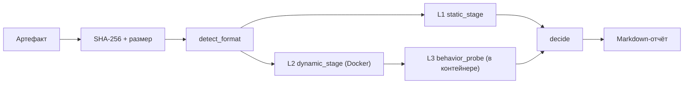

# MLScanner PoC — описание

Отдельное описание минимального PoC системы анализа опасности ML-моделей в формате pickle.
Файл реализации: [`mlscan_poc.py`](./mlscan_poc.py). План проекта: `../docs/06-implementation-plan.md`.

PoC реализует **все три метода проверки** (статика, динамика в изоляции, поведение),
обладает наблюдаемостью за действиями тестируемой модели и формирует результат анализа
в виде **Markdown**. Это **один Python-файл**, опирающийся на заранее установленный Docker,
и едва ли не единственный инструмент, проверяющий **все поддерживаемые форматы pickle**.

---

## 1. Назначение и место в проекте

PoC — это Этап 0 плана (`../docs/06-implementation-plan.md`): срез всех трёх компонент
архитектуры (Sandbox → Testing → Analytics) в одном исполняемом файле. Он даёт
воспроизводимый ответ на вопрос «есть ли в этой pickle-модели опасное содержимое»,
с доказательствами и вердиктом.

Ключевой принцип: **«не доказано, что безопасно» ≠ «безопасно».** Если динамический этап
не выполнен (например, недоступен Docker), вердикт — `Inconclusive`, а не `Safe`.

---

## 2. Требования

- Python 3.10+ (проверено на 3.12). Внешние Python-зависимости на хосте **не требуются** —
  только стандартная библиотека (`pickletools`, `zipfile`, `subprocess`, `hashlib`, `json`, …).
- **Docker** (CLI + запущенный демон) — только для динамического этапа.
  - Образ по умолчанию: `python:3.11-slim` (без numpy/torch).
  - Для форматов с numpy/torch нужен образ с этими библиотеками (см. §9).
- Для gVisor-изоляции (опция) — установленный и настроенный runtime `runsc`.

---

## 3. Быстрый старт

```bash
# Полный анализ (статика + динамика в Docker + поведение), отчёт в файл
python3 poc/mlscan_poc.py path/to/model.pt --out report.md

# Только статика (Docker не нужен)
python3 poc/mlscan_poc.py model.pkl --static-only

# С gVisor и собственным образом
python3 poc/mlscan_poc.py model.pt --runtime runsc --image mlscan-poc:latest --timeout 90

# Ввод из stdin (без файла на диске); --name задаёт расширение для выбора загрузчика
cat model.pt | python3 poc/mlscan_poc.py - --name model.pt

# Сохранить временный файл при вводе из stdin
cat model.pkl | python3 poc/mlscan_poc.py - --keep
```

> Требуется запущенный Docker-демон. Если он недоступен, PoC не падает: динамический этап
> помечается `skipped`, а вердикт становится `Inconclusive`.

Код возврата: `0` — успех, `2` — файл не найден.

---

## 4. Интерфейс командной строки

```
python3 mlscan_poc.py <target> [опции]
```

| Аргумент/опция | По умолчанию | Описание |
|----------------|--------------|----------|
| `target` | — | путь к файлу модели (или `-` для чтения из stdin) |
| `--out FILE` | stdout | куда записать Markdown-отчёт |
| `--image IMG` | `python:3.11-slim` | образ Docker для песочницы |
| `--runtime RT` | — | runtime Docker, напр. `runsc` (gVisor) |
| `--timeout N` | `60` | таймаут динамического этапа, секунды |
| `--static-only` | выкл. | без запуска контейнера (только L1) |
| `--name NAME` | `sample.pkl` | имя/расширение при вводе из stdin (`-`) |
| `--keep` | выкл. | сохранить временный файл при вводе из stdin |
| `--version` | — | версия PoC |

---

## 5. Как это работает



### 5.1 Определение формата (`detect_format`)
Формат берётся из расширения и уточняется по «магическим байтам»:
`\x93NUMPY` (numpy), `\x89HDF` (HDF5), `PK\x03\x04` (zip), pickle PROTO `\x80\x02…\x80\x05`.

### 5.2 L1 — статический анализ (`static_stage`) — без исполнения
- `pickletools.genops` → список opcodes и глобальных имён (включая реконструкцию `STACK_GLOBAL`).
- Классификация каждого глобала: `dangerous` / `safe` (allowlist) / `unknown`.
- Наличие `REDUCE`/`BUILD` — признак вызовов при десериализации.
- Поиск подозрительных подстрок: `/bin/sh`, `cmd.exe`, `curl `, `wget `, `http://`,
  `169.254.169.254`, `base64`, `eval(`, `exec(`, `socket`, `subprocess`, `os.system`…
- Zip/tar-контейнеры: перебор членов (`data.pkl`, `*.pkl`, и по сигнатуре `\x80`),
  детект zip-slip (`../`, абсолютные пути), рекурсивный статический разбор pickle-членов.
- Для `.npy/.npz` — извлечение полезной нагрузки за заголовком и её разбор.
- Форматы, не являющиеся pickle (`.h5`, `.safetensors`, `.onnx`), помечаются как «не pickle».

### 5.3 L2 — динамический анализ в песочнице (`dynamic_stage`)

**Транспорт без расшаренных каталогов.** PoC **не монтирует** хостовые директории.
Всё передаётся через потоки контейнера:

- **Модель** — на **stdin** контейнера (`docker run --interactive`); harness пишет её
  в свой tmpfs-каталог `/tmp` (внутри контейнера).
- **Код harness** — как **base64-бутстрап** в `python -c` (никаких файлов на хосте,
  никаких проблем с квотированием и кодировками).
- **Результат** — в **stdout** строкой с маркером `MLSCAN_RESULT_JSON:` (JSON).

```bash
cat model.pt | docker run --rm --interactive --name mlscan-poc-<id> \
  --network none \
  --read-only \
  --cap-drop=ALL \
  --security-opt=no-new-privileges \
  --pids-limit=128 \
  --memory=1g --memory-swap=1g \
  --cpus=1 \
  --tmpfs /tmp:rw,nosuid,nodev,size=<N>m \
  [--runtime runsc] \
  <image> python -X utf8 -B -c '<base64-бутстрап>' "<harness-b64>" <fmt> <name>
```

Размер tmpfs подбирается автоматически под размер модели (≈ 2×+64 МБ, минимум 128 МБ).
При превышении `--timeout` контейнер убивается (`docker kill`), результат помечается
`timed_out`. На хосте сохраняются exit code, stdout/stderr и wall-time.

Преимущества такого способа: не нужны общие тома и права на них, файл задаётся обычным
путём в командной строке, а при желании модель можно подать и потоком:
`cat model.pkl | python3 poc/mlscan_poc.py - --name model.pkl`.

### 5.4 L3 — поведенческое тестирование (внутри контейнера)

Поведенческий этап анализирует **что payload делает с процессом и что содержит загруженный
объект**, даже если этот объект не является вызываемой моделью (многие отравления действуют
на этапе десериализации). Он выполняет три вещи:

1. **Интерпретация наблюдаемых эффектов загрузки** (`F-30…F-33`): запуск процессов/команд,
   сетевые обращения, исполнение кода в памяти (`exec <string>`), запись файлов — по трассе
   из L2, но в терминах «поведения».
2. **Diff состояния процесса до/после загрузки** (`snapshot`/`diff_snapshot`):
   модификация `builtins` (`F-20/F-21`), подмена `sys.meta_path`/`path_hooks` (`F-22`),
   изменение `sys.path` (`F-23`), окружения (`F-24`), рабочего каталога (`F-25`),
   а также изменения во время вызова модели (`F-26`).
3. **Интроспекция и probe загруженного объекта**: ограниченный обход (`introspect`) собирает
   callable и подозрительные строки (`F-27`); найденные `predict`/`__call__`/`forward`/
   `transform`/`generate` вызываются синтетическими входами (numpy `(1,4)` и `(1,3,8,8)`,
   list, str) с фиксацией типа/превью выхода, ошибок и времени.

| ID | Что фиксирует | Severity |
|----|---------------|----------|
| F-20/F-21 | модификация/удаление элементов `builtins` при загрузке | high |
| F-22 | подмена механизма импорта (`sys.meta_path`/`path_hooks`) | high |
| F-23/F-24/F-25 | изменение `sys.path` / окружения / рабочего каталога | med/low |
| F-26 | модификация `builtins` во время вызова модели | high |
| F-27 | подозрительные строки внутри загруженного объекта | medium |
| F-30 | запуск внешних процессов/команд при загрузке | high |
| F-31 | сетевые обращения при загрузке | high |
| F-32 | исполнение кода в памяти (`exec <string>`) при загрузке | high |
| F-33 | запись файлов при загрузке | medium |

Находки L3 попадают в общий вердикт наравне со статикой и динамикой.

---

## 6. Наблюдаемость («полноценная» для PoC)

Внутри контейнера harness устанавливает `sys.addaudithook` (PEP 578) и пишет события с
таймстемпом и фазой (`warmup` / `load` / `probe` / `done`):

| Категория | События |
|-----------|---------|
| Файлы | `open` (путь, режим), `os.mkdir/remove/rename/link/symlink`, `shutil.*` |
| Процессы/код | `os.system`, `os.exec`, `os.spawn`, `subprocess.Popen`, `exec`, `compile` |
| Сеть | `socket.connect/connect_ex/bind/getaddrinfo/gethostbyname/sendto`, `ftplib.connect`, `smtplib.connect`, `urllib.Request` |
| Нативные библиотеки | `ctypes.dlopen/dlsym/call_function` |
| Импорты | `import` |

Меры для точности сигналов:
1. **`prewarm`** — библиотеки формата (numpy/torch/joblib/dill/cloudpickle) импортируются
   **до** установки хука, чтобы их шум не приписывался payload.
2. **Фильтрация библиотечного кода** — события `exec`/`compile` из `sys.prefix`,
   `site-packages`, `dist-packages`, `<frozen …>` отбрасываются; `marshal.loads` игнорируется.
3. **Разделение сигналов** — жёсткие (влияют на вердикт): сеть, процессы, запись файлов,
   `ctypes.dlopen` не-`None`, таймаут; информационные: `exec`/`compile`/`import`.
4. **Нормализация аргументов** и лимит событий (5000) против переполнения отчёта.

Дополнительно фиксируются `maxrss` (пиковая память), wall-time и таймаут.

---

## 7. Поддерживаемые форматы

| Формат | Расширения | L1 (статика) | L2 (динамика) |
|--------|-----------|--------------|---------------|
| pickle | `.pkl`, `.pickle`, `.p` | opcode-анализ | `pickle.loads` (+ permissive retry через `find_class`) |
| joblib | `.joblib`, `.jl` | opcode-анализ | `joblib.load`, фолбэк pickle/zip |
| dill | `.dill` | opcode-анализ | `dill.loads`, фолбэк pickle |
| cloudpickle | `.cloudpickle` | opcode-анализ | `cloudpickle.loads`, фолбэк pickle |
| torch | `.pt`, `.pth`, `.bin`, `.ckpt` | разбор zip-членов (`data.pkl`, `*.pkl`) | `torch.load(weights_only=False)`, фолбэк — распаковка zip |
| numpy | `.npy`, `.npz` | извлечение payload за заголовком + opcode-анализ | `np.load(allow_pickle=True)`, фолбэк |
| контейнеры | `.zip`, `.tar`, `.gz`, `.tgz` | разбор членов + zip-slip | распаковка pickle-членов |
| HDF5 | `.h5`, `.hdf5` | помечается «не pickle» | не применимо |
| SafeTensors | `.safetensors` | помечается «не pickle» | не применимо |
| ONNX | `.onnx` | помечается «не pickle» | не применимо |

> `torch.load(weights_only=False)` в PoC применяется **намеренно** (мы проверяем сам payload),
> и допустим только внутри песочницы.

---

## 8. Логика вердикта (`decide`)

```
max_severity = максимум severity статических находок
hard_dynamic = сеть>0 ИЛИ subprocess>0 ИЛИ dlopen>0 ИЛИ записи>0 ИЛИ timeout

critical/high И hard_dynamic → Malicious
critical/high                → Dangerous     (нужно подтверждение динамикой)
hard_dynamic                 → Dangerous
динамика пропущена           → Inconclusive  (неполное покрытие)
medium                       → Needs review
иначе                        → Safe
```

Шкала severity: `critical` > `high` > `medium` > `low` > `info`.

---

## 9. Формат отчёта (Markdown)

Разделы отчёта:
1. **Шапка** — имя, размер, SHA-256, формат, вердикт, дата.
2. **L1 Статический анализ** — таблица находок (ID, категория, severity, уверенность,
   формулировка, доказательство); список просканированных членов контейнера.
3. **L2 Динамический анализ** — статус, exit code, wall-time, результат загрузки, summary
   (сеть/процессы/exec/dlopen/записи/maxRSS), таблица наблюдаемых событий, `stderr` контейнера.
4. **L3 Поведенческое тестирование** — callable и таблица probe-результатов.
5. **Ограничения PoC.**

Пример находки в отчёте:

```
| A-01 | A | critical | 0.90 | Опасный глобал posix system (evil.pkl) | `GLOBAL posix system` |
```

### Образ для numpy/torch-форматов

```dockerfile
FROM python:3.11-slim
RUN pip install --no-cache-dir numpy joblib dill cloudpickle \
 && pip install --no-cache-dir --index-url https://download.pytorch.org/whl/cpu torch
```

Сеть нужна только на этапе сборки образа; на этапе динамики контейнер запускается без сети.

---

## 10. Как проверить работу

Мини-набор для самопроверки:

```python
# samples/evil.pkl — RCE через os.system
import pickle, os
class Evil:
    def __reduce__(self):
        return (os.system, ("echo pwned",))
pickle.dump(Evil(), open("samples/evil.pkl", "wb"))
```

| Образец | Ожидание L1 | Ожидание L2 | Вердикт |
|---------|-------------|-------------|---------|
| benign `{...}` | нет находок | 0 жёстких сигналов | Safe |
| `os.system` в `__reduce__` | critical A-01 | `os.system` | Malicious |
| `subprocess.Popen` | critical A-01 | `subprocess.Popen` | Malicious |
| `socket.connect` | подстроки (medium) | `socket.*` ≥1 | Malicious |
| запись файла через `open` | — | `file_writes` ≥1 | Dangerous |
| torch-zip c `data.pkl`=`os.system` | critical (член) | `os.system` | Malicious |
| `.npy` object-массив с payload | critical | `os.system` | Malicious |
| zip с `../evil` | high B-03 | — | Dangerous |

Эта матрица прогонялась при разработке PoC (без Docker проверен только L1; с Docker — полный цикл).
Готовые примеры отравлений лежат в `poc/scan/` (`evil0…evil5.pkl`):

```bash
for f in poc/scan/evil*.pkl; do python3 poc/mlscan_poc.py "$f"; done
```

---

## 11. Ограничения PoC

- Наблюдаемость — Python audit hooks + изоляция Docker, **не eBPF** и не микро-ВМ.
  Возможен sandbox evasion (payload может не активироваться в песочнице).
- Действие в дочернем процессе видно как факт запуска процесса, но его syscalls — нет
  (нужен eBPF; Этап 1 плана).
- Поведенческий probe минимален: наборы тестов ограничены (backdoor/privacy/adversarial —
  Этап 2). Однако load-time-effect'ы (builtins/import-хуки/process/network/exec) уже
  фиксируются на L3 (F-20…F-33).
- Нет скоринга, Policy Engine, реестра и БД (Этап 3).
- Отсутствие находок при пропущенной динамике трактуется как `Inconclusive`.
- Модель целиком помещается в tmpfs-каталог контейнера (это память контейнера); для очень
  больших моделей следует увеличить `--memory` и лимит tmpfs (размер tmpfs подбирается
  автоматически по размеру файла).

---

## 12. Структура файла (карта для доработки)

| Блок | Назначение |
|------|-----------|
| `VERSION`, `FORMAT_BY_EXT` | версия и карта расширений → формат |
| `DANGEROUS_MODULES`, `DANGEROUS_NAMES`, `KNOWN_SAFE_MODULES` | правила классификации глобалов |
| `SUSPICIOUS_SUBSTRINGS` | эвристики по содержимому |
| `Finding` | модель находки |
| `disassemble`, `classify_global`, `static_scan_pickle`, `scan_zip_container`, `detect_format`, `static_stage` | L1 |
| `HARNESS_SRC` | исходник harness, исполняемый в контейнере (L2/L3) |
| `recv_target` (в harness) | приём модели из stdin в tmpfs контейнера |
| `snapshot`, `diff_snapshot` (harness) | снимок/дифф состояния процесса (builtins, import-хуки, sys.path, env, cwd) |
| `introspect`, `behavior_probe`, `behavior_findings` (harness) | L3: обход объекта, probe, находки F-20…F-33 |
| `docker_available`, `dynamic_stage` | запуск/контроль контейнера (base64-бутстрап + stdin/stdout) |
| `decide`, `render_report` | вердикт и Markdown-отчёт |
| `main` | CLI-оркестрация (в т.ч. ввод из stdin при `target='-'`) |

---

## 13. Расширение

- **Новый детектор L1** — добавить проверку в `static_scan_pickle` / правила в
  `DANGEROUS_*` / `SUSPICIOUS_SUBSTRINGS`.
- **Новый сигнал L2** — добавить событие в `INTERESTING` и учёт в `summarize` (при «шумности»
  — фильтр в `hook`/`_is_lib_code`).
- **Новый probe L3** — расширить `behavior_probe`/`introspect` (генератор входов `make_inputs`)
  и/или `behavior_findings` (новые ID F-xx и пороги severity).
- **Новый формат** — запись в `FORMAT_BY_EXT` + ветка загрузки в `load_target` (harness)
  и, при необходимости, в `detect_format`/`static_stage`.

---

## 14. Связь с документацией

- `../docs/06-implementation-plan.md` — план реализации; PoC как первый шаг (Этап 0).
- `../Concept.md` — концепция и архитектура системы.
- `../docs/01-threat-checklist.md` — чеклист рисков (что покрывают L1/L2/L3).
- `../docs/02-testing-strategy.md` — стратегия тестирования L0–L4.
- `../docs/03-isolation.md` — методы изоляции (Этап 1).
- `../docs/04-risk-analysis-decision.md` — обработка результатов и решения (Этап 3).
- `../docs/05-architecture.md` — детальная архитектура.
